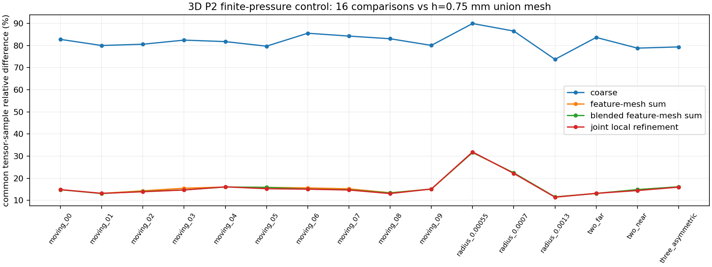
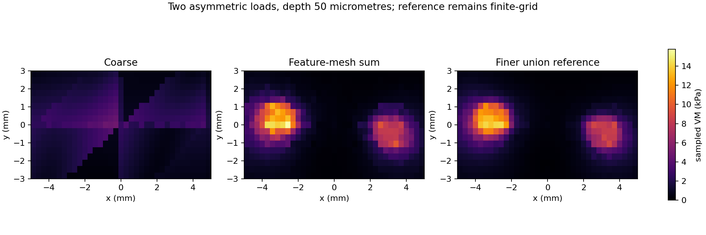
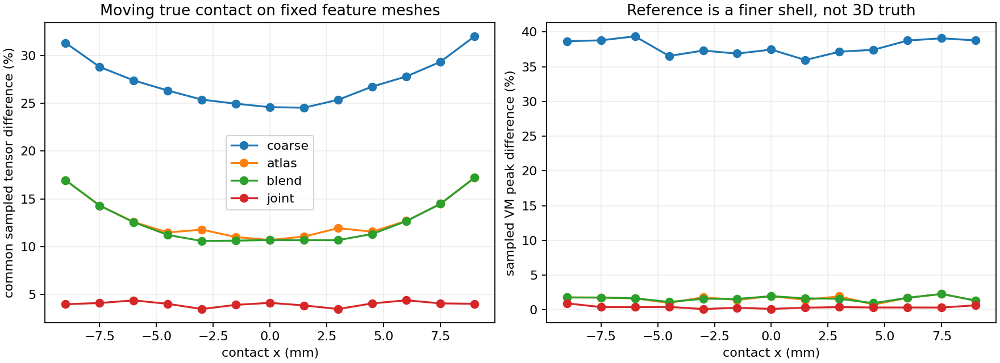
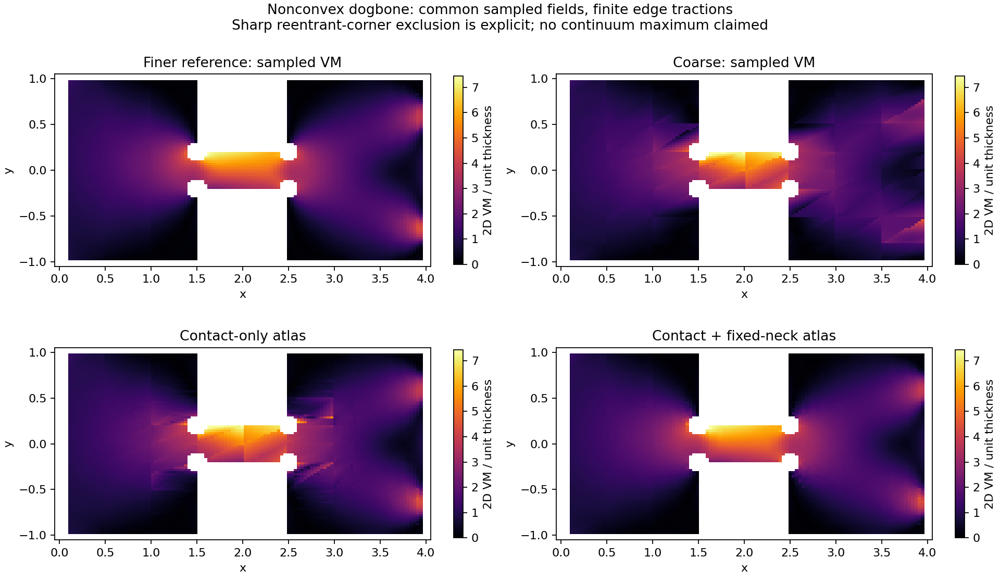
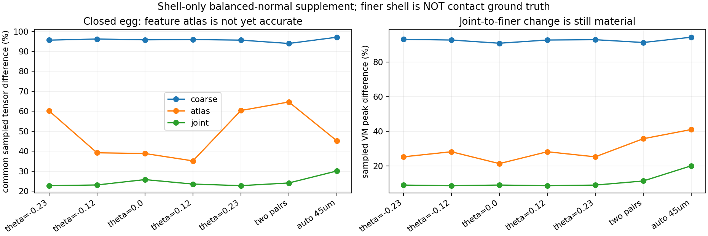
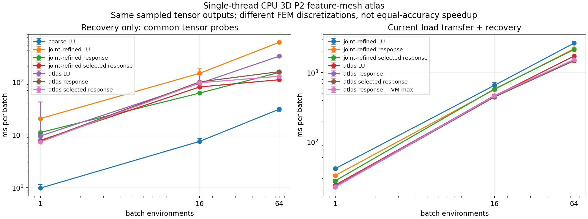

# 特征网格库：严谨推导与 CPU 验证

2026-10-24 · 固定参考形状、线弹性、有限接触压力 · CPU 研究，未修改原生引擎

## 结论

你的思路具有明确的理论依据，CPU 实验也确认：按真实接触选择预分解的局部加密网格，可以明显降低粗网格的应力误差。在线不需要重新网格化或重新分解。

**它是可控近似，不是联合细化 FEM 的精确替代。**硬切换会引入额外跳变；多个网格及响应表会重复存储整体结构。当前数据支持继续研究，但不支持“任何模型上均更准、更快、更省内存”，也不能宣布鸡蛋三维接触最大应力已合格。

本轮分别验证数学恒等式、FEM 实现、不同网格的近似误差、切换和运行成本。数值检查通过与物理/空间收敛分开报告；所有百分比场差均是声明的公共物理采样点张量范数，不是连续域误差界。

## 一、实际实现的算法

1. 离线建立几张完整物体网格，每张只在一个候选区域重点加密；保存分解或节点载荷到应力的响应算子。
2. 在线保留真实接触位置、压力半径、力方向及摩擦，把有限压力积分到选定网格。代表点只选择网格，不把接触吸附到代表点。
3. 按源分配载荷；同一张网格接到的源可合并为一个 RHS。每张网格只承担它分到的源，而不是重复承担全部载荷。
4. 在相同物理坐标和张量坐标系下叠加应力，再计算 VM／主应力和采样最大值。
5. 接触跨越选择边界时，使用依赖接触参数的平滑权重。不要把不同空间片段的应力任意裁剪拼接。

有限压力已经生成后的 FEM 响应是线性的。Hertz 半径和 DPR 的锚定/非负拟合仍可能依赖当前力，所以预计算的是节点响应，不是简单缩放某个固定点的单位力快照。

## 二、理论证明与反例

完整中文推导见下方“中文推导”章节，扩展假设、证明及参考文献见英文附录。核心结果是：共同线性变分问题下，每个源用其选定空间的 Galerkin 近似，总能量误差不超过各源最佳逼近误差之和。强相消会放大相对总误差；这个能量结论本身不能保证最大应力误差。

实际有限维反例表明：共同粗空间上的残差可以接近零，联合空间中的误差却很大。因此“每张网格都收敛、粗残差也小”并不能认证 atlas 精度。另有明确的压力快照反例：两个已偏离真实接触中心的峰即使组合后合力/质心正确，峰形仍会被抹平。

| 数值控制 | 实测结果 | 范围 |
| --- | --- | --- |
| 多网格不是联合解 | 反例的能量相对误差 48.84%；共同粗残差 6.54e-17 | 用于否定普遍精确性，不是实际几何误差 |
| 粗解＋完整细化差值 | 代数相对差 4.01e-17 | 截断远场差值后不再保持该恒等式 |
| 独立解析牵引 P2 常应变 | 应力误差 3.56e-15 | 3D、真实边界牵引积分；不是接触真值 |
| 自由物体＋共同一致质量释放 | 质量/惯量差 1.91e-15；应力叠加差 7.45e-16 | 无物理夹持；单网格证明实现 |
| 实际 3D FEM 静态凝聚 | 6 个案例位移差 ≤3.38e-15 | 保留完整接口、内部无外载；未做端口降阶 |

## 三、误差对照

| 模型 | 查询数 | 粗基线／接触单独加密 | 特征网格结果 | 比较范围 |
| --- | --- | --- | --- | --- |
| 三维 P2 盒体 | 16 | 73.76–89.95% | 11.58–31.67% | 与 h=0.75 mm 的较细离散参考比较；不是接触真值 |
| 线性壳平板 | 20 | 21.82–32.02% | 10.68–17.21% | 与 28,482 DOF 壳参考比较；面内应力 |
| 非凸细颈 P2 平面应力 | 17 | 15.07–24.42% | 3.32–4.76% | 本行比较接触加密／接触＋固定细颈加密；不是三维物体 |

三维盒体是 20×20×10 mm 的固定精确几何，底面夹持，二阶四面体局部二分加密。测试移动接触、半径变化、摩擦、相邻／远离双接触及非对称三接触。压力半径明确指定在 0.55–1.3 mm；这是固定分布载荷下的算法验证，没有把它伪称为鸡蛋的自动半径。实际三维场包括六个应力分量。

三维更细参考继续变化约 7%–19%，所以这些误差是对离散参考的差异，不能当作连续场绝对误差。q24→q48 压力积分变化也单独保留。部分源的整个压力盘未完全处于名义最细核心，实际积分仍完整，但不能称为已充分解析。

平板壳的 atlas 采样峰值差为 0.062%–4.483%，粗网格为 21.69%–48.94%；但是 atlas 场差仍有 10.68%–17.21%，说明“峰值碰巧接近”并不等于整个场准确。相邻两级参考仍有 2.71%–3.60% 的场变化。外域网格加密消融只将一个双接触案例的 atlas 场差从 14.55% 降到 14.23%，剩余误差不能全部归因于粗外域。

非凸模型中，最大采样响应出现在远离接触的细颈／凹角邻域。加入几何决定的固定细颈加密后，接触单独加密的 15.1%–24.4% 场差降到 3.32%–4.76%。最细参考的末级变化仍为 1.15%–2.33%。图中白色角区是明确排除的奇异点邻域，不是把物理几何磨圆。

非凸例是归一化线性单位响应；单位力可产生形式上的大位移。按比例降低物理力可进入小应变范围并保持相对误差，不能把图当成大变形接触模拟或断裂预测。

鸡蛋是重要负例：7 个平衡法向查询虽通过载荷/求解数值检查，毫米级压力盘的 atlas 场差仍约 35%–65%；自动 45.47 μm 盘约 45.25%，采样峰值差约 41.09%。参考仍明显变化，**未认证鸡蛋准确性**。该曲面补充使用现有 CPU projected-Hertz 变体，不是原生曲面 surface-ball DPR 的逐点对齐。

## 四、连续性与误差控制

平板接触只移动 20 nm，硬切换就产生约 9% 的场跳变；平滑组合后的变化约 2.45e-6，与参考物理运动约 2.49e-6 接近。三维盒体同一接触处硬切换也产生 8.08%–8.71% 的跳变；非凸模型为 3.09%–3.44%。平滑组合修复的是额外切换跳变，并不保证其瞬时应力已经准确。

生产设计应验证选中区域对当前压力盘的覆盖和分辨率；覆盖不足时需明确选择别的已预处理区域或已验证后端。不得把载荷移到锚点、扩大半径、丢掉异常源或只看某个接触自己的最大值。

## 五、独立 CPU 性能确认

EPYC 9V74、单线程 BLAS/OMP。在其他重数值作业结束后，进行五次交错计时。性能集使用三维精度集相同的 16 个物理载荷查询和 3,822 个公共应力采样点；B64 是这 16 个查询的四次平铺。

双方都比较预分解 LU、完整响应矩阵和选列响应。下表分别选择各方法测得的最佳完整采样场路径，包含当前压力载荷转移；不包含初始化、刚体、Franka、策略和渲染。

| Batch | Atlas ms/批 | 联合加密 ms/批 | 联合/Atlas |
| --- | --- | --- | --- |
| 1 | 22.58 | 27.63 | 1.224× |
| 16 | 444.91 | 569.17 | 1.279× |
| 64 | 1482.47 | 2146.90 | 1.448× |

**这里没有宣称同精度加速。**Atlas 与联合加密是不同的近似；二者都用同类响应优化后，当前三维样本的在线成本仍有改善，但完整误差与参考变化都必须一起考虑。

B64 单独恢复的选列响应乘法，atlas 约 128.66 ms、联合网格约 110.81 ms，联合网格更快。整体收益主要来自当前载荷转移更便宜，不能解释为“atlas 的矩阵乘法更快”。相同离散场的响应算子与 LU 差约 5e-15。

三张 atlas 的响应表合计 **633.47 MB**，联合网格 **350.58 MB**，存储反而更大。构建约 13.11／16.51 s，另计网格、刚度和分解准备；进程峰值约 2.806 GB。所有表由同形环境共享，不应每环境复制。

非凸例保留了性能负例：atlas 约 2.82 ms，联合加密约 2.34 ms，atlas 没有优势；平滑组合约 4.11 ms。不能只选正例宣布普遍更快。

## 六、保留的失败与未完成的资格

- 非凸原始载荷相对残差严格阈值 1e-9 仍失败，最坏约 1.944e-9；不改变阈值、不写成通过。扩展精度残差修正仅改变完整采样场约 9.21e-11、VM 峰值约 8.09e-11，量化了该数值误差的实际影响。
- 初始点定位的全点×全单元回退引起内存耗尽或长时间停滞；改成分批定位后保持方程和网格不变。资源失败和中断记录保留。
- 鸡蛋纯法向、显式零摩擦的旧 oracle 检查触发 roundoff 问题；初始失败保留。最终没有改力，只移除该输入检查并记录 ≤2.8e-16 的实际切向舍入量，保留转移积分、wrench 和 FEM 检查。
- 没有运行完整 Franka、原生 Quadrants 或 GPU；没有独立求解鸡蛋物理接触压力，也没有认证连续三维全局峰值。

## 七、推荐路线

可以继续研究“预处理网格库＋真实载荷＋平滑源参数组合”。第一版保持完整物体响应，避免引入未经验证的局部截断。几何决定的细颈和薄弱区域需要保留固定分辨率。

若规模继续扩大，更值得实施共享粗空间＋局部细化基函数／静态凝聚：它能减少每张网格重复的整体数据，同时保留经全局结构传递的耦合。本文证明并测试了完整接口凝聚恒等式，**尚未声称已实现高效的在线活动端口降阶系统**。

不建议把当前独立整网格库直接设为默认后端。先选择具体误差预算和覆盖范围，再决定在哪些形状与接触尺度上具有可用的精度—时间—存储优势。

源码、原始 JSON、各套实验范围与复现命令见 [README.md](README.md)。基线为 e156cbf43529166aa6218aaa6aae860fecb54ea0。最终源码版本由报告底部链接固定。
