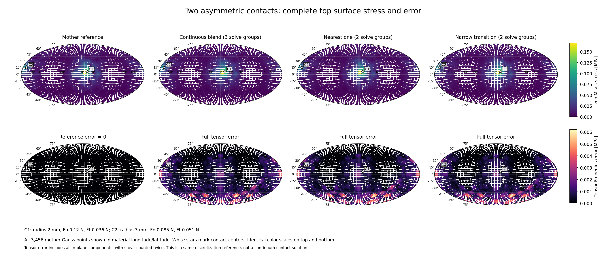

# 5,196 DOF 薄壳 Atlas：CPU 重建与复现实验

这是根据保留下来的报告重新实现并测量的参考代码。原 `cpu_next`
源码和未推送提交 `3ac2e3a66203c9287de2dff428bb9ef4e8be506f`
未恢复，因此不能保证原案例、轨迹、实现细节或绝对时间逐项重现。
旧报告数字保存在 [HISTORICAL_TARGETS.json](HISTORICAL_TARGETS.json)，
新实验协议、参数冻结和几何纠正记录见
[RECONSTRUCTION_PLAN.md](RECONSTRUCTION_PLAN.md)。

## 已复现的算法与数值机制

母模型是非对称鸡蛋中面：半轴参数 22/22/30 mm，非对称系数 -0.18，
厚 0.5 mm，E=10 GPa，nu=0.3。54 个冻结双线性粗宏单元分别细分
4x4，得到 864 个 Q4 MITC4 单元、866 个节点、5,196 原始 DOF。
6 个共同规范坐标消除刚体自由度，实际母求解有 5,190 个未知数。
两面、每单元四个 Gauss 点，共 6,912 个应力样点。

十二个特征中心为正二十面体顶点。每个特征拥有独立的刚度及因子：

\[
T_i=[P_f,B_i],\qquad K_i=T_i^T K_m T_i.
\]

其中全局粗空间为 330 个自由坐标；局部细节点补充空间为 3,186 个坐标。
每个特征有 **3,522 原始 / 3,516 自由 DOF**，与旧报告维度一致。
这是实际较小的 Galerkin 空间，不是把同一完整逆矩阵的列换个标签。
一个特征涉及 37/54 个宏单元；在这轮很低的粗网格及一层 halo 下，
局部空间并不极小。它的成本优势需要测量，不能从“局部”二字推断。

所有特征使用同一个母模型的质量、转动惯量卸载及规范约束。
令共同卸载算子为 Q，第 e 个环境的分组载荷为

\[
b_i^e=T_i^T Q\sum_{c\in e}w_{ic} f_c,\qquad
q^e=\sum_i T_i K_i^{-1}b_i^e,\qquad \sigma^e=S_m q^e.
\]

先按每个接触选择特征，只将该源载荷交给所选特征；相同
`(feature, environment)` 的载荷先合并，多环境一起多 RHS 回代。
最后先合并位移，再统一恢复完整应力。必须叠加张量，不能叠加 von Mises
或各特征最大值。不同特征解的叠加通常不是联合加密空间的 Galerkin 解，
因此空间近似误差另行实测。

源载荷使用当前真实位置处的有限材料球帽，角半径为 nominal_radius/22 mm，
径向为归一化 Hertz 形密度，包含摩擦及表面偏心力矩。积分阶 q 使用
4q² 个点。这是预先给定半径的载荷适配器，不是自动物理接触面积的验证。
特征选择不把接触点吸附到特征中心。当前库准备到 3 nominal mm，
超过范围会拒绝，不能直接外推。

## 42 个加载案例：选择精度与求解组数

新案例集在看结果前冻结：24 个遍布全表面的方向，6 个极点/接缝/角点，
2 个双接触、1 个三接触、9 个几何移动帧，另加释放案例。
完整输入和 SHA 见 [fixtures.json](results/selection/fixtures.json)。
9 个移动帧只验证几何路径；其默认切向基可能切换，不作为摩擦力连续性证明。
真正的连续性检查使用独立固定全局力的边界轨迹及后述平滑历史轨迹。

完整场误差采用共同 Gauss 面积加权的张量 Frobenius 相对范数，包含全部
两面样点和剪切分量的系数二。参考是相同载荷、相同离散的完整母 FEM，
不是连续体或独立接触 ground truth。

| 策略 | 旧平均场误差 | 新平均场误差 | 旧平均组数 | 新平均组数 |
| --- | ---: | ---: | ---: | ---: |
| 连续加权 | 4.02% | 4.4524% | 1.90 | 2.0714 |
| 每接触最近一张 | 4.14% | 4.5979% | 1.07 | 1.0714 |
| 最近一张＋窄过渡 | 4.08% | 4.4734% | 1.33 | 1.3333 |

旧案例详细坐标不可恢复，新数据没有为追旧均值调参。源分配和求解组数
的机制复现；精度趋势一致，具体均值不同。
组数按每个环境中不同特征 RHS 计数；批执行会跨环境复用相同因子，
这个均值不等于整批回代函数调用数或未来的 GPU kernel 数。
最坏选中空间求解残差 3.20e-14，合并 RHS 与逐源恢复差 5.16e-14。
所有正权重源的有限形函数支撑覆盖检查通过。
反例“把整个环境载荷交给每张网格再平均”的最坏完整场误差为 48.277%，
且有五个源/特征组合不满足局部支撑要求。

窄过渡用连续紧支撑权重乘以相对最近角距的窄窗并归一化，保留全部正贡献。
三重交界必须允许第三张参与；强行截取前两张不保证连续。
在角偏移 1e-6 rad 的边界控制中，最近一张的普通分界完整场跳变为
2.9083%，三重交界为 6.5754%；相应峰值跳变仅 0.0006406% 和 0.018955%。
连续与窄过渡的变化随偏移缩小。峰值看似平滑不能证明完整场平滑。
详见 [选择结果](results/selection/results.json) 与
[边界结果](results/boundary/results.json)。

## 完整响应库存、最大值筛选和降阶

共同顶面节点三向力基有 2,598 列，包含固定的顶面偏心力矩关系。
完整线性响应 H 有 20,736 x 2,598 个标量：

| 指标 | 新结果 |
| --- | ---: |
| H64 库存 | 430,977,024 bytes |
| H32 库存 | 215,488,512 bytes，约 215.5 MB / 205.5 MiB |
| H64 最坏完整场差 | 3.62e-15 |
| H32 最坏完整场差 | 7.94e-8 |
| H32 最坏采样峰值差 | 2.33e-7 |

该独立响应集为 45 总 / 44 加载案例，不是上面的 42 加载集。
这些库存误差是相对同阶积分的母 FEM；积分阶误差在后面的 q24 对照中另算。
H32 的库存、输入和响应乘法/累加使用 FP32，几何及 full9 张量坐标转换
仍使用 FP64，不能称整个流程纯 FP32。H64/H32 没有随结果提交，可离线重建。
底面载荷及独立节点偶矩不属于该输入基，程序显式拒绝。

全域块上界筛选没有只查接触附近。b6 下跳过 97.680% 的加载块，所测
最大值与全扫描的相对差不超过 2.87e-16。跳过比例不等于总加速比，
因为构造上界、访问 H 列及调度也有成本。80 帧、两个独立环境的移动/
变半径/摩擦/释放/重置/冲击/重排控制同样通过。

全局 POD 是保留的失败：216 个训练快照下，rank32/64/128/192 的平均
完整场误差分别为 91.746% / 87.520% / 79.165% / 74.631%。
与旧报告 rank192 仍有约 73.6% 误差的结论一致，不应作为默认替代。
见 [响应结果](results/response/response_results.json) 与
[POD 结果](results/response/pod_results.json)。

## 历史预测：对每帧变化速度敏感

两帧位移与完整局部应力线性外推，用当前载荷残差门控；失败环境压缩后
精确回代。已接受近似继续参与下一帧历史，没有用精确参考偷偷修复历史。
三缓冲旋转与复制等价。缓存的是实际 Kq；失败后重新计算 Kq，不能把
右端 f 当作数值精确的 Kq。临近门限会直接重算当前乘积。

新冻结轨迹有每环境两个独立非对称接触，平滑移动、法向力、摩擦及半径变化，
并保留释放、局部重置和冲击。默认 B64 x 80 帧结果：

| 残差门限 | 接受比例 | 最坏加权场误差 | 最坏采样峰值误差 |
| --- | ---: | ---: | ---: |
| 0.01 | 9.059% | 0.8273% | 0.5732% |
| 0.05 | 51.266% | 4.7956% | 3.7036% |

0.01 残差门限不是应力误差 1% 的数学保证。
copy/rotate/cached 的位移、应力、逻辑历史及门控决定一致；所测释放输出、
重置及未触碰环境隔离差均为零。另有 320 帧人工算子与门限边界控制。

旧报告约 55.9% 接受率不能在这个缺失原轨迹的新默认案例上重现。
因此另行预声明倍率 0.25/0.5/1/2，仅缩放平滑演化的时间，事件帧固定。
B16 接受率为 53.481% / 52.136% / 9.019% / 0%；最坏场误差分别为
0.7863% / 0.7423% / 0.8061% / 0%。两倍速误差为零源于全量精确回退。
慢速在相同 80 帧内走的总路径更短，这是每帧步长敏感性，不是等总运动耗时比较。
速度 1 的力序列 SHA 与主轨迹完全一致。
另行验证的 B64、0.25 倍速接受率为 52.670%，最坏场误差 0.7863%，
采样最大值误差 0.9439%，见 `history_slow_results.json`。
跨 batch 的前 16 环境因卸载矩阵乘法批宽不同有舍入差，载荷相对差
1.52e-17；同 batch 速度 1 的 SHA 一致性检查仍为严格逐位检查。
详细结果和完整输入见 `history_results.json`、`history_speed_results.json`、
`history_speed_cases.jsonl.gz`（无损压缩，解压后 SHA 与记录一致）及
[历史说明](README_HISTORY.md)。

## 精确凝聚与独立数值检查

四种单/双/三局部联合空间同时验证 coarse-first 和 local-first 完整 Schur
凝聚。使用物理有限帽和一般分布 RHS，每个 RHS 单独验收。
最坏完整场差 4.17e-13，投影残差 1.13e-13，证明它们在相同离散空间内
是数值精确的重排，而不是新的空间近似。删除局部块交叉 Schur 耦合的物理
场误差可达 73.0%，不能无条件省略。因子载荷内存、两种凝聚方向的成本
分别记录，不能只比较一个小阶段。

另外，独立全宏单元三维 Newton 定位验证了 15,240 个方向/接缝/角点查询。
所有闭式定位选择的 chart 都独立有效；同 chart 局部参数差不超过 1.67e-15，
物理位置差不超过 1.04e-17 m，完整源载荷和应力差分别不超过
2.63e-16 和 2.77e-15。相邻 chart 的合法别名计数单列，初始严格 ID
比较的失败记录保留，未以改核心或放宽物理误差标准隐藏。
刚体重现、共同卸载虚功、直接单元本构和稀疏应力算子、三维 von Mises
计算、载荷合并、释放输出也有单独控制。它们验证离散算法的一致性，
没有建立物理接触或连续体最大应力的正确性。

## 完整静态流水线吞吐：新测量

正式运行采用 Intel Xeon Platinum 8573C，Python 3.12.14、NumPy 2.3.5、
SciPy 1.17.0；实际记录的两个 BLAS 池都限制为一个线程。
所有其他研究数值进程停止后串行运行，先预热，再按正/反顺序做五次重复，
同时保留 wall 和 process CPU 时间、校验和、源文件前后 SHA。
`source_unchanged=true`。宿主仍有显著时间波动，因此下表同时给范围。

这里 B64 是 16 个固定案例重复四次，60 个加载环境、4 个释放环境，共
76 个接触源；不是 64 个独立动态抓取场景。每次都重新执行当前材料帽积分、
表面定位、节点装配、卸载/投影、分组求解/响应及输出。
不可变案例的显式全局力预先冻结，接触载荷和应力解没有按案例缓存。
母 FEM 也跳过释放环境的零 RHS。完整输出为全两面 Gauss 点的 body-frame
3x3 应力张量九个分量。

| q8、B64、完整 full9 | 旧报告 ms | 新中位数 ms | 新 min--max ms |
| --- | ---: | ---: | ---: |
| 母 FEM | 301.89 | 251.48 | 220.58--295.42 |
| 连续加权，先合并位移 | 未逐项给出 | 261.15 | 248.07--365.46 |
| 最近一张＋预投影卸载 | 274.22 | 212.39 | 201.74--275.25 |
| 窄过渡＋显式卸载 | 292.72 | 227.39 | 211.46--317.65 |
| H64 | 235.24 | 220.24 | 195.53--310.82 |
| H32 | 228.63 | 199.56 | 167.29--287.99 |

新机器型号相同但运行时状态及案例不同，绝对时间没有照搬旧报告。
最近一张相对母 FEM 的同轮样本五次均更快，配对加速比中位为 **1.093x**；
分别取两方法中位再求比是 1.184x，不能混称配对中位。
窄过渡仅三次比母 FEM 快，H32 四次；H32/nearest/narrow 的细排名并不稳定。
q4/q8、B1/B16/B64、max/full 和全部样本均保留在
[benchmark.json](formal/benchmark.json)。B1 是 16 次单环境调用的算术平均。

为隔离归因，三种选择器均测 balanced/projected 对照，而不是把同时改变
投影和选择器后的全部收益归因于选择器：

- 最近一张对连续加权，在相同 balanced 设置下五次均更快，配对节约
  中位 39.52 ms；相同 projected 设置下为 44.34 ms。
- 先合并位移再恢复，对连续策略逐组独立恢复五次均更快，配对节约
  中位 104.72 ms。使用同一母网应力算子是这一优化的关键条件。
- `project_raw` 单独收益尚未证实；nearest 配对中位反慢 3.24 ms，
  narrow 仅改善 0.34 ms，波动范围包含正负。
- H32 对 H64 full9 只有三次更快，不能宣称这轮已稳定确认其速度优势；
  减半的库存字节数及所测 FP32 数值误差是明确结果。
- H64 全域上界筛选相对 H64 最大值全扫描五次均更快，配对节约中位
  52.67 ms；相对 H32 扫描也五次更快，节约中位 25.95 ms。
  max 中位数分别为母 FEM 225.18、H32 扫描 184.34、H64 筛选 166.61 ms。
  正式筛选配置为每块 24 单元，与前述 b6 跳过比例不是同一配置。

单次拆分 profiling 给出以下诊断，不能当成五次中位或跨方法严格归因。
合计还含选择、准备、投影；`recovery_seconds` 是父项，不能与其子阶段重复相加。

| 路径 | 当前源积分/定位/装配 ms | 求解/响应及恢复 ms | full9 输出 ms | 单次总计 ms |
| --- | ---: | ---: | ---: | ---: |
| 母 FEM | 99.69 | 88.09 | 17.58 | 214.05 |
| 最近一张＋预投影 | 110.11 | 60.32 | 17.72 | 192.11 |
| 窄过渡 | 119.46 | 79.79 | 19.69 | 226.51 |
| H32 | 104.73 | 51.44 | 20.87 | 181.50 |

优化后完整路径的当前源生成占该次总计约 53%--58%；筛选 max 路径约 79%。
下一步应优先减少重复材料帽积分、表面查询和节点装配，再测完整吞吐。
同一性能案例集，q4 母 FEM 对 q24 的最坏场差为 0.3046%，q8 为 0.0725%；
q4 的 B64 母/nearest/H32 中位为 197.27/166.88/135.11 ms。
这是该给定载荷的积分阶权衡，不能自动推广到更小足迹或原生 DPR。
离线基础准备约 10.13 s；母因子 payload 20.28 MB，十二个特征因子合计
129.69 MB；H64 额外构建约 3.65 s，H32 库存为 215.49 MB。整次验证进程峰值 RSS 约 1.31 GB，
同时保留母模型、特征、H64/H32、筛选数据，不能当作一个生产配置的占用。

## 持续历史完整成本：默认负结果与慢速条件收益

每个样本从新历史开始，连续运行全部 80 帧，包含冷启动、释放、重置与冲击，
并计入当前源生成、卸载、门控、失败压缩、回退、输出及历史更新。
三个重复按正/反顺序交替，参考解/校验和在计时外。
这里所有方法输出完整局部三个应力分量，不额外导出 body-frame 九分量，
因此不能把绝对 ms 与前面的静态 full9 表横比。

| B64、q8、门限 0.01 | 默认速度中位 ms/帧 | 0.25 倍速中位 ms/帧 |
| --- | ---: | ---: |
| 精确全量恢复 | 305.13 | 291.82 |
| 预测＋直接门控＋旋转 | 345.90 | 255.11 |
| 预测＋缓存 Kq＋旋转 | 293.78 | 258.69 |

默认轨迹只有 9.06% 接受，直接门控版本的配对加速中位为 **0.858x**，
缓存版本约 **1.010x**，均不能支持稳定加速结论。
默认 recovery-only 下的直接/缓存版本也没有收益。
提高到 0.05 门限虽然能接受约一半预测，但场误差可达 4.80%，不能将其
当作“误差小于 1%”的旧结果重现。

0.25 倍速控制有 52.67% 接受，直接版本三次配对加速为
1.443 / 1.101 / 1.134，中位 **1.134x**；缓存版本为
1.481 / 1.086 / 1.100，中位 **1.100x**。
缓存没有额外稳定收益。该控制是为解释每帧变化敏感性而补测，
没有替换默认轨迹。其最坏场/峰值误差分别为 0.786% / 0.944%。

因此，历史预测在足够缓慢的接触演化下节省完整成本的机制得到了复现，
**旧 1.21x 没有精确重现**。不能把某一轮 1.44x、宽容差结果或两个独立
中位的比值包装成该方法的稳定收益。全部逐帧接受计数、失败列数、载荷 SHA
都与数值资格数据一致。原始分布保留在
[主轨迹计时](formal/history_timings.json) 和
[慢速计时](formal/history_slow_timings.json)。

## 凝聚阶段成本与内存

以下是 B64、五次重复中位数，范围仅为 reduced RHS 到求解及全部 common3
应力；不含载荷生成、投影或 full9 导出，不能当作完整流程加速。

| 联合空间案例 | Direct ms | Coarse-first ms | Local-first ms |
| --- | ---: | ---: | ---: |
| 单 patch | 51.566 | 87.004 | 54.301 |
| 两处远接触 | 67.464 | 104.643 | 69.803 |
| 两处近接触 | 50.487 | 60.924 | 43.669 |
| 三处接触 | 73.068 | 106.549 | 65.872 |

Local-first 只在后两例的阶段中位延迟更低，分别约 13.5% 和 9.85%；
其他两例更慢。它保留的数组 payload 为 24.6--40.1 MB，约 direct 的
2.0--2.24 倍。Coarse-first 四例都更慢，payload 99--216 MB。
这些不是完整进程内存。原始范围、离群样本和内存细节均保留在
[condensation_timing.json](formal/condensation/condensation_timing.json)。
“部分阶段可获益”的趋势复现，具体获益案例与旧报告不同。远双接触与三接触
使用同一完整 union 空间，不能用两者的不同中位数推断接触数决定性能。

## 应力分布图

两张图覆盖全部母网 Gauss 点，比较非对称双接触下的母 FEM、连续、最近
和窄过渡。上排为 von Mises，下排为完整张量误差的 Frobenius 范数；
两面使用相同 MPa 色标，白星为实际接触中心。图片不是只画局部接触区域。

## 适用边界与下一步

这份重建提供可运行的薄壳 CPU 对照、失败案例和性能依据，不改变原生实现
或默认配置。参考母模型本身很低模，有限球帽是给定载荷而非独立接触解；
不能以与母 FEM 一致证明局部峰值已物理收敛。
当前球面参数映射适合这个星形鸡蛋，未认证任意非凸表面。

原生移植应保留真实降维、共同几何/惯性卸载、源分配及全域输出，再测
完整加载/分组/回代/恢复/输出成本。GPU 可能改变因子复用、H 带宽和历史
压缩的盈亏；本 CPU 结果不能直接换算成 Quadrants 或 Franka RL FPS。
源代码入口与一键运行方式见 [README.md](README.md)。
