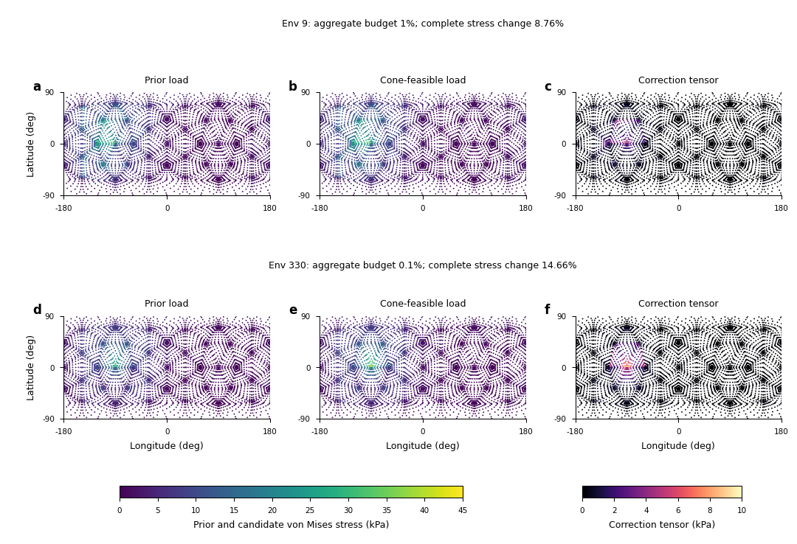

# Measured load sensitivity and resolved-boundary reference errors

The [engineering-budget clarification](AUTOMATIC_CONTACT_AND_THROUGHPUT_GOAL_20261020.md#error-judgments-and-practical-acceptance-budgets)
now has completed signed transfer and cooperative-load tests. The resolved-boundary native variant has18 admitted
physical error measurements against the existing qualified normal/friction
reference. Separately, the two retained SCR first failures have sampled
nearest-load and complete elastic correction measurements. On improved
surface-contained paths, aggregate budgets of1%/0.1% admit cone-feasible
env9/env330 loads but change complete stress by8.76%/14.66%. These results do
not justify a relaxed production tolerance. The earlier29.81%/33.51% values
remain diagnostics on a narrower centroid-path subset, not minimum corrections
over the original physical support.

## Resolved pressure against the qualified reference

The native variant uses the measured external-pad samples with conservative
P2 work transfer on their actual boundary. It removes the second finite-radius
spread and the previously measured approximately42% inner-boundary normal
loading. Its own400-step history and both complete endpoints pass admission.
The original physical source positions/forces agree with the fixed-radius run
within the declared1e-9 relative check; original fields remain unchanged.

The same fine StVK reference, observed resolution envelopes, complete
physical-volume columns, outer/inner fields and raw/common peak measures are
reused. Sampling changes from9 to25 surface points per face pass the existing
measurement targets. The18 new dimensional errors include absolute values and
conditional intervals; they are not certified continuum bounds.

| Friction endpoint metric | Fixed2mm DPR | Resolved boundary |
| --- | ---: | ---: |
| Complete tangential tensor, volume L2 | 7.936% | 10.564% |
| Membrane, area L2 | 4.682% | 6.319% |
| Bending, area L2 | 10.307% | 14.077% |
| Outer tangential tensor, area L2 | 7.563% | 11.056% |
| Inner tangential tensor, area L2 | 9.881% | 11.128% |
| Raw von Mises maximum | 2.848% | 8.586% |
| Raw tensile maximum | 5.577% | 15.826% |
| Common-column von Mises maximum | 2.322% | 10.287% |
| Common-column tensile maximum | 5.543% | 15.792% |

The normal endpoint gives the same qualitative result. Conditional intervals
overlap for the complete tangential tensor, membrane and inner tensor. The
fixed-radius error is conditionally lower for bending, outer tensor and all
four peak measures at both endpoints. Thus the corrected boundary transfer
does not establish an accuracy improvement on this coarse mesh. Its larger
stress values are not evidence of being more physically accurate.

The direct three-field integration now passes all10 normal/friction metric
rows at9/25-point sampling. Its identity is
`new-reference = (new-old) + (old-reference)`, including the signed cross
product. Reversing this identity gives
`old-reference = (old-new) + (new-reference)`. At the friction endpoint,
the correlations between those latter two signed tensor differences are
-0.6721 for the complete tangent tensor, -0.6717 for membrane, -0.7100 for
bending, -0.7574 for the outer tensor and -0.5821 for the inner tensor.
The wrong-boundary transfer partly cancels the remaining resolved-reference
error. The9-to25-point change of the directly measured cross correlation
is at most5.95e-5.
A new-old transfer contrast can be isolated because its sources
and dynamics match. The remaining new-reference difference still combines
source quadrature, pressure response, geometry/elastic discretization and
reference effects; it is not an isolated elasticity error. Neither subtracting
the two scalar error norms nor returning to incorrect-boundary spreading
resolves those components.

## Original SCR centroid-path diagnostic

The original env9/step767 and env330/step645 inputs, strict failures and
continuous certificates are unchanged. Each source retains its original
radius, friction and boundary component. An explicit surface path through
facet centroids and edge midpoints proves every selected point is inside its
original intrinsic support. The path upper bound is conservative; these
sampled optimizations do not establish the continuous minimum correction.
In particular, these paths omit admissible portions with different material
normals. The port-path comparison below supersedes any interpretation of these
failures as rejection of every load within the original support.

The prior uses the existing compact Gaussian profile, evaluated on this
declared surface path. An unconstrained minimum weighted correction makes
that prior preserve each original source force and anchor moment. It is an
explicit diagnostic transfer: its tractions can violate the physical cones,
and it is not a previously admitted SCR stress or a physical reference.

The numerical problem then minimizes weighted distance from that prior under
actual circular Coulomb cones. Each source separately has force and moment
budgets `|delta F| <= beta |F|` and
`|delta M_anchor| <= beta R |F|`. The predeclared grid is
`beta = 0, 0.001, 0.01, 0.1`. This prevents large mutually cancelling source
changes from hiding behind a small aggregate wrench. It is a declared stronger
constraint than aggregate-wrench preservation alone.

At25 and81 points per facet, all grid cases return sampled
`PrimalInfeasible`; none is accepted. Independent sampled minimax searches
give source budgets30.780%/27.393% for env9 and18.082%/17.326% for env330,
stable to the shown digits between those samplings. These are not continuous
lower bounds or recommended budgets. In particular they do not replace the
original independently verified continuous certificates.

A separately labelled **unbudgeted nearest-prior projection** measures stress
sensitivity outside that grid. Successful SOCP solutions are independently
checked against the closed-form pointwise Euclidean cone projection. Actual
post-projection compression, friction, force/moment changes and unsigned
point-force changes are remeasured. Numerical KKT acceptance stays1e-8,
with the solver itself targeting1e-11; no solver cap or unsuccessful optimizer
is accepted. This diagnostic is never an accepted engineering observation.
At625 points/facet for env9, the1e-11 solver target failed the independent1e-7
coordinate check; tightening to1e-14 returned `AlmostSolved`, also rejected.
The replacement uses the exact pointwise projection, with independently
checked primal-cone, dual-polar and weighted-complementarity conditions.
It does not relabel either optimizer attempt as successful.

## Refined response on the original centroid paths

The original480-tetrahedron,810-P2-node Franka asset uses E=10GPa,
Poisson ratio0.3 and density2000kg/m3. The625-point/facet results are:

| Quantity | Env9 | Env330 |
| --- | ---: | ---: |
| Individual source force changes | 36.770%,38.541% | 32.097%,31.549% |
| Individual anchor-moment changes, scaled by R times source force | 12.523%,16.306% | 14.958%,14.932% |
| Complete3D stress correction, volume RMS | 1929.063Pa | 1656.939Pa |
| Complete3D correction / contact-only baseline | 29.813% | 33.510% |
| Membrane correction / baseline | 30.545% | 34.072% |
| Bending correction / baseline | 29.269% | 35.432% |
| Contact-only raw VM maximum, before → after | 42.836 → 48.938kPa | 39.403 → 44.615kPa |
| Contact-only raw tensile maximum, before → after | 23.304 → 25.206kPa | 16.079 → 16.578kPa |
| Maximum VM norm of correction | 12.842kPa | 8.499kPa |
| Maximum spectral norm of correction | 15.478kPa | 8.576kPa |

The full correction field changes by0.170%/0.316% of its own norm between225
and625 points/facet, or0.0508%/0.1059% of the finer contact-only baseline.
Baseline field changes are0.00271%/0.00318%. This is measured sampling
sensitivity on the same discrete elastic geometry, not a continuum bound.
The env330 contact-only tensile maximum moves from
`(0,-21.504,-0.0654)mm` to `(-16.808,-10.388,9.271)mm`;
the exact raw peak locations for every field remain in the receipts.

Exploratory625-point projection calls take0.124/0.077ms for the two analytic
env9 sources and2.122/2.228ms for the two SOCP env330 sources. These different
algorithms are not a controlled speed comparison. These call timers exclude
sampling/matrix preparation, elastic solves, host exports and process startup.
The independent elastic model setup takes0.520/0.600s. None is production
native throughput or a matched RL observation-cost measurement.

## Stress interpretation and limits

All complete3D tensors use the exact physical-volume norm of the affine P2
stress field. Actual tetrahedral orientation is retained and integration uses
absolute Jacobian determinants. P2 surface edge nodes are explicitly mapped
to the CPU shape convention, with point reproduction and original-wrench
checks. Membrane and bending resultants use exact line integration through
the actual tetrahedra and physical wall lengths. Raw von Mises/tensile maxima
and their actual sample positions are preserved without smoothing.

The captured first-failure files do not contain angular velocity or all
applied inertial inputs. Absolute baseline/candidate stresses therefore use
the explicitly declared contact-only free-link response. They are not the
actual dynamic total stress. The **correction field** nevertheless includes
the change in consistent-mass equilibrium projection, and the unchanged
inertial contribution cancels by linearity. Direct correction solves agree
with subtraction of the two full solutions and satisfy the full elastic
equations. No physical pins are introduced.

The correction's maximum von Mises norm and maximum spectral norm bound
changes of the global von Mises and tensile maxima, respectively, for any
unchanged inertial state in this same linear model. They do not bound peak
location changes, continuum/model error or a change of physical trajectory.

Early controls remain retained: the initial implementation incorrectly
assumed positive tetrahedral orientations, then exposed the differing edge
node order. Both were repaired with unchanged numerical checks. The9-point
sampling was too sparse for one source's unconstrained wrench fit and was
rejected without enlarging the support. Initial25/81-point results showed
7.55%/14.32% changes of the correction field itself, motivating225/625-point
refinement with the original budget grid unchanged.

## Cooperative loads on improved surface paths

Vertex/shared-edge ports preserve mesh topology, and exact adjacent-facet
unfolding admits more of the original support. Folded-facet and coincident
disconnected-sheet controls pass. Eight and16 edge subdivisions and225/625
points per facet separate path and angular sampling changes. All paths remain
surface-contained upper bounds: this CPU construction does not implement the
native general coplanar multi-facet straight walk and is not an exact
continuous geodesic/minimum proof. No radius or friction coefficient increases.

The joint objective preserves the sum of normalized per-source weighted prior
distances. Its force scale is `S = sum |F_source|`, and its moment scale is
`R_group S` about the captured failure position. These declared diagnostic
scales are not identical to native body's source-prior normalization.
Historical captured start metadata incorrectly names this moment as
`delta M_origin`; the actual matrix uses `failure.position`. The independent
comparison checks that anchor explicitly and separately checks the saved
origin moment. Frozen inputs and numerical results are unchanged.

Strict zero-budget cases remain rejected. The small positive-budget grid is
unchanged. At16 subdivisions/625 points, the selected successful joint
constructions give:

| Quantity | Env9,1% budget | Env330,0.1% budget |
| --- | ---: | ---: |
| Actual aggregate force / moment change | 1% /1% | 0.1% /0.1% |
| Largest individual source-force change | 38.211% | 0.449% |
| Largest individual anchor-moment change / R times source force | 9.143% | 8.698% |
| Complete3D correction, volume RMS | 551.738Pa | 674.686Pa |
| Complete3D correction / contact-only baseline | 8.762% | 14.665% |
| Membrane correction / baseline | 6.075% | 12.072% |
| Bending correction / baseline | 4.852% | 8.325% |
| Contact-only raw VM maximum, before → after | 39.160 →40.310kPa | 32.812 →40.783kPa |
| Contact-only raw tensile maximum, before → after | 22.952 →22.955kPa | 12.333 →15.323kPa |
| Maximum VM norm of correction | 5.662kPa | 9.722kPa |
| Maximum spectral norm of correction | 5.083kPa | 8.016kPa |
| QP call / two elastic solves | 89.14 /16.53ms | 51.55 /17.15ms |

The actual candidate and correction peak locations and complete resultants
are retained. For env330, the contact-only tensile maximum moves from
`(-16.808,-10.388,9.271)mm` to `(0,-21.504,-0.0654)mm`.
Small aggregate wrench changes can conceal individual-source redistribution
and substantial self-equilibrated stress. Changing the budget does not
monotonically minimize stress: the objective is distance to the load prior.
These CPU call times exclude geometry preparation and startup and establish
no production throughput.

The matched source-local control uses exactly the same points, priors and
numerical target. Env9 rejects0.1% and1% per-source budgets but admits10%,
with10.051% complete-stress change. Env330 admits1% with11.469% stress
change; its0.1% attempt returns `AlmostSolved` and is rejected. The
unbudgeted pointwise projections agree with the joint projections, providing
a control independent of the budget coupling. No unsuccessful optimizer,
including the selected runs' minimax attempts, contributes an admitted
minimum or engineering result.

### Numerical and sampling sensitivity

Positive-budget stopping targets1e-9 and1e-10 give seven evaluated fields
whose maximum relative difference is6.27e-8; the correction fields differ
by at most4.75e-7 of their own norms. KKT acceptance1e-8, actual-budget
allowance1e-9, cone rounding1e-13 and elastic/superposition checks1e-7
remain unchanged. The original1e-11 target remains the default; its failed
attempts stay retained. Removing positive profile factors from cone rows is
an equivalent conditioning change, verified on14 mutually successful fields
to3.46e-10 relative field difference.

Across mutually successful pairs,225-to625 angular sampling changes candidate
fields by at most0.0414% and correction fields by0.3271% of their own norms.
Eight-to16 port refinement has a larger effect: up to1.307% and9.373%,
respectively. These distinct observed sensitivities are not certified bounds;
failed optimizations are excluded from paired numerical comparisons and
remain visible in the original records.

The six panels show every sampled outer face using the owning tetrahedron's
P2 stress trace. Prior and candidate fields share a common scale; the third
column shows von Mises of the signed correction tensor on its own common
scale. Strong changes concentrate near longitude-90degrees and low latitude,
while the complete-volume changes in the table include the entire shell.
White gaps are sample spacing, without smoothing or clipping. This explains
why a small global wrench change need not imply small local or complete stress
change. Editable SVG, PDF,600dpi PNG, exact plotted data, caption and direct
preview/export QA are retained in the new packet.

## Consequence for implementation

The [terminal packet](../evidence/20261019-qualified-ranking/engineering-load-sensitivity-v1/README.md)
retains original failed controls, numerical rejections, captured sources,
18 admitted resolved-transfer errors and the complete local-load sensitivity
study. Full fields stay at externally hashed data-side paths.

The [cooperative-load and signed-transfer packet](../evidence/20261019-qualified-ranking/cooperative-load-and-transfer-decomposition-v1/README.md)
adds the actual feasible constructions, independent source/aggregate checks,
same-path source-local control, numerical/path sensitivity and signed tensor
cross terms. The original centroid-path failures remain a narrower diagnostic.
This work measures separate numerical convergence, permitted load discrepancy
and stress response. It supports no new global default tolerance. Every
candidate explicitly has `engineering_stress_accepted=false`.
A useful engineering approximation still needs
an admissible stress budget, source-prior control and its own matched native
history/cost evidence.

The native `load_transfer="resolved"` implementation now uses actual boundary
and source provenance, including legitimate inner/nonconvex contacts.
Its independent quadratic-work, force/moment, release and failure-isolation
controls pass on both nonconvex and cavity meshes. Native max/full scene
observation, checkpoint, partial reset and subsequent unaffected-environment
updates pass on both CPU and GPU; six manual-pressure regressions remain
passing. The [implementation packet](../evidence/20261019-qualified-ranking/native-resolved-boundary-v1/README.md)
retains all tests and their initial setup/API failures.
On the actual retained normal/friction pad loads,
complete-field differences from the existing independent CPU resolved transfer
are1.13e-11/1.25e-11. These are numerical conformance results, not new physical
error measurements. Sparse collider sources still need the physical
support/pressure model, including
the [measured compliance limits](PAD_COMPLIANCE_STUDY_20261020.md).
Automatic Quadrants pressure prediction, moving/friction and thickness
validation, and measured incremental production costs remain open.
