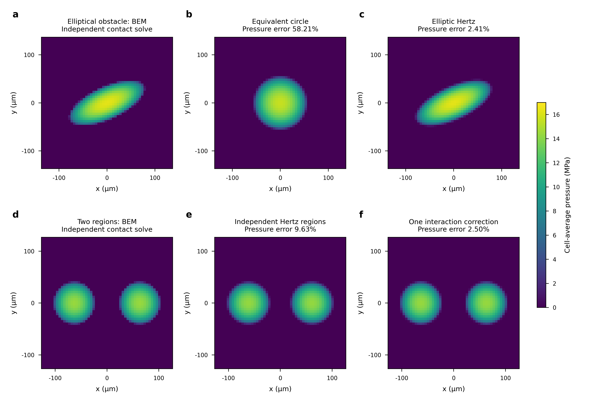

# Cheap hard-contact estimates: first executed controls

The new priority in remote commit `75d534428` is active: inexpensive Hertz/thin-shell
estimates and native throughput. Further soft-pad, vector-compliance and coupled
Newton-PCG integration is superseded. Existing evidence stays unchanged.

This study supports retaining both principal curvatures in a cheap estimate.
Replacing them by one equivalent circular curvature produces58.21% pressure
error in the rotated elliptical half-space control. A native elliptic lookup
costs approximately21us per update for1–8192 supplied regions on the measured GPU.
One explicit far-field correction also improves a symmetric two-region example.
These are local hard-contact component results, not a finished egg estimator.

## Physical comparison

The deformable material has E=10GPa, nu=0.3 and reduced modulus
E*=E/(1-nu²); the opposing quadratic obstacle is rigid. The total normal load
is0.1N. An independent square-cell Boussinesq boundary-element solve minimizes
complementary energy under nonnegative cell forces and the total-force equality.
It determines support and pressure without a prescribed Hertz footprint.
The influence matrix integrates1/(pi*E*distance) over each constant-pressure
square. Active-set completion requires force balance, nonnegative force/gap
and complementarity, and loaded cells may not touch the search boundary.

The cases are circular curvature(50,50)/m, curvature(20,80)/m rotated0.43rad,
and the minimum of two circular quadratic gaps. The latter has two known
symmetric regions, each carrying0.05N; their initial centers are separated by
three isolated-contact radii. All cases retain36² and54² reference grids.
Analytical estimates use8x8 Gauss cell averages and a reported quadrature-only
load normalization, never a fit to the reference distribution.

| Case / estimate | Pressure L2 error,36² →54² | Subsurface sampled tensor error,36² →54² |
| --- | ---: | ---: |
| Circular Hertz | 1.903% →1.162% | 0.2014% →0.0808% |
| Rotated elliptical Hertz | 3.591% →2.407% | 0.3949% →0.1835% |
| Equivalent circle for elliptical obstacle | 58.040% →58.212% | 25.279% →25.330% |
| Independent Hertz for two regions | 9.678% →9.628% | 5.390% →5.360% |
| One interaction correction for two regions | 3.172% →2.501% | 0.6776% →0.4120% |

Pressure error is the relative area-weighted L2 norm of cell-average pressure
on the same grid. Subsurface stress uses Boussinesq displacement differentiated
by complex step and isotropic Hooke's law, with a separate on-axis point-force
identity check. The15x15x9 observation grid is fixed across both reference
resolutions, at depths0.4a–2a. The tensor metric is an unweighted sample norm,
not a complete-volume norm. Cell resultants are point sources for this
subsurface evaluation; its shallowest depth exceeds two coarse-grid cell widths.
Surface peaks, global continuum maxima, shell membrane/bending and friction
are **not qualified** by these sampled tensors. The retained original tables
also include sampled tensile/von-Mises maxima and locations; their variation
is not a global peak-error bound.

The ellipse semi-axes are85.51um and34.19um; the equivalent-circle radius is
55.46um. Keeping ellipticity has a clear advantage larger than the observed
36²→54² differences. For the circular control the54² indentation differs
from Hertz by0.0163%. For the two-region case independent Hertz misses
approximately14.16% of the indentation scale through neglected interaction.
Reference-grid differences are reported sensitivity, not certified continuum
uncertainty or shell accuracy.

## A bounded inexpensive interaction candidate

For each known region, approximate another region's surface displacement by
`w_j(x)=F_j/(pi*E*|x-c_j|)`. Evaluate its gradient and Hessian at the original
region center. Replace the relative curvature K by K+H and shift the center
by `-(K+H)^-1 grad(w)`, then evaluate Hertz once. No additional contact solve,
iteration or fitted coefficient is introduced. This is a point-resultant
far-field Taylor approximation, not a general shell correction.

The two centers move outwards by1.868um. On54², pressure error drops from9.628%
to2.501% and sampled tensor error from5.360% to0.4120%. The unchanged reference
solves/fields are reused. This positive control assumes known symmetric load
allocation and keeps aggregate moment by symmetry. Arbitrary load allocation,
current-source moment fidelity, nearby/merging islands and shell interactions
remain open; this correction is not a production default.

## Native implementation and measured cost

[`native_hertz.py`](../qipc_comparison/native_hertz.py) is a Quadrants component
with total force, reduced modulus and a symmetric2x2 relative-curvature input
per supplied physical region. It uses the tangent-frame eigenvectors and a
shared257-row table for ellipse aspect ratio b/a in[0.05,1]. Numerical table
construction uses256 transformed angular quadrature points in Quadrants;
each update performs eight lookup comparisons and interpolation. Production
geometry preparation, source grouping and the pressure scatter are not yet
connected, so this component remains in the research package.

The table follows the elastic half-space potential integrals. With a>=b,
q=b/a and s=tan²(theta), its dimensionless curvature integrals are

```text
Jx(q) = 2 integral[0,pi/2] cos²(theta) / sqrt(q²cos²(theta)+sin²(theta)) dtheta
Jy(q) = 2 integral[0,pi/2] cos²(theta) / (q²cos²(theta)+sin²(theta))^(3/2) dtheta
kx/ky = Jx/Jy
a³ = 3 Fn Jx/(2 pi E* kx)
p(x,y) = 3 Fn/(2 pi a b) * sqrt(max(1-x²/a²-y²/b²,0))
```

The circular limit recovers the [standard Hertz force/modulus relation](https://docs.software.vt.edu/abaqusv2025/English/SIMACAEANLRefMap/simaanl-c-demanalysis.htm).
Independent SciPy adaptive integrals/root solves check101 rotated and
force/material-scaled cases per CPU/GPU backend. Maximum relative differences
are2.10e-6 for axes,2.24e-7 for indentation and4.16e-6 for peak pressure.
Direct pressure sampling, zero/invalid loads, unsupported curvature and
independent-region isolation pass. Nonpositive curvature, out-of-table aspect
ratio and invalid inputs remain explicit statuses, with no invented radius.
This does not yet test live collider source splitting or environment lifecycle.

| Supplied regions/update | GPU median | CPU median | Logical tensor storage |
| ---: | ---: | ---: | ---: |
| 1 | 21.32us | 16.69us | 6,268B |
| 128 | 20.58us | 25.46us | 18,968B |
| 512 | 20.64us | 49.25us | 57,368B |
| 8192 | 21.01us | 531.08us | 825,368B |

Hardware: NVIDIA RTX PRO6000 Blackwell Server Edition; CPU uses the engine's
default one Quadrants thread. Each number is the median of21 groups of100
resident updates, synchronized at the group boundary. Dispatch is included;
input transfers, JIT/imports, pressure-sample evaluation, geometry, grouping,
elasticity and output are excluded. These are estimator-module measurements,
not scene throughput or the cost of a complete observation. P90 timings are
retained in the receipts. Table/allocation preparation with warm kernels is
1.84–2.26ms; storage counts logical tensors, not allocator/driver overhead.

## Pressure maps and reproducibility



Caption: constant-cell pressure on the54² grid. Panels a–c compare the rotated
elliptical obstacle's independent BEM solution, equivalent-circle estimate and
elliptic Hertz estimate. Panels d–f compare the nonconvex two-region solution,
independent Hertz regions and one far-field correction. All maps share the
MPa color scale and show the complete nonzero support. Error labels compare
cell-average pressure with the corresponding BEM reference. No smoothing or
statistical error bars are applied. The [SVG](../evidence/20261019-qualified-ranking/hard-hertz-v1/hard-hertz-figure-v1/group0/figure/hard-hertz.svg)
and [PDF](../evidence/20261019-qualified-ranking/hard-hertz-v1/hard-hertz-figure-v1/group0/figure/hard-hertz.pdf)
retain editable text; the rendered preview has been inspected.

The figure supports retaining elliptical geometry and testing cheap interaction
corrections before a coupled solver. The circular replacement loses the long
axis and loads regions outside the elliptical support. The local correction
improves the two-island example without representing arbitrary nonconvex contact.

Executed campaigns under the existing data run root:

- `hard-hertz-v1`, job733211: native GPU/CPU controls and six independent BEM cases.
- `hard-hertz-interaction-v1`, job733223: two reused-reference correction comparisons.
- `hard-hertz-figure-v1`, job733233: pressure maps and editable exports.

All allocations completed with exit0. Each campaign retains exact task arguments,
captured analysis sources, engine identity, logs and results. Use the archived
`tasks.json` with the existing `research.rigid_stress.shell_comparison.submit`
entrypoint and a fresh explicit data-side output directory; its `--cpu-only`
mode still runs numerical work in Slurm `rtx-mid`. Original arrays stay on data
with manifest hashes; no live source, environment or old evidence was migrated.

## Finite footprints on the witnessed mesh

The [native transfer component](../qipc_comparison/native_hertz_transfer.py)
now feeds supplied Hertz regions into the existing native elastic recovery.
It places96 integration points on each physical ellipse, rather than hoping
that fixed mesh quadrature samples intersect a roughly50um footprint. A
projected triangle walk follows boundary-edge identities from the witnessed
face. It cannot use a nearby disconnected face as a shortcut across a cavity
or the gap of a U-shaped material. It refuses non-facing/open walks.

The normalized Hertz measure uses r=sqrt(1-t²), giving3t² dt dtheta/(2pi).
Three Gauss points in t and32 angular points exactly integrate its constant,
linear and quadratic moments on one affine patch. Every mapped sample uses
signed P2 shape weights on its reached boundary face, preserving discrete
virtual work. Crossing several triangles introduces a measured integration
error; this rule is not a certificate of the entire continuous footprint.
No physical radius or elasticity tolerance is enlarged.

Seven controls pass on each CPU/GPU backend: an interior face, shared edge,
interior mesh vertex, cavity inner wall, U-shaped boundary, coarse egg vertex
and its common rotation/translation. All use three environments and include
release, failure isolation, resultant force/moment checks and independent
all-triangle projection. Planar normal/tangential loads also pass a closed-form
quadratic virtual-work identity. Independent scikit-fem P2 solves reproduce
all same-load complete native fields to1.42e-11 relative error. This is
implementation agreement, not Hertz accuracy on the shell.

A separate12-radial by1024-angular CPU rule measures source-integration
sensitivity on the same mesh. Relative complete tensor differences use volume
weights over all tetrahedron corners:

| Footprint placement |96-point versus dense-rule complete tensor difference |
| --- | ---: |
| Interior flat face | Below5e-14 |
| Shared flat edge |0.1808% |
| Interior flat vertex |0.1989% |
| Cavity inner wall |0.1375% |
| U-shaped flat wall | Below1e-12 |
| Coarse egg vertex, either frame |0.01676% |

Invalid environment indices, a valid and a failed region sharing one environment,
and nonzero shear at zero normal load also pass explicit rejection/isolation
controls in the final source. The original vertex/rotated failure is retained. Its cause was comparing a
barycentric roundoff allowance directly with a segment parameter: very short
footprints have small barycentric derivatives. The correction bounds the
current barycentric coordinate first and clamps only its roundoff-sized
zero-distance crossing; no load or geometry acceptance budget changes. A prior
wrong-environment `skfem` import failure is also retained. Successful reruns
reuse the existing data-side physical-validation environment.

The combined estimate,96-point boundary mapping, wrench checks and nodal
scatter costs below include zeroing the destination nodal load and all native
dispatch. They exclude elastic recovery, grouping/curvature preparation,
input transfers, imports/JIT and actual scene dynamics. Each allocation requests
one CPU; timing uses seven groups of five resident updates with synchronization
at each group boundary. The workload repeats one known coarse-egg vertex
region in each environment, with max-mode elastic state storage.

| Regions/environments | GPU median | CPU median |
| ---: | ---: | ---: |
|1 |0.1728ms |0.1747ms |
|128 |0.1727ms |3.207ms |
|512 |0.1955ms |12.584ms |

These timings include the estimate itself and must not be added to the earlier
lookup-only table. They remain module measurements rather than moving-scene
throughput. No public automatic contact option is connected yet.

## A measured friction/moment limitation

On the faceted egg, proportional tangential traction with Fn=0.2N and
Ft/Fn=0.2 introduces7.951e-7N*m about the witnessed center. The strict transfer
rejects this mismatch and retains unaffected environments. A separate CPU
candidate applies one6x6 weighted minimum-force correction to enforce the
same total force and zero source free moment. It does not change rigid dynamics
or the strict transfer path.

The correction changes the samples by0.02172N in summed magnitudes, or12.20%
in the pressure-weighted force norm. Its mass-relieved complete P2 tensor
change is only0.09582%; raw tensile maximum changes from31,231.48Pa to31,235.37Pa,
and raw von-Mises maximum from93,450.51Pa to93,452.35Pa. The free-link balance
correction is recomputed for each load; it is included in these field changes.
Small aggregate-moment disagreement and local source redistribution therefore
need separate stress-response measurements.

This candidate is **not engineering-admitted**. Against declared mu=0.5 cones
on the actual reference facets,60 of96 samples violate the cone both before
and after correction. Maximum required local mu changes from0.8114 to0.8276;
we do not raise mu to make the candidate pass. A separate diagnostic in the
unchanged Hertz contact-plane frame has no cone violations: maximum shear/normal
ratio changes from0.2000 to0.2483, with positive compression throughout. These
are two explicitly different friction-frame models. The latter does not erase
the reference-facet violation, prove the physically correct current normal, or
supply partial-slip/unloading history. This is evidence of the
normal/geometry/traction-model conflict on the coarse faceted mesh, not proof
that physical smooth-shell contact is impossible. Neither the0.09582% coarse
field change nor exact wrench balance establishes hard-contact accuracy,
friction history or a general practical tolerance. Normal curvature/model
preparation and actual source semantics must be reconciled before promotion.

Executed transfer campaigns are `hard-hertz-transfer-v1`/job733285 (missing
validation dependency), `v2`/733299 (retained geometry failures) and `v3`/733327
(seven successful cases per backend and timing). Final `v4`/733392 repeats
the unchanged geometry checks, adds invalid-index/multiple-region/zero-normal
rejection controls and supplies the matching timings above. `hard-hertz-wrench-v1`/733351
reuses the completed v3 GPU fields for the correction study; `v2`/733398 adds
the explicit contact-plane versus reference-facet cone comparison. Their sources,
receipts, failures and data-side full-array hashes are retained in the
[transfer packet](../evidence/20261019-qualified-ranking/hard-hertz-transfer-v1/README.md).

## A cheap normal near-field tensor

The [elliptic tensor evaluator](../qipc_comparison/hertz_stress.py) differentiates
the Newton potential of the Hertz pressure disk. Its confocal coordinate solves
x²/(a²+lambda)+y²/(b²+lambda)+z²/lambda=1. Three differentiated potential
integrals use Carlson RD; swapping the order of a depth integral reduces the
remaining planar components to one-dimensional quadratic-root integrals. A
Gauss rule after s=lambda+(lambda+b²)*tan(theta)² resolves both their contact-edge endpoint
and the far field.
The zero-depth branch imposes the exact pressure and zero tangential traction.
No finite sampling depth replaces the actual surface value.

This computes all six normal-load tensor components for an elliptical footprint,
including surface, edge and symmetry axis. Coordinates are principal-frame
lengths with positive depth into material. It is a half-space particular field;
its use on a finite shell still requires a boundary correction. Carlson's
[duplication method](https://dlmf.nist.gov/19.36) gives a compact native evaluation;
[Greenwood's elliptic-contact analysis](https://doi.org/10.1177/03093247211060288)
provides the related mechanics context. Circular axis/surface controls use
[independently documented Hertz relations](https://contactengineering.github.io/ContactMechanics/source/ContactMechanics.ReferenceSolutions.html).

CPU controls cover axis ratios1,0.73,0.25 and0.05, surface/edge/axis and near/far
positions. Circular axis and surface formulas agree for nu=0,0.3,0.49, including
the surface-center and contact-edge limits. For nu=0.3 the circular control
recovers the axial von-Mises maximum0.620041*p0 at z/a=0.480864 and the edge
tension0.133333*p0. These controls are independent of the potential quadrature.
A separate pressure-area integration differentiates Boussinesq displacement;
its finest positive-depth complete-tensor differences range from1.2e-13 to
4.60e-7 relative. The original q=0.05 pressure quadrature failed at0.724%;
refining only that independent reference to256/512 radial points reduced its
successive change to0.03151% and its final difference to0.00004594%.
The original failed allocation and its first three completed cases are retained.

Against a192-point potential rule, the48-point rule's largest sampled tensor
error is8.38e-6*p0 across these controls. Sixteen points give at most1.84e-4*p0
on these sampled sets. These are numerical evaluation errors for the same
Hertz pressure law. They do not independently qualify pressure on a thin shell,
a friction history or a global maximum after arbitrary field superposition.

The [native implementation](../qipc_comparison/native_hertz_stress.py) constructs
its Gauss rule and evaluates shared Carlson duplication entirely in Quadrants.
Final16-point CPU/GPU checks cover37 region configurations and77 probes each
(2,849 full tensors per backend), q=0.05–1, nu=0–0.49 and varying physical
scale/pressure. Same-order implementation difference is at most1.23e-8*p0;
comparison with192-point evaluation is at most0.0001805*p0 (0.01805% of peak
pressure), within the predeclared0.1% numerical evaluation budget. This is an
absolute tensor scale, not0.01805% relative accuracy at every near-zero tensor.
Surface traction, closed-form axial compression, release, invalid depth/NaN/
Poisson inputs, unaffected-region isolation and exact recovery all pass.

Four additional far probes extend to200 major-axis lengths. Their tensor-relative
difference is at most1.01e-8 with the scaled integration map. The original
fixed-b² map and48-point/16-point measurements remain archived. No physical
pressure radius or solver tolerance changes with the integration map/order.

Matched warmed timings use seven groups of ten complete resident tensor updates,
77 probes per supplied region, on RTX PRO6000 Blackwell GPUs of the same model
in separate allocations. Each CPU control requests one core. Required point
status checks and all tensor writes are included. Ellipse estimation, boundary
transfer, shell recovery/correction, peak reduction, input copies, imports/JIT
and moving-scene dynamics are excluded.

| Regions | GPU16 points | GPU48 points | CPU16 points |
| ---: | ---: | ---: | ---: |
|1 |0.1113ms |0.1842ms |0.03673ms |
|128 |0.1130ms |0.1924ms |2.632ms |
|512 |0.1726ms |0.3152ms |10.509ms |

Sixteen integration points reduce measured GPU time by39.6–45.2% on this
matched workload, so16 is the component's default. These costs are for the
full supplied probe tensors; they are not max/full simulator overhead.

Executed campaigns are hard-hertz-nearfield-v1/733454 (the retained q=0.05
reference-resolution failure), v2/733465 (that reference alone) and v3/733537
(final integration map, all four ratios). Native-stress-v1/733478 and v2/733521
retain two initialization/type errors. V3/733524 validates48 points; v4/733532
validates16 points; final v5/733538 includes the distant probes and matched16/48
GPU controls. Exact sources, failures, terminal accounting and array hashes
are retained in the [near-field packet](../evidence/20261019-qualified-ranking/hard-hertz-stress-v1/README.md).

The retained0.2N coarse-egg normal case now has a concrete scale comparison:

| Quantity | Elliptic half-space local candidate | Coarse complete P2 shell field |
| --- | ---: | ---: |
| Von-Mises maximum |16.502MPa on the symmetry axis |0.08571MPa |
| Tensile maximum |3.7146MPa on the sampled contact edge |0.03020MPa |

The supplied ellipse has semiaxes69.93um and51.14um, p0=26.702MPa and an axial
von-Mises peak at28.22um depth. The coarse values are only0.519% and0.813% of
the corresponding local candidates. The complete P2 field, not just a selected
corner, is used for the coarse maxima. The domains differ: a local elastic
half-space versus a faceted finite shell with inertial relief. This table is a
scale-gap diagnosis, not a measured shell error. It rules out using same-load
coarse-core agreement alone to claim contact-peak resolution.

## Finite-box particular stress and boundary correction

The [finite-domain study](../qipc_comparison/study_hertz_residual.py) now tests
sigma_total=sigma_Hertz+sigma_residual on a free box under the same finite
elliptical normal pressure. Its dimensions are40a by40a by20a, with material
depth positive from the loaded plane. Fn=0.2N, E=10GPa, nu=0.3 and density
2000kg/m³ give a=69.93um, b=51.14um and p0=26.702MPa. The top prescribed and
particular tractions cancel exactly in the residual problem. Other faces carry
minus sigma_Hertz*n; the existing consistent-mass inertial relief is retained.
Adding the particular field therefore does not duplicate the original top load.

The192/6,048/12,288-tetrahedron P2 meshes share24,192 volume-weighted interior
queries and9,123 surface/interior peak probes. All element-corner tensors and
displacements are saved as well. The coarse particular field uses16 integration
points; finer controls use96. Boundary integration uses an independent facet
rule. Complete-field differences are weighted tensor L2 norms, not unweighted
norms of differently sized arrays.

| Comparison | Complete tensor difference |
| --- | ---: |
| Coarse direct pressure versus fine direct pressure |86.18% |
| Coarse corrected versus fine direct pressure |8.56% |
| Coarse corrected versus fine corrected |1.575% |
| Medium direct pressure versus fine direct pressure |8.03% |
| Medium corrected versus fine corrected |0.274% |
| Fine direct pressure versus fine corrected |8.36% |

The coarse corrected tensile/von-Mises sampled maxima are3.699MPa/16.482MPa;
the fine corrected values are3.698MPa/16.481MPa. Their relative changes are
0.0247%/0.00942%. The medium/fine corrected peak changes are below0.0001%.
These meet the predeclared **internal corrected-mesh** targets:5% complete
field,10% peak, with2%/5% reference refinement changes. The shared analytical
particular field makes this a decomposition/discretization check. The direct
pressure FEM reference still changes8.03% between its last two meshes and its
tensile corner peaks remain unresolved; neither a5% independent physical error
nor hollow-shell pressure accuracy is established. Maxima of the corrected
nonpolynomial field are sampled, not certified continuum global maxima.

The complete particular boundary resultant closes within7.6e-12 of Fn and
its moment within2.1e-12 of Fn*a. Changing coarse boundary integration order
8 to12 changes the corrected complete field by6.54e-8 relative; changing remote
stress evaluation from16 to96 points changes it by2.63e-6. Doubling the fine
pressure rule from24x512 to48x1024 changes its direct field by0.309%. Complete
elastic residuals remain below9.8e-13 relative. Thus the direct/corrected gap
cannot be represented as a failed algebraic tolerance or a precise physical
error estimate.

The first8GB allocation failed during natural-order factorization; nested
dissection allowed both finer factors to complete, but the second allocation
exhausted memory during later evaluation. The final run bounds pressure-point
location and tensor-evaluation scratch by chunking and completes on the same
8GB allocation. Interface queries can select different incident elements when
batched; stress is discontinuous across P2 tetrahedra. All incident corner
values remain retained, and the combined maxima use those corners plus probes.
Original outputs and failures remain intact. This fixed-pressure box control
does not add a pad model or prescribe an automatic shell contact radius.

## Native combined field and a cheaper distant-boundary correction

The bounded [native box control](../qipc_comparison/native_hertz_box.py) now
combines the Hertz estimate, remote boundary subtraction, existing native
elastic recovery and the particular tensor at every requested material point.
The192-tetrahedron/405-node mesh uses4x4 positive face quadrature and16-point
Hertz evaluation. Both maximum and complete-output modes evaluate all768
element corners plus93 local probes; full mode writes861 symmetric tensors,
and maximum mode reduces the same sampled von-Mises values on device. This is
a research module for one normal contact per environment on a flat box, not
the public moving-scene route or a certified continuum maximum.

Three forces0.12/0.2/0.25N are compared against independent P2 elasticity.
Same-load/same-ellipse combined tensors agree within1.2e-14 relative. Moving
one supplied center and rotating its supplied curvature23 degrees agrees
within1.6e-13; other environments are unchanged. Release, invalid force/NaN
center rejection, single-environment isolation and recovery pass on CPU/GPU.
Maximum/full reductions agree at1/128/512 environments. These are supplied
inputs and module-level state changes, not collider grouping or scene resets.

The retained first native allocation failed on a compile-time shape check.
The second exposed a reference mismatch: it compared the approximate lookup
ellipse with the independently solved ellipse as if they were identical.
Final checks retain the1e-7 implementation and0.1% quadrature budgets on
matching ellipses, and separately report the lookup contribution. At the exact
0.2N ellipse edge, its tiny support shift changes the query-set tensor norm
by0.1200%; the square-root pressure edge amplifies axis errors. This is neither
a failed elastic tolerance nor a0.1200% complete-volume physical error.

Profiling the original combined module identifies boundary integration as
the dominant GPU phase:1.70ms at B1 and4.30ms at B512. A separate inexpensive
variant uses the closed-form Boussinesq point-force tensor **only on the distant
box boundary**, while keeping finite Hertz tensors at all output queries.
These faces are at least18.6 major-axis lengths away across the force controls;
this is not a point-load peak approximation. Independent complex-step
derivatives of Boussinesq displacement check its integrated nodal traction.
The4x4 versus independent high-order point traction difference is0.00626%.
Relative force/moment discrepancy stays below5.21e-7 under the declared1e-4
runtime budget; a rejected environment's entire residual load is cleared.

Compared with the96-point Hertz/high-order boundary control on24,192 common
volume queries, complete volume-weighted tensor differences are0.00329–0.00365%
for the native Hertz-boundary version and0.0131–0.0238% for the distant-point
version. Both meet the predeclared0.1% **numerical/approximation difference**
budget on this box. The native full-field arrays, reconstructed complete-volume
tensors and independent references are retained. These differences do not
replace the finite-domain physical-reference uncertainty above or establish a
safe point-force distance threshold for a thin shell.

Matched primary timings use five groups of ten warmed resident updates. The
two variants execute sequentially on the same RTX PRO6000 Blackwell GPU; the
CPU control requests two cores. Every inclusive update includes ellipse
estimation, required wrench/status checks, boundary scatter, inertial relief,
elastic solve and complete residual, combined field and reduction. Forces vary
across the batch, but repeat during timing. Imports/JIT, geometry setup,
CPU validation, host readback and dynamics are excluded. The existing inverse
recovery also scans its residual-field peak before the combined scan; that
work is included, not subtracted from the measurements.

| Environments | GPU Hertz boundary, full | GPU distant point, max | GPU distant point, full |
| ---: | ---: | ---: | ---: |
|1 |2.536ms |1.101ms |1.100ms |
|128 |3.021ms |1.579ms |1.566ms |
|512 |7.150ms |3.260ms |3.267ms |

On the matched two-core CPU allocation, full-output Hertz/distant-point times
are2.072/1.498ms at B1,170.555/94.265ms at B128 and716.690/422.909ms at B512.
CPU/GPU validation uses the same configurations and numerical thresholds.

The distant-boundary approximation reduces matched full-update GPU time by
48.2–56.6%. Boundary work falls to0.274/0.287/0.425ms at B1/128/512; at B512,
combined-field evaluation is now1.632ms and recovery1.190ms in separate phase
measurements. Separate phase medians are descriptive and are not added to
manufacture an inclusive timing. This supports using the cheaper correction
for this distant-boundary control; shell inner walls and arbitrary curved
regions require their own accuracy checks. It is not a simulator speedup.

Executed finite-domain campaigns are `hard-hertz-residual-v1`/733597 and
`v2`/733628 (retained memory failures), and `v3`/733635 (complete three-grid
study). Native `hard-hertz-box-v1`/733638 and `v2`/733641 retain initialization
and reference-matching failures. `v3`/733644 passes the initial combined
CPU/GPU controls and timings; `v4`/733648 adds complete-volume validation and
matched Hertz/distant-point variants. Their executed sources, receipts and
external array identities are in the
[finite-box packet](../evidence/20261019-qualified-ranking/hard-hertz-residual-v1/README.md).

To reproduce, use the archived `tasks.json` for the corresponding campaign
with `python3 -m research.rigid_stress.shell_comparison.submit`, the unchanged
`automatic-pad-geometry` engine checkout, the analysis sources in
`stress_qualified_ranking`, and the existing `rigid-stress-physical` Python.
Use a fresh explicit data-side `--output`, `--node-local-cache`, `rtx-mid` and
image1_26. The finite-domain task used `--cpu-only --cpus 1 --memory-gb 8
--minutes 15`; the native pair used `--cpus 2 --memory-gb 16 --minutes 20`.
The native task's reference NPZ supplies the fixed box mesh/common queries;
it does not supply production contact inputs.

## Remaining work

Next connect cached rest-curvature/current physical-region inputs to the cheap
native estimate and the now-executed witnessed-boundary transfer. Keep sparse
collider samples distinct from physical regions and preserve complete force
and moment under source splitting. Compare a declared inexpensive tangential
law with monotonic/unloading controls, then test hollow-shell thickness/global
response against a matched targeted hard-contact reference. The observed
51um circular footprint also makes mesh/transfer resolution a concrete issue;
do not enlarge it to a numerical disk. Run matched max/full and pure-rigid
moving-scene timing as soon as the native route is connected. No further
soft-pad campaign or dense elastic-basis preparation is required by this goal.

Correctly transferring a50um pressure footprint does not resolve a coarse mesh's
elastic near field. Before claiming damage-relevant global peaks, test a cheap
Hertz near-field stress estimate/correction alongside the coarse shell response
and check its overlap/double-counting and full-output meaning against a matched
reference. Repeating a point-load peak convergence sweep is not the next step.

The finite-box control now supports testing that residual decomposition on a
hollow polar-land egg, retaining inertial relief and boundary integration checks.
Its direct-pressure reference uncertainty remains visible; it does not qualify
unknown shell contact pressure. Directly adding a Hertz field to the original
coarse loaded solution would still count part of the load twice.
General curved/nonconvex use also needs a valid local domain or a controlled
cutoff and its equilibrium residual; the half-space formula alone supplies neither.

## Current curvature and live contact inputs

The native input candidate caches signed rest curvature and evaluates it in
current geom poses. Sphere, plane, box-face, cylinder and capsule queries have
analytical controls; box edges, cylinder rims and capsule seams remain explicit
ambiguities. Mesh tensors estimate a smooth surface from the supplied vertex
normals. The comparison evaluates analytical sphere/ellipsoid curvature at the
radial projection of each collision-face centroid; it does not certify that a
faceted collision asset is the same physical smooth surface.

| Shape | Faces | RMS tensor error | Maximum tensor error | Predeclared5% RMS target |
| --- | ---: | ---: | ---: | --- |
| Sphere | 80 | 11.075% | 12.015% | Fail |
| Sphere | 1280 | 1.191% | 2.923% | Pass |
| Ellipsoid | 80 | 26.750% | 48.057% | Fail |
| Ellipsoid | 1280 | 3.037% | 9.553% | Pass |

CPU/GPU controls also cover two disconnected spherical minima on one link,
source permutation, swapping collider sides, source splitting with half forces,
release, invalid pair IDs, NaN force/moment/position quarantine, recovery and
rigid rotation. Complete original source force and moment are retained at each
region center. All sources in an invalid environment yield zero region loads;
other environments remain independent. This preserves a wrench, but does not
prove that a centered Hertz pressure or a tangential law represents that wrench.

The candidate performs at most six2D geometric Newton updates, with normal
misalignment below1e-7, before combining sources that resolve to the same local
minimum. Its coalescing length is set by curvature and geometric resolution,
independently of source count, load and Hertz radius. This is a local geometry
candidate, not a general contact-union or pressure certificate. In particular,
normal interpolation, finite box faces and disconnected/occluded boundaries need
their own applicability checks.

The actual Franka adapter runs this input stage before position integration,
using the native association and both current geometry and solved forces from
the same substep. It then evaluates the existing normal Hertz lookup. It does
not request a recovered elastic stress field. Four varied environments run720
steps at dt=0.01s, one substep, including release and four partial resets. The
matched pure-rigid baseline receives exactly the same saved condition bank.
The retained level1 egg collision asset has80 outer triangles; the sphere and
ellipsoid errors above do not measure its physical stress or curvature error.
Three complete warm timing intervals exclude detailed host histories/exports;
aggregate device counters, dispatch and the research callback remain included.

Before the opposing-box correction, all joint/position/quaternion trajectories
match the pure-rigid baseline exactly. Only882 of2808 loaded environment steps
pass region input checks. Across9893 loaded source observations there are887
converged roots,8016 geometry rejections and990 iteration-limit rejections.
The corresponding input-stage scene cost is6.660ms versus2.235ms for pure rigid,
an added4.426ms/scene step. This is measured rejected-candidate cost, not usable
stress throughput or max/full observation cost.

Same-substep boundary probes identify a specific geometric failure: an egg
witness can lie inside the opposing box during rigid overlap, so the closest
box face can be a side face whose normal is nearly perpendicular to the egg's
surface normal. The candidate now fixes the box face most opposed to the initial
material normal during the local solve. It queries the actual finite face;
edge-clipped roots remain unresolved. A separate1mm-overlap sphere/box control
passes on CPU and GPU. This correction does not translate physical geometry,
use penetration as elastic indentation, or establish visibility of a box union.

The final source passes12 region controls on each backend, but the box correction
does not improve the Franka admission count:882/2808 loaded environment steps
remain valid, with8006 geometry and1000 iteration-limit source rejections.
The retained early-grasp snapshots now identify finite-face ambiguities rather
than accepting a perpendicular side face. Final matched scene medians are
6.825ms for the input adapter and2.222ms for pure rigid, an added4.603ms.
All trajectories still match exactly. Normal lookup success on admitted inputs
does not supply the missing tangential/history law or complete shell stress.
This six-iteration, full-mesh-search candidate is not recommended as a runtime
default. Finite-face/link-union selection and coarse normal-field convergence
need targeted repair before larger-batch or max/full throughput promotion.

The original invalid Mesh option, compile failure from reusing a loop index as
an unpack target, and NaN-force acceptance failure are retained with their
corrections. Explicit native isnan/isinf checks now reject the nonfinite inputs.
Reproduce with `qipc_comparison.check_hertz_regions`, `live_hertz_inputs` and
`compare_live_hertz_inputs` using the captured Slurm task lists. Full arrays,
trajectories and generated control meshes remain under the established data root;
compact sources, receipts and histories are in the
[retained input packet](../evidence/20261019-qualified-ranking/hard-hertz-inputs-v1/README.md).


## Direct planar normal roots

For a planar opponent and a sphere or smooth-normal mesh, the input candidate
now solves the normal-field condition directly. Each fixed triangle caches the
inverse of its three raw vertex-normal columns. Given the opposing plane normal,
the barycentric normal weights follow from one matrix product and normalization;
only nonnegative weights are eligible. The source-nearest eligible triangle
supplies the center and cached curvature. Spheres retain their analytical root.
Box contacts still select an opposed face and check its finite tangential bounds;
other shape pairs retain the bounded geometric iteration. The direct inversion
does not certify nonconvex visibility, physical smoothing or finite pressure support.

The final CPU/GPU controls retain all12 region/source cases and add128 mesh
normal-root queries per backend. Re-evaluating the existing forward interpolation
at each returned point gives a maximum normal discrepancy of3.34e-15. This small
residual measures inversion of the supplied normal field, not geometric accuracy.
The maximum root-position differences from the analytical smooth shapes are:

| Collision shape | 80 faces | 1280 faces |
| --- | ---: | ---: |
| Sphere | 1.317mm | 0.115mm |
| Ellipsoid | 2.117mm | 0.175mm |

These geometry differences exceed the approximately40–60um Hertz radii sampled
in the Franka pilot. No physical contact-location accuracy follows from an
accurate algebraic root or the finer mesh's curvature RMS target.

The matched720-step, four-environment Franka pilot now records3020 successful
roots and6873 finite-geometry rejections among9893 loaded source observations;
iteration-limit rejections fall from1000 to zero. Complete valid loaded
environment steps increase from882/2808 to1381/2808. Position, quaternion and
joint histories remain exactly equal to the paired pure-rigid run. Measured
warm full-run medians are4.025ms/scene step for the input adapter and2.249ms
for pure rigid, an added1.777ms. The previous input implementation cost6.825ms;
this is an input-stage improvement, with rejected steps still included, rather
than admitted stress throughput. No elastic field is recovered in this pilot.

Even successful region inputs retain a separate pressure compatibility problem:
the largest sampled magnitude of region moment divided by force magnitude times
Hertz major axis is121.63. Preserving that source wrench in bookkeeping does
not make it representable by centered normal Hertz pressure. It cannot be
silently dropped, converted to a tiny pressure-centroid shift or declared
physically accurate. The actual stepped finite finger boxes, source moment
allocation, friction/history and finite-shell response remain unresolved.

Executed jobs are733883 (CPU/GPU controls) and733886 (matched moving-scene
input/rigid runs). Full control and trajectory arrays remain on data. Exact
sources, logs and compact histories are retained with the
[normal-root and edge packet](../evidence/20261019-qualified-ranking/hard-normal-roots-and-edge-v1/README.md).


## Finite straight-edge pressure candidates

A separate compact control places a rigid half-plane x>=0 against the same
elastic spherical quadratic gap. Its unconstrained minimum is x=-d; d/a0 is
-0.5,0,0.5 or2, where a0 is the unrestricted Hertz radius. The independent
force-controlled unilateral BEM determines its own pressure and support. E,
nu, curvature and normal load match the earlier circular half-space control.

Simply clipping Hertz pressure at the edge fails the predeclared15% cell-pressure,
10% sampled-tensor and15% sampled-von-Mises-peak targets. The cap radius is
adjusted to conserve total force, using
`F=(E*/R)*(a-d)^2*(2a+d)/3`; force conservation alone does not recover pressure.
A pure edge trial `p proportional to sqrt(max(a^2-(x+d)^2-y^2,0)/x)` improves
outside-center cases but overweights the edge in the interior case.

A two-parameter mixed trial improves all four tested offsets. At each trial
radius, normalize both the regular cap and edge shape to F, then write cell
forces `f=h+alpha*(e-h)`. Minimize `0.5*f.T*K*f+gap.T*f` over0<=alpha<=1
analytically, then use a bounded scalar radius minimization. This uses the
independent Green operator and prescribed gap, never reference pressures or
fitted stress targets. It remains an offline variational candidate; its
0.276–1.363s fitting cost is not a native runtime estimate. A useful runtime
version would require a verified dimensionless table or equivalent inexpensive
formula, with explicit limits on ellipticity, offset and finite-face topology.

The48² and72² grids have the same cell widths as the original36²/54² pilot,
but extend to x=4.8a0 and |y|=2.4a0 so every trial footprint is contained.
The reference's three remote boundaries are unloaded. The substitution x=u²
removes the trial edge singularity from integration;20-point versus40-point
per-axis quadrature changes the mixed cell forces by at most0.00765% in these
cases. No radius minimizer reaches its search bound. Final72² comparisons are:

| d/a0 | Hertz cap cell-pressure error | Mixed cell-pressure error | Mixed sampled tensor error | Mixed sampled VM peak error |
| --- | ---: | ---: | ---: | ---: |
| -0.5 | 25.992% | 5.714% | 1.549% | 0.591% |
| 0 | 48.505% | 5.550% | 1.262% | 0.162% |
| 0.5 | 60.793% | 7.333% | 2.291% | 0.419% |
| 2 | 75.113% | 12.335% | 5.779% | 2.419% |

All eight mixed comparisons meet the three declared sample/cell targets. The
fine-grid edge fractions are0.273,0.556,0.766 and1.0. The pure edge trial misses
the15% pressure target at d/a0=0.5 after quadrature correction:15.151%, versus
the preliminary13.299%. That earlier provisional pass is superseded.

Stress uses the same17x17x9 observation points at positive depths0.25a0–2a0
for both grids; minimum depth is2.5 coarse or3.75 fine cell widths. Cell
resultants remain point sources for this subsurface evaluation. These are
sampled fields, not a complete-volume or continuum global-peak comparison.
The cell-pressure norm is resolution-specific near the singular edge. Sharp
edge/surface maxima, a finite hollow shell, friction, multiple finite faces,
source-wrench compatibility and current-region integration remain unqualified.
The two-grid changes and quadrature check are measured sensitivities, not a
certified continuum error bound.

Job733898 retains the original diagnostic with an insufficient trial domain:
at d/a0=2 the Hertz cap extends beyond |y|=1.8a0 and was inadvertently clipped
before load normalization. Its results are historical diagnostics. Job733910
retains the corrected domain, transformed quadrature and mixed candidate; both
finished with exit0. Use the captured `study_hard_edge` tasks with a fresh data
output directory to reproduce them. Full force/stress arrays remain on data;
both source variants and their results are in the retained packet above.
