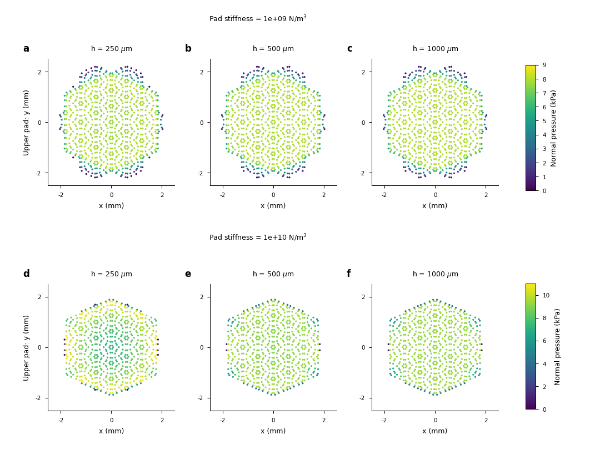

# Physical pressure with local and coupled compliance

The eight-case CPU study now predicts pressure and support using the declared
pad law and measured elastic operators. A rigid-gap model is close for the
original10GPa link/1e9N/m3 pad, but its pressure error reaches24.47% for a1GPa
link/1e10N/m3 pad. A diagonal compliance approximation barely improves that case.
The useful next integration therefore needs both an inexpensive validated regime
and a route that retains regional elastic coupling when it matters.

This is a static normal, coarse linear-elastic study on the full hollow egg,
initially with500um walls and now with250/1000um thickness controls. It extends the [first geometric study](AUTOMATIC_CONTACT_PROGRESS_20261020.md)
and [resolved-pressure transfer](RESOLVED_PAD_AND_SOURCE_INPUTS_20261020.md).
It does not supply moving/friction validation, spatial convergence or an
automatic production model. The [extended goal](AUTOMATIC_CONTACT_AND_THROUGHPUT_GOAL_20261020.md)
remains active.

## Model contrast and numerical checks

One full elastic factor and the existing834-node contact compliance are reused.
All six free-link rigid modes are retained through mass projection and gauge
alignment; there are no physical pins. Coupled compliance includes interactions
between opposite pads and surface regions. Rigid and diagonal models solve their
own approximate pad laws. Their residual against full elasticity is measured
separately and must not be interpreted as an admitted full physical solution.
The asymmetric case declares a smooth physical stiffness factor
`1+0.5*tanh(x/1mm)` on the pads, rather than a numerical contact penalty.

The48 saved fields cover eight cases, three models and centroid/degree6 contact
quadrature. All declared-model force/moment, pad-law, equilibrium and balance
checks pass. The coupled full-elastic pad-law residual stays below2.75e-9.
Independent full-elastic fixed-point pressure agrees with the condensed solution
to4.69e-11 in nodal force; splitting every source into two half-area samples
changes nodal force by1.54e-11. The original cached nominal complete stress is
reproduced within5.69e-13.

A separate actual search control starts at1mm. All three models detect omitted
compression (about21um) using exact quadratic minima on omitted boundary faces,
then expand to3mm and pass containment. The search extent is numerical and does
not prescribe the pressure-bearing support. The eight primary cases all fit
inside the3mm search. Smaller footprints are not artificially expanded.

The [terminal packet](../evidence/20261019-qualified-ranking/pad-compliance-study-v1/README.md) retains actual sources, full controls,
[32 model-error rows](../evidence/20261019-qualified-ranking/pad-compliance-study-v1/meta/pad-compliance-model-errors-v1.csv),
24 separate quadrature comparisons and externally hashed fields.

## Errors against coupled pressure at degree6 quadrature

Each entry is pressure area-weighted L2 error / complete stress physical-volume
L2 error. Values compare models at the same quadrature and mesh, with coupled
pressure as the declared discrete physical solution; they are not continuum
stress errors.

| Link E (GPa) | Pad stiffness (N/m3) | Load (N) | Pad | Rigid pressure / stress | Diagonal pressure / stress |
| ---: | ---: | ---: | --- | ---: | ---: |
| 10 | 1e+09 | 0.1 | Uniform | 0.355% / 0.104% | 0.347% / 0.102% |
| 10 | 1e+08 | 0.1 | Uniform | 0.054% / 0.020% | 0.053% / 0.019% |
| 10 | 1e+10 | 0.1 | Uniform | 2.694% / 0.696% | 2.636% / 0.681% |
| 1 | 1e+08 | 0.1 | Uniform | 0.536% / 0.197% | 0.528% / 0.194% |
| 1 | 1e+09 | 0.1 | Uniform | 3.525% / 1.040% | 3.448% / 1.018% |
| 1 | 1e+10 | 0.1 | Uniform | 24.472% / 6.684% | 23.914% / 6.535% |
| 10 | 1e+09 | 0.3 | Uniform | 0.446% / 0.147% | 0.437% / 0.144% |
| 1 | 1e+09 | 0.1 | Gradient | 3.523% / 1.113% | 3.426% / 1.078% |

For the nominal case, both rigid and coupled models identify the same sampled
upper/lower areas,14.098/15.704mm2, but their pressure fields still differ.
For the flexible-link/stiff-pad case, upper support areas differ by less than1%
(11.295 versus11.379mm2), while the two-sided pressure error is24.47%. A correct
radius or area alone therefore cannot establish a correct pressure field.
The coupled upper peak is11.702kPa versus9.303kPa for the rigid predictor.
The inherited distribution key `maximum_cell_average_pressure_pa` stores
quadrature-point law pressure in these study records; the separate quadrature
comparison explicitly integrates actual face-average pressures.
In the gradient-pad case, the coupled force centroid moves0.3395mm in x;
the rigid estimate is0.3488mm. The complete records retain both sides and axes.

The upper row shows close nominal pressure patterns. The lower row shows the
coupled flexible-link/stiff-pad pressure concentrating toward the finite-land
edge; the diagonal model stays close to the rigid prediction. Each row shares
a kPa scale, all panels use common physical coordinates, and every positive
quadrature pressure is shown without smoothing or clipping. The complete lower
pad, tensors and errors remain in the saved data. The183×142mm SVG/PDF/600dpi PNG
and150dpi preview pass direct visual review and text/size/font checks.

## Sampling and cost limits that affect the next implementation

Changing centroid to degree6 source quadrature changes the coupled complete
stress by1.94–2.82% across the eight cases. The nominal change is2.677%, much
larger than its0.104% rigid-versus-coupled model difference. Face-average pressure
changes range3.74–10.44%; these compare integrated cell averages, not unmatched
point samples. Source sampling must therefore be controlled independently of
pressure-model selection. Neither quadrature alone establishes spatial convergence.

The reused834×834 operator occupies5,564,448 bytes. Its original construction
cost is not remeasured here. The new full elastic factor setup takes46.78s.
Exploratory degree6 contact calls take about0.009s for rigid equilibrium,
0.165–0.202s for diagonal compliance and23.64–25.65s for the selected coupled
cases. These single-process research call measurements include current CPU
solver work, have no independent timing repeats and are not production rates.
The diagonal model pays substantial extra work for little measured accuracy gain.

The coupled solve and thickness contrast have now been checked below. Extend the
physical study to changing nonconvex/asymmetric geometry and
friction/unloading. Then integrate the useful model into the existing native
Quadrants feature, preserving supported batching, output, isolation and resets,
and measure paired module/scene costs including prediction. No Gaussian radius
fit or loose solver tolerance replaces these checks.

## Exact pad elimination and inner/outer solver accuracy

The [completed reduced-solve packet](../evidence/20261019-qualified-ranking/reduced-pad-equilibrium-v1/README.md)
retains48 new fields: direct reduced Newton, fixed-PCG Newton and an adaptive-PCG
control each replay the16 coupled cases above. It reuses the original16 coupled
reference fields and changes only the numerical formulation. Eliminating each
independent compression-only pad spring analytically leaves a piecewise
quadratic energy in the834 elastic coordinates and four free plate/link
coordinates. At degree6 quadrature, this reduces5446 unknowns to838. Regional
elastic coupling, free-link balance and the physical pad law are preserved.

The direct solve differs from the original coupled reference by at most
1.51e-10 in complete stress and2.28e-10 in area-weighted pressure. Full elastic
pad-law, force/moment, equilibrium and exact omitted-face checks retain their
original limits. Independent remeasurement bounds both PCG variants' complete
stress differences from direct Newton by8.21e-12 and their raw tensile/von-Mises
peak differences by1.17e-11. These are implementation checks on the same
discrete physical problem, not new continuum errors or ranks.

Three paired calls per case on one allocated CPU core on `rtx-209-099` give:

| Degree6 case | Full QP median (s) | Reduced Newton including cold initialization (s) | Ratio |
| --- | ---: | ---: | ---: |
| Nominal10GPa link /1e9N/m3 pad | 23.467 | 0.0600 | 391 |
| Flexible1GPa link /1e10N/m3 pad | 23.638 | 0.0924 | 256 |
| Gradient pad /1GPa link | 24.583 | 0.0929 | 265 |

Both paths reuse the saved elastic compliance. Reduced Newton also caches its
factor and quadrature map. Actual factor/map rebuilds take0.014–0.021s at
centroid quadrature and0.083–0.090s at degree6; the independent full FEM setup
takes43.71s in this process. Stored compliance, its factor and the mapped factor
together occupy13,690,944/41,873,472 bytes at the two quadratures. Those counts
exclude interpolation, solve workspace and full FEM storage. The captured
direct-v1 metadata repeats the last setup duration on reused cases; only
cases0,3,6,7 at each quadrature are actual rebuilds. Later workers record zero
on reuse. The paired calls are repetitions inside one process, not independent
process samples, native throughput or end-to-end scene rates.

PCG is an inner linear solve. Inexact Newton controls that solve through a
relative linear-residual forcing term while separately checking the nonlinear
residual; see [Eisenstat and Walker](https://epubs.siam.org/doi/10.1137/0917003).
Here every variant keeps the dimensionless outer gradient target1e-10,
independent pad-law target1e-7 and force/moment target1e-8. Fixed inner1e-6
therefore does not impose a1e-6 final nonlinear residual. The tested adaptive
rule is explicitly `min(0.1, sqrt(current_gradient_norm))`, not the paper's
Eisenstat-Walker update.

| Solver, over16 fields | Newton updates | Total PCG iterations |
| --- | ---: | ---: |
| Direct reduced Newton | 24 | — |
| Fixed inner1e-6 PCG | 36 | 268 |
| Tested adaptive PCG | 74 | 304 |

All pass the same final checks. The tested looser early solves increase total
iterations and supply no reason to change a default; cross-job PCG wall times
are not a paired speed experiment. No production tolerance is changed.
This keeps numerical convergence distinct from load-model discrepancy and
physical stress accuracy.

Each solver also passes four prescribed normal load/upper-gap tilt states,
including loading and unloading, against the full QP. Previous pressure is only
an initial guess; cold/warm results agree, and return to the original load/gap
recovers pressure within1.75e-11. These controls use a fixed candidate region.
They do not establish general moving/nonconvex search, tangential history
or automatic native integration. Those remain physical and production work.

## Physical thickness controls

Two new meshes retain the original outer vertices/faces and wall layer count,
but change the actual inward offset to250um and1000um. Each rebuilds mass,
stiffness and the full834-node normal compliance with the same free-link
projection and gauge. The24 new rigid/diagonal/coupled fields cover both pad
stiffnesses at centroid/degree6 quadrature. All own-model pad-law, force/moment,
complete elasticity and exact omitted-face compression checks pass.

At10GPa and0.1N, the degree6 rigid-versus-coupled errors are:

| Wall thickness (um) | Pad stiffness (N/m3) | Pressure L2 error | Complete stress L2 error |
| ---: | ---: | ---: | ---: |
| 250 | 1e9 | 2.095% | 0.851% |
| 500 | 1e9 | 0.355% | 0.104% |
| 1000 | 1e9 | 0.0656% | 0.0142% |
| 250 | 1e10 | 15.515% | 5.624% |
| 500 | 1e10 | 2.694% | 0.696% |
| 1000 | 1e10 | 0.489% | 0.0965% |

Each error compares models on its own physical thickness; fields on different
domains are not subtracted. The diagonal250um/hard-pad result remains close to
rigid, with15.183% pressure and5.507% stress errors. The maximum displacement
gradient across these six coupled cases is5.53e-4. This supports the small-strain
scope but does not establish spatial convergence or a universal model-selection
threshold.

The thin wall concentrates hard-pad pressure toward the finite-land edge;
the soft-pad row changes less. Each row shares a kPa scale and every positive
degree6 quadrature pressure is shown without smoothing or clipping. The gaps
between samples are quadrature spacing. The183×142mm editable SVG and preview
were inspected before final PDF/600dpi PNG export; final SVG/preview bytes match
the inspected draft. PDF page size and embedded fonts were checked, without
claiming a separate PDF-render inspection.

Source sampling remains a separate error: centroid-to-degree6 coupled stress
changes are2.84%/2.41% at250um and3.07%/2.88% at1000um for the soft/hard pads.
Corresponding integrated face-average pressure changes are9.89%/7.51% and
9.59%/5.06%. These are sampling contrasts on fixed meshes, not pressure-model
errors or continuum bounds.

## Quadrants pressure stage and independent full fields

The reduced Newton solve now runs entirely in Quadrants: batched gradients,
matrix-free Hessian products, diagonal-preconditioned CG and line search.
It retains the outer gradient target1e-10, inner relative PCG target1e-6
and separate physical admission. No per-environment dense Hessian is stored.
The initial elastic coordinates are zero; cold initialization uses only the
separately solved rigid-pad pose, not the coupled reference solution.

CPU/GPU tests cover48 pressure cases across the three physical thicknesses,
two source quadratures andB8/B2 batches. Independent full-C pad-law residuals
are at most7.87e-12, with force/moment errors below1e-8. Unchanged warm requests
take zero Newton updates and preserve pressure exactly. Separated zero-load
release, invalid-spring failure isolation and selected-environment recovery
all pass exactly.

The actual native forces then drive48 independent complete elastic solves.
The largest complete stress and raw peak differences from the corresponding
full-QP references are1.50e-10 and2.26e-10; CPU/GPU normalized-force differences
are below2.02e-15. These establish numerical conformance for supplied operators
and inputs. The [terminal packet](../evidence/20261019-qualified-ranking/native-pad-pressure-and-thickness-v1/README.md)
retains the thickness fields, sampling controls, inspected maps, captured
workers and final-source equivalence checks.

That first pressure-stage packet supplies CPU geometry, compliance/factors and
cold rigid guesses. The following component checks remove two of those supplied
inputs and independently validate native compliance construction on a small mesh.

## Native preparation components

`NativePadCompliance` now uses the existing native elastic factor to solve
balanced unit loads in supplied nodal directions. It then removes rigid
displacement using the consistent mass gauge before extracting the contact
compliance. Four CPU/GPU controls on a compact two-tetrahedron mesh include
six arbitrary directions, translated/rotated geometry and a change from10GPa
to2GPa. Relative compliance error against independent complete FEM is at most
4.16e-14; the frame/material scaling error stays below1.44e-14. These controls
verify the numerical operator, not large-mesh preparation cost.

`NativePadBasis` factors compliance and assembles the sparse work-conjugate map
in Quadrants. The original834-node matrices for all three thicknesses reproduce
their independent elastic maps within1.88e-14. Native opposing-pad cold starts
put both candidate regions in compression, with zero elastic coordinates;
they use no CPU rigid-equilibrium solve. All48 pressure cases pass the same
outer1e-10, pad-law1e-7 and wrench1e-8 targets, with measured full-C pad-law
residuals below3.75e-13. Warm repeat, separated release, failure isolation and
partial recovery remain exact. For the original eight cases, this conservative
cold start takes4–7 Newton updates, versus2–3 with supplied rigid guesses.
Include that extra solve work when measuring end-to-end cost.

All48 actual pressures from this preparation variant also pass independent
complete elastic reconstruction. Maximum complete stress and raw peak relative
differences from the full-QP references are1.51e-10 and2.31e-10; CPU/GPU force
differences stay below1.08e-14. The
[native-preparation packet](../evidence/20261019-qualified-ranking/native-pad-preparation-v1/README.md)
retains these fields, operator controls and the exact captured sources.

The large physical834-node compliances and geometry interpolation remain supplied
validation inputs. Compact native condensation and the large mapped-pressure
checks are distinct controls, not one demonstrated large-mesh preparation chain.
This research core is not a public automatic contact model. Native current-geometry
production, physical region grouping, moving/nonconvex and friction history,
the small public material/pad configuration and production lifecycle integration
remain required. Current call times include compilation and research checks;
they establish no controlled native throughput. Measure module and actual-scene
costs, including prediction/preprocessing, after those components are connected.

## Current opposing-geometry component

`StressPairGeometry` groups the observed link's sources by opposing rigid link,
so two collision geoms on one link do not become two independent pressure
models. It sums complete forces and moments, including supplied free moments,
in the observed material frame. Invalid source provenance excludes that
environment and remains visible; valid environments retain their complete loads.
Splitting a source into coincident half loads leaves the pair wrench unchanged.

The native query reads current geom poses and returns nearest opposing points,
signed gaps, material-frame normals, relative point velocities and projected
quadrature areas. It handles planes, boxes, spheres, capsules, cylinders and
triangle meshes. Material-boundary intersection tests identify self-occlusion;
back-facing, ambiguous and unsupported queries have zero candidate area.
The geometric gap is not interpreted as physical pad indentation.

Four controls pass on each of CPU and GPU: primitive/mesh distance and live rigid transforms,
U-shaped and cavity nearest-boundary queries, material occlusion with
selected-environment motion/velocity/reset, and split-source grouping with
invalid-source isolation. Distances and velocities use absolute tolerances
of1e-12; split-source force and moment use1e-14N and1e-16Nm.
The [geometry packet](../evidence/20261019-qualified-ranking/native-pair-geometry-v1/README.md)
retains each test outcome, execution identity and source. The earlier unsupported
Mesh option and nonexistent velocity-setter test setup failures remain retained.

This component is not connected to the pressure solver or public recovery
lifecycle. It reports the nearest boundary: an occluded nearest component can
hide a farther accessible component, so these outputs do not establish complete
physical support. Composite interior distances remain ambiguous; ellipsoid
and terrain queries are unsupported. Moving pressure, friction history,
current-geometry elastic maps and controlled production cost remain unverified.
The next integration must resolve accessible support and feed the coupled
pressure stage before a public automatic configuration can be admitted.
