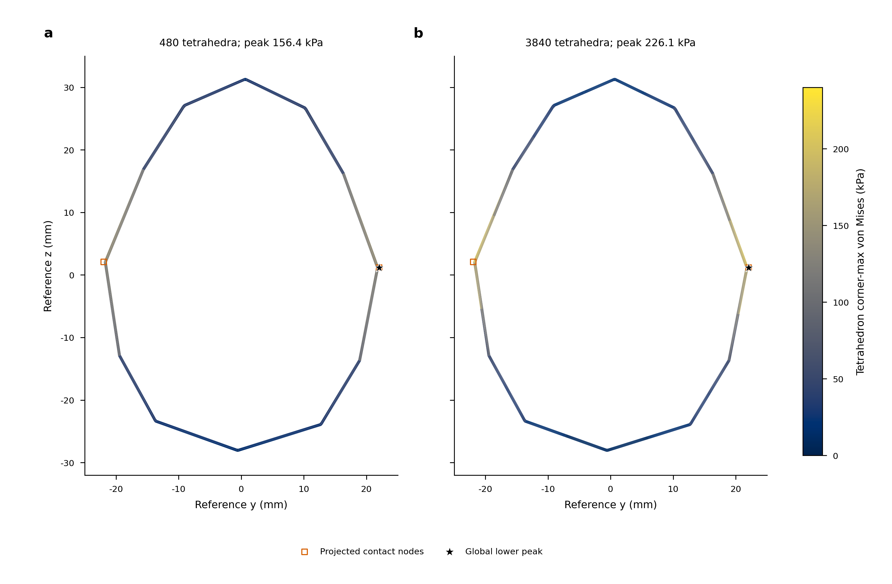

# Actual articulated inputs, physical inertia and common spatial probes

This checkpoint retains the complete scope of
[LOAD_MODEL_PHYSICAL_VALIDATION.md](LOAD_MODEL_PHYSICAL_VALIDATION.md).
Full solved deformable application matching and physical accuracy/cost are
unfinished. Completed input/observer/equation checks are distinguished from
contact/stress convergence and live experiments.

## Common material-point comparison

`compare_spatial_franka.py` selects five interior material points in each seed
tetrahedron,2400 points total, and compares exact common physical times. Seed
volume weights define a discrete diagnostic; they are not an exact continuum
stress norm. Affine P2 displacement gradients are reconstructed at the same
points before nonlinear Cauchy stress evaluation. Each solution's proper finite
body rotation transforms its tensor into the corresponding material frame.
Objective displacement, velocity, energy and separate contact force/moment
resultants are also compared. Original nonlinear raw-corner lower peaks and
whole-volume upper bounds remain separately reported.

First attempt714509 fails because scalar `Basis.probes` expects coordinates
as columns. The corrected control714510 completes. Its independent quadratic
polynomial displacement error is2.338e-19m; tensor error is3.558e-6Pa.
A0.7rad finite rotation gives0.001019Pa maximum tensor discrepancy on the
manufactured field, within the declared relative/absolute check.

Two equation- and array-identical480-tet cold runs give exactly zero changes
for all measured fields, wrenches and energy at10 common times from0.01 to0.1s.
This checks comparison semantics; it is not spatial convergence. The actual
3840-tet run714449_1 subsequently completes all64 cold control targets and80
dynamic steps. Maximum complete mapped/body residuals are3.679e-10/3.650e-10N
at the unchanged1e-9N budgets. Whole-volume determinant lower bound is0.9999824.
The original30720-tet sparse study714462_1 remains live.

Comparison714518 fails at child-interface point location. Prime-radical
barycentric probe coordinates avoid rational planes of nested midpoint
refinement, independently of field values. They are fixed once on the seed
mesh; all2400 points must have barycentric margin above1e-8 in every case.
Attempts714646/714652 then fail the original finite-rotation component check.
Extended-precision barycentric gradient contraction removes translation
cancellation, and stable manufactured rotation encoding at exact affine-P2
vertex/edge locations removes input-coordinate cancellation. No component
threshold, solve tolerance, material, geometry or loading parameter is relaxed.
All three failed attempts remain archived.

Comparison714664 completes the new same-constructor control and actual spatial
comparison. Coarse/fine polynomial tensor errors are3.040e-6/2.947e-6Pa;
finite-rotation maximum component differences are0.000188/0.000763Pa, within
the original componentwise relative/absolute gates. The repeated480-tet
constructor comparison remains exactly zero at the new fixed probes.

| Common-time observable |480 to3840 tetrahedra relative change |
|---|---:|
| Full objective tensor |56.2224%|
| Von Mises probes |34.5606%|
| Objective displacement |36.3022%|
| Body elastic energy |35.1552%|
| Velocity |0.001157%|
| Per-body/finger contact force resultants |0.007130%|
| Per-body/finger contact moments |0.004477%|
| Final raw nonlinear lower peak |30.8126%|

Coarse lower/upper peaks are156447.016857/156447.017184Pa; finer peaks are
226120.525349/226120.525677Pa. Both lower peaks occur at the same reference
vertex `[1.769745e-6,0.022028915,0.001184687]` m. Two levels do not establish
boundedness or diagnose a singularity. Nearly unchanged aggregate wrench does
not establish stable interior stress. The fixed-contact volume diagnostic
separates its two changed discretization axes; a third useful level and physical
contact/geometry tails remain required.

[Editable SVG](figures/franka-first-spatial.svg) and [PDF](figures/franka-first-spatial.pdf)
retain the same183x120mm layout and shared scale. Each intersected tetrahedron
is colored by its original unaveraged four-corner von Mises maximum, an element
envelope rather than interpolated cut-plane stress. Reference geometry is
undeformed; the data comes from the full3D0.1s solved state. Squares project
all body contact nodes with force norm above1e-8N; stars mark the global lower
peak. Both final states have two such active body nodes. This count motivates
contact-discretization studies; it alone proves neither a singularity nor
contact convergence. Strongest field changes occur near contact, while polar
regions remain lower. These matched maps support the measured unresolved
spatial sensitivity despite stable resultants, not a physical-accuracy claim.
Rendered QA verifies readable text, editability,450dpi output and physical size.

## Full original arm and finger controls at three contact settings

Captures714514_0/1/2 complete the full original approach/grip/lift and stationary
hold at0.3125ms integration interval. Contact time constants are2.5,1.25 and
0.625ms. All seven arm PD joints, both fingers and the original joint equality
remain dynamic. Every case retains576 same-substep geometry/force/pose frames
and joint mass readouts, hand/finger Jacobians, velocity and actual control
position/velocity/mode/force fields. The final320 frames span0.1s without
interpolation. Saved initial conditions, gains, armatures, damping and source
contact identities are unchanged across the three settings.

Actual joint equality parameters are
`[0.005,1,0.95,0.99,0.001,0.5,2]`, with runtime joint objects8/9 and the captured
identity polynomial. These replace no constraints in the full application.

| Contact time constant | Final normal force, contacts16/23 (N) | Final raw penetration16/23 (um) |
|---|---:|---:|
|2.5ms|0.395431 /0.395333|42.90497 /42.89439|
|1.25ms|0.398716 /0.398618|10.83817 /10.83550|
|0.625ms|0.399607 /0.399509|2.715959 /2.715293|

Common-time normal-force changes decrease from0.82393% to0.22287%; maximum
sampled absolute changes are0.003285N and0.000891N. This is a three-level rigid
contact-law force tail at fixed physical controls. It does not establish patch
pressure/shear, nonlinear stress, temporal/spatial/history convergence or
deformable feedback accuracy. Finest overlap is about0.543% of wall thickness.

## Working mass is separated from physical inertia

Original articulated audit714519 is terminalCOMPLETED, but its near-stationary
energy check cannot establish physical mass. Motion-frame inspection reveals
the default `approximate_implicitfast` integrator stores a working mass matrix
with a diagonal damping term. Calling `get_mass_mat` during the observer does
not remove this term. The archived original data and audit are retained.

The captured source's forward-dynamics assembly gives

`M_physical = M_readout - dt*diag(passive_damping + kv*controlled_mask)`.

Control modes0/1 are position/velocity control; force mode2 has no velocity-gain
correction. Physical rotor armature remains in the matrix. The correction is
applied locally to copied readouts; the solver's matrix and dynamics are unchanged.

Corrected audit714523 checks physical kinetic energy on all576 motion/hold
frames per setting. Uncorrected working-matrix errors reach0.0018334J.
Corrected maximum errors are1.041e-17/1.041e-17/6.939e-18J. The held-tail physical
mass matrices are positive definite; their smallest recorded-coordinate
eigenvalues are0.106496. These mixed rotational/prismatic coordinates do not
give one shared physical unit to all eigenvalues. Hand Jacobian/velocity
discrepancies remain below8.624e-25 in the recorded coordinates. Finger slide
columns and zero opposite-finger/hand slide columns pass their original checks.

Fresh capture714524 explicitly saves physical and working matrices, correction
vectors and generalized bias/applied/passive/constraint efforts. Runtime
integrator is recorded as `integrator.approximate_implicitfast`. Every captured
physical-mass energy check passes. Its576 saved rows and12672 common original
npy geometry/operator payloads are byte-identical to the earlier finest case;
new readouts therefore do not perturb the measured dynamics in this protocol.
NPZ container metadata is excluded from this array-payload check.

Contact-point Jacobians also map the actual reactions to seven joint torques
and two finger forces. Actuator-only static hand displacement estimates are
about7.69um, with rotation about1.38e-5rad. They omit equality/contact constraint
compliance, gravity/follower-force derivatives and actuation clipping. They
are support diagnostics, not observed hand displacement or a solved articulated
deformable reference. Tiny stationary hand speed does not prove infinite
support stiffness; the complete matching requirement remains active.

## Fixed contact triangles isolate a volume-discretization diagnostic

`frozen_franka_contact.py` retains all seed contact triangles at the same
physical nodes while refining the body volume. A nearest-coordinate and full
triangle-position guard binds the seed points in the nested P2 grid. Actual
finger geometry, material, mass, actuation, gravity, friction and original
64-target/80-step history remain fixed. An isolated copied-source runner uses
the already qualified sparse inertia constructor and preserves separate input
and executable before/after hashes. Canonical live reference sources stay fixed.

Coarse control714531 completes at the original force budgets. Every npy payload
in all83 original matched NPZ archives is byte-identical to the unmodified cold
case, including complete geometry and80 dynamic field states. The3840-tet
volume-only diagnostic714550 is running separately. Fixed contact quadrature can
retain point-supported traction concentration; its raw peak is not assumed
bounded. This diagnostic does not establish a converged contact discretization.
The original joint volume/contact refinement is retained as its own axis.

## Reproduction and unchanged completion criteria

Use `compare_spatial_franka.sh` with closed cold runs, and
`capture_franka_reference.sh --substeps 32 --dense-hold-tail-steps 10
--capture-articulated-operators` with the declared contact time constant.
`audit_franka_articulation.sh` independently checks the saved operators and
source histories. `run_frozen_contact_franka.sh` executes the isolated fixed
contact-triangle volume diagnostic. Exact Slurm commands, original failures,
snapshots, package/hardware records and source identities are published together.

The full egg continuation714503 and third-level U714003_0 remain on their
original live handles. Complete resolved contact spatial/quadrature/
regularization/history tails, actual full-arm deformable matching, per-island
load-model/feedback comparisons, matched stress/traction maps and verified
physical accuracy/cost remain required. This checkpoint closes none of those
requirements by substituting the input/observer checks above.

The immutable `articulated-spatial-checkpoint-v1` manifest retains7576 complete
original entries, with zero prefix-only checks. Manifest SHA-256:
`ddbfa5576a49c856406f05846ad7218fa2572f35cc844c603bda37cd83b3d034`.
Its verifier proves exact publication identity; the original failed probe call
and the original insufficient physical-mass interpretation remain explicit.
Live experiments are excluded from the archive. Earlier checkpoint statuses
do not override subsequent authoritative Slurm completion/failure records.

`franka-first-spatial-checkpoint-v1` retains174 complete originals, including
the full3840-tet solve and three failed postprocessors. Manifest SHA-256:
`3a3412c19e323d51e99b8647316cb81d7b5dd04499beab918a7cd3d1c9c91df3`.
`franka-spatial-comparison-checkpoint-v1` retains55 complete originals for the
successful new-probe qualification/control/comparison. Manifest SHA-256:
`2293694cffc85f40b55082613ded0dca1476b16815ca917e334da02880969cef`.
Both verify complete original bytes with zero prefix-only checks. Their
publication-time "running" notes are historical observations.

`franka-spatial-figure-checkpoint-v1` retains63 complete originals for all
render attempts, corrected final size, inspected previews and actual IPC API
documentation. Manifest SHA-256:
`63c0b8e1eb67ec0f35f65bee015ee5690926eb6c5be1665d53d5edcd432458c7`.
The actual `CollisionMesh` constructor documents a displacement map and gradient/
Hessian pullbacks to full degrees of freedom. This enables a separate contact-
quadrature implementation, but its interpolation and variational consistency
must be qualified before using it as contact convergence evidence.
