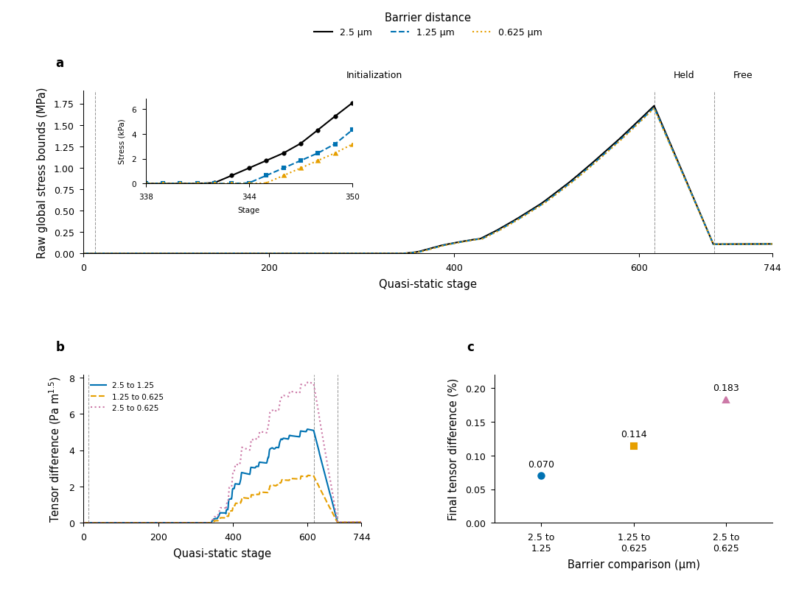

# Complete barrier histories and the five-level thickness comparison

The [complete physical-validation objective](LOAD_MODEL_PHYSICAL_VALIDATION.md)
remains active. Three U barrier distances now have independent current-friction,
original-force and full-field audits at all744 corresponding stages. Final
tensor differences are small, while initialization has substantially larger
absolute differences and raw maxima. The six-layer egg solve also completes;
its last tensor changes remain3.30–4.68%. Neither result establishes the required
physical convergence or verified accuracy/cost operating range.

## All744 stages remain independently balanced at every barrier distance

Producers718718/718720 and independent auditors718719/718721 complete at actual
wrapper0 with unchanged copied/input-source identities. They retain the original
845-tet body, pad5 geometry, material, mass,0.05N per shoe, gravity, friction0.8,
original initialization coordinates and1e-8m tangential mollifier per stage.
All12 approach,604 contact-initialization,64 held-force and64 free-body stages
are fixed. Barrier distance alone changes from2.5 to1.25 and0.625µm. These are
quasi-static loading stages, not physical time samples.

|Barrier distance|Maximum independent constrained residual|Final independent body residual|Final original-map residual|
|---|---:|---:|---:|
|2.5µm|9.550504e-10N|3.101533e-10N|4.796677e-10N|
|1.25µm|9.896307e-10N|3.285458e-10N|5.034417e-10N|
|0.625µm|9.931454e-10N|2.161345e-10N|3.327155e-10N|

Every original1e-9N gate passes. Individual current normal/friction stencils,
all-part nonlinear forces, complete corner/quadrature tensors and raw whole-body
bounds remain retained. Maximum independent contact-force reconstruction
difference in each new audit is5.551115e-17N. Each shoe's force and current-COM
moment is retained; these source identities are not continuum contact islands.
Different barrier problems are compared without claiming identical solutions.

## Full-path sensitivity differs from final-state sensitivity

Comparison718883 completes all744 stages at all three distances. Proper finite
material frames remove rigid pose from tensor comparisons. The unchanged
positive reference quadrature weights define the volume-weighted norm; this is
not an exact nonlinear continuum integral. Final relative changes below use the
finer member's norm, unlike the separate qualification audits' baseline-normalized
final differences. Absolute values and denominators remain explicit.

|Barrier comparison|Final tensor relative L2|Maximum absolute tensor L2 over744 stages|Stage of that absolute maximum|
|---|---:|---:|---:|
|2.5→1.25µm|0.0699867%|5.151377Pa·m^1.5|599|
|1.25→0.625µm|0.1138120%|2.612841Pa·m^1.5|601|
|2.5→0.625µm|0.1828867%|7.757819Pa·m^1.5|601|

All three absolute maxima occur during contact initialization. At the final
free-body state, corresponding absolute tensor differences are0.0208763,
0.0339477 and0.0545512Pa·m^1.5. Objective displacement mass-RMS differences are
3.154309e-11,3.851572e-11 and6.958885e-11m. Per-stage nonlinear body energies
and material-frame normal/shear source forces and moments are retained.

Activation stages have large relative quotients against small nonzero reference
norms: the largest quotient is29.8262 for the full span at stage345. The complete
absolute difference there is0.172627Pa·m^1.5, with finer norm0.00578777Pa·m^1.5.
For near-zero references, the declared1e-3Pa stress scale identifies ill-conditioned
relative denominators; the relative field alone is null, while every absolute
difference, original field and raw maximum remains. All12 approach stages have
zero stress/difference. No stage, component or raw extremum is removed.

|Barrier distance|Raw maximum interval over all744 stages|Stage|Final raw maximum interval|
|---|---:|---:|---:|
|2.5µm|[1724286.867717,1724488.986490]Pa|616|[112413.887876,112414.743121]Pa|
|1.25µm|[1704537.677459,1704735.190840]Pa|616|[112413.688763,112414.544004]Pa|
|0.625µm|[1694547.249109,1694742.452937]Pa|616|[112412.113282,112412.968497]Pa|

These are bounds on the computed unsmoothed nonlinear field, not statistical
confidence intervals or bounds on continuum/model error. The larger history
maxima belong to the temporary held initialization before force control; they
are not quietly replaced by final-state peaks or interpreted as physical-time
application maxima. Small final changes do not summarize this full path.
The final adjacent tensor change rises under halving distance. Fourth-distance
producer718912, independent audit718913 and four-level comparison718914 therefore
test0.3125µm with every other original control unchanged. They remain unaccepted
while running/pending; neither three levels nor a small scalar peak closes a tail.

The [editable SVG](figures/u-barrier-history-20261015/u_barrier_history.svg),
[embedded-font PDF](figures/u-barrier-history-20261015/u_barrier_history.pdf),
1000dpi PNG, exact744-row CSV, claim/panel contract, caption, body interpretation
and accessibility description remain together in the [figure deliverables](figures/u-barrier-history-20261015/README.md).
RGB/grayscale previews and all65 editable text elements pass rendered/source QA.
PDF font streams are decoded and checked as actual embedded TrueType subsets.
The first missing-font attempt and the subsequent source-QA rejection retain
their real code1 and frozen sources. Accepted source718936 and export718948
retain code0 and identical accepted SVG/source-data hashes. No plot is smoothed
or downsampled. The full-path large raw extrema remain visible.

The distinct common-initialization coarse control718746 also completes.
Independent audits718747/718833 check all744 stages, actual requested coordinate
anchors and final consistent-mass gravity/uniform shoe actuation. Its final
tensor difference from the old coordinates is0.00565248%, normalized by the old
case's volume norm; raw interval is[112413.292553,112414.147787]Pa. This small
coarse-control difference does not establish how coordinate selection affects
the finer meshes. The qualified shared-anchor2339/5669-tet, fixed-pad5 producers
718834/718836 have now started; their full stage audits and strict75-probe
comparison remain outstanding. Original differently initialized results remain.

## Six layers do not resolve the original thickness tensor criterion

Six-layer producer716836 completes all five prescribed-traction cases on602676
tetrahedra. Comparison716837 independently checks fixed actual boundaries,
volume, mass and traction samples across2/3/4/5/6 layers and retains all25
complete saved fields. All36 original probes and global raw maxima remain.

|Case|5→6 full tensor change|5→6 von Mises change|5→6 raw peak change|5→6 energy change|
|---|---:|---:|---:|---:|
|Opposing|3.529210%|1.409404%|0.003933%|0.003094%|
|Bending|3.927925%|1.334981%|0.165354%|0.003091%|
|Asymmetric|3.640431%|3.054341%|0.037436%|0.003106%|
|Near slip|4.682601%|1.817683%|0.036063%|0.003056%|
|Multiple|3.298746%|1.370649%|0.004418%|0.002823%|

Every case still fails the original3% full-observable diagnostic. Most tensor
changes grow rather than shrink from the previous4→5 pair. The thickness
direction alone has not resolved the discrepancy. The separate fixed-domain,
frozen-traction local bulk studies remain necessary and are not accepted here.

The original archive comparator explicitly reads producer-recorded complete
residual fractions. It reconstructs saved corner von Mises, raw extrema and work
identities, but does not reassemble stiffness/mass. Fresh auditor718858 now
completes at actual wrapper0 with closed copied/input sources. It independently
reassembles stiffness, consistent mass and inertia relief for all five levels,
then checks all25 linear FEM fields at their original complete force budgets,
corner tensors, quadrature gradients, all original probes, energy and peak
locations without repeating the solves.

The maximum fresh complete residual is4.493998e-12N; the largest fraction of an
original complete budget is0.0422775. All reconstructed corner tensor arrays
are bit-identical to their saved counterparts. The largest difference between
direct quadrature-gradient stress and interpolation of the complete saved
affine corner field is1.019071e-7Pa. These checks add fresh assembly evidence;
they do not change the original3.30–4.68% tensor tail or relax any physical gate.

Separately, the171228-tet covered CAD contact reference717975 ends FAILED with
actual wrapper1 after2h55m57s. All64 original held initialization increments
complete; the final held residual is1.635652e-11N. The first dynamic reduced
Newton factorization then raises MemoryError. The saved closure, geometry/maps,
all source identities and sparse factor/linear histories remain intact, with
no accepted dynamic-state files. Unstarted success-only auditors717976/717977
are cancelled after preserving their pending/accounting records. The cause
beyond the observed factorization failure is not established here, and no
memory/ordering remedy or fine physical convergence is inferred.

## Evidence and remaining objective

The [fixed-history barrier packet](../evidence/20261014-physical/fixed-history-barrier-v1/manifest.json)
passes archive/source and actual-original verification:6234 archive entries,
3230 actual runtime originals, no sharded originals; manifest SHA256
`9a2d395f263d86385c955e9e6c1be99762b1d0cbec2a02c9fae31b0b6b9634d6`.
Its baseline [recorded-history parent](../evidence/20261014-physical/recorded-contact-history-v1/manifest.json)
is fully reverified at SHA256
`7f9accb7d15815fd1e73614c43e456071668a19cf0fe7d23494a0f66d9674e87`;
referenced actual parent input hashes are rechecked rather than duplicating
their original fields. Archive counts are provenance entries, not experiments.

The [figure/source-QA packet](../evidence/20261014-physical/barrier-history-figures-v1/manifest.json)
verifies132 archive entries and132 actual runtime originals, including the real
font/rendering failures and accepted exports; manifest SHA256
`d6bab6c0c21f58820117d968bf2493196b0a81307b51b6fdf686c7b9bf03a266`.

The [five-level thickness packet](../evidence/20261014-physical/five-level-thickness-v2/manifest.json)
verifies275 archive entries,220 actual originals and10 exactly reconstructed
large fields; manifest SHA256
`c7b35308cbb0dcb776cb120b6ea8465805251b038249f068b40e624f5b53a2c8`.
It includes all new five/six-layer originals and the complete25-field fresh
audit, referencing the fully reverified older15-field parent at SHA256
`915665a4ada17beb8ef5d4d21b678e8de4b2e5f5086a44440cc0d68228b3de52`.
The unselected first publication redundantly included the same ten large raw
fields as direct extras alongside their complete byte chunks. Its192 files are
copied with metadata/symlinks and individually SHA256-verified under the data
root before removing only that untracked archive from the checkout. The selected
v2 removes redundant representations, preserves every original field byte and
adds a bound on extra-file sizes. The migration journal and original publisher
source are preserved; [DATA_LOCATION.md](../../../DATA_LOCATION.md) records
the exact old/new locations and verification.

The [actual fine-CAD factorization failure](../evidence/20261014-physical/covered-cad-dynamic-factor-failure-v1/manifest.json)
verifies111 archive entries and111 actual originals, including the saved
initialization closure and cancellation/accounting records; manifest SHA256
`0015205f170331b1a4f59700f1ef0ddee1c2e3112d9b90f93d50ad1425e1f10b`.

Exact command journals include `meta/u-fixed-barrier-all-stage-comparison-commands-v1.json`,
`meta/u-fixed-history-barrier-fourth-distance-commands-v1.json` and
`meta/thickness-five-level-fem-reassembly-commands-v1.json` under the declared
data root. The complete A/B/C objective remains: separated geometry/bulk/contact/
quadrature/history/regularization evidence, finite-load model and island
redistribution accuracy, converged full egg/Franka and interior-hotspot contact,
resolved native replay versus feedback at that accuracy, and verified warmed
accuracy/cost. Production Quadrants and rigid dynamics are unchanged.
