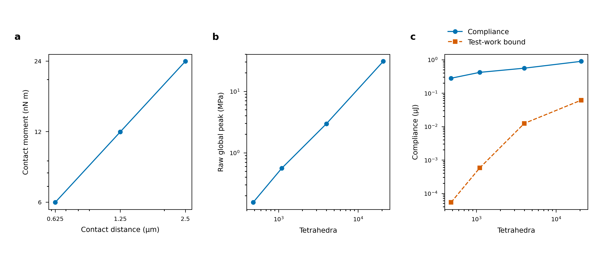

# Contact-distance tails and concentrated spatial loads

The [complete physical-validation objective](LOAD_MODEL_PHYSICAL_VALIDATION.md)
remains active. Four original local body/contact levels now finish, but their
finest tensor change is32.75% and raw global peaks reach30.8MPa. Independent
geometry and fixed-load controls explain why this is not a finite-footprint
convergence study. A narrower numerical refinement band now puts additional
collision samples inside the contact activation scale; its finer solves are live.

## Fourth original local contact level

Original jobs714874_3/7 finish their unchanged64-target held initialization and
80-step inertial histories on20696 tetrahedra. These spatial controls prescribe
the hand frame and retain the two dynamic jaws. Full nine-joint dynamics remain
a separate, currently coarse reference. Complete dynamic/body residuals
remain below1e-9N; their largest values are2.856e-10/2.729e-10N coupled and
2.985e-10/2.827e-10N with the original collision surface frozen.
Independent field audits715078_0/1 retain the original polynomial/objectivity
gates and all2400 material probes at10 common times. Traction audits715101_0/1
reconstruct every retained final contact force with zero pullback difference.

| Coupled local level | Body tetrahedra | Raw global lower peak (MPa) | Active lumped area (mm²) |
|---|---:|---:|---:|
|0|480|0.156447|96.51|
|3|1099|0.562064|6.458|
|6|3993|2.970655|0.4366|
|9|20696|30.767227|0.0347433|

The last adjacent tensor changes are32.7476% coupled and32.7519% frozen-contact;
energy changes are37.5003%/37.5242%. Coupled resultants change only0.02954%,
yet the raw peak changes90.3447% relative to the finer value. Both paths retain
two active body nodes and two islands. The final frozen-contact peak is
30.784720MPa despite its unchanged approximately96.51mm² lumped area.
Its normal force/area diagnostic remains8.282kPa, while the coupled diagnostic
reaches29.727MPa. These are quadrature areas/densities, not observed physical
patch areas or a resolved continuum pressure field.

Both finest lower peaks remain at reference position
`[1.769745e-6,0.022028915,0.001184687]`m. Whole-volume nonlinear upper/lower peak
intervals remain about0.000329Pa wide. Accurate bounds on each computed field
do not bound its continuum discretization error. No physical spatial tail passes.

## Geometry retained by the original refinement

Audits715068/715075 independently orient boundary facets, recover both actual
normal-force directions in the material frame and solve normal-cone feasibility.
The contact locations are vertices of the fixed seed polyhedron. Each has six
distinct incident planes with maximum normal angle35.411834deg. Positive cone
coefficient margins are0.120698 and0.093458. All four original local meshes retain
the same plane-normal sets, differing by at most2.97e-14 in vector norm.
They refine volume and contact sampling, not the underlying smooth-surface geometry.

Relative to a supporting plane through each undeformed contact vertex, the closest
other P2 boundary sample on level9 is11.438um/17.714um away:4.575/7.086 times
the2.5um contact activation distance. Exactly one trace sample per tip is inside
that distance at every original local level. These undeformed geometric facts
are separate from the solved trajectory's measured active-node counts.
They explain why more bulk elements alone have not demonstrated a finite patch;
they do not prove a singular continuum solution of the nonlinear contact problem.

## Explicit fixed-point-load control

Job715076 imposes the same two archived force vectors at the same reference
vertices on all four meshes, with independent linear scikit-fem elasticity and
consistent free-body inertia relief. There is no traction footprint or contact
solve in this separately declared control. Discarded non-anchor force entries
have norm below1e-12N. Every complete elastic residual is below4.70e-11N, also
passing the declared1e-9N cap. Raw extrema, full fields, equilibrium/work identities
and2400 common probes are retained.

| Tetrahedra | Raw global peak (MPa) | Elastic energy (µJ) | Local-test compliance lower bound (µJ) |
|---|---:|---:|---:|
|480|0.156447|0.139935|0.0000540330|
|1099|0.562049|0.209438|0.000580065|
|3993|2.971378|0.279602|0.0124594|
|20696|30.777118|0.447650|0.0616094|

Localized, gauge-projected P2 vertex tests provide a directly checked variational
bound `lᵀ A⁻¹ l ≤ fᵀu = 2U`, where `A` is their elastic-energy Gram matrix and
`l` their load work. The bound grows as support shrinks. It is a lower bound on
compliance, not a fitted singular exponent. The last common-probe tensor change
is32.7501%, so even those sampled fields have no accepted tail.

The finite-energy limitation of this declared point-load problem follows from
a local scaling argument, independently of the four measured peaks. Choose a
smooth test bump around a loaded vertex with radius epsilon and fixed value in
the force direction. In a three-dimensional solid near that vertex,

\[
\|v_\epsilon\|_{L^2}^2=O(\epsilon^3),\qquad
\|\nabla v_\epsilon\|_{L^2}^2=O(\epsilon),\qquad
F_i\cdot v_\epsilon(x_i)=|F_i|.
\]

The other point is outside its support. The distributed inertia-relief term and
mass-gauge projection vanish with the bump volume. Thus the point-load functional
does not tend to zero with the H1 norm. It cannot equal the continuous elastic
bilinear form of a finite-energy H1 displacement. This diagnoses the explicitly
fixed concentrated-load control; it does not classify the complete nonlinear
contact law or supply a finite-area reference. A finite footprint defines a
different load functional, and sharp geometry/traction transitions can still
limit its raw maximum.

For context, the [primary half-space treatment in SIAM Review](https://epubs.siam.org/doi/full/10.1137/22M1541721)
distinguishes a concentrated elastic load from integrated surface traction.
Its half-space fields are illustrative here; no half-space exponent or stress
formula is fitted to the hollow polyhedron.

## Contact-distance regularization at fixed geometry

Array715058 completes three64-target closures and8-step pilots. Array715065 then
solves corresponding80-step full-arm holds at1.25ms, independently reusing each
distance's own closure. Geometry, material, collision quadrature, PD/equality,
friction0.6 and stopping criteria remain fixed. Only activation distance changes.
Audits715069/715070 reconstruct264 dynamic states in total, including every body,
joint and fresh robot-step balance, actual stencil loads, Coulomb bounds, objective
nonlinear fields and unaveraged whole-volume peak intervals.

| Activation distance (µm) | Final raw lower peak (Pa) | Maximum complete contact moment about body COM (Nm) |
|---|---:|---:|
|2.5|156447.322|2.39435e-8|
|1.25|156400.741|1.19683e-8|
|0.625|156377.451|5.98325e-9|

Across80 matched times, maximum adjacent tensor changes are0.0302465%/0.0151266%,
energy changes0.0604815%/0.0302453%, raw-peak changes0.0298643%/0.0149355%, and
per-finger resultant changes0.0300634%/0.0150350%. Moment comparisons use separate
Nm norms about current body COM. Complete body residuals remain below6.822e-10N;
all original1e-9 body/joint/fresh-step budgets and per-stencil friction bounds pass.
The full regularized-contact moment decreases with distance and is retained,
rather than projected out. These are contact-distance diagnostics at one coarse
spatial setting, not a converged physical pressure or patch-area result.

[Editable SVG](figures/franka-contact-limit.svg) and
[embedded-font PDF](figures/franka-contact-limit.pdf) use183x82mm.
Panel a shows the maximum complete contact moment across80 accepted states at
each distance. Panels b/c show the distinct fixed-point-force control's raw peak,
compliance and localized-test lower bound. All15 deterministic source values are
shown without fitting, smoothing or statistical uncertainty. The strongest spatial
concentration is on the finest mesh; no plateau supports a bounded physical peak.
Only figure version2 passes rendered QA; version1's overlapping minor ticks and
its correction remain archived. Caption/context must preserve the different
physical controls used by panel a and panels b/c.

## Contact-scale numerical refinement now scheduled

Qualification715084 narrows only the numerical marking band to50um. It retains
the original physical polyhedron, material, contact distance/law and6 physical
initializer coordinates. Volume, COM, boundary area, original vertices and
positive tetrahedron volumes pass the unchanged geometry checks.

| Local level | Tetrahedra | Trace samples within activation distance, tip1/tip2 |
|---|---:|---:|
|0|480|1 /1|
|9|2167|1 /1|
|12|3577|1 /1|
|15|8433|1 /4|
|18|30298|13 /25|

The level18 contact-incident maximum edge is16.828um. Closest other trace gaps
are0.286/0.221 activation distances. These are undeformed supporting-plane sample
counts, not measured contact nodes or pressure footprints. Global volume/geometry
accuracy must still be checked independently. No physical footprint radius,
rounding, material, friction or averaging parameter was tuned.

New level0 reproduces every member payload in all85 original NPZ archives exactly.
Array715083 schedules the same original64+80 protocol at levels0/12/15/18.
This checkpoint includes level0 and its exact-payload control. Finer cases are
excluded pending complete field/traction audits, even if an individual solve
finishes first. They must demonstrate an actual resolved patch and credible tails.
The radius argument here controls mesh marking, not the physical load model.

Finer U cache audit715056 also passes: both5669-tet562-step protocols retain all
original1e-9 gates; final tensors differ6.452e-12 relative. Intermediate full
fields were not saved and their equivalence is not claimed. These are final-field
and retained-gate diagnostics; full-history acceleration equivalence, U physical
convergence and physically verified warmed native cost remain unverified.

## Evidence and remaining acceptance

The [immutable checkpoint](../evidence/20261014-physical/contact-limit-checkpoint-v1/manifest.json)
retains28 terminal runs and2187 exact original files, with870 input/executable
source identities checked. Manifest SHA256 is
`7db7a0e31f48aec8d994122d1b46ed2128751121726932601a2824120acdecff`.
Its verifier compares originals and archive reconstruction. Named prior
dependencies retain unchanged coarse/contact/mesh inputs. Source data, editable
exports, package/hardware records, exact commands and Slurm states accompany it.

Failures remain visible: initial geometry/configuration lookup and point-field
unpacking errors, two60000-cell-cap failures at iteration20/140103 cells,
the repeated level list caused by an ineffective escaped-string replacement,
and the failed figure QA. Invalid startup wrapper paths have Slurm/log records
and an explicit correction journal; they produced no scientific run directories.
The pending solve dependency was explicitly changed to the successful715084
qualification. No failed or merely scheduled case is counted as accepted physics.

Use `scripts/audit_contact_vertex_geometry.sh RUN --mesh-run MESH --contact-run
CONTACT --levels 0 3 6 9`, `scripts/point_load_franka_control.sh RUN --mesh-run
MESH --contact-run CONTACT --probes PROBES`, and
`scripts/audit_articulated_regularization.sh RUN --run COARSE MIDDLE FINE --steps 80`
for these analyses. Existing `run_localized_franka.sh RUN qualify` and
`run_localized_franka.sh RUN solve` reproduce qualified tip meshes and histories;
traction auditing uses `run_refined_contact_franka.sh RUN audit`.
Use the established allocated environment and explicit project data/cache paths.

The original full A/B/C objective remains open: finite-area spatial/contact and
geometry tails, original egg/Franka approach and angular history, U nonlinear/
compliance/contact coverage, applicable identical-input load models, native
finite-footprint mapping versus feedback, and physically verified warmed costs.
The fixed-point diagnosis explains that control; it does not replace these tasks.
