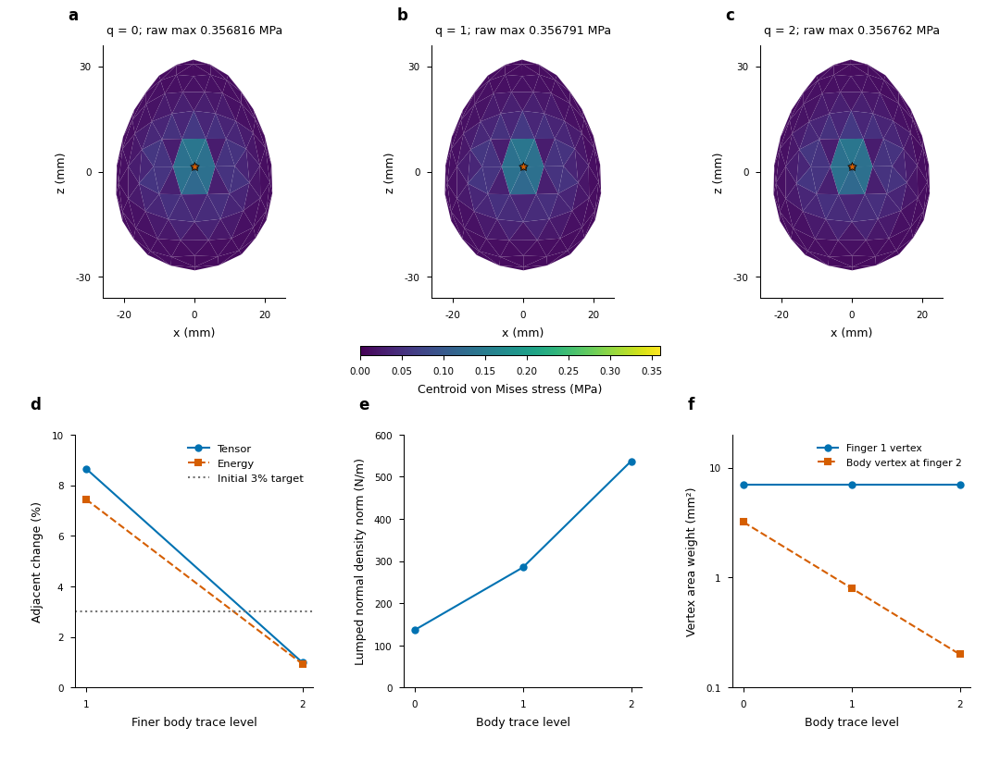

# Separated egg contact integration and verified refinement coverage

The [complete physical-validation objective](LOAD_MODEL_PHYSICAL_VALIDATION.md) remains active. Body and rigid-finger contact-integration axes now have three solved levels each on one byte-identical 1920-tet material geometry. The last body-trace tensor/energy changes are 0.990%/0.935%, while discrete contact concentration still grows. Separately, every active sample of the first corrected local CAD reference lies inside its refinement caps; its raw global peak is 40.4MPa. All four earlier small-cap levels miss their actual contacts and their 6.42MPa peak plateau is rejected. These results establish useful error separation and numerical coverage, not a physical contact tail.

## Fixed physical inputs and independent gates

The separated integration studies retain the original 1920-tet CAD-approximating polyhedron, E=1e10Pa, ν=0.3, density2000kg/m³ and represented mass0.007231131042204171kg. Bulk nodes/elements, all six physical held initializer points, original rigid finger vertices/axes/masses, gravity, friction0.6, barrier range2.5µm and stiffness, 64 held-control targets, jaw control law, dt=1.25ms and five dynamic states remain fixed. Material-boundary vertices and topology are byte-identical. Only the selected collision trace changes; no new bulk unknowns, physical radius or pad compliance are introduced. This fixed polyhedral approximation is one declared numerical case; its continuum geometry and bulk errors remain open.

Body trace levels use exact P2 interpolation and preserve constant/affine fields. An independent construction subdivides the original rigid-finger triangles by exact linear interpolation onto their original rigid coordinates. It preserves every body trace row, actual undeformed group surface areas, rigid motion and force/moment/virtual-work pullback. Four seeded arbitrary affine-motion/load checks per level give maximum affine error1.11e-16m, force error2.03e-15N, moment error2.64e-16Nm and virtual-work error1.79e-22J. These are construction tests, not contact convergence.

Each new case independently solves the same held initializer and all five subsequent physical states. Separate all-state audits freshly reconstruct centered contact/friction forces, consistent body inertia, actual jaw control, mapped balances, raw extrema and complete fields at unchanged 1e-9N physical gates and 1e-10N internal Newton target. Across the six new histories, maximum independently reconstructed body/mapped residuals are7.95e-12/1.63e-11N. Original and failed cases remain visible.

## Zero-level preservation before refinement

Body-axis zero case717003 and audit717004 reproduce the original five-state 1920-tet CAD history; comparison717005 checks every saved array plus every corner/quadrature tensor. The newly repeated initializer differs by at most9.12e-19m, while all other initializer arrays are identical. Maximum saved displacement/contact-force changes are8.89e-19m/1.69e-14N; full corner/quadrature relative changes are1.13e-14/3.07e-12. Initializer bytes are explicitly not identical. The comparator keeps strict byte identity by default; the opt-in independently resolved initializer path checks its full arrays at the existing state budgets and records the actual difference.

Before finger refinement, zero case717150 and audit717151 are compared with body-axis level2 by717152. Initializer bytes are identical, and all five saved state arrays plus complete corner/quadrature stress fields have zero measured difference. An absent historical finger-refinement option is normalized only to its explicit zero default for configuration comparison. No numerical budget is relaxed. Refined cases cannot execute before these qualifications and the constructor qualification complete successfully.

## Body contact-integration axis

Body levels0/1/2 have1462/5302/20662 collision vertices and2868/10548/41268 triangles including the fixed fingers. Only the P2 body trace is refined. All fields below are at6.25ms; actual undeformed body/finger surface areas are checked independently by group. Positive lumped sample areas support the reported discrete density diagnostics.

| Body trace level | Active body samples | Lumped active body support (m²) | Raw global lower peak (Pa) | Body normal density L2 (N/m) |
|---:|---:|---:|---:|---:|
| 0 | 4 | 5.602666485e-05 | 356816.418614352 | 136.358911077 |
| 1 | 4 | 1.439843094e-05 | 356790.664199134 | 284.922221827 |
| 2 | 4 | 3.599600209e-06 | 356762.340213170 | 537.191273793 |

| Adjacent body levels | Tensor (%) | von Mises (%) | Objective displacement (%) | Energy (%) | Raw peak (%) |
|---|---:|---:|---:|---:|---:|
| 0→1 | 8.661183 | 6.140781 | 6.186960 | 7.447877 | 0.007218 |
| 1→2 | 0.989752 | 0.719339 | 0.709870 | 0.934573 | 0.007939 |

Relative changes normalize by the finer field/value. Tensor/displacement norms use9600 identical interior physical probes, weighted by fixed seed-tetrahedron volume. Full global raw corner fields and whole-volume bounds remain intact. A peak-only comparison would hide the initial8.66% tensor/7.45% energy change. The final five scalar/field changes fall below the initial3% diagnostic, but the fixed bulk and unresolved contact-pressure/geometry axes prevent physical acceptance.

## Actual stencil weights distinguish the two interfaces

Job717111 directly observes every saved state and initializer on all three body levels. Both final contacts are face–vertex stencils: one fixed finger1 vertex against a body face, and one body vertex against a finger2 face. Their actual vertex area weights are:

| Body level | Finger1 vertex weight (m²) | Body vertex weight at finger2 (m²) |
|---:|---:|---:|
|0|7.000000000e-6|3.209014837e-6|
|1|7.000000000e-6|8.022537092e-7|
|2|7.000000000e-6|2.005634273e-7|

The first interface retains the coarse finger-vertex weight while the second quarters its body-vertex weight each level. Four active body samples and two normal stencils persist. Discrete sample-force/lumped-area concentration therefore keeps growing even as the bulk field changes become small. These area weights, lumped sample supports and density norms are distinct discrete measures; none is silently interpreted as a resolved continuum contact patch or continuous pressure.

## Rigid-finger integration at fixed body level2

Construction qualification717133 precedes the complete zero-level regression and new finger levels1/2 (717153/717155). Each retains the same body P2 trace and its original bulk unknowns. All five states per level pass separate audits717151/717154/717156. Comparison717157 reconstructs matched fields and source-reaction wrenches; observation717240 retains actual stencil weights, distances and identities.

| Finger level | Collision vertices | Collision triangles | Raw global lower peak (Pa) | Finger1 normal density L2 (N/m) | Finger2 normal density L2 (N/m) |
|---:|---:|---:|---:|---:|---:|
| 0 | 20662 | 41268 | 356762.340213170 | 78.229647067 | 48.637654816 |
| 1 | 21124 | 42192 | 356746.196852327 | 156.452167209 | 81.678745340 |
| 2 | 22972 | 45888 | 356708.887828339 | 312.871317713 | 188.610243710 |

| Adjacent finger levels | Tensor (%) | Energy (%) | Raw peak (%) |
|---|---:|---:|---:|
| 0→1 | 0.0045970 | 0.0092030 | 0.0045252 |
| 1→2 | 0.0106357 | 0.0212917 | 0.0104592 |

The tensor changes are small but increase from0.00460% to0.01064%; this is not a demonstrated asymptotic tail. The fixed finger1 vertex weight now quarters (7e-6→1.75e-6→4.375e-7m²), while the opposing body vertex weight remains2.005634273e-7m². Four active body samples and two stencils remain; body density stays near537N/m, while finger1 density doubles each level. The independent eighteen-row group-density audit717277 preserves all forces in each norm; its1e-8N threshold selects samples only for active count/area reporting. It does not smooth or replace raw maxima.

Per-finger opposite reaction resultants/moments are retained, with their signs and fixed body-COM reference stated explicitly. They identify source reactions, not resolved continuum islands. Normal-contact internal moment errors are about2–4e-19Nm. Total frictional surface moments remain around1.4–1.6e-7Nm for these body-axis states under the existing finite-gap, lagged-tangent reference law. They are measured separately; no additional zero-moment gate is substituted for the original force budgets, and opposite finger moments are not silently treated as identical body moments. Contact regularization convergence remains required.

## Matched editable figure and QA



[Editable SVG](figures/contact-quadrature-20261015/contact_quadrature.svg), [PDF](figures/contact-quadrature-20261015/contact_quadrature.pdf), [source tables](figures/contact-quadrature-20261015/metrics.csv), [full figure contract](figures/contact-quadrature-20261015/figure_contract.json) and [caption/placement](figures/contact-quadrature-20261015/caption.md) accompany the [plotting source](../plot_contact_quadrature.py).

Panels a–c evaluate nonlinear Cauchy stress directly at outer-front facet centroids on identical reference geometry, with shared MPa limits. White circles mark visible contacts and stars mark whole-volume raw-peak locations; coincident markers can overlap. The titles retain original whole-volume raw maxima, and centroid colours do not replace them. Panels d–f distinguish the conditional field tail, growing discrete density and unchanged finger integration weight. There are no statistical replicates, uncertainty bars or fitted convergence orders.

The first rendering job717198 fails text QA because an out-of-view logarithmic tick is flagged as clipped; its real FAILED1:0, source snapshots and preview are retained. Explicit in-range ticks fix the issue. The editable source/preview717235 passes visual and programmatic QA before PDF export717276. Final source tables and raster bytes match exactly; SVG retains77 editable text elements and the PDF embeds a TrueType font stream. No publication-ready physical accuracy is inferred from visual QA.

## Corrected contact coverage changes the observed stress

The fourth original small-cap producer716803 and audit716804 now complete naturally. Independent coverage717286 finds every active sample outside the50µm numerical caps in both third/fourth levels, as already found for the first two levels. All four old17340/22152/32340/61812-tet references retain eight active samples, unchanged active trace edges about276–1002µm and raw peaks near6.42MPa; the final two differ by only0.025Pa. That apparent plateau is not convergence.

The corrected31668-tet CAD reference716883 and its all-state audit716884 retain the same declared continuum geometry parameters, density, original physical controls/friction/dt and force gates, while explicitly recording the new approximation and represented mass. Its numerical marking anchors include independently observed contact positions and normal-force support directions. Coverage716885 verifies all32 active body samples are inside the150µm marking caps in every saved state; the final maximum angle/cap-angle ratio is0.70982. Actual incident trace edges are34.38/34.49/34.76µm (minimum/median/maximum), and the parameter norm deficit is8.32e-7. This is real contact resolution rather than refinement only away from contacts.

The final raw global peak interval is40400486.643240824–40400486.64324099Pa, with30 normal stencils, active lumped support2.896091859e-8m² and maximum normal sample-force density70.49MPa. Independent maximum body/mapped residuals over all five states are1.10e-13/2.60e-13N. The whole-volume J lower bound is0.99760136. This first covered case is not a physical tail and is a distinct mesh/mass approximation from the fixed1920-tet integration studies. Inside-cap samples also do not exclude contacts suppressed by coarse geometry elsewhere. The second64716-tet case and broader500µm-cap90240-tet pilot remain live; a171228-tet third level and its force/coverage audits717295/717296/717297 are scheduled after this measured coverage result.

## Immutable evidence and reproduction

Runtime root is `$RIGID_STRESS_DATA_ROOT/runs/20261014-physical-validation`. Exact commands, Slurm states, before/after source identities, versions/hardware, all initializer/history arrays, complete unsmoothed corner/quadrature fields, source reaction diagnostics and failed render records are retained. Reusable entry points include:

```bash
bash research/rigid_stress/scripts/run_egg_contact_quadrature_axis.sh FRESH_RUN ORDER_QUAL ZERO_QUAL_OR_DASH run_paired_egg_contact [physical arguments] --contact-refinement LEVEL
bash research/rigid_stress/scripts/run_egg_finger_quadrature_axis.sh FRESH_RUN ORDER_QUAL ZERO_QUAL_OR_DASH CONSTRUCTION_QUAL run_paired_egg_contact [physical arguments] --contact-refinement 2 --finger-refinement LEVEL
bash research/rigid_stress/scripts/compare_egg_finger_quadrature.sh FRESH_RUN --run CLOSED_RUNS --audit MATCHED_ALL_STATE_AUDITS --axis finger
```

| Packet | Manifest SHA256 | Archive entries | Actual originals verified | Source identity records |
|---|---|---:|---:|---:|
|[egg-contact-quadrature-v1](../evidence/20261014-physical/egg-contact-quadrature-v1/manifest.json)|`a6b7e11d021dcbce290c09444a45835e938aa58b1d256805c02618373b3b8663`|914|903|684|
|[egg-finger-quadrature-v1](../evidence/20261014-physical/egg-finger-quadrature-v1/manifest.json)|`abd0ff8fe7fef8208c64b0c71ee7d931c022d73a4bd184b8dbcce4be1b62e067`|1046|1035|798|
|[egg-contact-quadrature-followup-v1](../evidence/20261014-physical/egg-contact-quadrature-followup-v1/manifest.json)|`619a1bda3a0c9c17364a29270106d95d20d5b57cb1d3a746ec7eaaaee7ce6634`|792|792|578|

Counts are per-packet checks, with repeated baseline files retained where needed; they are not unique experiments or statistical replicates. Runtime verification checks actual producer paths separately from staging and validates every published byte. Production engine code is unchanged.

The full original A/B/C objective remains required: representative convex/nonconvex physical and geometry/contact/regularization tails or justified singularity outcomes, load-model sensitivity, complete original egg/Franka and U references, resolved-load native replay versus feedback and physically verified warmed costs. Five/six-layer thickness and U jobs remain live. The full original-history and fine80-state producers have just terminated; their separate postprocessing evidence is outside this packet. These separated small-strain diagnostics and corrected contact prefixes do not complete those requirements.
