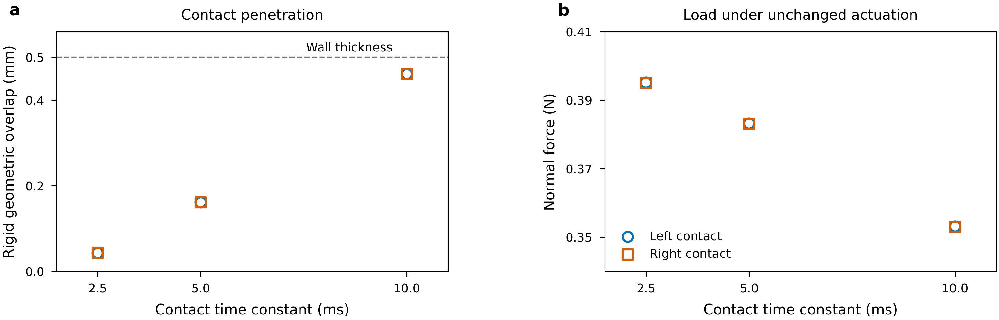

# Contact regularization and inertial actual-finger reference

This continues the full [physical-validation goal](LOAD_MODEL_PHYSICAL_VALIDATION.md)
and [actual Panda mechanics checkpoint](PHYSICAL_FRANKA_MECHANICS_20261014.md).
The original scope remains active. Contact stiffness, initializer compliance,
time discretization, constitutive approximation and load-mapping error are
separate evidence requirements.

## Measured numerical overlap under unchanged physical inputs

The controlled fixed-hand Panda fixture now records actual collider penetration,
mixed seven-component solver parameters, final runtime collision vertices and
temporary-weld parameters at each selected physical substep. Contact parameters
are changed only through the per-geom API; material, mass, pose, geometry, friction,
PD gains/caps,52s control history and1.25ms integration interval remain fixed.
The three actual contact time constants are10,5 and2.5ms. The temporary weld
uses the same recorded parameters in every case:
[0.0025,1,0.9,0.95,0.001,0.5,2].

All three cases714299_0/1/2 complete with1152 distinct saved force/pose frames
each. Audit714334 reconstructs both finite box faces from actual runtime vertices.
The supporting egg vertex projects inside each finite face. Projected overlap
along the captured contact normal agrees with the raw collider penetration
to below1.3e-17m at the checked held/released endpoints. Runtime collision
vertices agree with the independent body mesh within2.523e-9m, consistent with
the recorded FP32 collision import. The comparison does not silently replace
a box with an infinite plane or attribute geometric overlap to elastic strain.

| Contact time constant | Final penetration, contacts16/23 (mm) | Penetration /0.5mm wall | Final normal forces16/23 (N) |
|---|---:|---:|---:|
|10ms|0.461237 /0.461159|92.25% /92.23%|0.353098 /0.353000|
|5ms|0.161291 /0.161252|32.26% /32.25%|0.383198 /0.383100|
|2.5ms|0.042840 /0.042830|8.568% /8.566%|0.395136 /0.395038|

At80 identical released-phase times, normal-force L2 changes are7.8410% and
3.0101% across the two successive refinements. The latter remains above the
previous3% engineering diagnostic; no tolerance is relaxed. Force/depth ratios
are about766,2376 and9223N/m, but are state diagnostics rather than a universal
pad stiffness: impedance, geometry, coupled dynamics and controller response
also contribute. This contact-law effect must be checked before calling a
rigid/deformable force difference material-deformation feedback.

Both actual source contacts are retained at51.99875s, with no smoothing or
statistical interval. The dashed line is the physical wall thickness. Editable
SVG/PDF, exact plotted values, caption/argument contract and rendered QA are
adjacent. The selected v2 plot snapshots its transitive project imports; the
earlier v1 plot omitted an imported mesh-generator definition and is retained
with that source-coverage limitation. Both numeric plots use the same verified
audit values. The body still rotates; this is not static-contact acceptance.

## Corrected interpretation of the earlier time-axis fixture

Source inspection of `kernel_add_weld_constraint` finds that a dynamic weld
automatically uses2*substep_dt, independent of the default geom time constant.
Thus the earlier2/4/8-substep sweep changes the initializer's numerical
compliance as well as integration resolution. Identical user configuration
does not freeze that internal parameter. Its previously reported observations
remain exact, but they do not establish pure fixed-support temporal convergence.
The mechanics report and acceptance ledger now state this explicitly.
The contact-only sweep above fixes both integration and recorded weld parameters.

## Objective inertial FEM contact with real rigid fingers

The independently assembled reference retains the full level1 hollow egg,
all12 actual finger collision geoms, physical mass, E=10GPa, nu=0.3, density2000,
friction0.6,18mm jaw targets and4N actuator caps. `dynamic_franka_reference.py`
adds backward-Euler consistent inertia to the objective neo-Hookean body and
the two rigid jaw coordinates:

M*(u_n-u_previous-dt*v_previous)/dt^2 + bulk + contact + actuation - gravity =0.

The body mass is0.0065298482104kg. Each physical finger is15g; its source
prismatic-joint armature adds0.1kg generalized inertia, giving0.115kg in the
jaw coordinate without adding gravity mass. The actuator force is
clip[100*(q_target-q)-10*q_velocity,-4,4]; passive damping1N*s/m remains
outside this cap. The friction mollifier's physical velocity stays4e-6m/s,
with its displacement scale multiplied by dt.

Qualification714330 independently checks the body's six mass-mode Gram entries,
effective jaw masses, capped/uncapped virtual work and no-contact derivatives.
Mass-mode Gram difference is zero at the reported precision. Maximum virtual
work error is5.69e-14N. Energy/gradient differences are below3.49e-7 and
gradient/Hessian differences below2.84e-11. These are algebra/derivative checks,
not contact convergence.

The40-step pilot714335 and20/80-step temporal controls714337_0/1 finish the same
0.1s release horizon from the same independently completed held-row closure,
with zero initial velocity. All140 saved steps meet the unchanged1e-9N complete
mapped/body dynamic-force gates; largest residuals are3.071e-10/3.032e-10N.
At the40-step endpoint, omitting mass acceleration leaves body residual
1.351e-6N. The model accounts for that acceleration rather than accepting this
as a static equilibrium.

Audit714367 compares20 exact common times and unsmoothed full corner tensors,
objective elastic displacement, velocities, contact forces, body elastic energy
and total kinetic energy. No temporal interpolation is used.

| Dynamic interval refinement | Full tensor L2 change | Velocity L2 change | Contact-force L2 change | Elastic-energy L2 change | Kinetic-energy L2 change |
|---|---:|---:|---:|---:|---:|
|5ms to2.5ms|0.001922%|0.4583%|0.0004751%|0.0008011%|0.9368%|
|2.5ms to1.25ms|0.001006%|0.2202%|0.0003687%|0.0006315%|0.4690%|

The selected audit retains actual energy values and complete raw fields.
These temporal diagnostics lie below3% at the fixed coarse spatial/contact
settings; they do not qualify a spatial or contact-regularization tail.
Final nonlinear corner lower/whole-volume upper peaks are:

| Interval | Lower peak (Pa) | Whole-volume upper peak (Pa) |
|---|---:|---:|
|5ms|156446.904381|156446.904709|
|2.5ms|156446.978824|156446.979152|
|1.25ms|156447.016857|156447.017184|

Positive whole-volume determinant bounds are about0.9999918753. Objective
elastic displacement is0.3516um, about0.0703% of wall thickness and0.00586%
of the nominal6mm recovery footprint. Narrow peak bounds and small deformation
remain distinct from continuum contact/mesh accuracy.

## Actual native replay of the solved dynamic loads

Replay714352 reconstructs the saved velocity/acceleration identities and full
dynamic force residual, rotates the original nodal contact forces into a fitted
finite material frame, and keeps their values unchanged. A backward finite
rotation rate supplies omega for actual native inertia relief. Native full
tensors and the original global peak are checked against independently assembled
linear FEM on those same loads. This is nodal elastic recovery, not the
finite-footprint mapper.

|40-step replay diagnostic | Result |
|---|---:|
| Actual native versus independent linear full tensor |7.77146e-11 relative|
| Native complete residual budget used |1.9144%|
| Native versus nonlinear Cauchy tensor, reference-volume quadrature |4.80423e-5 relative|
| Linear full-inertia versus nonlinear Cauchy tensor |4.80425e-5 relative|
| Native rigid relief versus linear full-inertia tensor |7.90827e-10 relative|
| Actual native global unaveraged peak |156442.862163Pa|
| Nonlinear lower/upper peak |156446.978824 /156446.979152Pa|

Thus linear elastic recovery and rigid inertia relief closely approximate this
one solved, small-strain dynamic field at the declared coarse resolution. The
full-inertia diagnostic still uses reference geometry and linear material; these
differences are not an exact causal decomposition. The deformation-induced
reference moment difference is retained, approximately
[-5.192e-11,-6.283e-12,-7.997e-14]Nm. The original v1 replay omits the required
surface-triangle asset field and fails before native recovery; v2 supplies the
complete boundary topology without changing the physical problem or gates.

## Reproduction, scope and unfinished acceptance

Rigid controls use `bash research/rigid_stress/scripts/capture_franka_fixture.sh RUN --capture INPUT --substeps 8 --contact-timeconst TAU`.
The per-geom setter leaves joint/weld parameters
unchanged. Use `scripts/audit_franka_contact_regularization.sh` for raw geometry
and matched-input audits. Inertial checks use
`scripts/dynamic_franka_reference.sh RUN qualify|solve` with the retained capture
or closure argument. Replays use `scripts/replay_dynamic_franka.sh` and temporal
audits `scripts/audit_dynamic_franka_axes.sh`. Every runtime directory is fresh
under the existing20261014 physical data root, reused after the UTC date rollover.
The immutable `franka-regularization-checkpoint-v1` retains4292 exact original
entries, successful and failed sources/results, commands, package/hardware
identity and the reviewed figure. Its verifier accepts no original-log prefix
substitutions. Manifest SHA256:
`957a3745b5f075630d44b8f985690d6409c6c1eafbcbce3a0c5ae421f35a838e`.
Run `bash research/rigid_stress/scripts/publish_franka_regularization_checkpoint.sh v1`
in a fresh checkout/data-root publication destination to reproduce its selection.

The independent held-row initializer differs from the rigid compliant weld.
The hand remains fixed and full arm PD/finger equality are omitted. Actual
full-application matching, longer histories, spatial/contact/quadrature tails,
resolved traction/island/load-model comparisons, matched stress maps and the
complete representative physical accuracy/cost range remain required. The
original third-level U and full-egg jobs714003_0/3 remain live and excluded from
the completed checkpoint. The complete A/B/C objective is not narrowed.
