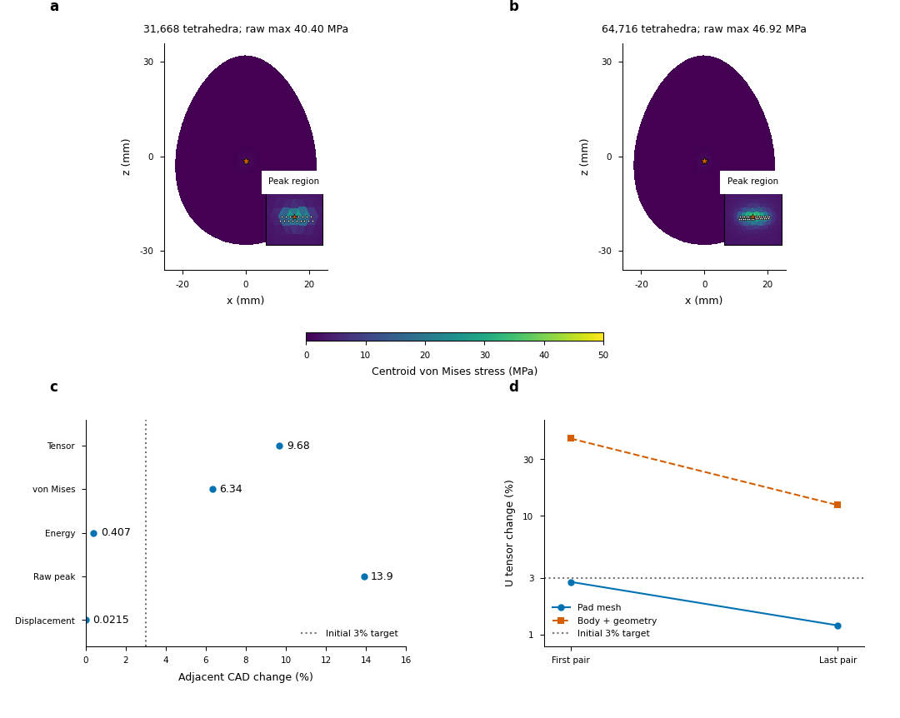

# Covered contact fields and original-protocol reference recovery

The [full physical-validation objective](LOAD_MODEL_PHYSICAL_VALIDATION.md)
remains active. The second covered CAD egg level now has complete independent
force/coverage audits. Its last-pair common-probe tensor and raw global peak
changes are9.68% and13.89%, while energy changes only0.407%. Independently
audited current-friction recovery also qualifies original rigid step866 without
changing physical inputs or the original1e-9 gates. These are physical-reference
and numerical-method checkpoints, not completed physical convergence or warmed
native accuracy/cost acceptance.

## Covered CAD fields retain the stress discrepancy

The31668/64716-tet cases approximate the same declared CAD egg, with unchanged
E=10GPa, Poisson ratio0.3, density2000kg/m³, friction, supports,64-target held
initializer, jaw control and1.25ms physical timestep. Each has five independently
audited dynamic states. The numerical marking cap is150µm; all32/61 active body
samples lie inside it in all five states. Target100/50µm mesh edges produce
actual active trace median edges34.49/17.26µm. Neither those marking caps nor
the lumped active sample areas prescribe a continuum contact footprint.

| Final6.25ms observable |31668 tetrahedra|64716 tetrahedra|
|---|---:|---:|
| Represented mass (kg) |0.007424160816030722|0.007424160823023387|
| Normal stencils / active body samples |30 /32|59 /61|
| Active lumped support (m²) |2.896091859e-8|1.380415405e-8|
| Maximum normal sample force/lumped area (MPa) |70.489892|107.726557|
| Raw global lower peak (MPa) |40.4004866432|46.9176668787|
| Raw global upper peak (MPa) |40.4004866432|46.9176668787|
| Nonlinear energy (J) |9.636238254e-7|9.675580316e-7|
| Whole-volume J lower bound |0.9976013605|0.9972333812|

Full-precision raw lower/upper values remain in the archive; the MPa rounding
above does not collapse their deterministic bound intervals. The two raw peaks
have the same reference location
(2.114692079e-5,0.022251337694,-0.001827384333)m. A stable location does not
accept growing stress or pressure concentration. Sample force/lumped area is
a discrete density diagnostic, not independently resolved continuum pressure.

Job717788 reconstructs complete fields at158340 identical physical probes,
retaining complete unsmoothed corner tensors and original contact/inertia
arrays. Relative field changes use fixed seed-volume weights and normalize by
the finer field. The independently reconstructed final body/mapped residuals
are6.06e-14/1.65e-13N and4.77e-14/1.14e-13N; saved contact reconstruction
differences remain about1e-16N.

| Adjacent observable | Change |
|---|---:|
| Full tensor |9.680122%|
| von Mises |6.339263%|
| Objective displacement |0.0214814%|
| Nonlinear energy |0.406612%|
| Raw global lower peak |13.890674%|

The [predeclared3% criterion](PHYSICAL_VALIDATION_PROTOCOL_20261014.md) is not
met for stress, and two levels do not show a credible tail. Bulk, surface
geometry and body contact-trace resolution vary together here. The almost
equal represented masses do not make this a separated fixed-boundary bulk axis.
Broader-cap coverage and geometry/contact/regularization studies remain required.

### Full-probe processing and numerical qualification

The first comparison717706 fails during source patching because a required
module was omitted from the isolated snapshot. Python/FEM never starts; the
missing natural exit/final source identity is preserved rather than fabricated.
After a complete patch preflight,717744 reaches the process but its Slurm step
isOUT_OF_MEMORY and its real inner wrapper code is137. Batching bounds the
point-lookup temporary memory while retaining every original probe.

Attempt717746 then correctly fails the original manufactured finite-rotation
criterion:254 of1425060 tensor components exceed RTOL1e-8/ATOL2e-4Pa, with
maximum violating absolute difference0.00031961Pa. Its manufactured nodal field
was constructed from extended coordinates and then rounded back to FP64.
An isolated reference patch retains that known field in extended precision.
The original tolerances and all physical states remain unchanged.

Accepted717788 checks all158340 probes on both meshes. Maximum manufactured
polynomial tensor errors are3.02e-6Pa; finite-rotation errors are3.35e-6Pa and
1.68e-5Pa. This is a numerical point-evaluator qualification, not a physical
mesh-convergence result. All failed setup/OOM/qualification records remain visible.

## U pad refinement is now a separate three-level sequence

Producer716310 and independent audit716317 close the resolution5/7/9 pad axis
on byte-identical2339-tet body geometry and unchanged represented body mass.
Material, pad compliance/physical dimensions,0.05N shoe forces, gravity,
friction0.8,2.5µm barrier distance and64 loading increments stay fixed.
The body/source fields use75 common material probes with no outside probes.

| Pad pair | Tensor (%) | von Mises (%) | Objective displacement (%) | Energy (%) | Raw peak (%) |
|---|---:|---:|---:|---:|---:|
|5→7|2.782667|1.220169|2.675212|0.673997|0.0153356|
|7→9|1.195351|0.506438|1.518174|0.563221|0.0176236|

The finest final body/mapped residuals are1.358711780e-10N and2.223065813e-10N;
all597 original recorded accepted stages remain below1e-9N. Its raw peak
interval is100667.756533–100668.168317Pa and the hotspot location is unchanged
from the medium pad level. These conditional field changes lie below the
initial3% target on this fixed body. They do not establish a continuum contact
pressure tail or convergence of the body/geometry axis.

The [separate fixed-pad body/geometry sequence](PHYSICAL_COMPLETE_HISTORIES_20261015.md)
still changes tensor12.33% and raw peak5.26% at2339→5669 tetrahedra. It changes
represented mass with geometry approximation at fixed density. The two axes'
norms cannot be added or subtracted to decompose the coupled error. The coupled
finer U reference and its successor remain separate outstanding evidence.

## Original rigid step866 passes the unchanged physical equation

The original current-friction Newton search and residual-continuation attempts
remain rejected. Four-state full-tangent diagnosis717697 observes no stencil
changes across the tested perturbations, and no observed rank loss at those
four points under its declared coordinate scales. That does not prove a global
branch property or root uniqueness. Direct rigid contact/inertia assembly717719
does not materially improve the measured tangent error; it is not adopted as
the recovery fix. Separate717734 verifies that direct assembly preserves all865
original saved displacement/contact arrays exactly and passes their original
force/actual-robot gates.

Scaled continuation717745 stops near artificial parameter0.307404759, before
the original equation at1. Deformable-state numerical guesses717809 yield two
very small residual roots whose endpoints intersect; those roots stay rejected.
A small residual alone is not physical acceptance.

Lagged-friction recovery717812 freezes tangential geometry/normal magnitude
only within numerical inner solves, then restores and evaluates the complete
original current-friction equation. The38 outer stages and relaxation are
numerical iterations, not physical time steps. Material, geometry/mass,
previous state, original controls/caps,dt1.25ms, friction/regularization and
the original physical gates remain fixed. Final acceptance uses the original
current friction, a fresh actual old-state Panda step and the same straight
vertex motion certified by contiguous default CCD queries.

Independent auditor717813 reconstructs all866 accepted states:

| Step866 independent observable | Result |
|---|---:|
| Actual body force-equivalent residual |7.230822040e-10N|
| Actual net body moment residual |1.992173285e-11Nm|
| Fresh actual robot effort residual |3.655930605e-11|
| Saved versus reconstructed contact-force maximum difference |0N|
| Default CCD intervals certifying the original straight path |4|

All865 retained prefix files are byte-identical. The full rigid producer now
has an opt-in recovery guarded by that independent qualification and an exact
helper-source hash. It preserves each rejected Newton state and all numerical
recovery arrays. Every new accepted state still needs the original current
force/robot/motion gates. Complete continuation717843, all-state audit717844,
full comparison717876 and actual native resolved replay717918 are running or
success-dependent work, not completed2640-state evidence in this checkpoint.
Production rigid dynamics and Quadrants recovery kernels are unchanged.

## Feedback postprocessor qualifies on the audited866-state prefix

Comparison717941 independently decomposes normal/shear source resultants and
body moments at the actual force points about the current body COM for each
finger and the ground. Complete contact-force pullbacks are checked against
both saved histories at the original tolerances. The same represented480-tet
geometry/mass, full Panda backend, controls, ground, timestep and contact law
isolate these conditional history differences from a change of contact backend.

At matched saved times, resolved nodal loads enter the same independent linear
recovery operator in fitted consistent-mass material frames. Full-inertia input
includes the corresponding contact, gravity and actual consistent-mass
acceleration; its balance correction is recorded. The following norms use the
actual15-point nonlinear volume quadrature and retain absolute errors.

| Step / time | Rigid versus deformable resolved-linear tensor (%) | Absolute L2 (Pa·m^1.5) | Deformable linear versus nonlinear tensor (%) |
|---|---:|---:|---:|
|11 /0.01375s|0.2313405|0.009646035|0.000291746|
|80 /0.1s|2.089956e-8|9.481553e-10|0.000317425|
|866 /1.0825s|7.810383|26.787529|0.03216745|

This separates resolved-load/history feedback from elastic-recovery
approximation within the declared coarse case; the norms are not additive.
It does not establish a continuum pressure/island reconstruction, native
finite-footprint model accuracy or a physically converged reference. The
known coarse-polyhedron geometry/mass error and local-concentration limitations
remain. Source moments and raw maxima are not replaced by total-wrench agreement.

The first postprocessor717919 fails because elasticity11-point weights do not
match the nonlinear15-point tensor grid. The corrected run717928 completes the
calculations but fails JSON serialization of extended joint metadata.717941
uses the correct quadrature and explicitly serializes metadata scalars without
changing stored physical states. The full330-control comparison remains
separately scheduled and requires all2640 independently audited rigid states.

## Fine-reference factorization is qualified before reuse

The171228-tet MMD/SuperLU first-factor failure remains recorded. A pinned
PyMETIS2025.2.2 dependency is installed only under the project's data-side
assets; active environments are unchanged. Its [nested-dissection API](https://documen.tician.de/pymetis/functionality.html#pymetis.nested_dissection)
supplies a seeded symmetric sparsity permutation. Matrix values, force
equations, Newton/GMRES acceptance and final physical budgets are unchanged.
Each solve restores the original coordinate order.

Before fine reuse,717897/717916/717917 qualify all five saved1920-tet dynamic
states, the independently resolved held initializer, every saved array and
complete corner/quadrature tensors. The original physical gates pass in both
baseline and candidate audits. Final relative corner/quadrature changes are
7.10e-15/3.07e-12; the initializer and complete-array differences remain inside
the declared original numerical budgets. No bit-identical initializer claim
is substituted for that explicit numerical qualification.

The first fine retry717938 fails its source qualification gate because the
comparator stores its independent force audits in nested rows. The corrected
gate checks all ten original/candidate audit records, with a schema preflight
before submission.717975 retries the unchanged physical case; its own complete
force/coverage audits717976/717977 are success-dependent. This is not yet an
accepted third physical level. Reference factorization timing or memory is
not warmed native throughput or a verified physical accuracy/cost result.

## Editable figure and interpretation



The [editable SVG](figures/covered-contact-20261015/covered_contact_axes.svg),
[PDF](figures/covered-contact-20261015/covered_contact_axes.pdf),600dpi PNG,
[source CSV](figures/covered-contact-20261015/cad_changes.csv), figure contract,
[caption/placement](figures/covered-contact-20261015/caption.md),
[render/export QA](figures/covered-contact-20261015/covered-contact-axes-export-qa-v4.json)
and [plotting source](../plot_covered_contact_axes.py) accompany this
report. Direct facet-centroid evaluations use a shared0–50MPa scale. White
circles mark actual front contact samples; stars mark independently computed
whole-volume raw peaks. Insets span0.4mm by0.4mm. Centroid colours do not replace
the raw global maxima or their certificates.

Panels a/b show that the stress concentration remains local as its raw peak
grows. Panel c makes the key accuracy distinction: displacement and energy
changes are small while tensor/von Mises/peak changes remain above the initial
criterion. Panel d distinguishes conditional U pad-field stability from the
larger body/geometry discrepancy. There are no statistical replicates,
uncertainty bars or fitted convergence orders. The rendered source retains
62 editable text objects and no embedded raster images; PDF export follows
accepted-source byte checks and separate font/vector QA.

## Reproduction and remaining acceptance

Runtime root is
`$RIGID_STRESS_DATA_ROOT/runs/20261014-physical-validation`. The source/configuration,
versions/hardware, before/after identities, all original arrays, full fields,
matched source wrenches and failed attempts remain reproducible. Long studies
stay opt-in. Reusable entry points include:

```bash
bash research/rigid_stress/scripts/setup_reference_metis.sh FRESH_SETUP DATA_SIDE_DEPENDENCY_DIRECTORY
bash research/rigid_stress/scripts/compare_covered_cad_fields.sh FRESH_RUN --run CLOSED_CAD_RUNS --audit MATCHED_ALL_STATE_AUDITS
bash research/rigid_stress/scripts/recover_lagged_rigid_contact.sh FRESH_RUN --run FAILED_ORIGINAL_RIGID --prefix-audit CLOSED_PREFIX_AUDIT --lagged-anchor LAST_ACCEPTED_STATE
bash research/rigid_stress/scripts/run_metis_paired_reference.sh FRESH_RUN CLOSED_DEPENDENCY_SETUP CLOSED_FULL_FIELD_QUALIFICATION run_paired_egg_contact PHYSICAL_ARGUMENTS
bash research/rigid_stress/scripts/compare_original_contact_feedback.sh FRESH_RUN --rigid CLOSED_FULL_RIGID --rigid-audit FULL_RIGID_AUDIT --deformable CLOSED_FULL_DEFORMABLE --deformable-audit FULL_DEFORMABLE_AUDIT --deformable-fields FULL_DEFORMABLE_FIELDS
```

The explicit `--allow-audited-prefix` postprocessor option is for bounded
qualification and always reports incomplete original coverage. The default
full comparator requires2640 states. Numerical artificial stages never fill
missing physical states.

| Immutable packet | Manifest SHA256 | Entries / actual originals verified | Source identity records |
|---|---|---:|---:|
|[covered-contact-fields-v1](../evidence/20261014-physical/covered-contact-fields-v1/manifest.json)|`823d97f4858532f728257f36b74ccef409d4444cb57d99a1af6c880c86029faa`|1129 /1115|766|
|[contact-reference-methods-v1](../evidence/20261014-physical/contact-reference-methods-v1/manifest.json)|`68a1349889fa5790b16af4305813ec9b4a99d9205299f6671070561c13f92bf1`|4672 /3795|876|

Counts are per-packet byte checks, with repeated inputs retained where needed;
they are not unique experiments or statistical replicates. One large full-field
file uses exact ordered32MiB compressed byte ranges. Reconstruction and actual
producer bytes are verified separately from publication staging. The early
source-setup failure keeps its missing exit/final identity explicitly missing.

The full A/B/C objective still requires explained geometry/bulk/contact/time
and regularization tails, meaningful converged egg/interior-hotspot contact
references, remaining applicable load-model sensitivities, full feedback versus
resolved native replay and warmed costs at physically verified accuracy. A
conditional field tail, recovered Newton step or polished figure is not that
completion. No production arithmetic or unrelated source checkout changes.
