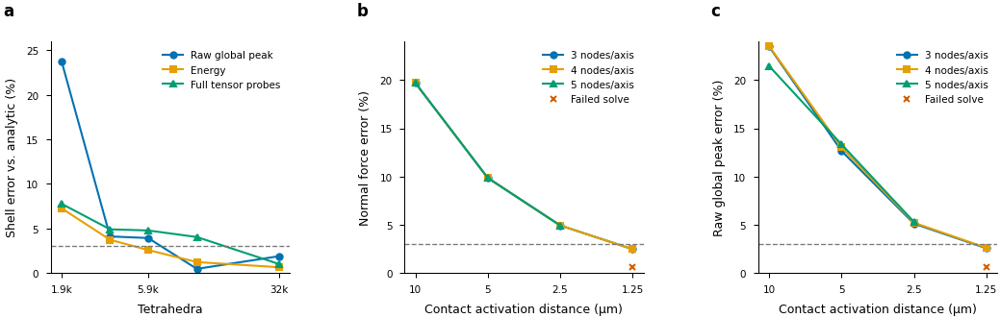
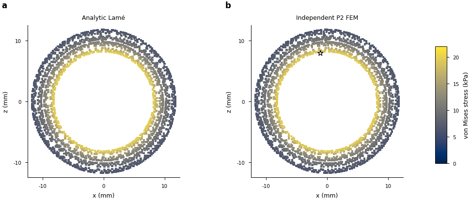

# Independent gauges and initial physical controls

The [active physical-validation goal](LOAD_MODEL_PHYSICAL_VALIDATION.md) remains
unfinished. This checkpoint extends the initial independent FEM qualification,
obtains a finer analytic-shell field and exposes an unresolved contact-reference
configuration. Production engine `76537c2f` remains unchanged.

## Independent rigid gauge and physical probes

The scikit-fem reference now selects six independent displacement constraints
by pivoted QR of its own normalized rigid modes. It solves the constrained
elastic system and then aligns displacement to its consistent-mass rigid gauge.
Every equilibrium row, including the six constrained rows, is checked afterward.
Factorization is lazy, so contact models that only need bulk matrices avoid an
unused free-body solve. The original mass-orthogonal saddle system remains an
explicit reference cross-check.

CPU job711988 passes8/8 in53.26s; CUDA job711989 passes8/8 in35.32s.
The32 native fields compare both independently assembled gauges. Their largest
peak difference is2.0473e-8Pa. Worst complete independent residual budget
fractions are4.9938e-6 for pins and4.9029e-5 for the mass constraint.
The native full-field/peak and complete residual gates are unchanged.
Uniform strain and pure bending also pass three non-centroid physical probes
per tetrahedron, checking all tensor components against their analytic fields.

The test and its elasticity dependencies match their captured bytes. An offline
contact-benchmark module was included by the broad snapshot wrapper and later
changed separately; it is not imported by these elasticity tests. The collector
records both hashes and this limited exclusion rather than claiming whole-tree
identity. Historical runs retain their own complete source snapshots.

## Full spherical-shell curve

All cases keep inner/outer radii8/12mm, inner pressure10kPa, outer pressure0,
E10GPa, nu0.3, density2000kg/m³, two geometric shell partitions and the same36
physical probes. Gmsh meshes the complete3D shell independently. The analytic
global maximum is21.315789kPa on the entire inner boundary. Consequently the
analytic hotspot location is a surface set, not a unique angular position.

| Size | Tetrahedra | Raw peak (kPa) | Peak error | Energy error | Full tensor probe error |
|---:|---:|---:|---:|---:|---:|
|0.28|1937|26.3863|23.788%|7.272%|7.776%|
|0.20|3626|22.1916|4.109%|3.732%|4.908%|
|0.15|5934|22.1531|3.928%|2.582%|4.778%|
|0.11|11142|21.4148|0.464%|1.226%|4.041%|
|0.08|32158|21.7177|1.885%|0.650%|1.017%|

The original mass-gauge job711830 fails at h0.08 during SuperLU memory expansion
with a subsequent `gstrf` SystemError. Slurm recordsFAILED; its maximum resident
set is63,730,960KiB. Its successful coarser fields and complete failure remain
preserved. The pinned job711993 completes all five levels, including h0.08 with
complete residual1.402e-13N. Its peak resident set is50,725,500KiB; h0.08 spends
488.51s in factorization and1216.53s overall, with884,162,299 factor nonzeros.
This still motivates separately qualified reference-solver scaling work.

The finest absolute errors are below the initially declared3% target. However,
the h0.11-to-h0.08 common full-tensor change is3.966%, while the von Mises change
is1.622%. The nonmonotone raw peak is retained. This curve does not yet satisfy
the complete tail criterion or separate geometric and volume discretization
errors. Further independent refinement and the required error separation remain.

## Contact-reference control and unresolved configuration

The supported control couples independent3D quadratic bulk elasticity to IPC
Toolkit1.6.0's area-weighted physical barrier and improved-max collision set.
Each quadratic boundary triangle contributes four linear collision triangles.
Back-face displacement is the control; contact forces are solved outputs.
For nu0, E1MPa, area100mm², total material height10mm and50µm closure after
touch, the zero-gap analytic solution is0.5N and5000Pa.

The [package formulation](https://ipctk.xyz/tutorials/convergent.html)
describes the area weighting, physical barrier and collision-set options.
The current solver uses exact contact Hessians, a checked diagonal shift for
resolved ascent directions, continuous collision detection and a lagged Coulomb
potential. Friction/shear and unsupported free-grasp references remain unqualified.
These supported normal controls alone do not establish native free-link accuracy.

Grid sizes3/4/5 nodes per axis and activation distances10/5/2.5/1.25µm vary
spatial and regularization errors. The retained best scan711971 and its replay
with the new lazy/pinned bulk reference712043 each accept11/12 cases under the
unchanged1e-9N free-equilibrium gate. At1.25µm, accepted n3/n4 fields have about
2.47% force and2.56% raw peak error. The n5/1.25µm case remains unverified.

The original failure alternates between near-equal-energy states. The512-iteration
retry711980 remains near1.1e-7N. Direction and finite-difference diagnostics,
roundoff-aware line search and small-energy root-polishing trials are retained.
The latter combined scan712030 accepts10/12 and is not selected. Restoring the
previous best contact algorithm recovers11/12; it does not resolve the last case.
No force, radius, material, friction or stopping gate was adjusted to hide it.

## Figures, reproduction and remaining work

`plot_physical_controls.py` produces editable SVG/PDF, a high-resolution PNG,
preview, CSV, slice samples and a figure/caption/alt-text contract. Its curves
include failed-solve marks without assigning them accepted error values. The
paired shell maps use identical units and colour limits. They sample each
element's exact linear stress at its centroid in a fixed |y|<0.6mm slab, with
no averaging across elements. The full3D raw corner maximum and its projected
location remain separately recorded. Both exported figures pass rendered text
checks and visual inspection.

```bash
bash research/rigid_stress/scripts/check_physical_independent.sh cpu "$NEW_CPU_RUN"
bash research/rigid_stress/scripts/check_physical_independent.sh cuda "$NEW_GPU_RUN"
bash research/rigid_stress/scripts/run_shell_validation.sh "$NEW_SHELL_RUN" \
    --sizes 0.28 0.20 0.15 0.11 0.08
bash research/rigid_stress/scripts/run_contact_convergence.sh "$NEW_CONTACT_RUN"
bash research/rigid_stress/scripts/plot_physical_controls.sh "$NEW_FIGURE_RUN" \
    "$ACADEMIC_STYLE_MODULE" --shell-run "$COMPLETED_SHELL_RUN" \
    --contact-run "$COMPLETED_CONTACT_RUN"
```

Use the declared data-side reference environment and fresh runtime directories.
The style module is explicitly supplied and captured; it is not hardcoded into
portable plotting code. Long work belongs on allocations. Failed rendering and
publication attempts remain preserved. The publication collector verifies source
closures, captured bytes, matrix case identities, full equilibrium from stored
reaction vectors, raw peaks, field hashes, tail changes and figure inputs.

The complete convex/nonconvex matrix, independent continuous-traction transfer,
four-model sensitivity, per-island redistribution, all refinement axes and
deformable egg/interior-hotspot comparisons remain required. Initial coarse solid
asset construction also requires an audit of physical versus normalized Gmsh
mesh-size units before interpreting any new cross-shape refinement curve.

The [immutable checkpoint](../evidence/20261014-physical/physical-controls-checkpoint-v1/manifest.json)
verifies 2251 entries and 2251 exact originals, using 870 unique artifacts.
Manifest SHA256: `729d3870f0038c90ebcd3661e0888887a365a6d3508f374f19ef93612a0a3624`.
The [verification](../evidence/20261014-physical/physical-controls-checkpoint-v1/verification.json)
and publisher after-source hash are derived records outside its own file list.

[Editable control curves](../evidence/20261014-physical/physical-controls-checkpoint-v1/blobs/74c9ef7012c7504186a313fda2b3fd23278864f19c85430e63cc6a1de4ac8ba4.svg)
and [editable matched shell maps](../evidence/20261014-physical/physical-controls-checkpoint-v1/blobs/f13c1d61cb063147b2991e6e65b45e697bfd53d673b4fd28c0a4a7fd9839e0ab.svg)
have exact CSV/NPZ data, captions, alt text and PDF/PNG companions in the manifest.




