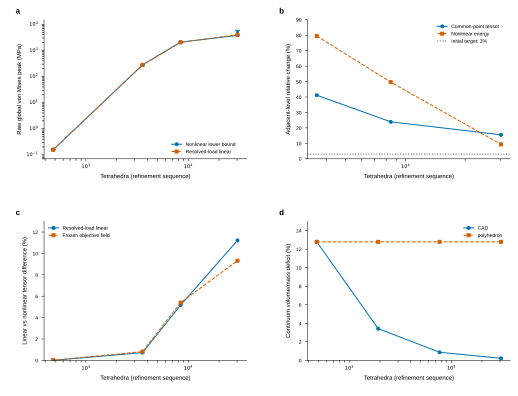

# Egg geometry and four-level spatial diagnostics

The complete [physical-validation objective](LOAD_MODEL_PHYSICAL_VALIDATION.md)
remains active. At the same6.25ms state, the finest two fixed-polyhedron meshes
still change common-point tensor by15.52% and energy by9.35%. Independent
resolved-load linear FEM differs11.22% from the finest nonlinear volume tensor.
An independent geometry audit identifies a separate12.79% volume/mass deficit
in the original native egg. None of these quantities is a physical tail pass.



The [editable SVG](figures/physical-egg-geometry-20261015/egg-geometry-spatial.svg),
[PDF](figures/physical-egg-geometry-20261015/egg-geometry-spatial.pdf), PNG,
three source CSV tables, figure contract and rendered QA accompany this report.
Panels distinguish nonlinear raw peak bounds, adjacent field/energy changes,
linear-model discrepancy and a separate CAD geometry sequence. Vertical peak
segments are deterministic whole-volume lower/upper bounds, not statistical
uncertainty. All original global maxima remain visible.

## Matched physical state

Jobs716451/716452 close naturally with source identities intact. The four
independently reconstructed states retain the same original finite-step physics,
dt1.25ms, material/density, coarse polyhedral geometry/mass,64-step held closure,
actual rigid fingers, friction and two-jaw control. The five-state finest prefix
has a separate prior full-field qualification. Different source history lengths
outside this common window do not establish a new four-history comparison.

| Tetrahedra | Active contact nodes | Lumped support, m² | Raw global peak bounds, MPa | Largest measured corner Green strain norm |
|---:|---:|---:|---:|---:|
|480|2|9.65136e-5|0.156453–0.156453|0.0000171539|
|3577|2|4.08089e-9|280.520–280.520|0.0311410|
|8433|18|2.83034e-9|2102.449–2102.449|0.203496|
|30298|186|3.43003e-9|3790.547–5940.331|0.466543|

Every independently assembled body/mapped force residual passes the unchanged
1e-9N physical gates. There are2400 common physical probes, with full tensor,
von Mises, raw/objective displacement and energy changes retained. The last
pair changes tensor15.5219%, von Mises4.53104%, objective displacement2.35766%
and nonlinear energy9.34808%. A small displacement change does not accept the
other observables. The finest objective nodal displacement is4.49085µm, only
0.89817% of the0.5mm wall, while its observed corner Green strain norm reaches
0.466543. Wall-relative displacement alone therefore misses local finite strain.
Corner strain values are samples, not claimed whole-volume strain bounds.

Unsmoothed normal force divided by lumped area reaches3.61394GPa on the finest
mesh. These quadrature areas are not independently resolved physical contact
boundaries. Persistent concentration remains unresolved; neither active-node
growth nor these four meshes proves nonlinear contact singularity.

## Linear-model and native numerical errors

The independent scikit-fem reference separately solves resolved full-inertia
loads and rigid inertia relief. It also evaluates linear and nonlinear stress
at the same frozen objective deformation, without calling that an equilibrium
solve. Actual solved rigid/deformable feedback remains a different requirement.

| Tetrahedra | Resolved-load linear/nonlinear volume tensor difference | Frozen-objective constitutive difference | Resolved linear global peak, MPa |
|---:|---:|---:|---:|
|480|0.00480425%|0.0123484%|0.156448|
|3577|0.726490%|0.818421%|279.143|
|8433|5.17117%|5.39944%|2035.346|
|30298|11.2208%|9.32130%|4021.713|

Native CUDA jobs716453/716454 pass both complete-equilibrium and original
field checks on480/3577 tetrahedra. Job716455 passes the8433-tet force budget
but fails one strict cached-corner component comparison. Job716456 reaches
20000 iterations on30298 tetrahedra and fails the complete force budget by
a factor21.42. These failed attempts are retained.

Diagnostic jobs716476/716477 raise only the PCG iteration cap to100000 and
preserve every original tolerance. Full-inertia iterations become22144/25783;
both full-inertia and rigid-relief modes now pass independently reconstructed
complete force gates and the independent full-tensor comparison. Their maximum
full-tensor relative differences are6.00e-12/3.38e-11. However, the strict cached
corner comparison still fails: maximum absolute component differences across
both modes are0.000180/0.000545Pa, with maximum original budget fractions
1.0874/5.9405. Both runs correctly retain FAILED scheduler/nonzero wrapper
status and explicit failed gates. A small global tensor error does not override
that comparison. Their full diagnostic arrays are archived; no production
kernel, physical tolerance or load law changes in this checkpoint.

## Independent continuum geometry

`audit_egg_continuum_geometry.py` independently integrates the authored
axisymmetric normal-offset egg with equatorial radius22mm, polar radius30mm,
taper0.18, thickness0.5mm and density2000kg/m³. It does not import `P2Shell` or
native elasticity assembly. Gauss–Legendre orders64/128/256 and depth orders4/8
agree under the declared geometry checks. Independent disk-difference volume
and first moment agree; an analytic spherical shell qualifies volume/inertia,
and finite differences verify the3D parameter Jacobian to4.71e-9 relative error.

The resulting continuum volume is3.743714406062984e-6m³, mass
0.007487428812125968kg and author-frame COMz−0.001964212255559334m.
Independent tetrahedron moments, oriented boundary flux and two closed material
boundary components verify every actual mesh. Native metadata mass, COM and
inertia agree with these independent mesh integrals.

| Geometry approximation | Tetrahedra | Represented mass, kg | Volume/mass error from continuum |
|---|---:|---:|---:|
|Native level1 and all fixed-polyhedron local refinements|480–30298|0.00652984821040133|−12.7892%|
|Native CAD level2|1920|0.00723113104220418|−3.42304%|
|Independent Gmsh h0.03|200892|0.00748492771265856|−0.0334040%|

The Gmsh mesh belongs to the independently declared finite-traction study;
its different represented mass is not silently substituted into the existing
Franka dynamics. Facet-centroid radial gaps and analytic-normal angles are
reported as local geometry diagnostics, not Hausdorff or normal-distance bounds.
Volume/mass differences cannot be converted into a fraction of stress error.

## Paired geometry assets and next contact comparison

Job716481 builds paired polyhedron/CAD meshes with identical connectivity
at480/1920/7680/30720 tetrahedra and two thickness layers. Each refinement
retains old vertices exactly. The polyhedron branch preserves both material
boundaries, volume, mass, COM and inertia. The CAD branch adds vertices on the
same analytic normal-offset shell; its volume/mass errors are12.7892%,3.42304%,
0.870790% and0.218652%. Material and density remain fixed. This reports changing
represented mass explicitly instead of tuning density.

All six original physical held-initializer points survive on both mesh families
to below5e-18m nearest-P2-node discrepancy; their world-frame constrained
components stay unchanged. A failed first driver incorrectly required a
historical configuration-provider run to have completed. Jobs716482/716484
preserve that startup failure before any solve; the corrected driver uses its
closed source/configuration and freshly solves every closure/dynamic state.
The corrected jobs716487/716489 close naturally, and independent jobs716488/
716490 audit every one of their five dynamic states. Each has a newly solved
64-target original held initializer, then the same dt, zero initial velocity,
friction0.6, dhat2.5µm, actual finger masses/geometry and jaw PD/damping/armature.
The audit reconstructs all original body/mapped force terms and friction
history; it does not independently audit each of the64 closure states.

|1920-tet geometry family|Mass, kg|Largest body/mapped residual over five states, N|Final active contact nodes|Final raw global peak bounds, MPa|
|---|---:|---:|---:|---:|
|Fixed polyhedron|0.006529848210401322|1.85e-11 /3.31e-11|2|0.284221–0.284221|
|CAD approximation|0.007231131042204171|6.27e-12 /1.48e-11|4|0.356816–0.356816|

Both final peaks occur at the same recorded physical point
[1.76974525692e-6,0.0220289148321,0.00118468705852]m. The shape and represented
mass change together at fixed density, and geometry also changes the solved
contact. These values therefore do not isolate an elastic discretization error
or a pure geometry-only stress error. Two geometry cases at one resolution are
not a contact tail. Newly scheduled7680/30720-tet cases and their independent
audits remain excluded from accepted evidence until they finish.
Geometry assets alone do not establish contact or stress convergence.

## Reproduction and immutable evidence

Use the existing scientific environment and source wrapper scripts; runtime
paths below are relative to `$RIGID_STRESS_DATA_ROOT/runs/20261014-physical-validation`.
The exact Slurm submit lines, source before/after identities, package versions,
successful and failed arrays, input hashes and figure data are in
`evidence/20261014-physical/egg-spatial-geometry-v1/manifest.json`.
External asset inputs have explicitly labeled post-termination byte-identical
observations rather than invented producer source captures.

The spatial/geometry packet verifies983 actual runtime originals and584 source
identity records; manifest SHA256 is
`e8d6d58c38e40141c8f73beae1539604756e4ad8f71501705f7199a4c282a8a6`.
The separate `egg-paired-contact-v1` packet verifies360 actual runtime originals
and260 source identity records for the two completed contact references and
their independent audits; manifest SHA256 is
`bf4619df9b5878e75e4f42174724584941911a0369e31094d466c0bbd433ef85`.
Both verifiers check stored/decompressed bytes against actual runtime files.
New live producers are absent from these immutable packets.

```bash
bash research/rigid_stress/scripts/audit_egg_continuum_geometry.sh "$run" \
  --mesh-spec "$base/meta/egg-continuum-geometry-spec-v1.json"
bash research/rigid_stress/scripts/paired_egg_geometry.sh "$run" \
  --seed examples/rigid/assets/hollow_egg/level1/elastic.npz \
  --reference-run "$base/franka-tip-coupled-0-v1" \
  --capture "$base/franka-input-complete-s4-v1" --maximum-level 4
bash research/rigid_stress/scripts/run_paired_egg_contact.sh "$run" \
  --geometry-run "$base/egg-paired-cad-polyhedron-geometry-v1" \
  --mode cad --level 2 --closure-run "$base/franka-ref-centred-v1" \
  --seed-reference "$base/franka-tip-coupled-0-v1" --steps 5
```

Choose a fresh `$run` each time. Full original approach/lift/support history,
separated thickness/volume/contact/quadrature/regularization tails, matched
egg and U references, remaining load-model/feedback comparisons and warmed
costs at physically verified accuracy all remain required.
