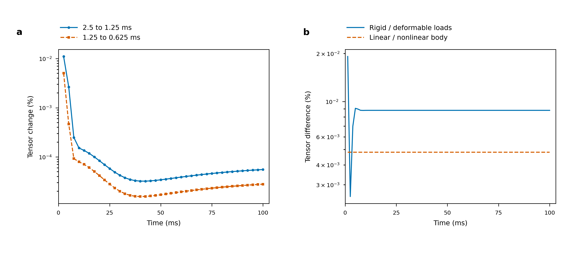

# Matched contact feedback and fixed-law temporal diagnostics

This checkpoint extends the [solved full-arm hold](PHYSICAL_COUPLED_FRANKA_U_20261015.md)
within the unchanged [physical-validation objective](LOAD_MODEL_PHYSICAL_VALIDATION.md).
It separates temporal discretization, resolved rigid/deformable contact feedback,
nonlinear body response and actual native nodal recovery. All measurements below
use one480-tetrahedron fixed polyhedron with unresolved spatial/contact stress
concentration. Small differences here do not establish a physical accuracy range.

## Matched rigid and deformable controls

`RigidEggArticulatedContact` restricts the same body collision surface to a finite
rigid translation/rotation while retaining its independently assembled consistent
mass. The corresponding deformable body retains stable neo-Hookean elasticity.
Both use the same actual12 compound finger geoms, nine-joint authored Panda
inertias/armatures/damping/equality, captured PD gains and effort caps, gravity,
friction0.6, IPC contact potential,2.5um barrier distance and current friction law.
Both solve a64-target closure with the original six body coordinates supported,
then release the body and all nine joints with zero initial velocities.
The rigid restriction makes the supported body pose fixed during closure.
Each closure solves its own contact loads under the same support/actuation;
forcing identical loads would suppress the feedback being measured.

The rigid body uses cancellation-stable exponential-map kinematics. Its complete
six generalized balance rows include consistent-mass backward-Euler inertia and
actual contact/gravity. A fixed reference radius0.0316360242m converts rotational
rows to force units for the numerical merit. Independent checks retain separate
resultant force and moment limits:1e-9N and radius*1e-9Nm. All nine joint rows
and a fresh complete MuJoCo step retain the original1e-9 effort budget. Arbitrary
nodal constraint reactions within a rigid body are not claimed to vanish.

Two pilot diagnostics715028/715032 fail the unchanged1e-3 tangent criterion.
Their complete64-target accepted closure and logs are retained. A longer central
difference sequence shows held/dynamic errors decreasing toward zero from
0.2606/0.4278 at1e-8 perturbation to0.0002625/0.0004284 at1e-11. The criterion,
physical contact law and outer equilibrium budgets remain fixed. Independent
finite-angle rigid kinematics differ4.066e-13 from their directional check.
Pilot715035 and80-step hold715038 pass. Reused closure identity and its failed
post-initialization diagnostic provenance remain explicit.

## Independent feedback and friction audit

Audits715036/715039 reconstruct corresponding rigid/deformable loads and motion;
715051 adds every-stencil Coulomb checks and complete contact resultants/moments.
No coupled Newton implementation is imported. Body velocity/acceleration come
from saved positions, rigid motion is independently fitted with consistent mass,
finger poses are checked against MuJoCo, and joint efforts are reconstructed from
finger resultant wrenches. Every saved state also passes a fresh robot step.
The80-step audit covers both cases through0.1s at1.25ms.

| Largest independently reconstructed residual | Rigid body | Deformable body |
|---|---:|---:|
| Body force-equivalent / complete FEM balance (N) |2.76862e-10|4.35231e-10|
| Body resultant (N) |2.33046e-10|4.66926e-10|
| Body moment about its current COM (Nm) |5.10363e-12|8.77329e-12|
| Joint effort residual (joint Nm/N coordinates) |1.61474e-10|3.26674e-10|
| Fresh complete robot-step effort residual |1.61283e-10|3.26808e-10|

For each case, resolved contact, gravity and full nodal inertia are transformed
to the independently fitted material frame and replayed through linear FEM.
This common elastic response isolates resolved-load feedback from the nonlinear
constitutive difference. The full six-row inertia-relief correction has norm at
most1.040e-10N and remains recorded. Full volume-quadrature tensors, raw corner
extrema, energy and each finger's body-side six-component wrench are retained.

| Maximum over80 matched times | Relative difference |
|---|---:|
| Rigid/deformable resolved-load tensor feedback |0.0191954%|
| Rigid/deformable raw replayed global peak |0.0189796%|
| Rigid/deformable replayed elastic energy |0.0381116%|
| Per-finger force feedback, combined force norm |0.0193951%|
| Per-finger moment feedback about current body COM |0.0295491%|
| Linear replay versus actual nonlinear deformable tensor |0.00480822%|

The maximum per-finger force/moment differences are1.10072e-4N/5.67590e-7Nm;
their norms and denominators are separate. At0.1s the tensor feedback is
0.00880888%. The largest raw replay peaks anywhere in the histories are
156460.664Pa rigid and156456.707Pa deformable. Final raw replay peaks are
156456.801Pa/156443.205Pa. The actual nonlinear deformable final peak lower
bound remains156447.322Pa, with its independently retained whole-volume bound.
Replay peaks and nonlinear peaks are different observables.

Every shear stencil remains within its current Coulomb bound; the least negative
force-minus-bound diagnostic is about-0.203N. These are sticking controls, not
near-sliding acceptance. The complete regularized-contact force cancels, but its
measured moment about body COM reaches2.39435e-8Nm. This moment is retained in
the source fields and must enter the outstanding contact-regularization study;
it is not silently removed or asserted to be exact contact moment conservation.

The matched rigid counterpart uses the same IPC law as the deformable reference.
It is not an equivalence claim for Genesis's original rigid contact algorithm or
its time integrator. Original approach/lift and captured angular motion remain
unmatched. This controlled comparison identifies feedback within its declared
protocol, rather than attributing differences between contact laws to elasticity.

## Actual native nodal replay

GPU jobs715040/715045 send audited loads through the production Quadrants
`StressModel.recover`, retaining actual device full tensors and global peaks.
Both cases are replayed at steps1/40/80 with two inputs: full nodal inertia, and
contact-only rigid inertia relief with fitted angular velocity. All12 full-hold
replays pass independent complete residual and raw-output checks. Maximum native
versus independently assembled full tensor difference is1.14641e-10; the largest
complete residual uses2.061% of its original budget. Eight pilot replays also pass.

These are actual native nodal replays. Finite-footprint distribution, model/source
redistribution and physical contact accuracy are separate unverified axes; passing
elastic algebra is not their acceptance. No warmed throughput claim is inferred
from these allocated correctness runs.

## Three time steps with one initialization and contact law

Array715012 completes40/80/160 steps at2.5/1.25/0.625ms through the same0.1s.
All cases reuse byte-identical closure fields and zero initial velocities.
The authored joint equality time constant stays5ms; a guard prevents `2*dt`
clamping from changing it. Independent audit715017 reconstructs every one of
the280 accepted states at unchanged original1e-9 body/joint/fresh-step gates.
Largest reconstructed residuals are9.130e-10N,8.612e-10 joint effort and
8.610e-10 fresh-step effort.

| Maximum at40 exact common times |2.5→1.25ms|1.25→0.625ms|
|---|---:|---:|
| Objective volume tensor change |0.0110542%|0.00506642%|
| Elastic energy change |0.0213851%|0.00906425%|
| Raw global peak change |0.0115275%|0.00479286%|
| Body contact resultant force change |0.0102354%|0.00600380%|

The temporal audit also retains separate moment differences about the fixed world
origin, explicitly unlike the feedback table's body-COM convention. No combined
N/Nm error is formed. Common-time raw peak differences are at most18.036Pa and
7.499Pa. Maxima over the entire coarse/middle/fine histories are
156453.558Pa/156460.824Pa/156474.021Pa. The computed nonlinear upper/lower peak
interval remains about0.000329Pa at every step.

All listed temporal diagnostics lie below the declared3% initial diagnostic at
this one coarse spatial/contact setting. Tensor changes decrease rapidly early,
reach a minimum around35–40ms and increase mildly later. No fitted order or
globally monotone history convergence is claimed. Temporal stability cannot close
the previously measured26.8% spatial tensor change or growing contact peaks.

[Editable SVG](figures/franka-temporal-feedback.svg) and
[embedded-font PDF](figures/franka-temporal-feedback.pdf) use183x82mm.
Panel a retains40 exact common times per adjacent time-step pair; panel b retains
all80 matched feedback/constitutive samples. Both y axes are logarithmic and use
percent. All240 deterministic values are included without smoothing, fitted
order or statistical uncertainty. The earliest times contain the largest
differences; the later feedback plateau remains near0.00881%, above the0.00481%
constitutive diagnostic. The figure supports separation of these error sources
within the short hold; it does not show a physical spatial operating range.
Its source data, contract, physical-size metadata and inspected rendered QA are
included alongside the figure.

## Evidence and reproduction

The [immutable checkpoint](../evidence/20261014-physical/feedback-time-checkpoint-v1/manifest.json)
retains all terminal successful and failed runs, complete arrays, exact input/
executable identities, packages/hardware and allocated commands. Its verification
checks1658 exact originals across14 terminal runs and464 input/executable source
identities. Manifest SHA256 is
`3a2fe60d811234910ce49a18e0b09b84c779d4719fed857d0405d85191b25c9c`.
The named previous checkpoint
provides unchanged deformable/capture inputs without duplicating them here.

Use `scripts/run_rigid_egg_franka.sh RUN --capture CAPTURE --steps 80
--held-closure-run PILOT`, then `scripts/audit_rigid_egg_feedback.sh AUDIT
--rigid-run RIGID --deformable-run DEFORMABLE --steps 80`.
`scripts/replay_articulated_feedback.sh REPLAY --audit-run AUDIT --steps 1 40 80`
runs actual native checks on allocated GPU hardware.
`scripts/audit_articulated_temporal.sh AUDIT --run COARSE MIDDLE FINE` and
`scripts/plot_articulated_feedback.sh FIGURE STYLE --temporal AUDIT
--feedback FEEDBACK` reproduce the common-time analysis and figure. Use the
existing physical-validation environment and explicit project data/cache paths.

The original full A/B/C matrix remains active. Priority remains credible
volume/geometry/contact and regularization tails, original egg/Franka history,
resolved U nonlinear/compliance coverage, applicable identical-input load models,
finite-footprint mapping versus contact feedback, physically verified warmed
native cost and complete reproducible deliverables. Fine local/uniform/U/egg
studies remain separate work; their live states do not count as accepted results.
