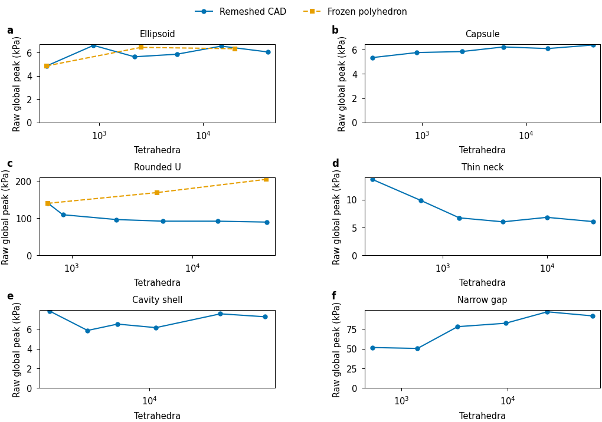
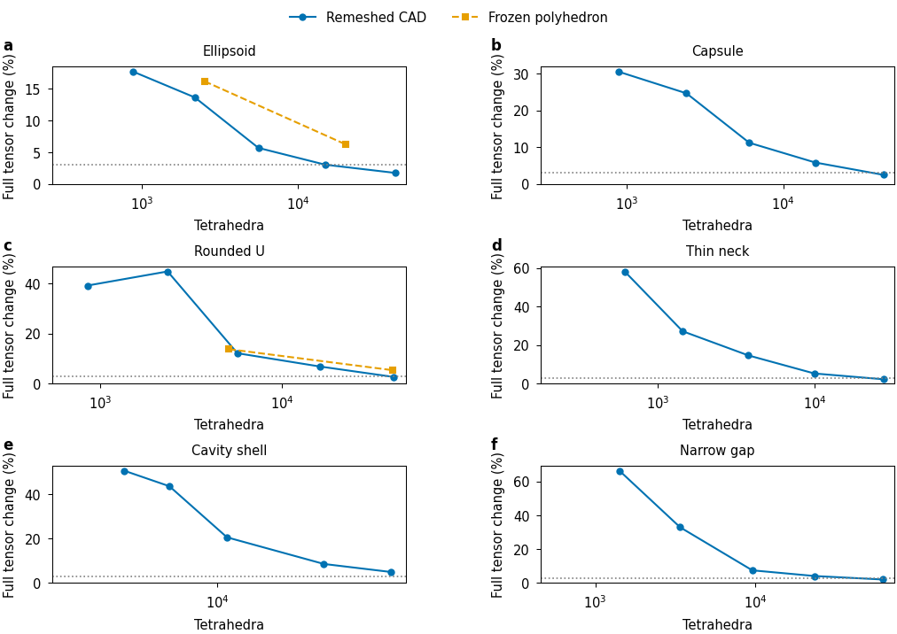

# Finer FEM references and contact-conditioning diagnostics

The [physical-validation goal](LOAD_MODEL_PHYSICAL_VALIDATION.md) remains active.
Six shapes now have six independently generated CAD/volume meshes and five
finite-load cases each:180 independent FEM fields. Ten of30 case tails meet
the initial3% diagnostic simultaneously for raw peak, energy, common-probe
tensor, von Mises and gauge-aligned displacement. This is progress toward a
credible operating range, rather than certification of continuum error or
native accuracy at the new resolutions. Production numerical source remains
`f63d0931`.

## Six-level reference curves

Material, physical anchors, footprint radius3mm, load law, friction and omega
remain fixed within each case. Near-slip tractions follow each approximate
material boundary's local normal. Geometry approximation and volume resolution
change together on these curves. The separate frozen-polyhedron and quadrature
studies are in [PHYSICAL_ERROR_AXES_20261014.md](PHYSICAL_ERROR_AXES_20261014.md).

| Opposing load, last two CAD levels | Finest tetrahedra | Tensor change | von Mises change | Displacement change | Raw peak change | Energy change |
|---|---:|---:|---:|---:|---:|---:|
| Ellipsoid |41566|1.758%|1.068%|0.134%|8.262%|0.581%|
| Capsule |43481|2.488%|0.793%|0.206%|4.617%|0.615%|
| U |40824|2.671%|1.141%|0.775%|2.700%|0.780%|
| Thin neck |27356|2.221%|1.810%|8.426%|12.532%|0.694%|
| Cavity shell |67035|4.981%|2.666%|0.405%|4.154%|0.239%|
| Narrow gap |62513|2.099%|0.929%|0.604%|5.678%|0.514%|

The U opposing case meets all five last-change diagnostics. Its six raw peaks
are140.542/109.647/96.607/92.255/92.182/89.759kPa. Its last energy change is
0.780%. The frozen seed-U polyhedron instead grows to205.414kPa on a reentrant
crease. Both raw curves are retained. Their distinction demonstrates why volume
convergence on a fixed polygonal boundary cannot establish convergence of the
intended CAD problem.

Across all loads, ellipsoid and capsule each meet the last-change diagnostic
for bending, asymmetric and near-slip cases. U also meets it for asymmetric,
near-slip and multiple contacts. Thin neck, cavity and narrow gap have no
complete diagnostic passes. Small tensor changes coexist with nonmonotone raw
peaks; the report does not substitute probe averages for global maxima. The CSV
also contains absolute probe differences for observables near zero, physical
peak locations, COM/mass changes and every excluded outside-probe index.





Editable SVG/PDF, raster exports, the figure argument, exact source CSV and
[complete180-field summary](figures/physical-fine-reference/refinement_summary.json)
are retained beside these previews. These are deterministic FEM evaluations;
no statistical uncertainty band or fitted limiting value is invented.

## Reference integrity and publication

All180 fields satisfy the complete residual budget computed by the independently
assembled scikit-fem driver. A separate publication check reconstructs each of
the90 new finer fields' full corner von Mises array, unaveraged peak/location
and0.5*u*rhs work identity. It checks the immutable mesh hash and original
source closures. This postprocessing check does not reassemble stiffness or
claim to independently recompute the driver's equilibrium residual.

The six manifests each verify229 entries/229 exact originals. Their mesh assets
are already retained in `physical-axes-checkpoint-v1`; the new archives preserve
the finer full fields, probes, snapshots, commands, mesh metadata and source.

| Geometry | Manifest | SHA256 |
|---|---|---|
| Ellipsoid |[archive](../evidence/20261014-physical/fine-reference-ellipsoid-v2/manifest.json)|`095347a1cce913f9ac70ab265bcb154079074de7f6c50337754ae6863f9aac78`|
| Capsule |[archive](../evidence/20261014-physical/fine-reference-capsule-v2/manifest.json)|`ab41d23849dad4dad393edce643e6edf985e508223ddabd6eefab971ea43bd18`|
| U |[archive](../evidence/20261014-physical/fine-reference-u-v2/manifest.json)|`5053af98b8792e72d987e922dda605f861d28781f8fbf5ffa734c938063ee3d6`|
| Thin neck |[archive](../evidence/20261014-physical/fine-reference-thin_neck-v2/manifest.json)|`61deafe9404d0838686ca98b9993b80721256eaef040a3e10cc6672a951768ce`|
| Cavity |[archive](../evidence/20261014-physical/fine-reference-cavity-v2/manifest.json)|`6ec1240d22a3280178c08b375c6d3d74cbd8d7cfd68a7e88e3391af9cf3126c7`|
| Narrow gap |[archive](../evidence/20261014-physical/fine-reference-narrow_gap-v2/manifest.json)|`5d4e03ee1a3bcec5878a16808dcaae01678033468f6b1132fbe5aa401e492b7c`|

The first publication attempts complete the field reconstruction but fail on a
missing required publisher argument. Their tools/logs remain retained. Corrected
v2 publications complete and verify every original byte. Publisher verification
and source-after records are derived companions.

At this checkpoint the full egg h0.06 and h0.04 FEM solves have produced their
five fields each; the final h0.03 array task remains running. Array712795 and its
dependent summary712878/plot712892 must be polled to authoritative completion.
Unfinished egg work is outside the completed six-shape evidence above.

## Coupled-contact diagnostics remain unqualified

The original full-U free-body force/gravity step has7.78e-10N residual with its
retained lagged friction stencil. Updating the stencil raises the residual to
0.010385N. The updated equilibrium criterion therefore correctly rejects it.
No elastic, force/moment, friction or contact stopping threshold is relaxed.

The independent prototype uses the
[IPC friction-force Jacobian interface](https://ipctk.xyz/python-api/potentials.html#ipctk.TangentialPotential.force_jacobian)
to include derivatives through current contact geometry and relative motion.
Pinned1.6.0 binding documentation is retained with the diagnostics. For the
three body translations, coupled derivatives agree with finite differences to
about1e-6 at appropriate increments, whereas the frozen-geometry derivative
differs by about9.96% along X. This is limited directional evidence.

Additional checks along the actual Newton direction expose poor conditioning:
the unscaled displacement is about0.143m, much larger than the38mm-long U.
Directional finite differences are inconsistent at those weak directions;
the three translation checks do not validate the complete Jacobian/solve.
The eight-coordinate rigid/backplate Schur matrix has singular values from
7723 to8.28e-8N/m, with a smallest/largest ratio1.072e-11. A second weak mode
has0.002151N/m stiffness and about0.000259N projected residual. These are local
linear diagnostics. They do not alone prove physical wrench infeasibility.

The prototype retains current-force Newton, an optional damped least-squares
step and an invertible elastic-plus-six-rigid-coordinate body basis. All body
degrees of freedom remain available. The normal and shear control problems
pass with the new current-force Newton equations. The unchanged legacy
friction control also passes on the current source:

| Current-source control | Complete residual |
|---|---:|
| Legacy n3 compression plus5um shear, mu0.5 |1.84e-10N|
| Updated-force n3 compression plus5um shear, mu0.5 |2.67e-10N|
| Updated-force n3 normal backplate0.5N |4.06e-12N|

The normal backplate translation is solved and its axial force is0.5N under the
original acceptance gate. Its raw global peak remains5.098kPa. These supported
controls establish useful local checks, while the full free-body U variants
still fail at their first updated-friction step. The extra gravity-along-Y
variant is a separately declared physical loading case. It is not a refinement
or a successful replacement for the original gravity-along-Z case. Saved failed
states, full coordinate maps, projected matrices and source remain retained.

The [diagnostic archive](../evidence/20261014-physical/fine-diagnostics-v1/manifest.json)
verifies402 entries/402 exact originals, including passing controls, failed
grasp/plot/publication attempts, figures, finite differences and the rigid Schur
matrix. SHA256:
`6a941a698e91043ed40a394f4e3019b7a1f7dabdb65d2df011024b0841a72865`.

## Reproduction and outstanding work

```bash
bash research/rigid_stress/scripts/summarize_fine_references.sh "$NEW_SUMMARY" \
  --runtime-root "$PHYSICAL_RUN_ROOT" \
  --geometries ellipsoid capsule u thin_neck cavity narrow_gap
bash research/rigid_stress/scripts/plot_fine_references.sh "$NEW_PLOT_RUN" "$STYLE_MODULE" \
  --summary "$NEW_SUMMARY/results/summary.json" \
  --fixed-summary "$FIXED_POLY_SUMMARY/results/summary.json"
bash research/rigid_stress/scripts/diagnose_grasp_friction.sh "$NEW_DIAGNOSTIC" \
  --body-mesh "$U_MESH" --failure "$RETAINED_FAILURE" \
  --coordinate-map "$RETAINED_COORDINATE_MAP" --geometry u \
  --coupled-jacobian --newton-direction-check --rigid-schur
```

Use the last diagnostic option only with the explicit six-body-rigid-coordinate
map. Runtime data, temporary files, caches and staging use the established data
root. Finer studies remain opt-in.

Complete egg references, credible shape-specific tails and separate geometry/
volume bounds remain required. The original goal also still requires physical
profile/count/history sensitivity, per-island traction/stress maps, finer native
accuracy with warmed cost, and converged resolved egg/Franka and interior-hotspot
contact with small-strain checks and native replay. No failed reference or
adjacent-change diagnostic closes those requirements.
