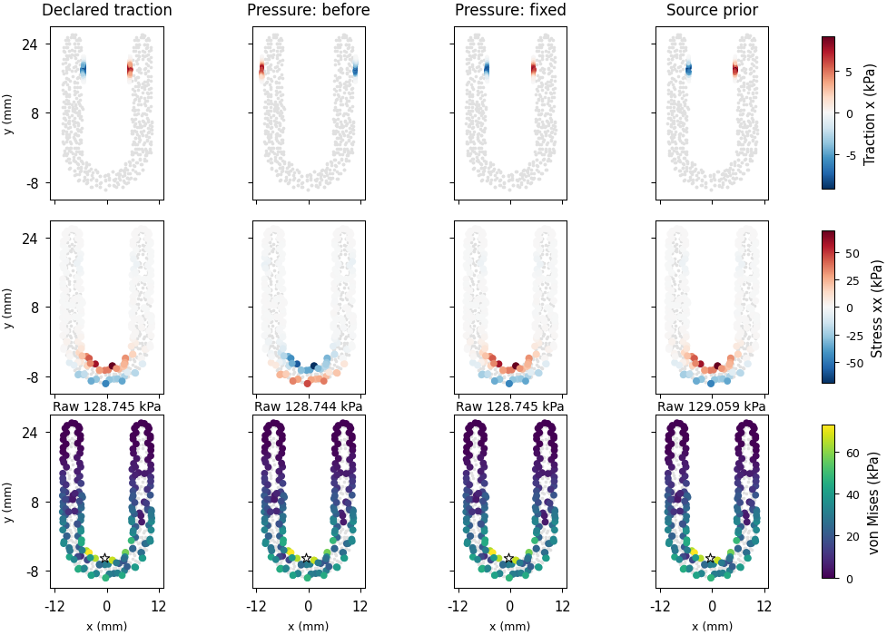
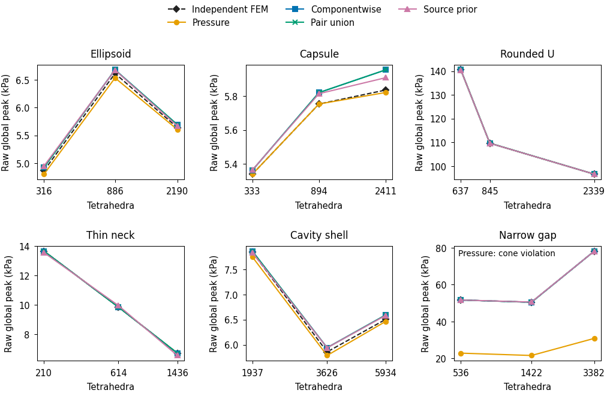
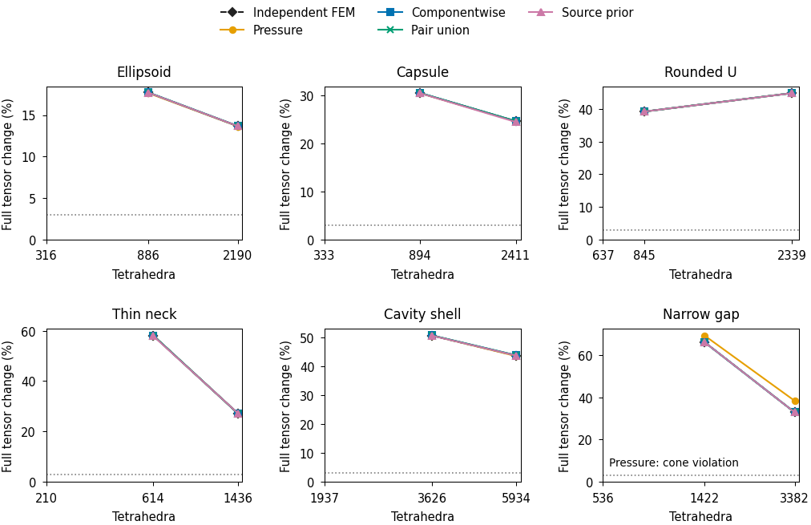

# Finite-load comparisons and the pressure material-sheet repair

The [physical-validation goal](LOAD_MODEL_PHYSICAL_VALIDATION.md) remains active.
This checkpoint qualifies a pressure-anchor repair, verifies independent
continuous boundary transfer, and measures unresolved physical refinement and
load-model limitations. It does not establish full egg/Franka or resolved
interior-hotspot contact acceptance.

## Qualified repair and independent elasticity

The old pressure force-ray anchor selected its farthest compatible intersection.
For an inner-wall U-link contact it selected the other arm's outer material
sheet. The repair selects the compatible intersection nearest the original force
point. Material, radius, force, moment, integration and acceptance budgets remain
fixed. The regression checks the actual force on the correct material sheet,
with an independent CPU mapper that starts at the known physical surface point.

The deliberately failing pre-repair test has4 failures. The repaired test has
4 CPU/4 CUDA passes. The complete changed stress module has33 CPU passes and21
existing CUDA-only skips, and54 CUDA passes. Independent scikit-fem transfer
tests have8 CPU/8 CUDA passes: each implementation integrates the same continuous
uniform-stress and bending boundary law separately. Original full tensor,
four-corner peak, mass/stiffness and complete six-gauge-row budgets are unchanged.

The matched U before/after snapshots have byte-identical frozen inputs.
For opposing loads the pressure full-tensor error versus the declared finite
traction changes from199.966% to0.1352%. The old raw peak error is only0.000876%:
von Mises hides the reversed signed stress. Other selected load models retain
their values. The editable matched traction/signed-stress/von-Mises figure
retains the full3D raw maxima and their projected locations.



[Editable SVG](../evidence/20261014-physical/load-model-checkpoint-v2/blobs/83ad182fef3f299d1fffb6b948c085e0f6f30825c419d1a852b1ea8a9077f7aa.svg)
and its exact CSV, slice samples, PDF, PNG and caption contract are archived.
The slice uses exact element-centroid tensor values without inter-element
smoothing; the raw full-domain corner maxima remain separate.

## Six-shape, three-level matrix

Gmsh independently constructs21 full3D assets: three useful levels for each
of seven shapes. Solid mesh sizes are in metres; egg/spherical-shell sizes are
in declared normalized sphere coordinates. Collision OBJ faces are oriented
outward from their material tetrahedron. Their signed surface volume is checked
against independent volume mass, avoiding the original unoriented OBJ's invalid
geometry inertia estimate.

The six-shape matrix has90 independent continuous-traction fields and360 native
model rows.342 native fields pass full tensor/von-Mises/energy/raw-peak and
complete independent equilibrium checks;18 pressure inputs carry unsupported
free contact moments. The publication audit reconstructs the independent
scikit-fem matrices and checks every saved native field again. Its worst complete
residual is0.2051 of the original budget. Each source/island retains resultant,
moment, prior movement, pressure/shear, supported/effective area and integrated
traction norms. Full native workspaces and sample-scatter checks are retained.

The cases are opposing grip, force couple, asymmetric grip with angular velocity,
near-slip local-normal traction, and three distinct patches with a shared pair.
Force, original points/all six wrenches, geometry, material, mass, pose, radius
and friction are identical between models within each snapshot. These are
synthetic frozen snapshots. The continuum geometry and compact profile remain
fixed during refinement, while their piecewise-affine geometric approximation
changes. Quadrature/ports remain fixed, so these initial curves combine volume
and geometric error.

Fixed physical interior probes are identical across levels. Displacements are
aligned using independently assembled consistent mass. The initial comparison
without this alignment is retained as an unqualified gauge comparison. A saved-
corner/probe convention audit passes42 uniform/bending manufactured fields on
all21 assets; the largest tensor difference is8.42e-7Pa, and intentionally wrong
corner ordering fails. The large refinement changes below are consequently
not explained by a corner/probe convention mismatch.

| Opposing-load reference | Tetrahedra, coarse/middle/fine | Finest adjacent full-tensor change | Finest adjacent raw-peak change |
|---|---:|---:|---:|
| Ellipsoid |316/886/2190|13.67%|17.35%|
| Capsule |333/894/2411|24.62%|1.42%|
| Rounded U |637/845/2339|44.87%|13.50%|
| Thin neck |210/614/1436|27.14%|46.51%|
| Cavity shell |1937/3626/5934|43.62%|9.96%|
| Narrow gap |536/1422/3382|32.93%|35.46%|

No complete peak/energy/full-tensor/von-Mises tail reaches the initially declared
3% diagnostic, across all five loads and applicable models. Small same-mesh
model errors or a stable scalar peak do not establish continuum accuracy.
[Complete refinement CSV](../evidence/20261014-physical/load-model-checkpoint-v2/blobs/4da54325f41092fcb27459199d5fb92957f2fd5b7a891d9c47f08fff3556b3ab.csv)
contains all450 reference/native rows, unsupported cases, raw hotspot locations,
same-mesh and finest-reference probe errors, and island redistribution.

The capsule's first pair-group replay observer failed after a successful full
mapping. All contacts in these snapshots fit one production workspace block;
capturing that actual workspace eliminates the unnecessary reduced-count
replay. The corrected five-case matrix completes, and exact sample-to-node
scatter remains checked. Original observer failures remain archived.

## Measured load-model limitations and the full egg

Euclidean pressure support reaches other material sheets across a narrow gap
or thin hollow wall. Nearest-sheet anchoring fixes the anchor; it does not make
the pressure footprint topology-aware. At the finest narrow-gap opposing case,
pressure has60.57% common-probe tensor error versus its same-mesh continuous
reference and6528Pa sampled compression/friction violation. The intrinsic
models have about0.02% probe error for this case. These are model differences
and local admissibility failures, despite numerically qualified elasticity.

The full egg h0.15 mesh has8232 tetrahedra and0.5mm wall thickness. Default
2000-iteration PCG recovery rejects all19 applicable fields in the initial scan.
The10000-iteration pressure follow-up still has2.936e-7N independent residual,
1177 times its budget. With a50000 cap it converges in14583 iterations, with
1.343e-11N residual and0.0539 budget fraction. The publisher independently
rechecks this343rd field. The cap changes iteration allowance; tolerances remain
fixed. Cold mapping/recovery take2.30/4.67s, excluding preprocessing and reference
analysis. These timings do not establish warmed production throughput.

That egg pressure result has2.173% full-tensor error,4.134% peak error and0.597%
energy error versus its same-mesh prescribed-traction reference. It also has
9011Pa local compression/friction violation. A converged algebraic solve and
modest internal tensor error therefore do not validate its local contact law.
The separate native direct-solve follow-up, job712347, completes in58m20s.
Its [matched-input solver supplement](../evidence/20261014-physical/egg-solver-comparison-v1/manifest.json)
retains the direct source, raw field and diagnostics. Both solvers satisfy the
unchanged numerical gates and give the same locally inadmissible pressure law.
Their full native tensor difference is1.048e-10 relative. The direct complete
independent residual is0.01082 of the unchanged budget.
These are separate cold allocations, including initialization/reference work;
their wall times are not a warmed throughput comparison.

An earlier constant-vector reference computed its declared force by summing
floating quadrature weights. Almost cancelling opposing inputs then caused
`body_source_prior` status33 under its aggregate-force-relative budget. The
reference now carries the mathematically declared exact strength/direction for
that law, while keeping the independently integrated nodal load and recording
the machine-level integration difference. Every compared model receives the
same corrected snapshot. Original rejected inputs remain visible. The numerical
near-cancellation sensitivity is a measured limitation; it is not resolved by
the successful exactly balanced fixtures.

## Analytic shell and supported friction control

The full spherical-shell h0.06 reference has67035 tetrahedra/305400 DOFs.
AMG-CG converges in69 iterations under the original complete residual budget.
Its raw peak error is1.811%, energy error0.392%, full-tensor probe error0.589%
and displacement error0.338%. The h0.08-to-h0.06 tail changes are0.879% tensor,
0.405% von Mises,0.0735% raw peak and0.259% energy. This passes the combined
initial shell tail diagnostic; geometry/volume error separation remains required.
AMG and symmetric SuperLU h0.08 whole-field tensor differences versus the saved
direct reference are5.59e-13 and5.24e-13 respectively. The failed initial solver
metadata serializations remain archived. h0.06 spends697.86s overall; the AMG
hierarchy takes19.78s and has operator complexity1.091.

The supported block reference combines independent quadratic elasticity with
IPC Toolkit1.6.0's physical area-weighted barrier, CCD and lagged Coulomb
friction. The [package formulation](https://ipctk.xyz/tutorials/convergent.html)
documents the barrier weighting. Back displacement controls closure and shear;
contact forces are solved outputs. E1MPa, nu0,100mm² area,10mm total height,
50µm compression after touch,5µm shear and friction0.5 remain fixed.

The original87.5µm contact-entry increment produces a nonconverging friction
iteration; under-relaxation does not resolve it. Separating a pre-contact
approach from contact increments at most dhat/4 gives12/12 accepted initial
mesh/regularization/step-size configurations. Every final load-step equilibrium
is explicitly recorded below1e-9N. Six additional dhat0.625/0.3125µm controls
also converge. At n5/dhat0.3125µm the normal force is0.503083N and free residual
1.227e-10N, about0.617% from the zero-gap0.5N limit.

Independent conforming bonded-interface references cover n3/4/5 and normal/
normal-plus-shear controls. Their exact normal solutions recover0.5N/5000Pa.
The shear references have positive Coulomb margins at every interface corner
on both material sides. Stress-flux integration differs from consistent nodal
reaction because finite elements enforce weak equilibrium; that discrepancy
decreases from0.466% to0.129%. The initial incorrect strong-flux equality
assertion is retained as a failed reference check. All12 IPC solves in that scan
converge; the combined job is nevertheless FAILED due to those bonded assertions.

At dhat1.25µm, common-tensor error versus the bonded stick reference is about
2.5%, raw-peak error about2.2%, and elastic-energy error about5%. Contact total
energy includes barrier/friction contributions and is not substituted for strain
energy. Finer regularization lowers the force error further. Sliding, free grasp,
the full egg/Franka and resolved nonconvex interior-hotspot comparisons remain
unverified. These supported controls are a contact-formulation qualification.

## Reproduction and evidence

All long studies use opt-in wrappers and fresh data-side directories. Examples:

```bash
bash research/rigid_stress/scripts/generate_physical_matrix_meshes.sh "$NEW_MESH_RUN" u
bash research/rigid_stress/scripts/run_load_models.sh "$NEW_LOAD_RUN" \
  --mesh "$MESH" --geometry u --backend cuda --method pcg
bash research/rigid_stress/scripts/sample_load_fields.sh "$NEW_PROBE_RUN" \
  --mesh "$MESH" --geometry u --run "$COMPLETED_LOAD_RUN/results"
bash research/rigid_stress/scripts/run_contact_reference.sh "$NEW_CONTACT_RUN" \
  --resolution 3 --dhat 2.5e-6 --friction 0.5 --shear-after-close 5e-6 \
  --contact-load-increment 6.25e-7
bash research/rigid_stress/scripts/run_bonded_controls.sh "$NEW_BONDED_RUN"
```

The [main immutable manifest](../evidence/20261014-physical/load-model-checkpoint-v2/manifest.json)
verifies9909 entries/9909 exact originals. SHA256:
`08122ea608f3c65d74956832531d773c7f57c52f66fa5eb13cb3e1c9caf99d9a`.
It preserves raw fields, meshes, quadrature clouds, workspaces, source/config
snapshots, hardware/package records, Slurm commands and successful/failed cases.
The independent audit recalculates343 complete equilibria, tensors and energies.
Verification and publisher after-source hashes are derived companion records.
The initial publication has an overwritten version label and omits the later
converged egg case; it is retained as an unselected publication attempt.

The [refinement-figure supplement](../evidence/20261014-physical/load-refinement-figures-v1/manifest.json)
preserves editable SVG/PDF, PNG previews, exact CSV and figure/caption/alt-text
contracts. Selected v2 renderings pass text and visual QA. The original annotation
overlap is retained. Per-island traction-map figures beyond the matched U
control remain required.
Its56 entries/56 exact originals have manifest SHA256
`3e58ac413f8c1aa7d1b964e32dd8c52450549410b200be15ce21ba0087a30961`.
The direct-solver supplement has45 entries/45 exact originals and manifest SHA256
`0f12f0ce9778ba10244a81d207ea0de2e7e43a0f617ad9a1689fbb80a2d3a733`.





Next acceptance work is finer independent convex/nonconvex refinement, separate
volume/geometry/quadrature/intrinsic-port axes, radius/profile sensitivity,
changing-contact histories, warmed accuracy/cost measurements, and resolved
egg/Franka plus interior-hotspot contact with matched physical actuation/supports.
None is replaced by the numerical agreement or the supported control results.
