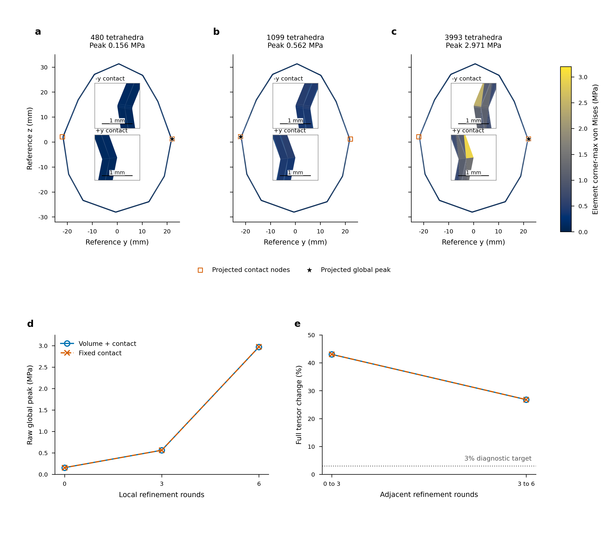

# Three local contact levels and independent full-arm dynamics

This checkpoint retains the complete [physical-validation objective](LOAD_MODEL_PHYSICAL_VALIDATION.md).
Three useful local levels still fail to establish a physical stress/contact tail.
An independent full nine-joint articulated backend now matches the captured
application inputs, enabling a coupled reference without fixed-hand substitution.
That coupled deformable application solve remains unfinished.

## Local refinement does not yet resolve stress

All six coupled/frozen-contact cases at480/1099/3993 tetrahedra complete the
original64 held targets and80 inertial steps. Material, mass, fixed seed
polyhedron, friction, actuation, physical held points and0.1s duration remain.
Source closure and the original1e-9N complete mapped/body budgets pass. Largest
finest mapped/body residuals are2.690e-10/2.685e-10N on the coupled path and
2.674e-10/2.619e-10N with fixed original contact triangles.

| Body tetrahedra | Coupled raw peak (MPa) | Fixed-contact raw peak (MPa) | Coupled active lumped area (mm2) | Maximum normal force/area (kPa) |
|---|---:|---:|---:|---:|
|480|0.156447|0.156447|96.51359|8.28321|
|1099|0.562064|0.562105|6.45833|160.64966|
|3993|2.970655|2.971656|0.43664|2119.28842|

Common-field audits714891/714893 use2400 unchanged material points at10 exact
physical times, including their original manufactured-field/finite-rotation
gates. Coupled adjacent tensor changes decrease43.0296% to26.8037%, von Mises
changes21.3203% to12.2680%, and energy changes33.1750% to25.0449%. Fixed-contact
tensor changes43.0287% to26.8041% remain nearly identical. These are far above
the declared initial3% diagnostic; raw peak changes grow rather than form a tail.
Coupled contact resultants change only0.011578%/0.036151%. Their stability does
not establish interior stress stability.

All three levels retain two active body nodes and two islands. Traction audits
714892/714894 reconstruct saved loads with exactly zero pullback discrepancy.
Coupled lumped area shrinks while force/area concentration grows. Fixed-contact
area remains about96.51mm2 and its density about8.28kPa, despite similar raw
stress growth. Lumped area and density are quadrature diagnostics, not a resolved
physical patch boundary or independently measured pressure. Every per-island
six-component wrench and unsmoothed source force remains recorded.

The lower peak moves from the positive-y to the negative-y contact neighbourhood
and returns at the finest level. At3993 tetrahedra it is at the original
positive-y reference vertex `[1.769745e-6,0.022028915,0.001184687]`m. Whole-volume
determinant lower bounds are0.99965236/0.99965222 on the finest paths. Nonlinear
global peak upper/lower intervals remain below0.000329Pa wide; these bound
extrema of each computed field, not continuum or contact-discretization error.
No singularity acceptance follows from three growing peaks or two active nodes.
The20696-tet local and30720-tet uniform studies remain live.

[Editable SVG](figures/franka-local-refinement.svg) and [PDF](figures/franka-local-refinement.pdf)
use183x160mm and shared0–3.2MPa limits. Maps show original tetrahedron four-corner
maximum envelopes, not exact cut-plane stress or smoothed nodal fields. Fixed
1.5x1.5mm insets expose both contact neighbourhoods with1mm scale bars. Contact
nodes and global lower peaks are projected onto the common reference section.
Curves show every deterministic discretization, with no fitted order or
statistical uncertainty. Original full geometry and global extrema remain.
The figure supports unresolved concentration near contact and comparatively
lower polar fields; it does not justify a physical operating range.

## Independent nine-joint rigid backend

`PandaSkeleton` compiles the authored Panda MJCF with MuJoCo3.15.0. Explicit
inertias, nine joint armatures/damping terms and the original joint equality
are retained. Geoms/assets are omitted from this dynamics skeleton; the
independently qualified contact representation supplies the captured12 actual
compound finger surfaces. Original tendon actuation is disabled so the
application's independent nine-joint PD controls can be supplied explicitly.
The authored asset and compiled skeleton are archived separately.

Qualification714915 and extended714934 check all576 actual motion/hold frames.
They compare full physical mass, bias, passive forces, hand/finger poses and
Jacobians, preserving the earlier physical-versus-working-mass distinction.

| Observable | Largest absolute discrepancy |
|---|---:|
| Physical mass-matrix component |7.106e-15|
| Generalized bias component (Nm or N) |6.395e-14|
| Passive effort component |0|
| Hand/finger Jacobian component |4.441e-15|

Poses/rotations pass1e-12 absolute checks. Original armature/damping and equality
solref/solimp/polynomial values match exactly. Contact-point Jacobians also
agree with independent point-offset transport at every captured force point.
This uses the [MuJoCo dynamics and bias definitions](https://mujoco.readthedocs.io/en/stable/computation/index.html)
and [mass/Jacobian/step APIs](https://mujoco.readthedocs.io/en/stable/APIreference/APIfunctions.html).

At three representative motion/hold states, nine independent unit-effort steps
construct the full next-velocity response. Fresh steps with mixed applied
efforts and actual PD effort readouts reproduce that affine response to at most
1.421e-12 effort-equivalent error, below the original1e-9N/Nm diagnostic.
Responses are valid for their current constraint set; a coupled solve must
recheck each proposed result against a fresh complete step. This qualifies
an articulated dynamics operator, not a solved FEM/robot coupled history or
equivalence between different rigid integrators.

## U control and remaining physical evidence

Cached U control714883_0 and audit714908 retain exactly the original physical
configuration. Final complete unaveraged body tensors differ9.920e-12 relative,
all-part displacement1.216e-12 and contact forces2.015e-10. Both original744
accepted-step force gates pass; the largest is9.305e-10N. Full intermediate
fields were not saved and their equality is not claimed. Fine cached U and
original U/egg studies remain live; numerical qualification does not close
their physical contact, geometry, nonlinear-compliance or history tails.

Next acceptance requires a solved full-arm/FEM contact reference using actual
PD/equality/history and the qualified nonlinear kinematics, with complete
coupled residuals. Spatial/contact/regularization tails must then support
resolved-load replay versus feedback, applicable identical-input load-model
comparisons and warmed native cost at verified physical accuracy. The original
full A/B/C, convex/nonconvex matrix and deliverables remain active.

## Reproduction and evidence closure

The [immutable checkpoint](../evidence/20261014-physical/local-tail-articulated-checkpoint-v1/manifest.json)
contains13 terminal successful runs and765 exact original files, with330
independently checked input/executable source identities. Its SHA256 is
`e3a06ba47081f49ab16ff86c4b90f4fc3c5c7e300ac4b5b0e110de9fc978e9a9`.
The adjacent verification compares every stored artifact with its original.
Earlier figure layouts remain archived; only version3 passes final rendered QA.
The editable SVG,450dpi3242x2834 PNG, PDF with embedded TrueType font data,
source curves, figure contract and rendered QA accompany the report.

Use `scripts/qualify_cached_grasp.sh RUN --run ORIGINAL CACHED` to check a
numerical grasp control. `scripts/qualify_franka_mujoco.sh RUN --capture CAPTURE`
checks all articulated frames and representative effort responses from the
authored source asset. `scripts/plot_local_franka.sh RUN STYLE --coupled AUDIT
--frozen AUDIT` renders the matched figure. Fresh runtime directories use the
established data root and the pinned physical-validation environment; exact
allocated commands, packages, hardware, configurations and source snapshots
are preserved in the checkpoint. Live fine studies remain excluded.
