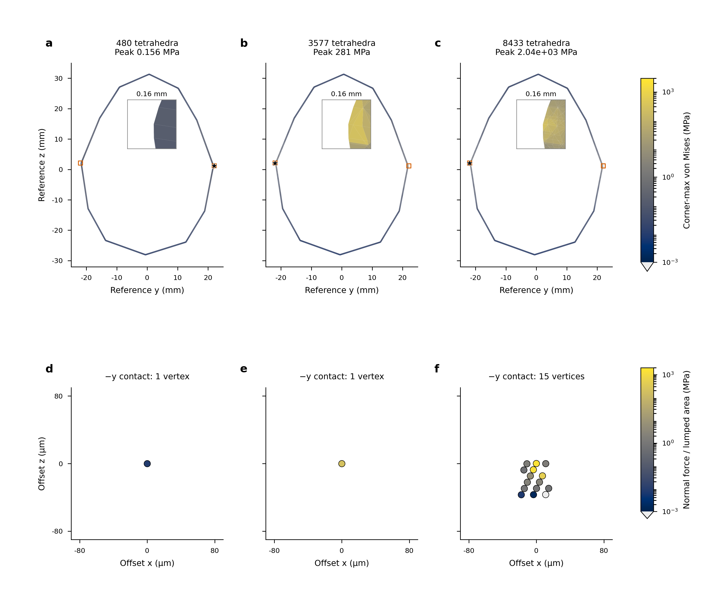

# Matched spatial fields remain unresolved after contact-node growth

This advances the complete [physical-validation objective](LOAD_MODEL_PHYSICAL_VALIDATION.md).
Three uniform meshes and three matched-time narrow-band states now quantify
the unresolved spatial change. More active contact nodes do not establish a
stress/contact tail. The original25 saved fine states also agree with a read-only
observation of the precision-aware producer; its complete80-step history and the
full original Franka application remain unfinished.

## Three complete uniform references

Producer714840_0 completes all80 dynamic states on30720 tetrahedra with the
original64-target cold closure, dt1.25ms, physical held points and full polyhedron.
It uses the already qualified current-matrix cached Newton algorithm. Its
maximum recorded original mapped/body residuals are5.41731e-10/5.38100e-10N.
Independent field audit715757 checks2400 common material points at ten common
times, proper finite body frames, evaluator polynomial/objectivity controls and
raw extrema on all three meshes. The original uncached finest attempt timed
out before saving dynamic states, so no complete fine uncached/cached history
equivalence is claimed.

| Body tetrahedra | Final raw peak lower bound (kPa) | Active body contact nodes |
|---|---:|---:|
|480|156.447017|2|
|3840|226.120525|2|
|30720|381.761774|2|

| Change over ten common times, normalized by finer result |480→3840|3840→30720|
|---|---:|---:|
| Complete probe tensor |56.2224%|49.3173%|
| Probe von Mises |34.5606%|19.5223%|
| Objective displacement |36.3022%|19.5996%|
| Body elastic energy |35.1552%|21.4085%|
| Contact force |0.00713012%|0.00866146%|
| Contact moment |0.00447744%|0.00545616%|

Final raw-peak changes are30.8% and40.8%. The earlier independently reconstructed
traction audit715758 retains area-quartering and fourfold density growth with
two active body nodes. These meshes refine both volume and collision triangles;
they retain the fixed polyhedron and physical contact law, not a solved finite
footprint. A small resultant change is insufficient physical stress evidence.
This field audit does not independently reconstruct every dynamic force gate.

## Three independently balanced states at32.5ms

Audits715908/715913/715933 compare the original fixed-arm/two-jaw controls at
step26, t=0.0325s. They preserve the physical mesh family, mass/material,
friction, contact regularization, dt, actuation, held-point protocol and64-target
initialization. The8433-tet state is the independently recovered26th equation
after its original accepted25-state prefix; it is not a completed new trajectory.
Each state has complete body and mapped balances independently reconstructed
using centered current-contact forces, consistent inertia and capped jaw PD.

| Body tetrahedra | Body residual (N) | Mapped residual (N) | Active body nodes | Lumped support (mm²) | Raw global peak (MPa) |
|---|---:|---:|---:|---:|---:|
|480|3.83169e-11|5.59460e-11|2|96.5136|0.156450|
|3577|1.39341e-10|2.75997e-10|2|0.00408089|280.524818|
|8433|4.36708e-13|9.611e-13|18|0.00283025|2044.208882|

All original1e-9N force gates pass. The original saved contact-force differences
are2.80827e-11/7.27317e-11/approximately3e-17N; those arithmetic differences are
retained separately. The original-body inputs are not retuned to improve the tail.

| Volume-weighted common-point change |480→3577|3577→8433|
|---|---:|---:|
| Complete tensor |41.1587%|23.9432%|
| Von Mises |20.7651%|8.15881%|
| Objective displacement |17.7018%|6.65696%|
| Body nonlinear energy |79.5391%|49.6615%|
| Raw global peak |99.9442%|86.2771%|

There are2400 fixed material probes. Their seed-volume weights define diagnostic
norms, not an exact continuum integral. Absolute tensor/VM L2 units are
Pa*m^(3/2), and displacement L2 units are m^(5/2). Raw spatial displacement and
the proper-frame objective elastic displacement have separate recorded columns;
the objective displacement is used in the table. No fitted order or statistical
confidence interval is implied by these three deterministic states.

The finest raw peak stays at the original negative-y contact vertex,
`[-2.26835e-5,-0.0219618335,0.0020866068]`m. Its maximum normal force/lumped area
is1.45993GPa. Fifteen active nodes lie on that contact and three on the other,
despite unrestricted asymmetric response. Lumped support is a quadrature
diagnostic rather than an independently determined physical contact boundary.
The full global search remains unrestricted; no nonlinear-contact singularity
proof follows merely from this peak growth.

## Small wall-relative displacement does not validate local linearization

| Body tetrahedra | Minimum corner J | Maximum corner Green-Lagrange strain norm | Maximum objective nodal displacement /0.5mm wall |
|---|---:|---:|---:|
|480|0.999991876|1.71536e-5|0.0703273%|
|3577|0.979701826|0.0311415|0.405027%|
|8433|0.796464741|0.199771|0.798235%|

The finest objective nodal displacement is3.99117um. Its small ratio to shell
thickness coexists with a local finite-strain norm near0.20. The reference uses
the declared finite-deformation law; a globally small displacement alone does
not justify the production feature's small-strain approximation at this hotspot.
Constitutive approximation, omitted feedback and native finite-footprint mapping
still require separate measurements at physically converged settings.

## Preserved original prefix and reviewed figure

Read-only observation `precise-spatial-prefix-observation-v1` copies the already
written first25 states while producer715870 remains live. Each NPZ is checked
as a complete ZIP, copied with metadata, and hashed against the live source
before/after copying. Geometry, closure, physical configuration and executable
source identity are also pinned. The observation never marks the live producer
complete and its files are archived as immutable input artifacts.

Qualification715926 compares every array in every original25 saved states,
all unaveraged corner tensors, complete quadrature tensors and raw peaks.
Maximum corner/quadrature relative changes are4.85747e-11/4.70804e-11. The
existing numerical comparison budgets are declared separately from unchanged
1e-9N physical force acceptance. Complete candidate history and terminal
independent audit715877 remain required.

After that independent audit, export715965 and complete-history comparison715966
are scheduled. The export preserves every original state byte and separately
derives the established FP64 final-field representation, retaining the independent
wide-coordinate raw-peak interval. It is explicitly a postprocessor, not a new
physical solve. The subsequent comparison uses ten common times; no result is
claimed before these dependent jobs complete.

The [editable figure packet](figures/matched-recovered-spatial/README.md) includes
SVG, embedded-font PDF,450dpi PNG, the rendered preview, caption, source table,
argument contract and completed QA. Shared logarithmic scales retain raw maxima;
the lower row uses a tangential x-z projection on the finest hotspot side, with
fixed-size markers rather than pressure-area glyphs. Producer metadata remains
immutable; the separate rendered QA records the completed review. The figure
shows unresolved fields and local finite strain, not physical acceptance.

## Nonlinear U numerical-method qualification

The coarse nonlinear U producers715781_0/715802_0 subsequently complete.
Independent comparisons715792/715818 check the same original physical inputs,
complete final displacement/contact/tensor/VM arrays, and all744 retained
accepted-step force-gate records in each run. The original uncached nonlinear
case is the reference. No intermediate full fields were saved, so their complete
trajectory-field equivalence is not claimed.

| Numerical reference change | Final complete body tensor relative difference | Raw-peak relative difference |
|---|---:|---:|
| Cached exact-current-matrix solve |7.67606e-11|1.52316e-11|
| Contact-free rigid translation as initial Newton iterate, with cache |7.60523e-11|3.79852e-12|

All retained original1e-9N gates pass; the maximum is9.65866e-10N. These tests
qualify numerical tools for finer studies and preserve their constitutive/contact
law. They do not validate a fine nonlinear contact tail, full Franka history,
omitted feedback or warmed production cost. Finer2339/5669-tet nonlinear cases
remain live and must meet their own independent physical checks.

## Live work and natural timeout

The generic compliant-shoe egg initializer714503_0 subsequently ends in Slurm
TIMEOUT at8h00m after progressing through the original remaining initialization.
Its wrapper still writes0, which is not completion. A request to extend that
live allocation to12h is rejected by cluster permissions; the request and
before/after state are recorded. There is no completed dynamic or contact result
from that attempt.

After the actual terminal state is confirmed, new snapshot715941 retries the
same saved initialization equation384 and physical protocol using only the
previously qualified cached exact-current-matrix numerical solve. All seven
original canonical inputs match the closed attempt byte for byte. The same
restored held rows, old friction state, current-force guard, material, geometry,
friction, actuation and original residual budgets remain. This is a new numerical
attempt after a real timeout; it is not an observation-timeout restart. Its
eventual physical/equilibrium results remain unverified.

Original full3.3s history715815, precision-aware80-state control715870, narrower
level18 and nonlinear/fifth-U producers continue. Neither scheduled audits nor
producer progress substitutes for their acceptance. The complete original
A/B/C, geometry/contact/time tails, finite-load model/feedback and physically
verified warmed accuracy/cost objective remains active.

The immutable `matched-spatial-checkpoint-v1` contains9 terminal runs and688
file entries, with386 source-hash records. It separately includes the sealed
25-state observation and records its producer as live at capture time. Manifest
SHA256: `7643ef45f08a2a0220f0b0bcd3634d946f948717dfb5164ea0ee58c66867f15e`.
Stored bytes are checked against their complete runtime originals. Reproduce
with `scripts/publish_matched_spatial_checkpoint.sh`; exact argument files,
Slurm commands and rendered QA are retained. The later method qualifications
and egg TIMEOUT are separately retained in `reference-methods-checkpoint-v1`:
5 terminal runs,175 entries and82 source-hash records. Manifest SHA256:
`684371c039d8bed4973fd1ac5419466139e489f4e431a0d7075efce54a3de984`.
Reproduce that supplement with `scripts/publish_reference_methods_checkpoint.sh`.
The new egg cached retry remains live and excluded from both publications.
