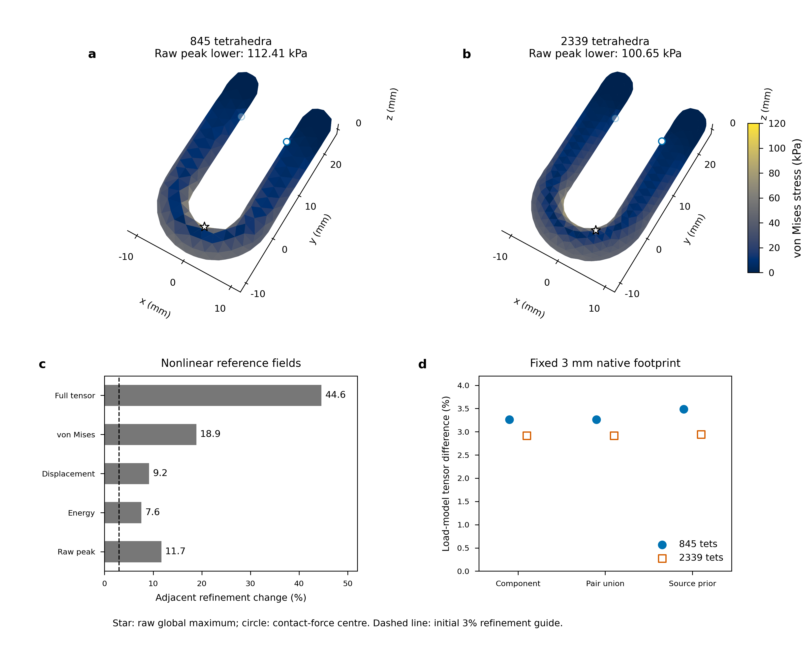
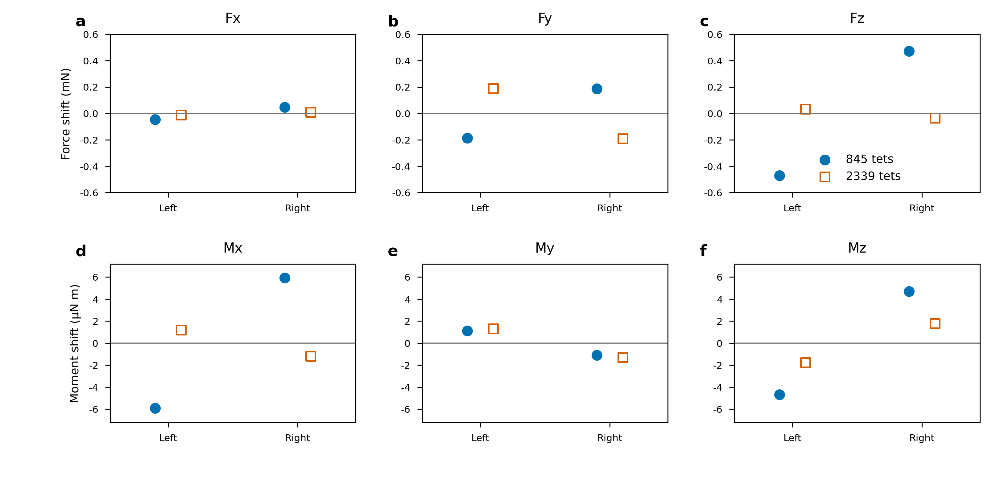

# Nonlinear U fields, geometry error and objective load models

This advances the complete [physical-validation objective](LOAD_MODEL_PHYSICAL_VALIDATION.md).
The2339-tet nonlinear U reference completes, and independent final-field/control
reconstruction passes on two spatial levels. Complete probe tensors still change
44.58%; a small native linearization discrepancy does not establish spatial
accuracy. Independent analytic/CAD measures also expose substantial coarse
geometry and mass approximation. Every original completion gate remains active.

## Two independently reconstructed nonlinear references

715802_1 completes the body2339/pad7 reference in2h09m39s. All parts use the
declared compressible neo-Hookean law: body E10GPa,nu0.3,rho2000kg/m³ and shoes
E1MPa,nu0,rho1000kg/m³. The force-controlled protocol retains0.05N per shoe,
friction0.8,dhat2.5um,1mm pad thickness and initial gap,0.1mm edge lift,64
force increments and gravity(0,-9.81,0)m/s². The temporary body fixture is
removed before the final force/gravity stage. The new initialized coarse
reference already agrees with its original final fields at the published
numerical budgets; this is not a new physical material or actuation choice.

716092_0 reconstructs all-part nonlinear bulk equilibrium from retained final
contact loads.716108_0 additionally checks material declarations, independent
consistent-mass gravity on every part, uniform signed pad actuation and the
declared coupled refinement axis. Original and centre-fixed coordinate maps
remain separate. Both references retain every original accepted-step residual
record. Intermediate complete fields and the last friction history were not
saved, so these are final-field audits rather than trajectory/contact-history
reconstructions.

| Body/pad discretization | Accepted records | Independent body residual (N) | Independent original-map residual (N) | Raw nonlinear global peak interval (kPa) |
|---|---:|---:|---:|---:|
|845/pad5|744|3.11204e-10|4.77308e-10|[112.413888,112.414743]|
|2339/pad7|598|4.51518e-11|4.55978e-11|[100.650015,100.650427]|

All original1e-9N gates pass. Maximum retained accepted-step residuals are
9.58591e-10 and9.97388e-10N. Body determinant lower bounds are0.999997584
and0.999997515; minimum shoe bounds are0.939183 and0.917120. The intervals
bound the computed unsmoothed field, not its continuum or model error.

Proper finite body frames preserve nonlinear energy. Direct evaluation of the
affine P2 deformation gradient at75 unchanged material points gives:

| Change normalized by finer result |845→2339|
|---|---:|
| Complete probe tensor |44.5831%|
| Probe von Mises |18.8751%|
| Objective displacement |9.17003%|
| Nonlinear body energy |7.59116%|
| Raw global peak lower bound |11.6879%|

Probe norms are deterministic diagnostics, not continuum integrals or confidence
intervals. Body energy is4.38300878e-8/4.07376299e-8J. Raw maximum reference
coordinates move from[0.357,-4.991,0.153]mm to[3.283,-3.823,-0.483]mm within
the inner bend. No stable hotspot or physical tail is accepted from two levels.
Body CAD approximation, volume resolution and contact/pad resolution all change.

## Geometry and mass are explicit approximation errors

716276_0 independently compares the original OpenCASCADE geometry with the
analytic semicircular tube, two straight arms and two outer hemispheres. For
bend radius R8mm,tube radius r3mm and arm length L24mm,

V = pi*r²*(pi*R+2L) +4*pi*r³/3,

A =2*pi*r*(pi*R+2L) +4*pi*r².

Both CAD measures agree with these expressions to the declared1e-10 relative
check. Continuum volume is2.18087687876e-6m³ and mass at the unchanged density
is4.36175375752g. Independent tetrahedral volumes also agree with the separately
assembled consistent FEM masses at both audited nonlinear levels.

| Affine body tetrahedra | Volume/mass error versus CAD | Surface-area error versus CAD |
|---|---:|---:|
|845|-8.57308%|-2.73433%|
|2339|-4.03933%|-1.28793%|
|5669|-2.20339%|-0.706277%|
|16146|-1.07160%|-0.350823%|
|40824|-0.556259%|-0.177502%|

The first two discrete masses are3.98781697/4.18556809g. Thus their gravity
loads differ because of geometric approximation at fixed density. Density is
not retuned to compensate. These geometric measures identify a real error axis
but do not assign a fraction of the44.58% stress difference to geometry alone.
The fixed-body pad study keeps the body mesh, geometry and mass identical.
The finer meshes' geometric measures are verified here; their interrupted
contact calculations are not thereby qualified.

## Subsequent fixed-body pad axis

716309_0 completes pad5 on the existing2339-tet body in1h18m52s.716416_0
independently checks it against the completed pad7 reference with
`--axis pad_at_fixed_body`. The body mesh and semantic geometry hashes are
identical, as is its4.185568092402535g discrete mass. All original force,
material, gravity and force-stage controls stay fixed. Pad surface geometry,
volume and contact resolution vary together on this declared axis.

| Fixed body2339 | Pad5 | Pad7 |
|---|---:|---:|
| Original accepted residual records |624|598|
| Independent body residual (N) |4.41440e-11|4.51518e-11|
| Independent original-map residual (N) |4.42500e-11|4.55978e-11|
| Raw global peak interval (kPa) |[100.634580,100.634990]|[100.650015,100.650427]|

The75-probe full tensor changes2.78267%, von Mises1.22017%, objective
displacement2.67521%, body energy0.673997% and raw peak lower bound0.0153356%.
Both unrestricted maxima occur at[3.283124812,-3.822847291,-0.483103659]mm.
Small peak change and a shared hotspot still do not establish a physical tail
from two levels. The pad9 producer and fixed-pad5 body refinement remain live.

The [fixed-body pad packet](../evidence/20261014-physical/u-fixed-body-pad-qualification-v1/README.md)
preserves150 actual-runtime entries and72 source-identity records. Its final-field
and recorded-history scope is unchanged: a missing complete friction trajectory
is not reconstructed from final nodal loads. These deterministic changes at
the fixed2339-tet body cannot be subtracted from the earlier coupled44.58%
diagnostic or combined with the distinct volume-L2 load-model differences.

## Objective replay separates numerical, constitutive and load-model differences

716089_0 adds one constant-load increment to the2339-tet reference with a known
friction increment, independently reconstructs stencil forces and material
frames, and checks actual native CUDA recovery. The original-map hold residual
is6.12823e-11N. Its native complete residual consumes0.0154300 of the original
elastic budget, including all gauge rows. Full native corner tensors agree
with independently assembled linear FEM to1.35773e-11 relative difference.
The separately evaluated native/nonlinear tensor difference at common volume
quadrature is2.87747e-5, or0.00287747%. This is one unresolved spatial setting,
not a converged deformable-contact truth or solved rigid/deformable feedback.

The existing coarse objective replay is reused.716117/716118 then compare
the applicable production load laws at fixed3mm native radius and2 ports.
Within each mesh, original source application points, forces, free moments,
friction and geometry are byte-frozen across models. Every source force is
rotated into its proper material frame; material anchors are preserved. The
baseline is independent linear FEM on those resolved nodal loads, isolating
mapping/model differences from the source nonlinear linearization diagnostic.

| Native model |845-tet exact volume-L2 tensor difference|2339-tet difference|
|---|---:|---:|
|pressure|Unsupported original free moments|Unsupported original free moments|
|componentwise|3.26270%|2.91802%|
|pair_union|3.26270%|2.91802%|
|body_source_prior|3.48355%|2.94483%|

All six admissible native fields pass original force/moment and complete elastic
budgets. The largest elastic budget fraction is0.0229899. Componentwise and
pair_union agree for these separated patches; this case does not demonstrate
their differences under overlapping support. Pressure rejection is a declared
model-input limitation, not a numerical convergence failure.

The aggregate prior moves equal-and-opposite local loads between the physical
shoes while conserving their aggregate wrench. Local force-shift norms are
0.508984mN on the coarse case and0.193589mN on the medium case, about0.94–0.96%
and0.36% of the corresponding source-force norms. Moment-shift norms about the
reference COM are7.63901/2.50501 microN*m. Raw prior peaks are112.065333 and
100.438933kPa, so a small scalar-peak change again does not describe the full
tensor or local wrench redistribution. These are conditional model comparisons,
not a universal model ranking or a verified accuracy/cost operating range.
The solved IPC weights and native finite-footprint quadrature represent different
declared traction measures. Physical profiles/radii and refined references remain
required. The probe, exact linear-field volume and nonlinear quadrature norms
are distinct diagnostics and are not combined into an additive error budget.

## Editable figures and reproduction

The [immutable evidence packet](../evidence/20261014-physical/nonlinear-u-checkpoint-v1/README.md)
preserves8878 byte-verified actual-runtime entries and775 source-identity records,
with natural producer exits distinguished from separate interrupted-source
observations. Both failed/rejected figure attempts remain visible. Source hashes,
exact scheduler commands and the short-resume qualification are included.





The figure packet includes editable SVG/PDF,450dpi PNG, previews,39 individually
verified source-data rows, captions, panel/argument contracts and separate
rendered QA. Reference surface colours evaluate Cauchy stress directly at each
boundary-facet centroid; no interelement smoothing or corner-stress averaging
is used. Peak markers retain the unrestricted global corner lower maxima,
with separately certified whole-volume upper bounds. The two main
maps share camera, dimensions and0–120kPa limits. The raw source metadata keeps
its pre-review QA flag; `rendered_qa.json` records the subsequent completed review.

Recorded commands run inside image1_26 and the existing physical-validation
environment, with fresh outputs under the project data root. Core reproductions:

```bash
P=/mnt/data/zhaofeng/projects/workspace/Genesis/rigid-stress-recovery/runs/20261014-physical-validation
bash research/rigid_stress/scripts/audit_nonlinear_u_tail.sh "$P/u-nonlinear-audit-reproduction" --axis coupled --run "$P/u-nonlinear-rigid-init-spatial-1-v1" "$P/u-nonlinear-rigid-init-spatial-2-v1"
bash research/rigid_stress/scripts/replay_objective_contact.sh "$P/u-objective-medium-reproduction" --reference "$P/u-nonlinear-rigid-init-spatial-2-v1" --mesh "$P/matrix-mesh-u-v1/meshes/h0.00175.npz"
bash research/rigid_stress/scripts/map_resolved_grasp.sh "$P/u-objective-models-reproduction" --replay "$P/u-objective-medium-reproduction" --mesh "$P/matrix-mesh-u-v1/meshes/h0.00175.npz" --radius 0.003 --ports 2 --objective
```

## Interrupted work and remaining acceptance

Several CPU references stop around11:04 without a solver exception or EXIT-trap
metadata. Authoritative Slurm states are FAILED; the execution cause remains
unconfirmed. This includes the30298-tet egg after five retained dynamic states,
fifth linear U, third nonlinear U, cached egg initializer, original history and
both new fixed-body pad attempts. They are not completed evidence. All seven
executed/input source snapshots still match their initial hashes, recorded in
separate post-termination observations without fabricating producer return codes
or natural source-closure files.

716294_0 uses that explicit observation to independently audit all1875 intact
original-history states through2.34375s. Maximum body residual is1.99964e-10N;
the original controls, actual robot step and unchanged1e-9 physical gates pass.
The new audited-prefix resume mode preserves all validated state bytes and
labels audit-derived history records explicitly, keeping original solver logs
intact.716300_0 completes five new physical steps, reaching1880 states and235
macro steps.716301_0 independently audits every retained state at the unchanged
original budgets, with maximum body residual1.99964e-10N. All1875 copied source
files are byte-identical. This qualifies the short continuation and resume
mechanism, not the complete330-macro history.716302_0 continues from the1880
audited states, whose copied files are also byte-identical; its full-history
audit, field export, native replay and interior-bound checks are dependent jobs.
The full continuation is running at publication preparation and its future
results are not counted here.

The third/fourth nonlinear levels and fixed-body pad5/7/9 comparison are retried
from fresh directories after the confirmed interruption. Previous dependent
placeholders with unsatisfied failed prerequisites are removed. All retries and
the complete original history remain unverified. Fixed-polyhedron geometry and
contact tails for the egg, separated U axes, remaining applicable load models,
true rigid/deformable feedback and warmed costs at verified physical accuracy
remain required by the [acceptance ledger](PHYSICAL_ACCEPTANCE_LEDGER.md).

The [retained-initializer continuation record](../evidence/20261014-physical/interrupted-spatial-resume-plan-v1/README.md)
records the next numerical qualification without counting scheduled work as a
result.716329_0 starts from the byte-identical30298-tet held closure and resolves
all five original dynamic states.716330_0 must independently reconstruct their
unchanged1e-9N force balances and compare every saved array and full corner/
quadrature tensor within the existing numerical-comparison budgets before
716331_0 may continue the80-step control.716332_0 independently audits that
complete reference. The original terminated source remains incomplete.

716333_0 separately adds a5669-tet body with the same pad5 mesh as the existing
845-tet case and running2339-tet case;716334_0 checks this declared fixed-pad axis.
It waits for the2339/pad5 producer to complete. Thus changing pad discretization
is separated from changing body meshes, while body CAD approximation and volume
discretization remain coupled on this axis. These six new jobs are scheduled
or running, not accepted physical accuracy or convergence evidence.
