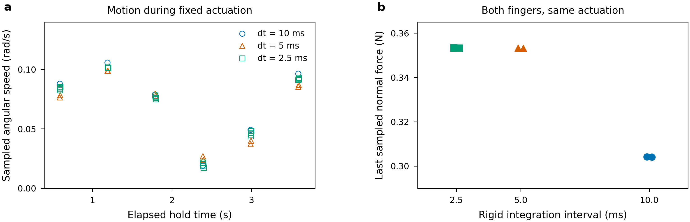

# Objective contact replay, separated spatial axes and actual Franka inputs

This checkpoint continues [nonlinear reference qualification](PHYSICAL_NONLINEAR_REFERENCE_20261014.md)
under the full [physical-validation goal](LOAD_MODEL_PHYSICAL_VALIDATION.md).
Two nonlinear U references and actual same-substep Franka inputs now complete.
Matched deformable Franka contact, remaining spatial/regularization/history tails
and representative physical accuracy/cost remain required.

## Solved nonlinear U and native recovery

The pad-only and all-part neo-Hookean cases714067_0/1 finish the same cold
force/gravity protocol as the845-tet linear U, at unchanged geometry, E, nu,
density,0.05N per shoe and friction0.8. Both meet the original1e-9N complete
coordinate/body budgets. The all-part case reports4.78223e-10/3.11627e-10N.
The pad-only case reports2.17336e-11/1.26789e-11N.

| Bulk model | Original corner/sample lower peak (Pa) | Whole-volume upper peak (Pa) |
|---|---:|---:|
| Linear body and shoes |112410.639369|Exact affine-P2 corner maximum|
| Linear body, nonlinear shoes |112412.113701|Exact affine-P2 body corner maximum|
| Nonlinear body and shoes |112413.887877|112414.743122|

The nonlinear interval has relative width7.60794e-6. Its lower point is still
the original inner-bend sample, away from the contacts. A nearly unchanged
global peak alone does not establish the full tensor, contact or spatial tail.
Pad whole-volume determinant lower bounds remain positive, about0.939–0.940.

Independent consistent-mass finite rigid-frame fits now preserve the saved
physical geometry and objective nonlinear energy. Known translated0.7rad
rotations are recovered independently. In the solved all-part case, body energy
is4.38301e-8J, compared with5.32348e-7J when the old pad-only body's saved linear
rotation is interpreted as a finite geometry under the nonlinear law. The
proper frame transform preserves each energy; infinitesimal gauge removal is
not a finite rotation of the same geometry. The all-part solved body rotation
is0.00242785rad, and objective elastic displacement remains about1.2334um.

The pad-only constant-load hold714141 completes its actual native tensor replay:
full-tensor difference2.72354e-11, using1.5966% of the unchanged native residual
budget. Its body is still linear, so these same-system gates retain that scope.

The all-part replay714198 reconstructs actual normal/friction stencil forces,
checks body and original coordinate-map residuals, removes the fitted finite
body rotation explicitly, and rotates the original nodal forces into material
coordinates without changing their values. Native linear recovery is checked
against a separately assembled linear FEM solve on those identical loads.
The hold's original-coordinate residual is2.21810e-10N. The selected v3 also
stores the actual raw native tensor and checks the native peak against its
independent reconstruction; the earlier v2 diagnostic is retained separately.

| Objective all-part replay diagnostic | Value |
|---|---:|
| Actual native versus independent linear full tensor |2.64841e-11 relative|
| Native complete residual budget used |1.19920%|
| Native versus nonlinear Cauchy full tensor, reference-volume quadrature |3.09337e-5 relative|
| Corresponding fixed-probe tensor difference |2.65988e-5 relative|
| Native raw global peak |112414.204206Pa|
| Nonlinear global peak lower/upper after hold |112413.664841/112414.520082Pa|

Thus elastic linearization is small in this single low-strain, declared pilot.
The original deformed/reference application-moment difference is retained:
[-1.85365e-10,2.85991e-10,-2.70498e-9]Nm. Numerical same-load agreement, physical
linearization differences and geometry-induced moment differences are separate
observations. This is one hold on one spatial level, not contact convergence.
The earlier finite-footprint load-model differences of about3% remain separate.

## Separated contact spatial axes

Array714003's fixed-body pad refinement and fixed-pad body refinement finish
successfully. All75 unchanged material-coordinate probes remain inside the
four approximate domains. `audit_contact_axes.py` holds all declared material,
geometry parameters, controls, friction and force-increment settings fixed.

| Changed axis | Tensor-probe change | Raw peak change | Energy change |
|---|---:|---:|---:|
| Pad5 to7,845 body tets |1.37464%|0.44222%|1.18927%|
| Pad5 to7,2339 body tets |2.77767%|0.01892%|0.67636%|
| Body845 to2339 tets, pad5 |44.86137%|11.70166%|8.31389%|
| Body845 to2339 tets, pad7 |45.09595%|12.17659%|8.87613%|

The body/CAD refinement dominates this pair of spatial changes. Neither axis
has enough useful levels to establish its tail. Body geometry approximation
and volume discretization still change together; pad curvature/contact spatial
approximation remains explicit. The third joint U level and longer full-egg
reference are still live and excluded from this immutable checkpoint.

## Corresponding actual Franka inputs

The qualified native `FrankaEgg` workload now supplies actual contacts,
world/material poses, original point forces, effective friction, controller
readouts and all12 finger collision geoms. The original approach/grip/lift
is followed by a declared stationary-control segment: original PD gains,
18mm finger targets,4N caps and fixed lift-joint targets. The added hold is
recorded as its own validation protocol. It is not an extra claim about the
original600-step rollout or a throughput measurement.

Three fresh captures714188_0/1/2 run at actual rigid integration intervals
10/5/2.5ms. Runtime mass/COM checks agree with the contemporaneously copied
level1 body assets: mass0.0065298482104kg and15g per rigid finger.
The effective contact coefficient is0.6. Contacts use side boxes16/23;
complete collision geometry includes each finger mesh and all five box geoms.
The main runtime box is17 by8 by17mm; side boxes include6 by4 by7mm.

Every physical substep has a distinct pose/force/geometry snapshot. Full captured
source sets have81 entries, including actual body assets and rigid numerical
source. The final4-substep case contains36 distinct captured frames and36
distinct geometry files. Strict slider reconstruction for all12 geoms passes
the original1e-10m guard, with largest errors below3e-16m.

| Rigid interval | Final normal forces, left/right (N) | Final angular-speed norm (rad/s) | Fixed-point wrench rank |
|---|---|---:|---:|
|10ms|0.304140/0.304042|0.096493|5|
|5ms|0.353205/0.353107|0.087071|5|
|2.5ms|0.353352/0.353254|0.093115|5|

Normal force changes materially from10 to5ms, then changes about0.042% on the
last reduction. Angular motion remains at the sampled hold times, despite
small translational speed. The original two point-force wrench maps have rank5.
With moments scaled by fixed20mm solely for diagnostics, the unconstrained
static gravity-wrench span residuals are3.37133e-5/3.74653e-5/3.34334e-5N.
The corresponding moment magnitudes are around6.7–7.5e-7Nm. This identifies
a fixed-point support limitation at these snapshots. It does not exclude
changing poses, contact birth, finite contact moments or a different grasp.

The markers retain deterministic observations without interpolation, frequency
inference or statistical confidence intervals. Both finger forces remain
visible. These data specify the next reference's real geometry, mass, controls
and friction, rather than assuming the earlier0.05N/0.8 curved-shoe pilot is
Franka matching. Angular/dynamic effects and corresponding supports remain
explicit before choosing a static or dynamic deformable comparison.

## Original failures and source closure

The original objective replay fails an incorrect independent-solver method
name; v2 uses the existing `solve` API and retains the original failure exactly.
Early capture wrappers attempted container-side `rg`, which is unavailable.
Their subset source hashes close naturally but do not prove full engine/asset
coverage. Current wrappers enumerate files with Python, fail if the expected
asset/source set is missing, and copy the complete input set before execution.

The callback parameter is a local checkpoint index and repeats0 when the
non-differentiable checkpoint window has one slot. Early2/4-substep capture
filenames therefore overwrite earlier geometry within a macro step, though
the summary retains the pose/force records. The original metadata lookup and
strict geometry failures are archived. Diagnostic v3 explicitly preserves its
failed guards; it is not accepted as matched geometry. Current captures use an
independent physical-substep counter and explicit geometry filenames. Their
strict audit passes without loosening the geometry tolerance or changing any
rigid engine numerics, controller gains, friction or source-force acceptance.

Reproducible commands are the retained arguments and Slurm submit lines for
`capture_franka_reference.sh`, `audit_franka_reference.sh`,
`audit_objective_frame.sh`, `replay_objective_contact.sh` and
`audit_contact_axes.sh`. Runtime data remains in the established physical run
root. Successful/failed records, exact source identity and selected figure
exports are published as `objective-franka-checkpoint-v1` under
`research/rigid_stress/evidence/20261014-physical/`.
The immutable manifest verifies1122 entries against1122 exact runtime originals,
with no log-prefix substitutions. Manifest SHA256:
`9cd8f2cf4b02f3f7e0a5b73f8c1e55e398199d635a1edfc7ab2201922c34952b`.
The selected input figure passes automatic text QA, manual preview inspection
and editable SVG-text checks; its argument contract and exports are adjacent.

The full [acceptance ledger](PHYSICAL_ACCEPTANCE_LEDGER.md) remains active.
Actual matched deformable Franka contact, contact spatial/quadrature/
regularization/history convergence, model and feedback separation at verified
physical resolution, explained raw singularities and accuracy/cost operating
ranges still require completion.
