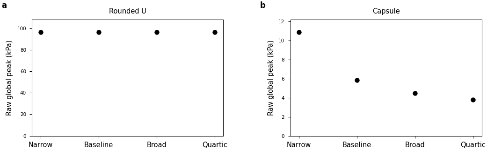
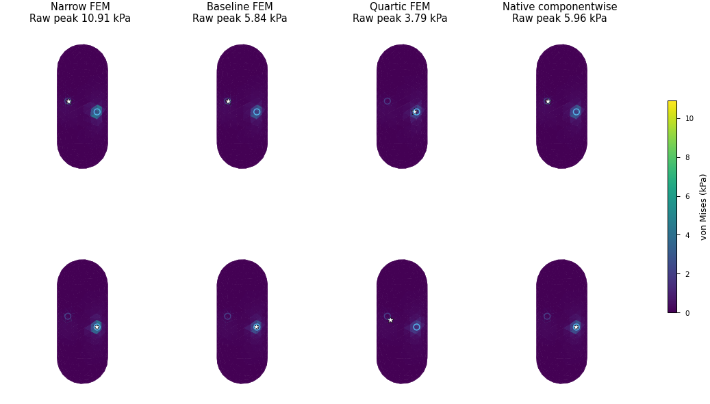
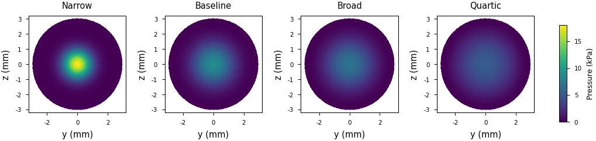

# Fixed-wrench profile sensitivity and changing-contact recovery

The [complete physical-validation goal](LOAD_MODEL_PHYSICAL_VALIDATION.md)
remains active. The seven-shape independent FEM reference sweep now completes,
including the200892-tetrahedron full egg. This checkpoint also quantifies
alternative physical traction profiles with identical original contact inputs,
adds native contact-count/history and warmed-cost evidence, and repairs a
PCG release failure without changing complete acceptance tolerances.

## Seven-shape reference completion and admissibility

All21 finer reference runs, probe stages and source closures complete. The
combined study contains200 fields and35 shape/load tails. Ten tails satisfy
the initial3% last-change diagnostic. A separate local-traction audit finds
that only seven of those ten have an admissible prescribed traction field at
the finest quadrature samples. The numerical tail and physical traction checks
are both retained. Their distinction supersedes any interpretation of the
earlier ten diagnostic passes as ten validated frictional-contact cases.

At the finest level the chosen U opposing, bending, asymmetric and multiple
profiles, plus narrow-gap bending, have sampled Coulomb violations. These are
valid prescribed-traction elasticity calculations. Their load-model comparison
requires the stated local-traction limitation. A violation in one chosen field
does not prove that its point wrench has no admissible distribution.

The egg opposing raw peaks are93.169/140.135/143.027/143.157kPa at
8232/51768/114228/200892 tetrahedra. Its last peak change is0.091%, and energy
changes0.262%, but its full-tensor probe change is7.783%. All five egg cases
retain7.64–9.61% tensor tails. The stable peak therefore leaves the full physical
tail unresolved. The final job completes in1h57m41s. Slurm rejects a requested
walltime extension; the original job completes normally and its dependent
summary, plot and publication complete.

The [egg field archive](../evidence/20261014-physical/fine-reference-egg-v2/manifest.json)
verifies229 exact entries/originals and15 complete field peak/work reconstructions.
Manifest SHA256:
`eb6636e1c548dfd8e82531bab7ee0f48c9ac0b5a2b8174f0dc3307d266585135`.
The six other finer archives are in
[PHYSICAL_FINE_REFERENCES_20261014.md](PHYSICAL_FINE_REFERENCES_20261014.md).

## Different profiles with exactly fixed point wrenches

The profile experiment retains the original geometry, material, mass, pose,
omega, radius3mm, friction and every original force point/six-component patch
wrench. Each variant copies byte-identical native inputs. The native fields
remain unchanged. Only the independently specified traction distribution varies:
Gaussian widths0.25/0.45/0.65 times a compact quartic cutoff, or the quartic
cutoff alone. A profile-weighted constant-force and linear-couple correction
matches every original wrench. Independent nodal scatter also preserves its
force and original-point moment. Every local compression/friction violation
is recorded.

| Opposing reference, unchanged input wrenches | Narrow | Baseline | Broad | Quartic |
|---|---:|---:|---:|---:|
| Capsule raw peak |10.907kPa|5.837kPa|4.484kPa|3.786kPa|
| Capsule energy |7.857e-11J|5.815e-11J|5.264e-11J|4.757e-11J|
| U raw interior peak |96.607kPa|96.607kPa|96.607kPa|96.607kPa|

For capsule opposing loads the unchanged native componentwise field differs
from the baseline by0.750% in exact volume-weighted full-tensor L2 norm.
That difference rises to22.539% for the narrow reference and20.069% for the
quartic reference. The point data alone therefore do not identify a unique
stress field. The far U interior bending maximum is much less sensitive to
these profile changes, although its whole-field tensor and local traction
still change.

Two independent quadrature levels produce80 fields:40 profile cases at each
level. Twenty-nine of40 finest cases meet the sampled local traction check.
The largest level3-to4 volume-weighted tensor change is6.13e-7. This is far
below the measured profile-law differences. The corrected narrow near-slip
profiles and several U fields remain inadmissible and are retained as such.
Their failed local check applies to this declared affine-corrected family,
without a general infeasibility claim.







The full3D maps display exact face-centroid tensors on a common colour scale.
White stars mark unaveraged global corner maxima. Blue circles mark physical
contact centres. Two full-geometry views expose the opposed patches. Pressure
maps retain actual quadrature samples and physical coordinates. Editable
SVG/PDF, previews, source identities and captions accompany the figures.

## Native contact histories and the PCG release repair

One reused native mapper/state handles empty input, opposed gripping, force
scaling, contact birth, reordering, death, near-slip, changed force/omega,
return and release. All four models receive the same physical snapshots.
Every accepted field is checked against independently assembled FEM equilibrium,
including the six constrained gauge rows, raw global peak, and a fresh-state
reconstruction. Source-chart resultants, moments, area and pressure/shear
concentration remain retained.

The original sequence accepts35 fields, rejects four release solves and marks
one pressure free moment unsupported. The release regression independently
reproduces four CPU failures with warm starts; four cold-start cases pass.
The two changes preserve the requested equations and final acceptance gates:

- A warm-started PCG state clears displacement when its complete RHS is exactly
  zero. The test also applies self-balanced grip forces with zero aggregate
  wrench and nonzero internal stress, preserving the full-RHS distinction.
- The inner free-row absolute stopping budget now has the same0.01 margin as
  the relative budget. The complete residual retains the original tolerance.

The repaired sequence accepts39 fields and retains the one unsupported pressure
input. Release returns exactly zero displacement, tensor, von Mises and peak.
Its largest warm/fresh full-tensor relative difference is1.11e-9. New U/cavity,
warm/cold and two-force-scale regressions pass8CPU/8CUDA cases. The complete
current-source CPU stress module passes41 cases with21 explicit CUDA-only skips.
The complete current-source CUDA module passes62 cases. The before/after logs
and JUnit records remain retained with their exact numerical source.

Two research-checker issues are separately retained. Sample capture now excludes
reserved inactive slots after verifying their forces are zero. Pair-group replay
uses the original force-fit budget instead of an over-strict per-entry relative
test near zero. The original maximum difference is3.30e-11N; independent
complete equilibrium and the fresh/warm tensor checks remain unchanged.
An initial GPU launch starts an independent CPU allocation through the shared
`gs-srun` single-task convention and stops before numerical execution. Subsequent
one-element job arrays retain the intended GPU allocation. Shared cluster
configuration is unchanged.

## Warmed scope and remaining work

The repaired2339-tetrahedron U case measures median6.72/18.25/18.26/20.32ms
for pressure/componentwise/pair-union/source-prior on an RTX PRO6000 Blackwell
Server Edition. These are one-environment full-field stress evaluations,
including input uploads, mapping status reads, load fitting, recovery, history,
global peak and synchronization. Bulk validation downloads, independent FEM,
rigid dynamics and policy work lie outside this scope. They are not aggregate
environment-transition rates or a claimed optimal configuration.

```bash
bash research/rigid_stress/scripts/run_profile_sensitivity.sh "$PROFILE_RUN" \
  --mesh "$MESH" --baseline "$FROZEN_BASELINE/results" --geometry capsule \
  --quadrature-level 4
bash research/rigid_stress/scripts/run_native_physical_sequence.sh "$SEQUENCE_RUN" \
  --mesh "$MESH" --geometry u --backend cuda --max-iterations 10000
```

The finer native U array713501 covers5669/16146/40824 tetrahedra at the unchanged
complete residual tolerances, with a declared20000-iteration ceiling. The5669
level accepts39 fields and retains one unsupported pressure moment. Its warmed
medians are10.27/29.20/29.69/32.44ms in the same named one-environment scope.
The16146 and40824 levels fail during intrinsic-distance matrix allocation on
96GB GPUs, before contact/elastic qualification. The dense8-port matrices alone
require about23.0/83.7GiB for these closed surface meshes. These are observed
allocation failures; they do not establish a universal hardware endpoint.
Original failed logs/source remain retained. Numerical port resolution and
distance-cache scalability require further study to extend the operating range.
The self-balanced, zero-gravity full-U
contact variant also fails its first updated equilibrium step at3.10e-7N. It is
retained as a separately declared failed physical case.

Credible remaining physical tails, separated geometry/thickness errors, complete
per-island maps and warmed accuracy/cost ranges remain required. Converged
resolved full egg/Franka and interior-hotspot contact, small-strain checks and
native replay remain required for completion of the original goal.

The [immutable profile/history archive](../evidence/20261014-physical/profile-history-checkpoint-v1/manifest.json)
verifies1754 entries/1754 exact originals. Manifest SHA256:
`8e473ddfee24a1e46e64a87b35dac55c1252e70853600e9f0866cdc00b1ddfca`.
It includes the complete profile cases, original pre-fix release failures,
passing release regressions, sampled-traction audit, figures and source.
The [native refinement supplement](../evidence/20261014-physical/native-refinement-closeout-v1/manifest.json)
verifies448 entries/448 exact originals, including the subsequently completed
CUDA suite and all three finer native runs with their source closures.
Manifest SHA256:
`cbb33d77488f7caed4e278b8a5b65a16b22bd3a6b9df61399a4807bb42bedb4c`.
