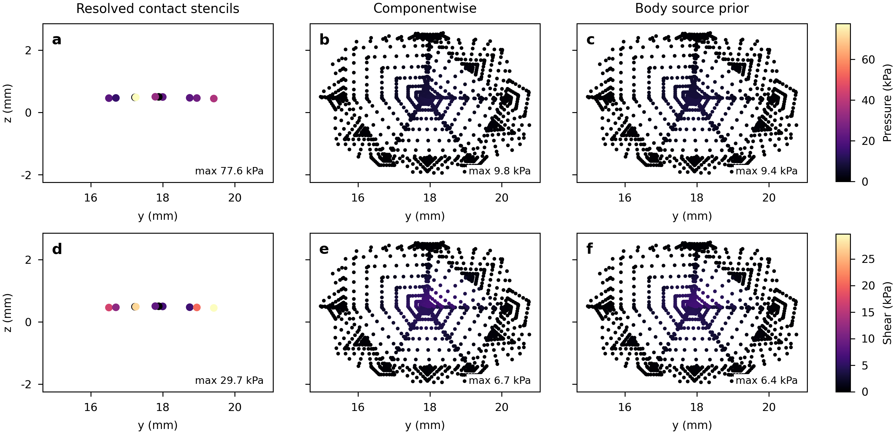

# Resolved U refinement and finite-footprint model replay

This checkpoint extends [the initial resolved-U study](PHYSICAL_RESOLVED_U_20261014.md).
The full [physical-validation requirement](LOAD_MODEL_PHYSICAL_VALIDATION.md)
remains active. Successful same-load algebra, a nearly unchanged peak, and two
useful contact levels do not establish physical convergence or Franka equivalence.

## Independent contact refinement

The original finer gravity case713655 and its native replay713949 complete
without changing the reference equations, controls or stopping criteria.
The replay uses the actual native six-component tensor, independently assembled
scikit-fem operators, complete residuals and original unaveraged global maximum.
Its full-tensor difference is1.62994e-10, with raw-native/postprocessor difference
2.33687e-13. The native complete residual consumes1.504% of its original budget.
The constant-load hold changes the body tensor by3.31671e-5 relative.

| Coupled U case | Body tetrahedra | Pad grid | Original peak (kPa) | Body elastic energy (J) |
|---|---:|---:|---:|---:|
| h0.0025, gravity |845|5|112.410639|4.38267944e-8|
| h0.00175, gravity |2339|7|100.653754|4.07383026e-8|

All75 unchanged material-coordinate probes lie inside both approximate domains.
Measured adjacent changes, normalized by the finer result, are44.579% for the
full tensor,18.872% for von Mises stress,9.168% for displacement after independent
consistent-mass rigid-gauge removal,11.681% for the raw peak and7.581% for energy.
The peak position also moves along the inner bend. These are unresolved changes,
not estimates of continuum error. Body CAD/volume resolution and pad spatial
resolution change together in this initial pair.

The finer hold gives maximum pad symmetric-strain norms6.221% and7.520%, with
minimum deformation Jacobians0.9337 and0.9162. The body strain norm remains
1.10751e-5. A nonlinear pad comparison is required; increased spatial resolution
does not remove that constitutive limitation.

## Identical source-wrench replay

`map_resolved_grasp.py` reduces the resolved nodal forces to two physical shoe
sources in linear-FEM material coordinates. It retains each original resultant,
application point and free moment; differences from deformed-space moments are
explicitly recorded. Geometry, E, nu, density, rigid pose, zero angular velocity,
friction0.8, physical radius3mm and two surface ports are fixed across models.
Each case records one byte-identical frozen-input archive shared by all models.

The observer exports each traction cloud once, checks unit normals, independently
scatters all six P2 face basis values, and compares the resulting nodal load with
the actual native force. Valid fields then pass the independent stiffness
residual, all six load-resultant rows, actual raw tensor and global-peak checks.
Reported stress differences integrate the exact linear tensor over body volume.

| Reference case | Componentwise / pair_union tensor difference | Body source prior tensor difference | Resolved-hold peak (kPa) | Body source prior peak (kPa) |
|---|---:|---:|---:|---:|
|845 tets, gravity|3.26979%|3.48711%|112.410351|112.075386|
|845 tets, zero gravity|3.16791%|Rejected in guarded run|108.926840|Unqualified|
|2339 tets, gravity|2.91647%|2.94385%|100.653944|100.435131|

Componentwise and pair_union coincide for these separated single-source pairs;
this does not establish their equivalence for shared support or multiple islands.
The componentwise peak is almost identical to the direct resolved-load peak
while its full field differs by about3%. Peak-only acceptance would miss this
load-model effect. Pressure rejects the original nonzero free contact moments;
the inputs are preserved instead of removing those moments to obtain a pass.

On the845-tet gravity case, the aggregate prior shifts the left source force
by[-0.05385,-0.18891,-0.46444]mN and the right source by the opposite amount.
The left source moment about the body COM shifts by
[-5.93709,1.07971,-4.62996]micro-Nm. The finer case has a different measured
redistribution: left force[-0.00728,0.18954,0.03441]mN and moment
[1.21191,1.28656,-1.83019]micro-Nm. Aggregate conservation does not mean each
physical patch keeps its prior wrench.

The native footprint areas are about24–26 square millimetres per source.
On the coarser gravity case, resolved stencil pressure/shear maxima reach
77.6/29.7kPa, while componentwise left-source maxima are9.77/6.66kPa and the
aggregate-prior maxima9.44/6.43kPa. IPC positive stencil weights and native
quadrature areas are different declared measures. These sample maxima expose
load concentration; they are not a converged continuum contact-edge pressure.

The maps retain individual samples, shared limits for each quantity, and the
same material-coordinate projection. No pressure smoothing or interpolation
is used. The companion [signed redistribution plot](figures/physical-resolved-models/resolved_native_redistribution.png)
retains both physical sources. Editable SVG/PDF and the figure argument contract
are adjacent to these exports.

## Near-zero aggregate arithmetic and retained failures

The zero-gravity frozen inputs have aggregate force magnitude3.13676e-10N
despite source scale0.1000493N. The original body-source-prior force budget is
3.13676e-18N; the contract uses source scale only when the aggregate is exactly
zero. Guarded run713992_1 reports9.54544e-18N and status40 on both contacts.
Its independently compensated sample-force error is1.14866e-17N. An earlier
identical-input run713962 accepts with reported2.64298e-18N. Thus this case is
arithmetic-sensitive at the FP64 cancellation floor. No acceptance tolerance or
physics was changed. It remains a measured robustness limitation rather than
a general claim of contact infeasibility.

Original v1 runs fail because the observer omitted required angular velocity
from an independent RHS call. v4 fails a newly added scatter guard because the
surface-node array needed transposition. An earlier repeated traction export
produces invalid zero geometry and is not accepted as physical traction
evidence. The corrected v5 and finer observers check geometry and scatter
before interpreting source charts. All original logs, partial results, code
snapshots and natural return codes are retained. Figure v1 also retains its
clipped-tick QA failure; only the corrected exports are selected.

## Qualified reference-only changes and unfinished work

The optional empty-contact factor cache reuses a factor only after exact CSC
data/index/offset equality and empty normal/tangential collision sets.
The optional centre gauge removes only common x translation when total applied
x force is zero, and final acceptance still checks the original coordinate map.
Both full-gravity candidates pass independent whole-body tensor, all-part
displacement and full contact-force comparisons against the original pilot:
tensor differences3.61106e-11/2.69953e-11 and maximum all-part displacement
differences after common translation1.439e-14/3.099e-16m. Both reuse340 empty
factors. Their16:03/16:20 elapsed times versus16:48 baseline do not establish a
controlled throughput gain. Production rigid stress arithmetic is unchanged.

Slurm confirms original full-egg job713701_0 TIMEOUT after2:00:29, during supported
initialization. It has no natural producer return-code or after-source file,
and no accepted final contact field. An explicit external-termination record
verifies its saved source snapshots and distinguishes external interruption
from normal producer closure. The full geometry is retained: h0.15 is a mesh
size parameter, not a reduction of egg dimensions.

Array714003 now schedules a third U body/pad level, separate fixed-body pad
and fixed-pad body refinements, and an eight-hour full-egg retry using the
qualified reference options. Live tasks are excluded from this immutable
checkpoint. Subsequent contact regularization/history tails, nonlinear pad
comparison, actual Franka geometry/compliance/control matching, rigid-contact
feedback separation and representative accuracy/cost operating ranges remain
required. See [the acceptance ledger](PHYSICAL_ACCEPTANCE_LEDGER.md).

Runtime root: the existing `runs/20261014-physical-validation/` data directory.
Reproduce model fields with `scripts/map_resolved_grasp.sh`, comparisons with
`scripts/summarize_resolved_refinement.sh`, and maps with
`scripts/plot_resolved_models.sh`; retained `arguments.txt`, source snapshots,
environment/hardware records and submitted Slurm commands specify each case.
The immutable publication is `resolved-model-checkpoint-v1` under
`research/rigid_stress/evidence/20261014-physical/`. Its manifest and independent
verification record give exact original bytes and hashes.
The checkpoint verifies948 entries against948 exact runtime originals, with
no log-prefix substitutions. Manifest SHA256:
`786271bf131b8f36bebfad9e605ff50ac9827eead5a6f1b2c2fa1a541e9b9111`.
Selected figure v4 passes automatic text QA, manual preview inspection and
editable SVG-text checks. Original figure versions remain archived.
