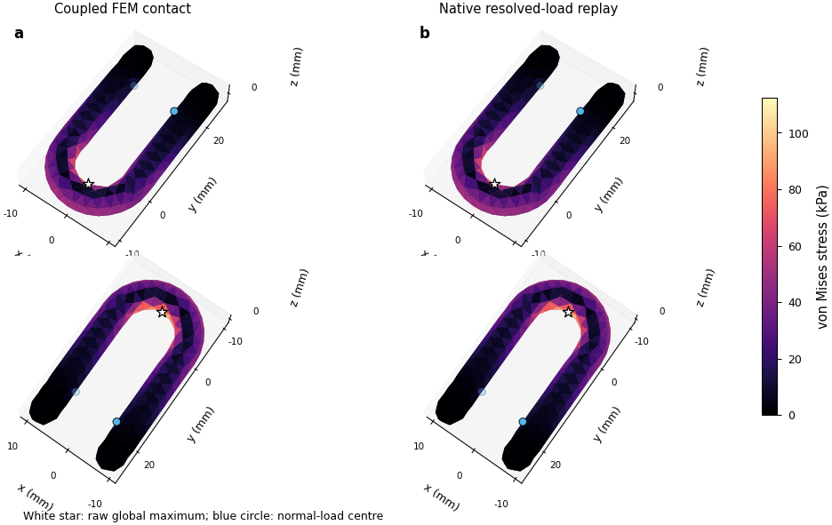
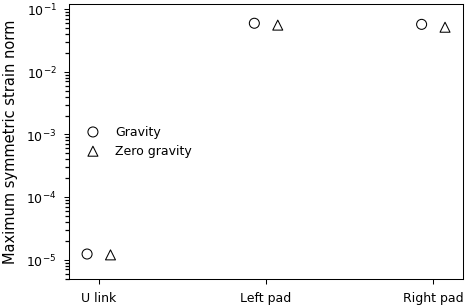

# Initial full U contact references and native resolved-load replay

The [complete physical-validation goal](LOAD_MODEL_PHYSICAL_VALIDATION.md)
remains active. Spatial refinement now produces two successful full3D U
force-controlled contact pilots with independently assembled elasticity and
updated IPC friction. Their resolved nodal loads also pass native full-field
recovery. This checkpoint isolates the elastic replay, identifies a coupled
translation gauge and preserves the limitations of the chosen linear pads.

## Contact equilibrium, physical case and scope

Both cases keep E10GPa, nu0.3 and density2000kg/m³ for the full rounded U,
E1MPa/nu0/density1000 for the compliant shoes,0.05N per backplate and mu0.8.
The shoes' undeformed dimensions/profile,1mm thickness and1mm initial gap are
unchanged. Body mesh size2.5mm and pad grid5 replace the earlier3.5mm/grid3
discretization. Geometry approximation, volume and contact spatial errors
change together; this is not a separated convergence sweep.

The loading protocol temporarily holds six body coordinates during collision-free
approach and establishment of both normal forces. It then releases the body
and ramps gravity over64 force steps. Backplates have fixed y/z guides and free
x actuation; final x positions and contact forces are solved outputs. The first
case uses gravity `(0,-9.81,0)` in material coordinates; the second uses zero
gravity. They are separately declared physical cases. No arbitrary final force
and jaw displacement are imposed simultaneously.

The reference uses scikit-fem quadratic tetrahedral elasticity, four linear
collision triangles per quadratic boundary face, IPC Toolkit1.6.0 area-weighted
physical barriers and improved-max collision sets. Activation distance2.5µm,
barrier stiffness1e6 and friction displacement smoothing1e-8m remain fixed.
The current-force Jacobian includes both geometry and relative-motion derivatives.
Continuous collision detection and the original1e-9N complete equilibrium gate
remain unchanged. This discretization and its smoothing require their own tails.

| Completed contact pilot | Gravity | Zero gravity |
|---|---:|---:|
| Complete constrained residual |3.100e-11N|4.674e-10N|
| Complete body residual |2.919e-11N|2.338e-10N|
| Raw global body peak |112.411kPa|108.927kPa|
| Final normal constraints |19|19|
| Elapsed |16m48s|16m01s|

Both raw maxima lie near `(0.357,-4.991,0.153)mm` at the inner bend, away
from arm contacts. Full fields and original source closures remain retained.
The finer1.75mm/grid7 U and full hollow egg mesh h0.15/grid7 cases are live
at this checkpoint, array713653_1 and job713701_0. They are not accepted results.
The existing body mesh is byte-preserved in
[load-model-checkpoint-v2](../evidence/20261014-physical/load-model-checkpoint-v2/manifest.json),
SHA256 `fca107fe6fcad9a1028ba5387f6123eb57540995349913c0e22b02e1509ce32b`.

## Fixed-stencil support and the separate gauge mode

A new audit reconstructs each retained coarse collision's exact force gradient
and source membership. Inner polygons provide force distributions inside exact
Coulomb cones. Outer polygons plus bounded Farkas certificates can exclude
every allowed distribution on that same fixed stencil. Fifteen cases use
8/16/32-sided polygons, two gravity orientations at1/64 and full magnitude,
and zero gravity. All three zero-gravity inner constructions are feasible.
All twelve gravity cases have bounded outer-cone separating certificates.
The certificates exclude that retained3-constraint stencil; deformation,
additional contacts and pose changes can alter support. They do not establish
general U grasp infeasibility or contact-solver convergence.

The first audit writes its numerical results but exits139 during teardown.
The version releasing the borrowed C++ collision reference while its owner
is alive completes naturally with exit0. Both sources, results and failures
remain exact. The pinned
[IPC binding](https://github.com/ipc-sim/ipc-toolkit/blob/v1.6.0/python/src/collisions/normal/normal_collisions.cpp)
uses a borrowed reference for single-collision access.

The weakest retained8-coordinate Schur mode is a different issue: common x
translation of the body and both x-free backplates. Its alignment with that
translation is0.99999999972; the relative matrix action is1.79e-11. Total
applied x force is exactly zero, so this is a gauge freedom. It does not alone
indicate missing physical support. An explicit gauge or nullspace-aware solve
should address it while preserving original complete balance checks.

After subtracting this common translation, one constant-load hold's maximum
nodal changes are0.240µm with gravity and0.00330µm without gravity. Their raw
changes are2.602/1.768µm. The gauge audit preserves both. Adding a physical
centre support under nonzero net x force would be a different problem.

## Native replay and small-strain limitations

An additional constant-load increment supplies an explicit preceding state
for local force reconstruction. Normal and tangential per-stencil gradients
sum exactly to the saved complete contact force. All19 normal/friction weights
are positive; every weighted friction force meets its local magnitude bound.
Source identities come from actual collision membership, not x-position guesses.
The static-gravity and native inertia-relief RHS differ only by1.4e-13N/
1.7e-11N in the initial replay cohorts.

Native replay uses identical resolved nodal loads with FP64 PCG and the unchanged
complete tolerance. It checks every equilibrium row, all six raw tensor
components, the complete von Mises field and the raw global peak. Native raw
stress also matches independent evaluation of its own displacement, to about
1.5e-13 relative difference. The native/contact full-tensor volume-L2 differences
are3.22e-11 with gravity and9.97e-10 without gravity. The complete native residual
uses1.10%/1.20% of its original budget.

The hold changes full body tensor norms by0.02915%/0.0002814%. This one hold
is a diagnostic, not temporal or contact-regularization convergence. Weighted
stencil pressure/shear maxima are77.59/29.70kPa with gravity and79.38/12.13kPa
without gravity; these are discrete area-weighted contact measures.

The maximum body symmetric strain norm is about1.2e-5. Its1.23µm elastic
displacement is about0.021% of the6mm material thickness,0.012% of the10mm
branch gap and0.062% of the minimum2mm pad half-width. The pads are less benign:
local symmetric strain norms reach5.1–6.0%, elastic displacements about20–21µm,
and minimum deformation Jacobians0.938–0.941. No intersections or inverted
elements appear in the inspected hold. Nonlinear pad response and rotation/
geometry error require quantified checks before final physical interpretation.





The stress map displays exact face-centroid tensors on shared colour limits;
white stars retain unaveraged corner maxima and blue circles mark equivalent
normal-load centres. Two views expose the full boundary. The strain plot shows
deterministic part maxima without invented confidence intervals. SVG/PDF and
source/claim/caption/alt-text trace accompany the previews. Initial automated
text QA rejects crowded3D ticks and out-of-range logarithmic labels. The third
layout passes; both failed exports remain retained.

```bash
bash research/rigid_stress/scripts/run_grasp_contact_reference.sh "$CONTACT_RUN" \
  --mesh "$U_MESH" --geometry u --pad-resolution 5 --gravity 0 -9.81 0 \
  --body-rigid-coordinates --updated-friction
bash research/rigid_stress/scripts/replay_resolved_grasp.sh "$REPLAY_RUN" \
  --reference "$CONTACT_RUN" --mesh "$U_MESH" --backend cuda
```

The [immutable contact/replay archive](../evidence/20261014-physical/resolved-grasp-checkpoint-v1/manifest.json)
verifies378 entries/378 exact originals, manifest SHA256
`697263be52c8385e5af1e17ba46705823521ed3817666244acb0c415c9cf58f0`.
The [gauge companion archive](../evidence/20261014-physical/grasp-gauge-checkpoint-v1/manifest.json)
verifies21 entries/21 exact originals, SHA256
`80eb43a7e50fe6755a333757764ee8de361ca91f9ca6d7574537f3870e476bb9`.
Remaining requirements include
credible contact spatial/regularization/history tails, pad nonlinear comparison,
finite-footprint load-model replay, rigid contact-feedback separation, and
the full hollow egg with actual Franka geometry/compliance/control matching.
The original physical-validation goal remains unfinished.
