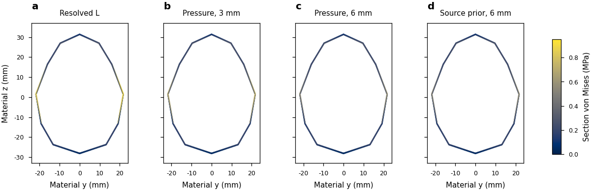
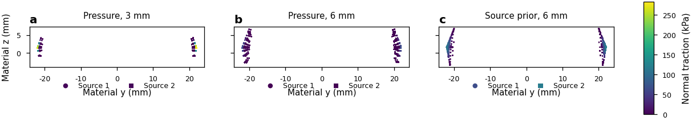

# Practical rigid stress observation for Franka grasping

The native feature is usable as a **conditional stress/reward proxy**. The new
application comparisons show that contact-footprint assumptions matter much
more than the verified elastic solve in the selected coarse reference. They
also quantify the cost of the robust source-prior model. These results do not
calibrate an absolute damage or fracture threshold.

This report follows [the current practical goal](PRACTICAL_VALIDATION_GOAL.md).
The [delivery checklist](PRACTICAL_VALIDATION_STATUS.md) records outstanding
closeout items. Historical all-shape convergence studies remain separately
scoped research; their failures and unresolved tails are preserved.

## Recommended starting configuration

| Setting | Recommendation and scope |
|---|---|
| Elastic discretization | Full hollow egg level1:480 affine P2 tetrahedra,2430 DOF. Practical measured starting point with known geometry/contact uncertainty; not a physically converged eggshell. |
| Material | Explicit example assumptions: E10GPa, nu0.3, density2000kg/m3. Set actual material properties before interpreting magnitudes. |
| Load model | Prefer intrinsic `body_source_prior` when requiring local compressive/friction-admissible finite tractions. It preserves aggregate wrench and permits measured local source redistribution. |
| Fast alternative | `pressure` is faster and numerically accepted in the tested trajectories. Its simplified footprint can violate local reference-surface Coulomb constraints; use only as a declared simplified proxy, not as qualified contact pressure. |
| Radius | Nominal6mm in the example, varied by the frozen condition bank and scripted phase. This is a physical compliance/footprint assumption. The3mm alternative materially changes stress; neither radius is inferred or calibrated from a point wrench. |
| Numerical settings | FP64, quadrature10, intrinsic ports8, max output, history4; unchanged original numerical budgets. The recorded source-prior scope uses contact support. |
| Collider and workload | `mesh64` collision geometry, explicit MPR and contact-patch off,32 environments for the cost measurement. Frozen bank has8 conditions repeated four times. |
| Observations | Retrieve the raw global maximum using `link.get_max_stress()`. Full field is optional. Invalid recovery raises the existing native error; do not reinterpret a rejected/NaN observation as safe zero stress. |

Pressure/componentwise/pair-union/source-prior are different load laws or
constraints. None is a universally correct traction reconstruction. In the
unchanged8-condition live diagnostic, componentwise rejects a contact with
status36 at radius7.857mm and mu0.4583; pressure and source-prior complete9600
observed timed environment steps each with0 invalid steps and8 partial resets.
The rejection is retained rather than repaired by changing its input.

## Separate reconstruction, elastic approximation and feedback

Four existing resolved-contact states are reused:11/866/869/2640 at
0.01375/1.0825/1.08625/3.3s. Exact source/group wrenches reproduce the previously
qualified history. Their1/2/3/2 actual contact-stencil packets retain points,
forces, enabled free moments, normals, friction and finger/ground identities.

R is the existing nonlinear contact field. L is its full-inertia linear replay.
M replaces only the contact part of that same RHS with native finite footprints.
Actual application points use the same proper finite rigid pullback. The small
deformation-induced moment difference from reference nodal coordinates remains
explicit: largest coordinate moment difference2.528e-7Nm and largest additional
rigid-mode balance projection6.123e-8N. Consequently M/L includes the declared
application-coordinate/balance convention and is not solely a profile error.

The32 combinations (four states, two radii, four models) pass native acceptance,
independent full elastic residual/corner/raw-peak checks and independent cloud
wrench checks under each model's original contract. Individual-contact models
retain each contact wrench; source-prior retains the aggregate and reports local
redistribution. Ten stricter global-net-scaled diagnostics fail for otherwise
valid individual-contact fits; they are preserved as extra diagnostics, not
substituted for the original per-contact acceptance. No tolerance changes.

| State | L/R volume tensor difference | Pressure M/L,3mm | Pressure M/L,6mm |
|---:|---:|---:|---:|
|11|0.00029175%|13.80618%|25.72776%|
|866|0.03216745%|10.92083%|20.28949%|
|869|0.00386535%|10.98858%|20.42280%|
|2640|0.00480741%|10.94274%|20.30422%|

These use positive nonlinear-reference volume quadrature and material-frame
Frobenius tensor norms. Source-prior M/L ranges10.603–12.998% at3mm and
20.205–25.551% at6mm. M/R remains separately recorded; the distinct error norms
must not be added or subtracted into a physical error budget.

Raw maxima expose a larger local effect. Pressure underestimates L's raw maximum
by18.95–19.39% at3mm and35.34–36.81% at6mm. Source-prior's6mm difference is
36.41–37.63%. At state866, R's retained global lower/upper values are
1068730.696874792/1068730.696874952Pa, L is1068533.458729444Pa, pressure M is
863106.445358322Pa at3mm and688269.440141767Pa at6mm. The R maximum's reference
coordinate is[0,0.022,0.001636024216633]m. All M raw peak coordinates remain
in the complete result rows; no percentile or smoothing replaces them.

The independent local-cone diagnostic distinguishes the models: maximum
pressure-model violation is240982Pa in these sampled finite tractions, while
intrinsic variants are within3.64e-12Pa. This is a substantive limitation of the
fast simplified law, despite its successful elastic/wrench numerics. Source-prior
also redistributes local loads: at state869/6mm, one finger packet shifts about
1.4mN in each of two force components and22.36microNm in one moment component,
while the body aggregate remains constrained. Similar scalar peaks do not imply
similar local loading.

At state866, the material x=0 sections share one full-range color scale. Each
tetrahedron is intersected independently and its linear tensor is interpolated
to section vertices; Gouraud color interpolation is display only. No cells are
merged or smoothed. The thin ring is the represented hollow shell, and the
section does not replace the raw global extrema above.

Every positive-area native traction sample is retained in this material y/z
projection. Marker shapes identify physical sources, not continuum islands.
Projection can overlap samples. The figure shows the narrower pressure profile
and broader source-prior redistribution under identical original input wrenches.
Editable SVG/PDF,1000dpi PNG, previews, plotting source and inspected QA accompany
both figures.

The [matched rigid/deformable history](PHYSICAL_COMPLETE_FEEDBACK_20261015.md)
independently measures omitted feedback: the largest tensor difference among
seven sampled times is23.17% at state869, compared with0.003865% linear/nonlinear
recovery there. It is not an all-time error bound. Both references retain the
same represented geometry/mass, actuation, contact law and dt0.00125s. The cost
workload below uses dt0.01s/substeps1 and a different rigid contact solver;
its rates are conditional engineering costs, not physically qualified rates
for the resolved reference.

## Representative nonconvex and convex controls

The [objective nonconvex U replay](PHYSICAL_NONLINEAR_U_SPATIAL_20261015.md)
already separates resolved-load linear recovery (0.002877% volume tensor
difference from nonlinear R) from M/L differences around2.918% for componentwise/
pair-union and2.945% for source-prior on2339 tetrahedra. Free-moment pressure
inputs remain unsupported. Its global hotspot lies in the inner bend, and
the report retains stress maps and signed source-wrench redistribution.
Unresolved spatial tails prevent an absolute accuracy claim.

The [small smooth convex controls](PHYSICAL_MATCHED_NATIVE_AXES_20261016.md)
retain228 accepted native fields,12 unsupported pressure rows and separate
distance/integration axes. Quadrature10/14 volume changes are below0.01346%,
while ports8/16 can still change the tensor norm by0.88726%. Existing14–17%
raw-peak tails remain research limitations. These controls support discrete
implementation and model-sensitivity conclusions within scope, not universal
physical accuracy.

## Warmed end-to-end cost

Each model uses its own same-GPU allocation for four separate processes.
Both GPUs are RTX PRO6000 Blackwell Server Edition. Every scope uses900 warmup
steps and three fixed2400-step repeats at32 environments, with the same frozen
condition bank. Each timed repeat executes96 partial resets and has0 invalid
environment steps. Timed repeats exclude intrusive trajectory observers.

| Scope | Pressure median valid env-step/s | Source-prior median valid env-step/s |
|---|---:|---:|
|Rigid baseline|11108.95|11287.24|
|Rigid + live stress|5840.70|2623.09|
|Policy + rigid baseline|9709.67|9776.50|
|Policy + rigid + stress|5437.83|2487.41|

The measured median incremental scripted cost is2.60ms per batch step for
pressure and9.36ms for source-prior at32 environments. This subtracts each
model allocation's own rigid baseline.

Live stress includes control, collision/constraints, mapping/traction fit,
recovery, numerical checks, raw peak, history and resets. Source-prior is the
more expensive robust option here. Live native allocations are83036438B for
pressure and119964854B for source-prior; these are stress allocations, not total
GPU resident memory. Complete buffer, Torch peak and free-device memory records
remain in the benchmark JSON. Cold build/JIT is recorded separately.

Scripted rigid/live samples differ by at most62.70nm in warmup height and5.37nm
in final coordinates. These are sampled invariance observations, not a proof
about every substep. The FP32 policy is the documented26→128→128→7 MLP with
1e-4rad residual scale; it reads stress, so its actions and trajectory need not
match the stress-disabled policy baseline. These are inference costs, not
full RL training or a throughput plateau.

## Reward proxy and operating range

The1N/4N experiment duplicates each of8 frozen conditions, changing only the
strong-grip force limit and preserving the original weak/release schedule.
Three1200-step restarts per model/radius retain all raw peaks, heights and phases.
Both original and half-radius schedules are tested. All230400 observed environment
steps are finite; partial resets zero selected peaks and preserve unselected
peaks. Original-radius lift-peak repeat spans are at most2.46e-13 relative for
pressure and7.70e-12 for source-prior. Reproducibility alone is not accuracy.

Ranking uses the phase0.3–0.6 maximum of the raw global step observations;
every original per-step value remains in the trace. Across both models and both
radii,6/8 condition rankings remain stable;2/8
reverse sign when the differences are tiny. Only condition3's minimum paired
separation (6627Pa) exceeds the observed absolute model/radius peak band
(6424Pa). All other cases remain inside that conservative band. A higher
commanded force limit does not invariably produce a larger raw stress.

The single predeclared0.2N/4N extension completes another230400 observed
environment steps with0 invalid values. All8 rankings remain stable across both
models/radii, and7/8 separations exceed the conservative observed absolute peak
band. Condition1 remains unresolved by that criterion (17719Pa separation versus
17802Pa band); it is not rounded into a pass. Minimum observed maximum lift
height is0.14939m for both force choices. Largest relative repeated lift-peak
span is2.03e-11. This establishes a useful conditional numerical reward signal,
while preserving all original1N/4N ties and reversals. It is not a continuum or
experimental uncertainty bound or a real damage threshold.

The lift-window result must not be used as a whole-episode damage claim.
[The complete phase audit](PRACTICAL_REWARD_PHASE_AUDIT_20261016.json) aggregates
already-computed raw whole-episode maxima from all original job logs. Here
whole-episode means each complete recorded1200-step rollout, including every
scripted phase; it is not an all-time or population bound. Whole-episode rankings are stable across the tested alternatives in8/8 conditions,
but only condition3 exceeds the absolute model/radius peak band in each force
comparison. In the0.2N/4N experiment, condition3 favors0.2N during lifting but
4N over the complete episode: low-force whole-episode peaks246–326kPa versus
157–203kPa for4N, with a minimum89158Pa separation and79230Pa observed band.
Condition0 also reverses its preferred choice between the two time scopes.
This is why the full raw step trace, contact transitions and separately named
phase observables remain available. No universal low-force recommendation,
physical safety threshold or whole-episode guarantee follows from the7/8
lift-window result.

| Operating case | Disposition |
|---|---|
|Native discrete solve, raw global max/full field, changing contacts and partial resets|Supported within the existing qualified numerical cases and the demonstrated finite application traces.|
|Franka stress reward at declared mesh/material/radius and accepted source-prior inputs|Conditional numerical proxy; measured reconstruction bias, feedback and reference uncertainty apply.|
|Paired0.2N/4N choices in the8 frozen conditions|Conditional and time-scoped:7/8 lift-window separations exceed the observed band, versus1/8 whole-episode separations. Preferred choices can reverse between phases. All raw trajectories remain.|
|Choices inside the relevant phase/model/radius band, or inferred whole-episode safety from a lift window|Unresolved; do not promise reliable stress-based ranking or termination there.|
|Pressure as physically admissible local contact traction|Unsupported for the diagnosed local-cone violations; retain only its simplified-proxy scope.|
|Componentwise diagnostic's status36 input|Unsupported at its unchanged physical input.|
|Source-prior near-cancelling force resultants|Conditional; the previously recorded near-zero FP64 wrench-budget limitation remains. Do not loosen acceptance or treat rejection as safe zero.|
|Absolute real-world damage/fracture threshold|Unverified; requires material and experimental calibration.|
|Full RL training and universal physical convergence|Separate work, outside this engineering delivery.|

Exact commands and source/configuration identities are retained under the
established physical run root in `meta/practical-franka-*-command.json` and the
native immutable snapshot. Its899 files (225384712B) match the tracked
`cd42aed09a36c1bb71eb00bc702e76da41967ac0` source checkpoint exactly (with an empty
synthetic production patch); its underlying production run records c8333ea38.
Use [the snapshot utility](../scripts/snapshot_practical_native.py) and
[the native wrapper](../scripts/run_practical_native_benchmark.sh) to reproduce
the configuration. The [complete compact publication](../evidence/20261014-physical/practical-application-v2/manifest.json)
retains23 naturally closed jobs, every failed/rejected input, original arrays,
source/configuration identities and job commands. All791 archive entries verify
against791 actual runtime originals. Manifest SHA256:
`bab8578d1fa989dc818db6a3e49db87dde9614133ae4bc70cf83a268a1a50268`.
[Runnable commands](RUNNING_PRACTICAL_APPLICATION.md) cover native cost, controlled
reward traces and reconstruction from restored compact published inputs.

The [restored-input reproduction packet](../evidence/20261014-physical/practical-reproduction-v1/manifest.json)
retains the actual53-file restoration and four fresh GPU replays. All89 entries
verify against89 actual runtime originals. Its manifest SHA256 is
`0944b2334185a5c4e3ebb91001638c3bc0333e2a7681ba2a156164c1d4e65758`.
Largest reproduced raw-peak relative difference is1.010e-11 at unchanged gates.
