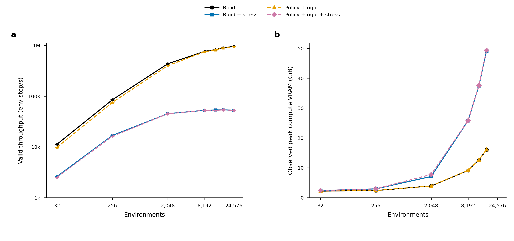

# Practical throughput experiments, 2026-10-17

The [throughput goal](PRACTICAL_THROUGHPUT_GOAL.md) is **complete within its
declared stage**. The [final report](PRACTICAL_THROUGHPUT_RESULTS_20261017.md),
[final metadata closure](PRACTICAL_THROUGHPUT_FINAL_METADATA_20261017.json)
and [completion audit](PRACTICAL_THROUGHPUT_COMPLETION_AUDIT_20261017.md)
supersede the delivery statuses in dated checkpoints below. Both final history
cohorts retain223 raw-record identities; independent audits pass115 history4
and13 history0 eligible records. The three final inspected source/figure packets
are linked in the final report.

The remaining text preserves the chronological investigation after the
[initial baseline checkpoint](PRACTICAL_THROUGHPUT_PROGRESS_20261017.md).
The earlier [recorded summary](PRACTICAL_THROUGHPUT_EXPERIMENTS_20261017.json) preserves
129 observed scope results and68 performance-eligible points, including
superseded candidates. The [scheduler export](PRACTICAL_THROUGHPUT_EXPERIMENT_SCHEDULER_20261017.txt)
is frozen separately. Performance eligibility checks the recorded numerical
gates, source, exits and timing protocol; it does not replace independent
field/lifecycle qualification or establish final recommendation/completion.
The [requirement-by-requirement audit](PRACTICAL_THROUGHPUT_COMPLETION_AUDIT_20261017.md)
now records their final dispositions; historical pending statements below
retain their original observation time.
An [independent metadata re-read](PRACTICAL_THROUGHPUT_METADATA_AUDIT_20261017.json)
checks all68 eligible points' actual three2400-step rows, rates, geometry,
controller, policy and precision. Observed policy reference errors remain below
the unchanged1e-9rad budget; they are not configuration equality fields.
A [source-label correction](PRACTICAL_THROUGHPUT_SOURCE_LABEL_20261017.json)
records job724962's actual baseline imports/snapshot after a descriptive engine
label was found incorrect in its retained original submission journal.

All runtime paths below are relative to
`runs/20261017-practical-throughput/` under the data root in `DATA_LOCATION.md`.
Immutable snapshots and exact submission commands remain there. Matched
capacity closures below justify retaining the barycentric cache; final operating
settings, the new recovery hypothesis and remaining large-batch checks are open.

## Closed robust baseline through B24576

The original matched configuration, condition bank and900 warmup/three2400-step
repeats remain fixed. Median valid env-step/s on RTX PRO6000 Blackwell:

| Environments | Rigid | Rigid + stress | Policy + rigid | Policy + rigid + stress |
| ---: | ---: | ---: | ---: | ---: |
|32|11293.87|2615.39|9821.80|2524.08|
|256|84845.51|16803.28|75216.98|16271.65|
|2048|434466.83|45118.75|398893.63|44814.51|
|8192|763819.52|52658.16|751745.52|52509.98|
|12288|825247.24|53262.03|813312.71|52687.11|
|16384|898658.33|53674.88|891844.22|53560.01|
|24576|952506.07|52731.09|948838.51|52678.82|

Parents724933–724936,724974/724975 and725087 now completed0:0. Every repetition has zero
invalid environment steps and zero scatter overflows, and every child closes
all899 snapshot hashes and its file inventory. The live native-buffer counts
at B32/256/2048/8192/12288/16384/24576 are119964854,447926614,3071620694,
12067143254,18064158294,24061173334 and36055203414 bytes respectively. These
are feature allocation counts, not peak process VRAM.

Actual baseline B32768 and B49152 trials724962/724971 failed with CUDA OOM
during profile-buffer growth; failed logs and exits remain. B65536 was cancelled
while pending, not observed to fail or pass. The
[workspace-size2 B32768 trial](PRACTICAL_THROUGHPUT_ORIGINAL_WORKSPACE2_20261017.json)
724976 now closes0:0 with53386.89 live and53295.31 policy env-step/s. It grows
to the complete9-contact union, retaining all contacts; this is separate
allocation tuning rather than the original default16 curve. Original stress-enabled throughput is
nearly flat from B8192 through B24576, while batch latency grows: live latency
is155.57ms at B8192 and466.06ms at B24576. This establishes a practical baseline
shoulder; B24576 is the largest closed original-options width, not an exact
capacity limit.

Separate100ms NVML memory samplers725021–725024 now complete0:0 for all four
scopes at B32/B256/B2048/B8192. Their rates are excluded from headline timings.
Maximum observed compute-process VRAM, GiB:

| Environments | Rigid | Rigid + stress | Policy + rigid | Policy + rigid + stress |
| ---: | ---: | ---: | ---: | ---: |
|32|2.1797|2.3594|2.1875|2.3672|
|256|2.3672|2.9219|2.3770|2.9316|
|2048|3.9043|7.0840|3.9180|7.7520|
|8192|9.1152|25.7949|9.1445|25.8242|
|12288|12.5996|37.4980|12.6406|37.5391|
|16384|16.0664|49.2148|16.1309|49.3418|

The additional memory jobs725088/725089 also complete0:0 with all four scopes.
These sampled peaks include setup,900 warmup steps and one2400-step pass per
scope. They are lower bounds with GPU UUID, sampling resolution and peak
sample count retained, not confidence intervals or native-buffer sizes. CUDA
reports101975851008 total device bytes for these allocations. The B2048 policy
peak is the actually observed value, not a smoothed or interpolated estimate.

The [updated figure packet](../evidence/20261017-throughput/baseline-scaling-v2/README.md)
contains editable SVG, PDF,450dpi PNG, raw repeat/source CSV, exact renderer/style
dependency, compressed input and visual/source/scheduler QA. Both panels use
independently complete matched widths: seven for rates and six for memory.
Missing B24576 memory observations remain blank. The stress-enabled baseline
shoulder is visible; these widths do not establish final capacity. The current goal needs
the final selected implementation's operating point and curves as well.

## Complete-period moving profile

Job724992 completed0:0 and its899 source hashes/inventory close. It uses an
otherwise unchanged baseline snapshot with only the benchmark measurement
harness updated: `baseline-complete-cycle-trace-v1`, manifest SHA256
`840fa4ea4408e15f878c10ed52d21498eeee266090e3b83fe72949d60da78407`.
The new `--trace-steps` defaults to the original50;600 records an entire
controller period without changing headline rollout steps or output frequency.
Post-trace errno and invalid-step checks qualify the observed window separately.

The trace covers ticks2400–2999, all256 environment resets and zero invalid
environment steps. It contains218824 GPU kernels,34896 HtoD copies and2463
DtoH copies. The full210598717-byte trace stays on data; the compact
[occupancy summary](PRACTICAL_THROUGHPUT_CYCLE_TRACE_20261017.json) and stage
summary are committed. Runtime API records include93056 `cuLaunchKernel`,8768
`cudaLaunchKernel` and2535 each of `cudaMemcpyAsync` and stream synchronization.
API launches and GPU kernel events have different scopes, including graph replay.

The following are kernel-duration sums divided by600 observed moving steps:

| Recorded GPU kernel stage | Mean summed duration per step, ms |
| --- | ---: |
|Traction fitting|3.662982|
|Elastic solve and initialization|2.033209|
|Load assembly and contact diagnostics|1.609265|
|Collision|1.101704|
|Contact mapping/source capture|0.921725|
|History prediction and maintenance|0.918180|
|Surface sampling|0.736010|
|Complete residual checks|0.303270|
|Global peak/full-output kernels in max mode|0.125947|

All kernel names are classified, with smaller dynamics, integration, controller,
reset, path, source-prior, refinement, acceptance and lifecycle stages retained
in JSON. Classification is by actual kernel names; it does not infer per-kernel
CPU work from a frozen microbenchmark. The summed7757.628ms of GPU durations
and9867.776ms of CPU step annotations overlap. Neither their difference nor
their sum is an unprofiled CPU/GPU timing decomposition. Kernel interval union
is reported separately, and CUPTI overhead stays outside headline claims.

Additional device work-counter runs725032/725033 observe every timed step at
B256/B8192. They retain loaded fractions, maxima/evaluation counters,
integration retries, elastic corrections/fallbacks and invalid steps. In
`body_source_prior`, the union leader carries the cumulative evaluation count;
inactive members retain zero evaluations. The commit path propagates wrench
errors/status to members. The earlier description of duplicated evaluation
counts was incorrect; the recorded values are unchanged. Evaluation counts
are distinct from independent solve counts or GPU wall time. Original
every10-step warmup samples remain a separate distribution.

The complete timed trajectories contain614400 and19660800 environment steps.
Valid stress-contact witnesses occupy97.46354% and two-finger nonzero contact
occupies56.29167% at both widths. A valid witness can have zero force; these
fractions have different meanings. Recorded fit evaluations average2.260143
and2.260089 per observed environment step, with a maximum13 in one step,
maximum1019 samples per source and maximum9 nonzero egg contacts. Integration
retries, elastic corrections/fallbacks and invalid steps are all zero in these
observations. The observed contact mix is preserved across these two widths;
the counts do not prove all workloads have the same expensive-path frequency.

The benchmark observer now additionally counts history predictions that pass
the complete residual, before recovery. Its baseline-only measurement overlay
is `baseline-work-history-metrics-v2`,899-file manifest
`11202ed1feb79f9724f31fdb72a0c2e4e4af9972525edf86ed63598ec1d6d301`.
B256 job725085 completes0:0 with149443 hits out of614400 observed environment
steps (24.32340%), zero invalid steps and closed hashes/inventory. The B8192
counterpart725086 also completes0:0 with4787110/19660800 hits (24.34850%),
zero invalid steps and closed hashes/inventory. These intrusive runs never supply headline
rates. This field is absent, rather than assumed zero, in earlier summaries.

## Bounded optimization results and remaining candidates

The packed-count bypass only activated when the entire750-slot raw capacity
fit the workspace. It never activated in the practical16-slot workload.
Its B2048 live result differed from the original by about3.4% despite taking
the same application path, illustrating allocation/run variation. It is not
evidence of a code speedup.

The merged-capacity readback candidate completes15 GPU and3 CPU field/lifecycle
checks, all passing, but adds one collection kernel per step. Its closed B32
live/policy medians2634.40/2543.06 and B2048 live45250.46 env-step/s differ
from baseline by less than1%. The avoided host fence does not establish a
material end-to-end benefit. The implementation has been removed from the
working candidate; its full source/results remain immutable.

Two numerical/storage experiments have distinct snapshots and are not mixed
into the baseline:

- `lazy-traction-hessian-v1` builds a Newton matrix only for an accepted,
  unconverged iterate. It passes23 CPU checks; GPU checks and same-GPU B2048
  ABBA trial724982 were initially pending. The now-closed same-GPU comparison
  gives a median candidate/baseline ratio0.964993 (3.50% slower). Its B256 diagnostic rate15571.52 is
  below the matched baseline diagnostic16643.53. It performs a second geometry
  traversal when a new direction is required; the measured result does not
  justify promoting the idea. Trace register counts fall242→224, so reduced
  register count alone does not predict application speed.
- `lazy-hessian-reconstructed-fan-v2` additionally reconstructs positions
  instead of caching them, retaining coalesced profile layout. It passes four
  CPU lifecycle/disk checks, but its B256 diagnostic rate14380.14 is lower
  still. Native buffers fall to347754862 bytes. GPU qualification and its
  complete B32768 four-scope capacity trial724988 remain open. Its memory
  reduction and rate penalty must both remain visible.

The current geometry-cache candidate, `barycentric-geometry-cache-v1`, restores
baseline fitting and caches two triangle coordinates per sample instead of
three world coordinates. It reuses those coordinates for both position and P2
shape queries, updates them on disk/fan refinement and grows/copies the complete
required workspace. It changes no physical footprint, force, friction, mesh or
tolerance. The existing direct reconstruction check retains its1e-15m bound.
Its immutable manifest SHA256 is
`4bc5a8871d8968e36a6853409ab2d9dd45944285d0f5402f2dd3ff0538fb6c80`.

The B256 diagnostic has zero invalid steps,16693.37 env-step/s and414536046
native bytes, versus baseline447926614 bytes. The7.45% buffer reduction is
measured. A material steady-state speedup is not demonstrated; usable capacity
gain is now closed by the allocation-matched experiment below.
Four CPU checks724996 and24 GPU cases724997 now pass, as do four CPU and four
GPU cached disk/refinement/torque cases725042/725043. Their original geometric,
wrench, full-field and gauge bounds remain unchanged. The
[targeted check record](PRACTICAL_THROUGHPUT_TARGETED_CHECKS_20261017.json)
retains actual JUnit counts and engine/test hash closures. Same-GPU B2048 ABBA
trial724999 completes0:0 with ratio0.998857: the result is effectively flat.
Candidate B32768 four-scope trial725051 remains open. B40960 workspace2
memory/capacity trial725052 has since closed; its result and allocation-matched
control are described below. The retained
[engine/test source audit](PRACTICAL_THROUGHPUT_CACHE_SOURCE_AUDIT_20261017.json)
matches the five implementation files byte-for-byte to the tested snapshot
and all three test ASTs to their qualified overlays. Final configuration
qualification remains open.

A final small scheduling ablation uses one warp per fit block instead of four,
with the original arithmetic and fallback unchanged. Its B256 diagnostic
16690.89 env-step/s also provides no material small-batch gain. Six targeted
GPU cases725007 pass. Same-GPU B2048 ABBA trial725009 closes with ratio1.003437,
below a1% gain. It is not adopted as a material improvement. Every ABBA
trial retains900 warmup steps and three2400-step repeats; incomplete pairs
are not declared winners. The summarizer records GPU UUID consistency,
baseline drift and the observed candidate/baseline repeat range, without
calling that range a statistical confidence interval.

The fixed6x6 Cholesky/triangular-solve loop-unrolling ablation
`static-traction-direction-v1` changes neither arithmetic order nor fitting
budgets. Eight CPU checks725067 and eight GPU checks725068 pass. Its B256
diagnostic725069 measures16745.02 env-step/s against16643.53 for the original
diagnostic, about0.61% higher. This single diagnostic does not establish a
large-batch improvement. The now-closed matched B2048 ABBA job725090 gives
ratio1.000022, effectively flat. The
[paired closure](PRACTICAL_THROUGHPUT_STATIC_FIT_20261017.json) checks all actual
exits, four source closures, one GPU UUID and twelve unchanged-duration repeats.
This unrolling is not retained. Its manifest
is `c67f82341e5830117d15398d5b12f786d06534f8fd1aea2f3309ceb5ce8e0d6a`.

## Bounded application checks and endpoint refinement

The geometry-cache candidate completes nominal-radius source-prior grasp runs
725093/725094 with the original0.2N/4N and1N/4N force choices,900 warmup steps
and three complete1200-step restarts each. Four fixed contact/load snapshots
725095 also complete0:0, preserving the exact original packet hashes and
numerical gates. The largest recorded complete-residual budget fraction is
0.043551 and the largest raw-peak relative change from the original four cases
is1.282e-11. The closed
[field/trajectory comparison](PRACTICAL_THROUGHPUT_APPLICATION_CHECKS_20261017.json)
725121 finds complete tensor relative L2 changes at most1.075e-10, and identical
sample positions after a bijection by packet/source/face/position. Frontier
sample export ordering differs across launches; row numbers are not physical
point identities. All four position comparisons retain the1e-15m bound and
observe zero matched-position difference. All per-step raw peaks pass the
existing1e-4-relative/1e-3Pa stress bounds; the largest absolute difference is
0.000508Pa. Heights and controller phases are identical. Original within-run
complete residual, gauge, wrench and replay checks remain enforced.

The first comparison job725098 stopped because its checker treated the saved
reconstructed RHS as an immutable input. That output includes the reconstructed
contact force and differs at about4.8e-15N. The source shows that the resolved
inertia/support input itself remains fixed. Job725099 corrects that checker
semantic error, then exposed a second checker mistake: comparing unsorted
traction rows. Version3 reaches the original fixed1N summary, whose old schema
predates configurable radius/force fields. Final checks725112/725121 match
samples bijectively and identify that fixed driver by its exact archived source
hash and actual force arrays. Cross-run nodal loads use the existing source-prior
test1e-4/1e-10 bounds; each run still enforces the stricter within-run load
replay1e-8/1e-12 bounds. These are distinct checks. Failed sources/logs remain,
and the [terminal scheduler record](PRACTICAL_THROUGHPUT_APPLICATION_SCHEDULER_20261017.txt)
retains both failures and successful checks. No production arithmetic or original
acceptance was changed to pass a comparison.

Replacing only nominal source-prior traces in the retained model/radius
reference ensemble preserves7/8 above-band lift decisions versus1/8 whole-episode
decisions for0.2N/4N;1N/4N has1/8 in both scopes. A nominal-only comparison can
give a different count and does not replace the cross-model uncertainty test.
The other three model/radius alternatives reuse original evidence; this is not
new qualification of all alternatives on candidate code. Phase-dependent choice
reversals and independent FEM/R/L/M limitations remain. These bounded checks do
not reopen the complete reference matrix.

B16384 parent724974 is closed. B24576 parent724975 remains open, although its
live child median is52731.09 env-step/s; that child is still provisional.
New matched B12288 trial725087 refines the shoulder;
separate B12288/B16384 memory trials725088/725089 supply missing process peaks.
Workspace2 B32768 and slower uncached B32768 trials724976/724988 remain open.
Every live handle is retained; none was restarted because an observation timed
out. Final settings are selected only from closed, qualified results.

## Closed B40960 live capacity observation

After the frozen main checkpoint, the candidate's workspace2 job725052 completes
0:0 with all899 child hashes/inventory closed. The complete required workspace
grows to9; no valid contacts are truncated. Its900-step warmup and one2400-step
live pass observe98304000 environment transitions, zero invalid steps/overflows,
53464.89 env-step/s and43044167278 native-buffer bytes (40.088GiB).
The separate100ms sampler observes a98383691776-byte compute-process peak
(91.627GiB), near the101975851008-byte CUDA device limit. This sampled peak
includes setup/growth and is a lower bound; end-of-run free memory is not its
substitute. Actual UUIDs, source/configuration, compact repeat records and
scheduler states are in the [capacity record](PRACTICAL_THROUGHPUT_CAPACITY_20261017.json).

This is a single-pass live capacity diagnostic, not a three-repeat four-scope
headline. The combined settings demonstrably run wider than the original block16
baseline's failed B32768. The allocation-matched original-engine workspace2
B40960 job725123 now fails with CUDA OOM in `_grow_sample_profiles`, while the
candidate completes that exact workload. Their recorded CLI files are byte
identical; both contain every required physical/numerical setting. The original
three-coordinate allocation fails where the candidate uses two coordinates.
Candidate workspace2 B43008 job725124 also fails with CUDA OOM during growth.
Both failures close899 source hashes/inventories and actual program/wrapper
exits1; neither is assigned a valid rate. Their
[boundary evidence](PRACTICAL_THROUGHPUT_CAPACITY_BOUNDARY_20261017.json) and
[terminal states](PRACTICAL_THROUGHPUT_CAPACITY_SCHEDULER_20261017.txt) establish
a tested live-capacity bracket of40960 successful and43008 failed for this
protocol/allocation. They do not claim an exact maximum independent of allocator
or workload. The code change therefore improves demonstrated usable capacity;
the observed benefit is not solely initial workspace tuning.

Candidate code-only B8192 four-scope and separate memory jobs725125/725126,
and a second four-scope memory point at B32768 (725150), complete the remaining
selected-candidate curve observations. They retain physical/numerical budgets
and remain open. B16384 full-output lifecycle job725134 now completes0:0.
Its [closed large-batch check](PRACTICAL_THROUGHPUT_LARGE_BATCH_CHECK_20261017.json)
verifies a checkpoint roundtrip, all-environment peak/displacement/history
isolation after resetting four environments, the following untouched physical
step, a complete additional controller period and frozen zero-load/recontact.
Seventeen representative environments retain seven full tensor/von-Mises
snapshots. Native complete-residual checks cover all16384 environments; the
largest sampled budget fraction is0.993147 without loosening the bound. Live
invalid steps are zero. Frozen replay's normalized force/moment errors are at
most5.576e-10/1.193e-9 against the unchanged1e-8 limits, and its largest raw-peak
difference is9.226e-9Pa. Full reset fields are NaN by API contract, while peak
resets to zero. The terminal source inventory,899 hashes, executed diagnostic
source and actual exits all close. This intrusive full-output check is not
throughput or new physical-model calibration. The
[reproduction guide](RUNNING_PRACTICAL_THROUGHPUT.md) separates normal timings,
intrusive memory/work/profile runs and numerical checks.

A bounded final fit-scheduling experiment restricts the body-prior auxiliary
fit grid to its one active constraint per environment, clearing inactive
diagnostics in the existing support-binding pass. Every physical source remains
in the support/fit integrations. It is isolated from the retained cache source,
with899-file manifest
`0705751f810b7a693b3776f3d64230f23255c95f481c674349320e6577bc568b`.
CPU job725138 and GPU job725139 each pass eight checks. The first B256
diagnostic725140 returns0 from the scientific program and preserves all899
source hashes, but its wrapper correctly rejects three prelaunch Ruff cache
sidecars in the source inventory. Its rate is ineligible. A fresh whitelist
copy preserves identical manifest source bytes and reruns that diagnostic as
725151. That clean diagnostic now completes0:0 with16651.46 env-step/s,
against16643.53 in the original diagnostic. This is effectively flat; no material
gain is demonstrated and this scheduling change is not retained. The
[closed diagnostic/test record](PRACTICAL_THROUGHPUT_LEADER_FIT_20261017.json)
and [terminal states](PRACTICAL_THROUGHPUT_LEADER_FIT_SCHEDULER_20261017.txt)
preserve both attempts. The old source, cache sidecars and failure remain;
no live source was cleaned or changed.

The retained geometry change is the cache implementation. Its matched sweep
uses B8192/B16384/B32768 with four normal scopes and separate four-scope process
memory passes (725125/725152/725051 and725126/725153/725150). The B16384 point
matches the already observed original-code throughput shoulder. B8192 closes
with53218.97 live and52958.88 policy env-step/s; its separate sampled peaks are
21.7637GiB live and23.7617GiB policy. Those separate-process peaks include
allocator behavior and100ms sampling, so their difference is not an isolated
policy-memory cost. The remaining sweep observations refine the cache-only
capacity/cost account; rejected scheduling variants are not combined with it.

## Large moving recovery bottleneck and current hypothesis

The [closed B8192 moving profile](PRACTICAL_THROUGHPUT_LARGE_MOVING_PROFILE_20261017.json)
is job725165, completed0:0 with all899 source hashes and the terminal inventory
closed. It uses the retained cache source,900 warmup steps, one2400-step pass
and then600 moving steps covering a complete controller period. This intrusive
trace is excluded from headline rates. Average GPU kernel duration sums per
observed step are58.768ms elastic recovery,26.061ms history prediction,
20.091ms traction fit,18.886ms surface sampling,8.103ms load assembly/diagnostics
and5.315ms complete residuals. CPU step annotations average159.717ms. These
overlapping categories are not additive wall-time components. The frozen
history-hit profile is not representative of this moving recovery cost.

Code inspection found that history misses bypassed the existing surface-load
inverse and use the full dense inverse. The fixed shell has810 P2 nodes;
its surface response has162 source nodes and is already available within the
same immutable-operator budget. A candidate now routes history misses through
that response, preserving accepted predictions and all original full residual,
correction and factor-fallback gates. Original history4 and all physical settings
remain fixed. The production arithmetic is frozen in899-file snapshot
`b0f2f9cdaac8b90cfffe6a691c1f2ef1cdb0c6eeb4d356e2632e72f7a072ec10`.
The
[targeted qualification](PRACTICAL_THROUGHPUT_PACKED_HISTORY_TESTS_20261017.json)
now closes12 CPU and12 GPU cases (725190/725191), including independent full
tensors/peaks, all-row equilibrium, six pinned gauges, mixed history hits,
partial resets, release and original correction/fallback behavior. All899 engine
and436 test source hashes and both inventories close. Three additional GPU
cases725223 require fresh sparse columns after clearing the packed counts and
compare directly against the dense response, preventing factor fallback from
hiding a bad packing path. The initial candidate's import tests
failed because Quadrants kernels prohibit default arguments; that failed source
and its exits remain preserved; the corrected fresh snapshot closes the checks above.

The [application comparison](PRACTICAL_THROUGHPUT_PACKED_HISTORY_APPLICATION_20261017.json)
closes GPU producers725194–725196 and independent CPU comparison725204.
All four original fixed load states retain full tensor relative-L2 differences
at most4.684e-11 and complete-residual budget fractions at most0.038274.
Both unchanged force-choice families retain three complete1200-step episodes;
the largest raw per-step stress difference is0.000636021Pa at the original
1e-4 relative/1e-3Pa absolute bounds, and all heights match exactly. The retained
cross-model/radius comparison still has7/8 above-band lift decisions versus
1/8 whole-episode decisions for0.2/4N; original limitations remain.

The [B16384 lifecycle check](PRACTICAL_THROUGHPUT_PACKED_HISTORY_LIFECYCLE_20261017.json)
also closes0:0 (725197): all16384 native complete-residual checks, checkpoint,
partial-reset isolation and following physical step, seven full-field snapshots
of17 representative environments, the additional full controller period and
frozen complete release/recontact pass. Its largest sampled complete-residual
budget fraction is0.962709 and live invalid steps are zero. Frozen replay's
normalized force/moment errors are5.579e-10/1.196e-9 against the unchanged1e-8
limits, and peak difference is9.175e-9Pa. Source hashes, inventory and actual
program/wrapper/scheduler exits close.

The [first B8192 diagnostic](PRACTICAL_THROUGHPUT_PACKED_HISTORY_DIAGNOSTIC_20261017.json)
completes0:0 (725192), with78526.92 valid env-step/s over one2400-step pass after
900 warmup steps, zero per-environment failures and zero scatter overflows.
This is a single diagnostic on a comparable GPU, not a repeated headline
speedup. Same-GPU original-baseline/candidate B8192 A/B/B/A job725203 uses three
2400-step repeats per trial. The new six-width four-scope sweep725211–725216,
separate sampled memory725218–725222 and existing
workspace2 capacity boundaries725227/725228 remain pending closure. These use
the same frozen candidate; no model, history or output frequency was changed.

The [new complete-period profile](PRACTICAL_THROUGHPUT_PACKED_HISTORY_PROFILE_20261017.json)
now closes0:0 as725205, with600 moving steps, all899 source checks/inventory
and220024 classified kernels. It retains all original gates and history4.
Average GPU kernel-duration sums per observed step, milliseconds:

| Stage | Geometry cache, history4 | Masked surface recovery, history4 | Same engine, history0 |
| --- | ---: | ---: | ---: |
| Elastic solve, including surface packing |58.7678|5.2805|5.3244|
| History prediction/maintenance |26.0611|26.0495|disabled|
| Traction fit |20.0909|20.6094|19.5672|
| Surface sampling |18.8859|19.3965|18.4346|
| Load assembly/diagnostics |8.1026|8.1927|8.1295|
| Complete residual |5.3149|5.4934|2.6649|
| CPU step annotation |159.7175|108.0242|77.5413|

These are separate intrusive traces on comparable GPUs, not matched headline
timings. Between the two history4 traces, recovered elastic cost falls sharply
while all other stage kernel counts remain identical. The change adds1200 elastic kernels and1200 driver
launch calls across600 steps; runtime cudaMemcpyAsync/stream-sync call counts
remain2535 each. Extra launches therefore coexist with much less recovery work.
The [new API/kernel overlap audit](PRACTICAL_THROUGHPUT_PACKED_HISTORY_OVERLAP_20261017.json)
finds99.812% of cudaMemcpyAsync API-span union overlapping GPU kernels. Those
API spans are not an independent CPU overhead to add to the table.

Startup remains separate: the closed78526.92-env-step/s diagnostic records
110.03s of scene setup/build before policy creation and900-step warmup. Its
model build timings, including JIT, are0.311s topology,1.740s operators,
14.114s factor,0.611s inverse and0.329s surface inverse. They are a subset of
setup, not extra costs to add to it. Runtime kernels can still compile in
warmup. None of this cold/setup work is included in the warmed2400-step rate.

History remains the largest named stage after the recovery change. A separate
same-source/same-GPU history4/history0 tuning job725232 measured three
2400-step repeats per setting. Its result cannot be counted as fixed-history4
code speedup. The parameterized bounded drivers retain the original force
choices, phase windows, residuals and full fields; history0 qualification
725233–725236 is reported separately below. The new-source work observer725230
uses only an updated measurement file and remains excluded from headline rates.

That [new work observer](PRACTICAL_THROUGHPUT_PACKED_HISTORY_WORK_20261017.json)
now closes0:0 (725230) over19660800 environment steps. Valid contact-witness
and two-finger fractions remain0.9746354 and0.5629167. History prediction hits
are24.51865%, versus24.34850% in the original large-batch observer: the0.17015
percentage-point change is small beside the measured recovery-cost reduction.
Recorded fit evaluations average2.260082 per environment step, with maximum13,
maximum1019 samples per source and9 nonzero egg contacts. Integration retries,
elastic corrections/fallbacks and invalid stress steps are zero. This supports
the same physical work mix; fit counts are parallel work proxies, not GPU time.

The [first closed new-source B32 point](PRACTICAL_THROUGHPUT_PACKED_HISTORY_B32_20261017.json)
has2454.58 live and2350.53 policy env-step/s, below the original comparable-GPU
baseline. Same-GPU cache-only/new-source B32 A/B/B/A725238 now checks this small
batch behavior independently. Large-batch improvement does not imply a small
batch improvement. The actual cache-only A source is4bc5a887..., as captured
by its899 hashes and submission journal; a
[source-label clarification](PRACTICAL_THROUGHPUT_SMALL_BATCH_SOURCE_LABEL_20261017.json)
retains the copied CLI's earlier descriptive revision label.

The [history0 qualification](PRACTICAL_THROUGHPUT_HISTORY0_QUALIFICATION_20261017.json)
closes both complete-grasp producers725233/725234, B16384 lifecycle725235 and
independent comparisons725236/725240. It reuses the unchanged fixed-state field
evidence and compares every saved moving tensor, von-Mises field and raw peak
at all seven snapshots. All1370880 saved tensor components pass the unchanged
1e-4/1e-3Pa bounds; maximum tensor difference is0.000156370Pa and relative-L2
difference1.328e-9. The new driver explicitly verifies that history storage is
disabled.

The [same-GPU history tuning](PRACTICAL_THROUGHPUT_HISTORY0_TUNING_20261017.json)
now closes0:0 (725232). Three2400-step rates after900 warmup steps give medians
78768.50 env-step/s with history4 and105939.20 with history0, a34.494% increase
on the same frozen engine/GPU. Every per-environment failure count and overflow
count is zero. All other physical/numerical/output options match. Native feature
buffers fall from10998644334 to8450129518 bytes; process VRAM remains a separate
measurement. This is configuration tuning, distinct from the fixed-history4
code comparison.

The [history0 moving profile](PRACTICAL_THROUGHPUT_HISTORY0_PROFILE_20261017.json)
also closes0:0 (725242) with600 moving steps and unchanged output validity.
Removing prediction removes its maintenance and preliminary residual check;
accepted output still passes complete equilibrium/gauge checks at the original
tolerance every step. The final column above explains the measured tuning gain.
History0 four-scope operating-point jobs725247/725249/725251 and separate memory
725248/725250/725252 cover B8192/B16384/B32768. Workspace2 boundary checks
725253/725254 cover B47104/B49152 and are closed below. The three-width curves
remain open before final recommendation.

The [B32 same-GPU pairing](PRACTICAL_THROUGHPUT_SMALL_BATCH_PAIRED_20261017.json)
now closes all four trials of725238: pooled six-repeat medians are2256.89 for
the cache-only baseline and2317.37 for masked recovery, a2.680% observed increase.
The earlier cross-allocation low B32 point does not recur as a paired slowdown.
This small gain is not generalized to every workload or allocation.

The new engine's history4/workspace2 capacity recheck also closes: [B40960 passes](PRACTICAL_THROUGHPUT_PACKED_HISTORY_CAPACITY_PASS_20261017.json)
725227 with98304000 valid environment transitions,86857.10 env-step/s in its one
intrusive pass, zero invalid steps/overflows,43044167278 native-buffer bytes and
91.626953GiB maximum observed process VRAM. The [B43008 failure](PRACTICAL_THROUGHPUT_PACKED_HISTORY_CAPACITY_FAIL_20261017.json)
725228 is an actual CUDA allocation OOM in complete two-coordinate fan growth,
with program/wrapper/scheduler failure1 and all899 source checks/inventory closed.
This is a tested history4/workspace2 capacity interval, not a history0 or universal
capacity limit, and its single sampled timing is excluded from headline rates.

The [CPU/GPU overlap audit](PRACTICAL_THROUGHPUT_CPU_GPU_OVERLAP_20261017.json)
also rereads the original600-step baseline trace using the updated stdlib
summarizer. Of2747.294ms in the union of recorded cudaMemcpyAsync API spans,
2696.024ms (98.134%) overlaps GPU kernel activity. Recorded API duration is
therefore not an independent CPU cost to add to kernel time, and this overlap
alone does not identify waiting versus useful CPU execution. The reproducible
metadata auditor and trace summarizer retain exact source/input hashes.

## Closed matched gains and exact reproduction

The [fixed-history4 code comparison](PRACTICAL_THROUGHPUT_MATCHED_CODE_GAIN_20261017.json)
now closes all four original/new/new/original B8192 trials of725203. Each trial
warms900 steps and measures three2400-step repeats on the same GPU, with every
original stress option matched. Pooled six-repeat medians are52719.54 original
and79524.92 new valid env-step/s: a50.845% observed code improvement. Every
per-environment failure/overflow count is zero; actual program, wrapper,
scheduler,899 source hashes and inventories close. The
[timing-source audit](PRACTICAL_THROUGHPUT_TIMING_SOURCE_AUDIT_20261017.json)
finds identical complete benchmark ASTs outside the explicitly excluded trace-only
parser/validation/pass. Normal timing, control and output/check code is unchanged.

The [history0 capacity bracket](PRACTICAL_THROUGHPUT_HISTORY0_CAPACITY_20261017.json)
also closes. Workspace2 grows to all9 actual contacts. B47104 completes113049600
valid transitions at122936.44 env-step/s in one sampled pass, with maximum observed
process memory98098479104 bytes; B49152 fails with an actual CUDA allocation OOM
during full fan-profile growth. Both source closures and actual terminal exits
are retained. This is separate intrusive capacity evidence, not the repeated
headline operating point or an exact universal limit.

The [metadata reference audit](PRACTICAL_THROUGHPUT_REFERENCE_METADATA_20261017.json)
independently verifies103 eligible history4 records and the one closed history0
tuning record at frozen checkpointv11. Explicit reference settings keep their
eligible sets disjoint. All16 closed sampled-memory rows in the new-source
family are marked intrusive and excluded from headlines. Both exact
[source recipes](../evidence/20261017-throughput/source-recipes-v1/README.md)
rebuild899/899 files with no extra/missing files, using committed objects,
small overrides and the archived original condition bank. Test-only bulk access
alignment also passes threeCPU/threeGPU cases with the unchanged engine, with
[executed source closure](PRACTICAL_THROUGHPUT_BATCH_ACCESS_TESTS_20261017.json).

## Delivery still required

Select improvements from closed measured results, finish/refine the practical
large-batch endpoint and peak-memory observations, validate the selected
implementation/configuration, retain a bounded complete-grasp proxy check,
and deliver scaling/memory curves plus reproducible final settings and a
measured bottleneck/plateau account. Existing independent FEM/R/L/M evidence
is reused. Full RL training, a new universal convergence matrix and fracture
calibration remain outside this throughput stage. The prior7/8 named lift
comparison and1/8 whole-episode comparison remain distinct; no force choices
or reward-reporting windows have been retuned.
