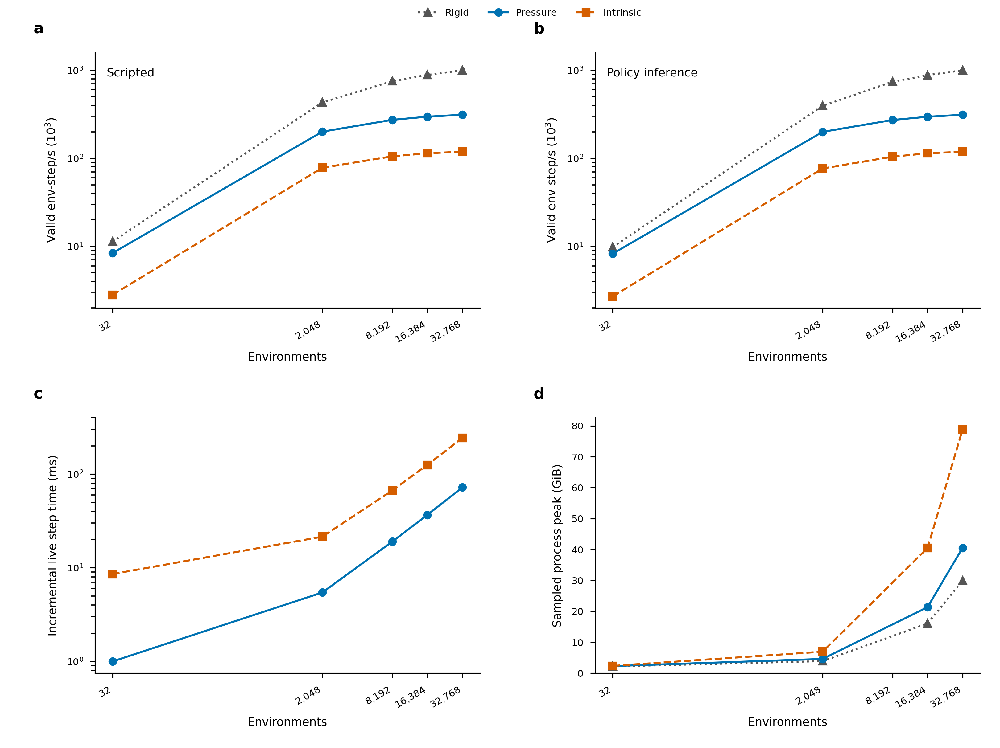
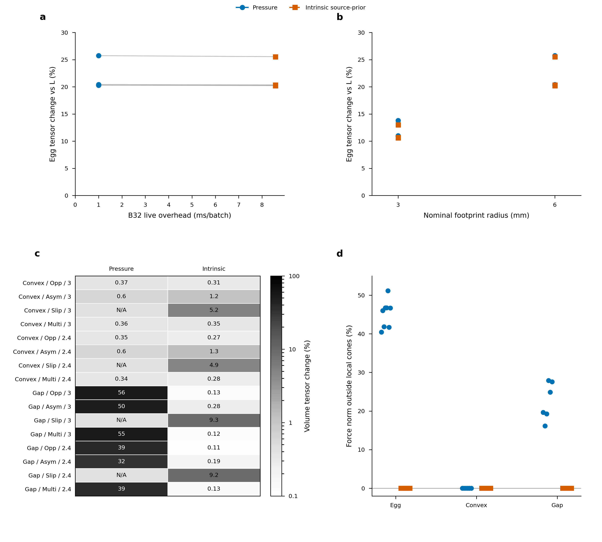
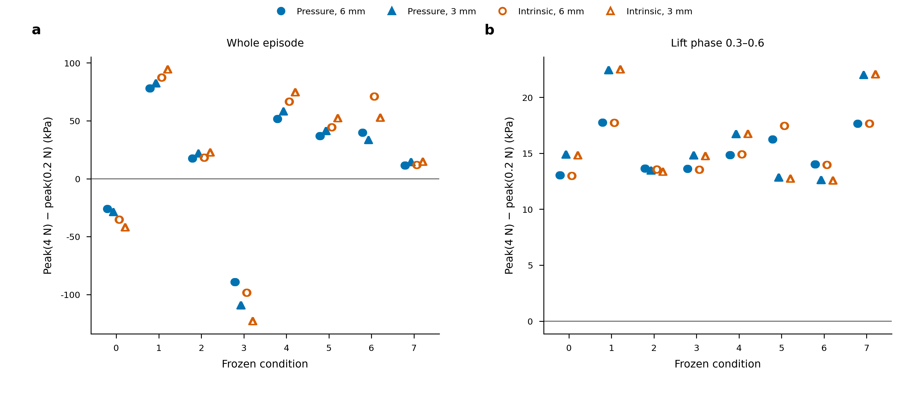

# Pressure and intrinsic configuration comparison

**This comparison stage is complete within its declared scope.** All91
successful benchmark records,3 retained capacity failures and required
scientific/scheduler receipts close; all three final figures pass source,
export and manual PNG/PDF-raster QA. See the [completion audit](../evidence/20261017-pressure-comparison/comparison-v1/completion-audit.json)
and [figure acceptance](../evidence/20261017-pressure-comparison/comparison-v1/figures/visual-review.json).

Pressure is a useful fast stress proxy on the declared egg workload and smooth
convex controls, subject to local-normal and footprint checks. Choose intrinsic
`body_source_prior` when material-normal admissibility or close-sheet topology
matters. Its extra cost does not remove the shared egg footprint/reference bias.
Neither model establishes an absolute physical damage threshold.

## Configuration decision

| Choice | Use and evidence | Limitation |
| --- | --- | --- |
| Public-default pressure | Literal `RigidStressOptions(mesh=...)`, max output/history0, with declared material and controller footprint inputs. Cheapest tested load model for the paired egg trajectory. | Supplied-pad constraints differ from local material-normal constraints; close-sheet loads can land across a gap. Successful elastic/wrench checks alone do not qualify contact pressure. |
| Tuned pressure | Same law/Q10/FP64;128 scatter tasks, wrench/moment reuse on, packed512 and coalesced residual on. Use the matched tuning table below. | Extra task storage; workload-specific speedup. Retain the full fallback for capacity overflow. This does not improve the physical load model. |
| Intrinsic source-prior | `contact_model="intrinsic", intrinsic_load_partition="body_source_prior"`, history0. Prefer for topology-aware support and local compressive/friction-admissible finite tractions. | More fitting/sampling and memory; local source resultants can redistribute. Some physical inputs remain incompatible and must fail. This model is not ground truth. |
| Max output | Default for a scalar reward/observation; retains the raw whole-body maximum. | No complete field observation. It is not a percentile, clipped maximum or local patch maximum. |
| Full output | Request complete corner tensors/von Mises for inspection, references and spatial observations. | Additional output storage/work; matched small/large costs are reported below. |
| History0 / history4 | History0 wins in this changing-contact screen. History4 remains available for workloads with useful reuse. | Do not infer a general history4 benefit from its name; every accepted solve still needs the original complete checks. |

`intrinsic_integration`, ports/support/frontier and intrinsic traction fitting
flags are inert for pressure. For `body_source_prior`, `intrinsic_support` does
not select a different law. Default metadata may therefore retain
`intrinsic_load_partition="componentwise"` on a pressure run without invoking
that intrinsic solver. Requested settings and actual native routes are retained
in the packet, rather than forcing irrelevant flags to match. With these810
vertices and the selected inverse, requested pipeline fusion is effective for
pressure/history0; intrinsic and pressure/history4 use the staged route.
Pressure rigid-post fusion is auto-on below B8192 and auto-off at/above B8192.
These native source selections explain the requested/effective differences.

## Matched workload and rate meaning

The frozen Franka/full hollow egg uses480 affine P2 tetrahedra,2430 DOF,
E=10GPa, nu=0.3, density2000kg/m3 and URDF mass
0.0065298482104013244kg. Both models retain normal and tangential contact forces,
the eight-condition bank/seed623016, nominal6mm radius with the same bank/phase
schedule, mesh64 collider, MPR/contact-patch off, dt0.01/substeps1, controller,
reset schedule and observations. The native rigid solver keeps the same
elliptic friction cone, contact resolution, iterations and tolerances.

The literal pressure default is tested through the normal public object, with
only its mesh required; the example's declared material defaults match the
physical assumptions above. The API/engine physics was not changed for this
comparison. The only example/benchmark change exposes and checks that literal
default object. All841 engine files match the preceding qualified stage.

Each batch cohort uses one GPU allocation with separate rigid, pressure live,
intrinsic live, policy+rigid, pressure policy and intrinsic policy processes.
The policy is the same seeded26→128→128→7 FP32 network, residual scale1e-4rad;
its warmup FP64 action-reference difference is checked against1e-9rad. Stress is
part of its observation, so policy trajectories can differ by model or from
the stress-disabled baseline. Scope is inference rollout, not RL training.

Normal runs have900 warmup steps, then three fixed2400-step repeats:24s of
simulated time per repeat, including all controller, reset, observation and
scope-dependent policy work. Each repeat performs3B partial resets. No
environment is discarded. Between-repeat restarts and observer diagnostics occur
outside the timer; all3B scheduled partial resets are timed. Valid aggregate
env-step/s is attempted env-steps
minus invalid env-steps, divided by measured elapsed time. All successful
normal repeats here have zero invalid env-steps. Cold setup/JIT,100ms memory
sampling,600-step tracing and single-repeat capacity runs are separate.

Hardware is NVIDIA RTX PRO6000 Blackwell Server Edition, exposing
101975851008 device bytes (94.97GiB). The packet records actual GPU UUID/node,
driver, Slurm job, container/package versions and source/configuration hashes.
Three repeats within one process/allocation give raw observations and a range;
they are not independent GPU replicates or a confidence interval.

## Scaling, overhead, memory and tuning

Median valid aggregate env-step/s, n=3 per cell:

| B | Rigid | Pressure live | Intrinsic live | Policy rigid | Pressure policy | Intrinsic policy |
| --- | --- | --- | --- | --- | --- | --- |
| 32 | 11,334 | 8,368 | 2,808 | 9,804 | 8,241 | 2,695 |
| 2,048 | 430,880 | 200,668 | 78,029 | 394,689 | 199,596 | 76,587 |
| 8,192 | 751,742 | 273,484 | 105,202 | 740,890 | 272,425 | 104,230 |
| 16,384 | 884,655 | 296,859 | 113,933 | 881,652 | 296,297 | 113,971 |
| 32,768 | 1,000,409 | 312,525 | 118,966 | 998,549 | 312,278 | 118,701 |

Batch / incremental stress latency in ms; time ratio / throughput loss:

| B | Model | Live ms / extra ms | Live ratio / loss | Policy ms / extra ms | Policy ratio / loss |
| --- | --- | --- | --- | --- | --- |
| 32 | Pressure | 3.824 / 1.001 | 1.354 / 26.17% | 3.883 / 0.619 | 1.190 / 15.94% |
| 32 | Intrinsic | 11.396 / 8.573 | 4.036 / 75.22% | 11.874 / 8.610 | 3.638 / 72.51% |
| 2,048 | Pressure | 10.206 / 5.453 | 2.147 / 53.43% | 10.261 / 5.072 | 1.977 / 49.43% |
| 2,048 | Intrinsic | 26.247 / 21.493 | 5.522 / 81.89% | 26.741 / 21.552 | 5.153 / 80.60% |
| 8,192 | Pressure | 29.954 / 19.057 | 2.749 / 63.62% | 30.071 / 19.014 | 2.720 / 63.23% |
| 8,192 | Intrinsic | 77.869 / 66.972 | 7.146 / 86.01% | 78.595 / 67.538 | 7.108 / 85.93% |
| 16,384 | Pressure | 55.191 / 36.671 | 2.980 / 66.44% | 55.296 / 36.712 | 2.976 / 66.39% |
| 16,384 | Intrinsic | 143.803 / 125.283 | 7.765 / 87.12% | 143.755 / 125.172 | 7.736 / 87.07% |
| 32,768 | Pressure | 104.849 / 72.094 | 3.201 / 68.76% | 104.932 / 72.117 | 3.198 / 68.73% |
| 32,768 | Intrinsic | 275.440 / 242.685 | 8.409 / 88.11% | 276.055 / 243.239 | 8.412 / 88.11% |

Separate sampled process peak GiB,100ms lower bounds:

| B | Rigid | Pressure live | Intrinsic live | Policy rigid | Pressure policy | Intrinsic policy |
| --- | --- | --- | --- | --- | --- | --- |
| 32 | 2.180 | 2.295 | 2.359 | 2.188 | 2.303 | 2.336 |
| 2,048 | 3.904 | 4.613 | 6.959 | 3.918 | 4.627 | 7.064 |
| 16,384 | 16.066 | 21.369 | 40.496 | 16.131 | 21.434 | 40.529 |
| 32,768 | 29.973 | 40.525 | 78.809 | 30.098 | 40.648 | 78.898 |

Same-GPU B2048 live pressure screen:

| Setting | env-step/s | Change vs default | Full fallback passes/repeat |
| --- | --- | --- | --- |
| default | 204,320 | +0.00% | 868 |
| scatter128 | 209,582 | +2.58% | 0 |
| scatter256 | 209,650 | +2.61% | 0 |
| fast | 205,319 | +0.49% | 868 |
| tuned | 215,610 | +5.53% | 0 |
| history4 | 116,429 | -43.02% | 868 |

Separate same-allocation default/tuned confirmation:

| B | Default / tuned live | Live gain | Default / tuned policy | Policy gain |
| --- | --- | --- | --- | --- |
| 2,048 | 204,921 / 216,220 | +5.51% | 203,554 / 214,472 | +5.36% |
| 16,384 | 299,771 / 319,809 | +6.68% | 299,412 / 318,515 | +6.38% |

Matched max/full, n=3, native production/storage cost:

| B | Model | Max / full env-step/s | Extra ms/batch | Time change | Native MiB change |
| --- | --- | --- | --- | --- | --- |
| 32 | Pressure | 8,248 / 8,219 | +0.014 | +0.36% | +3.28 |
| 32 | Intrinsic | 2,745 / 2,770 | -0.104 | -0.89% | +3.28 |
| 16,384 | Pressure | 301,070 / 296,016 | +0.929 | +1.71% | +1680.00 |
| 16,384 | Intrinsic | 115,781 / 115,127 | +0.803 | +0.57% | +1680.00 |

[All requested/effective native routes and raw repeats](../evidence/20261017-pressure-comparison/comparison-v1/README.md) are retained in the packet.

For each live/policy stress scope, incremental latency subtracts that cohort's
matching rigid-only median batch latency. Step-time ratio is stress median
latency divided by its matched baseline; throughput loss is `1 − 1/ratio`.
For example, ratio1.5 means50% more time and33.3% less throughput. Rates are
aggregate across environments, rather than individual-environment frame rates.

The default32-task scatter records868 complete canonical fallback passes per
2400-step live repeat and848 per policy repeat on this bank. The fallback clears and rebuilds the
entire load, including every contact, face and sample. These are valid results,
not dropped loads or failed environments.128 tasks eliminates these overflows;
256 gives little additional benefit in the bounded screen. The explicit fast
flags alone give a much smaller B2048 gain. At large batches, the native auto
route already enables the relevant packed/reuse paths, so the tuning's main
remaining difference is scatter capacity. The separate B16384 confirmation
measures6.68% live/6.38% policy throughput gains, with sampled pressure peaks
21.369→21.775GiB live and21.434→21.840GiB policy; B2048 confirms5.51%/5.36%. History4 also disables the pressure
fused pipeline/rigid-post route in this native selector, so its measured cost
includes that scheduling change as well as history work. Do not project a
small-batch tuning ratio onto all widths.

For this scene, B16384 is a useful starting balance: it retains about95%
of the B32768 default live throughput with about52% of its sampled process
memory. Doubling B adds only5.28% pressure/4.42% intrinsic live throughput,
while roughly doubling batch latency. B32768 supplies the highest repeated
untuned curve rates here. Choose tuned pressure at B16384 when its proxy
limitations are acceptable, or intrinsic at B16384 when local/topological
constraints matter. These are measured operating points, rather than a global
configuration optimum.

Full-mode cost measures native full-field production/storage with the same
scalar policy observation; transferring every tensor to a consumer each step
is additional work outside this timing scope.

Sampled process memory includes setup/growth and is a100ms lower bound on the
true peak. It differs from logical native stress-buffer counts and cannot
isolate policy memory by subtracting independent process peaks. Pressure
completes single-repeat capacity diagnostics at B49152 and B61440. B65536 and
B131072 fail the rigid Jacobian's2^31−1-element addressability guard
(`2328×15×B`), rather than CUDA allocation. Default intrinsic completes the
normal B32768 cohort and fails at B40960 during sample-profile growth with
CUDA out-of-memory. These are tested brackets for this scene/GPU/settings.
The prior B47104 intrinsic success used separately tuned initial contact
workspace2; the current default workspace is16. Capacity rates remain diagnostic.

## Why the costs differ

Separate changing-contact B2048 traces cover600 moving steps. Fused pressure
default/scatter128 CPU step annotations average10.623/10.360ms, with GPU kernel
sums8.869/8.611ms. Generated fused post-kernel names do not support an exact
stage split. A separate unfused pressure diagnostic exposes0.154ms anchor/refine,
0.853ms combined quadrature/fit,1.424ms scatter,1.405ms elastic recovery,
0.945ms balance/residual/acceptance and0.414ms raw peak per step. These explain
work, not a decomposition of the fused headline wall time.

Intrinsic's intrusive CPU/GPU sums are27.371/23.121ms per step. Support/fan
sampling averages5.111ms, traction fitting7.029ms, scatter2.586ms, recovery1.450ms,
checks0.972ms and peak0.427ms. The extra sampling/constrained fitting is the
largest visible model cost. History0 dispatches no prediction/maintenance;
the separately repeated history4 experiment measures its practical cost.

At B2048, native pressure buffers are492.51MiB versus2066.96MiB intrinsic.
Intrinsic's largest caches include sample barycentrics509.5MiB, profiles254.75MiB,
port distances220.5MiB and sample indices127.375MiB. Scatter128 adds10.5MiB
to pressure. These measured allocations describe memory footprint/reuse, not
DRAM bytes transferred. Copy/memset durations, launch/sync counts and interval
overlaps remain in `profile-comparison.json`; CPU/API and GPU durations overlap
and must not be added. Over600 steps, fused pressure records6311720 HtoD
and516096 DtoH bytes; intrinsic records14937320 and525696 bytes. CUDA graph
copy nodes and host API calls are counted separately. Driver launch counts are
18040 versus93040, and stream-sync calls135 versus2535. These observations
quantify explicit transfers/dispatch, not kernel DRAM traffic. An independent
Nsight Compute2025.2.1 probe on the same GPU family returns `n/a` for both DRAM
read/write metrics despite exit0; no valid hardware DRAM sample or measured
bandwidth bottleneck is claimed. Representative fresh-process scene/stress setup, including its build/JIT
subset, is about101–108s. Policy creation and900 warmup steps (including
remaining runtime compilation) are separate; all are outside headline rates.

## Accuracy, support and model limits

The current16 egg comparisons reuse the original independent R/L/M states
11/866/869/2640 at0.01375/1.0825/1.08625/3.3s, with radii3/6mm and both models.
R is the existing nonlinear contact field, L its full-inertia linear replay,
and M replaces only contact loads by the declared native finite footprint.
The proper rigid pullback and small application-coordinate/balance difference
remain explicit. These reference states use a different resolved-contact dt
from the cost workload. M/L is a conditional reconstruction difference,
rather than an experimental accuracy measurement.

L/R volume tensor changes are0.00029175–0.03216745%; M/L is20.289–25.728%
for nominal6mm pressure and20.205–25.551% for intrinsic. At3mm it falls to
about10–14%, while raw peaks increase. At6mm, raw maxima are35.34–36.81%
below L for pressure and36.41–37.63% below for intrinsic; at3mm these
differences are18.95–19.39% and19.32–19.96%. Both share substantial
model/reference bias. The existing sampled feedback comparison reaches23.17% tensor change at
one state, and unresolved spatial/raw-peak reference tails remain. These
distinct quantities are not additive error-budget components.

Pressure satisfies its supplied-pad-frame cones in the audited egg samples.
Relative to local material normals, its maximum raw violation is240982Pa and
up to51.16% of sample-force norm lies outside local cones. Intrinsic's maximum
local violation is3.58e-12Pa roundoff, with zero force fraction outside the
declared roundoff allowance. Small scalar peak differences do not imply similar
local loading or qualified pressure tractions.

The new control matrix uses the exact existing smooth ellipsoid886-tet and
close-sheet U536-tet meshes, two fixed radii3/2.4mm, and opposing, asymmetric,
near-sliding and multiple-contact inputs. It contains28 numerically qualified
fields plus4 pressure free-contact-moment inputs labeled unsupported. Paired
comparisons retain those N/A cases. Pressure's smooth-convex volume tensor
changes are0.337–0.602%; source-prior's larger near-slip tail has no supported
pressure counterpart. On the gap control pressure changes32.2–55.8%, with up
to27.90% of force norm mapped across the declared gap; source-prior changes
0.106–9.295% and has zero cross-gap force fraction. The latter envelope includes
near-slip cases unsupported by pressure. Convexity or a successful solve alone
does not qualify a footprint approximation.

Across the egg snapshots, source-prior changes an individual source force by
up to2.974mN and its moment about the body COM by191.90microNm; aggregate
force/moment discrepancies remain at most1.05e-10N/6.14e-13Nm. Pressure's
per-source changes are roundoff. The paired egg models select the same raw
hotspot coordinates at all eight state/radius pairs, despite their different
loads and maxima. On the gap control, pressure's hotspot can move4.002mm
from the continuous-reference hotspot; source-prior retains its location in
these controls. Signed vectors, complete peak values and coordinates remain
available rather than reducing qualification to one scalar.

The four moving pressure oracles have worst tensor error2.065e-6Pa, raw peak
error2.088e-6Pa, and complete-gauge residual below0.00634 of its original
budget. Maximum original individual-force/moment differences are
2.50e-16N/2.34e-19Nm. Each includes an unloaded zero-reference field, with
exactly zero peak error; relative error is undefined there and is reported
only for nonzero fields. All zero and loaded fields retain their absolute gates.

Volume tensor norms use the independent positive reference quadrature for egg,
and exact affine-corner volume integration for controls. Cone force fractions
sum sample-force norms beyond64 FP64 epsilon times original source-force norm;
raw violations remain unthresholded. Cross-gap diagnostics use opposite signs
of sample/source-witness x coordinates on the declared U arms. The packet
retains raw peaks, material-frame hotspot positions, per-source signed
force/moment shifts, loaded areas and aggregate wrench errors.

Four moving pressure oracle variants (32/128/256 scatter capacity and forced
fast128) retain the original complete equilibrium/all gauge, original wrench,
full tensor/von Mises and raw global-peak gates. Each samples120 complete
fields over1500 steps with32 partial resets, including transitions/release.
They test default fallback and tuned routes without changing tolerances.
The unchanged engine reuses the preceding independent FEM, history/reset/
isolation and max/full qualification; its source identity is separately checked.

Source-prior remains conditional. A newly replayed generated-bank case
(seed510000, outside the accepted bank) rejects at tick456/env0/status35 with
two sources, radius4.71655mm and friction0.79124. Its target net force is
99.9723% of the sum of source-force norms: this particular failure is not
near cancellation. Original contacts, target force/moment and error are retained,
with no successful complete-rollout rate. Supported self-balanced opposing
grips are distinct from incompatible or near-cancelling-wrench failures.
Earlier failures/unresolved reference identities remain in the archive index.

## Complete-grasp reward sensitivity

Four current model/radius runs retain230400 recorded environment steps:
16 environments (eight conditions duplicated at0.2N/4N strong-force limits), three complete
1200-step episodes per configuration after900 warmup. All raw maxima/heights/
phases are finite, with original reset/unselected-environment checks passing.
Whole-episode peaks remain separate from phase0.3–0.6 lift-window peaks and
stress exposure. Both force choices reach at least about0.14939m lift-window
maximum height across this bounded ensemble.

Within each phase all tested model/radius choices preserve the sign of the
paired peak ranking for all eight conditions. Changing the analysis phase
reverses conditions0 and3: the whole episode prefers4N, the lift window0.2N.
The minimum observed force-choice separation exceeds the observed model/radius
amplitude band for7/8 lift comparisons and1/8 whole-episode comparisons.
Those bands are sensitivity observations, rather than physical confidence bounds.

A threshold inside a configuration's observed peak range can change the
counterfactual episode-level stop decision across models/radii. For example,
condition0's0.2N whole-episode peak ranges279170–377264Pa, while4N ranges
253068–335276Pa. The packet records intervals for every condition and phase.
No early termination was executed, no trajectory was shortened to pass, and
no physical fracture threshold was fitted. A favorable named-phase reward
does not establish whole-episode safety.

## Reproduction and qualification boundary

The [running guide](RUNNING_PRESSURE_COMPARISON.md) covers exact source
reconstruction, paired rates, tuning/output/memory/profile scopes and reference/
reward replay. The [packet](../evidence/20261017-pressure-comparison/comparison-v1/README.md)
retains compact raw repeats/options/hardware identities, numerical/applicability
summaries, exact control/failure inputs, executed source recipes and launchers,
editable figures/captions and scheduler/source/visual closure.

Recommendations apply to these declared meshes, loads and hardware. Pressure
is appropriate only where the simplified supplied-pad footprint is an acceptable
proxy and local/topology diagnostics support that choice. Intrinsic is justified
when those constraints matter, with redistribution/failure handling retained.
Both remain conditional stress/reward models. Full RL training, universal
high-mesh convergence and physical fracture calibration are outside this stage.
