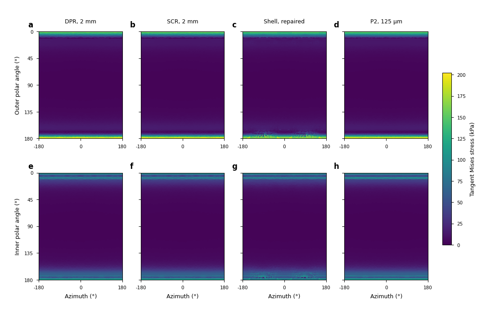
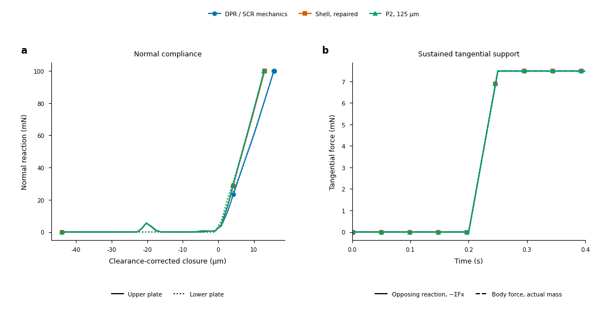

# Qualified normal and sustained-friction comparison

The fixed2mm DPR/SCR and repaired250um Shell comparison now has its complete
0.1N normal/sustained-friction StVK reference, dimensional errors, conditional
rankings, inspected maps and matching research-workflow costs. Complete tangent
errors are about7.94% DPR,7.99% SCR and25.98% Shell. Raw Mises peak-magnitude
errors favor Shell. No universal method order follows.

The [extended goal](AUTOMATIC_CONTACT_AND_THROUGHPUT_GOAL_20261020.md) remains
active: useful automatic physical-region prediction, native integration and
its measured incremental production cost are still required. The separate
[resolved-pressure and bounded-roundoff variants](RESOLVED_PAD_AND_SOURCE_INPUTS_20261020.md)
do not inherit these manual-baseline errors.

## Reference and admission

All seven physical parents complete their declared histories and pass independent
momentum, both equilibrium windows, sequential-history and endpoint-identity gates.
The resumed125um three-wall q10 and q6 parents complete400 steps; half-dt completes
800. The original interrupted records and continuation ancestry remain intact.
Qualification passes251 checks over36 comparisons and18 observed-resolution
envelopes, retaining the original2%/5% spatial and0.5%/1% control targets.
Maximum observed envelope is1.70027%. Source quadratureq6/q10, angularq9/q25,
depth2/4 and1/0.5ms controls remain individually recorded.

The error audit passes218 checks for54 dimensional errors and18 metric rankings.
It re-reduces physical-volume columns, membrane/bending resultants and complete
outer/inner arrays, and independently rechecks unsmoothed raw peak invariants
and locations. Shell transverse quantities unsupported by its formulation are
reported separately and receive no rank. Observed changes provide conditional
numerical-sensitivity envelopes, not confidence intervals or certified continuum
bounds; overlapping method intervals remain unresolved.

The [terminal packet](../evidence/20261019-qualified-ranking/qualified-friction-final-v1/README.md) retains exact sources, receipts and
[54-row error CSV](../evidence/20261019-qualified-ranking/qualified-friction-final-v1/canonical-stvk-resilient-method-ranking-v1/group0/ranking/errors.csv),
[reference envelopes](../evidence/20261019-qualified-ranking/qualified-friction-final-v1/canonical-friction-resilient-qualification-v1/group0/qualification/reference-envelopes.csv),
[cost table](../evidence/20261019-qualified-ranking/qualified-friction-final-v1/pad-friction-resilient-cost-accuracy-v1/group0/friction/timings.csv)
and [independent visual review](../evidence/20261019-qualified-ranking/qualified-friction-final-v1/meta/qualified-friction-figure-visual-qa-v1.json).
Full fields and trajectories remain externally hashed on data.

## Normal endpoint

Relative errors below use each metric's own reference norm or peak. The CSV
retains units, dimensional errors, sampling changes and all interval endpoints.

| Metric | DPR | SCR | Repaired Shell |
| --- | ---: | ---: | ---: |
| Complete tangent tensor | 7.936% | 7.990% | 25.981% |
| Membrane resultant | 4.682% | 4.727% | 5.751% |
| Bending resultant | 10.306% | 10.376% | 42.036% |
| Outer tangent tensor | 7.562% | 7.601% | 31.984% |
| Inner tangent tensor | 9.882% | 9.965% | 35.210% |
| Raw Mises peak magnitude | 2.849% | 1.370% | 0.219% |
| Raw tensile peak magnitude | 5.573% | 5.328% | 14.798% |
| Common tangent Mises peak | 2.317% | 2.507% | 3.098% |
| Common tangent tensile peak | 5.529% | 5.285% | 14.804% |

## Sustained-friction endpoint

Relative errors below use each metric's own reference norm or peak. The CSV
retains units, dimensional errors, sampling changes and all interval endpoints.

| Metric | DPR | SCR | Repaired Shell |
| --- | ---: | ---: | ---: |
| Complete tangent tensor | 7.936% | 7.990% | 25.979% |
| Membrane resultant | 4.682% | 4.727% | 5.750% |
| Bending resultant | 10.307% | 10.376% | 42.036% |
| Outer tangent tensor | 7.563% | 7.601% | 31.983% |
| Inner tangent tensor | 9.881% | 9.965% | 35.208% |
| Raw Mises peak magnitude | 2.848% | 1.374% | 0.261% |
| Raw tensile peak magnitude | 5.577% | 5.335% | 14.798% |
| Common tangent Mises peak | 2.322% | 2.515% | 3.053% |
| Common tangent tensile peak | 5.543% | 5.301% | 14.813% |

For both endpoints, DPR/SCR have lower conditional errors than Shell in the
complete tangent tensor, bending resultant, both surface tensors and tensile
peak magnitudes. Membrane and common tangent-Mises peak rankings are unresolved.
DPR versus SCR is unresolved except for the raw Mises peak magnitude, where SCR
is lower. Shell has the smallest raw Mises magnitude error; that scalar result
does not establish its full-field accuracy.

At the sustained-friction endpoint, tangent dimensional errors are723.07Pa DPR,
727.97Pa SCR and2367.10Pa Shell. Their conditional relative intervals are
6.13–9.80%,6.18–9.86% and23.87–28.16%. The two native intervals overlap extensively.
Raw Mises intervals are2.39–3.31%,0.92–1.83% and0–0.71%, respectively.

## Complete maps and physical response

The complete outer/inner maps show the concentration near both poles under one
scale. Their azimuth/polar coordinates are not equal-area. Numerical errors use
physical-volume/material integration, independently of the displayed centroids;
no pole, low-stress region or failed field is removed to improve the images.
The full tensor errors above quantify what similar colors alone cannot resolve.

The [normal pressure map](../evidence/20261019-qualified-ranking/qualified-friction-final-v1/canonical-stvk-resilient-figures-v1/group0/figures/friction-normal-traction_preview.png) and
[tangential pressure map](../evidence/20261019-qualified-ranking/qualified-friction-final-v1/canonical-stvk-resilient-figures-v1/group0/figures/friction-tangent-traction_preview.png) show actual
physical pad source loads, separately from reconstructed native boundary traction.
All nonzero-force samples remain displayed, with density defined per projected
reference area. The upper/lower native sources contain68/98 force-bearing points;
the fine reference contains132828/180414. Counts measure sampling, not contact
area. Upper maximum density is8.235kPa native versus6.477kPa reference; lower is
7.402 versus6.155kPa. These contrasts include source sampling and physical response.
Tangential arrows represent signed net force under one scale, not local vectors.

The force-response figure compares complete400-step trajectories. At final0.1N,
clearance-corrected closure is15.6283um native,13.0340um Shell and12.8740um reference.
Each history balances its actual-mass tangential body force: approximately
7.473/7.485/7.481mN. DPR/SCR mechanics share a legend only after their measured
agreement. Native equilibrium stress admission still refers to the requested
endpoints; the separate1000-step roundoff variants have their own history proof.

The four183mm-wide figures retain editable SVG/PDF text, embedded fonts,
450dpi dense artists,600dpi PNG and150dpi inspected previews. Actual SVG sizes
match183×120,183×147,183×147 and183×96mm. Labels, units, poles, legends and
common scales pass direct rendered review. The original renderer receipts stay
unchanged; the companion review records visual acceptance for the repository
supplement. Captions and all plotted arrays are retained alongside the exports.

## Matching costs and practical choice

The cost audit passes100 checks for four actual configurations and36 metric
associations. These are synchronized complete research-workflow intervals,
including mechanics, recovery, requested host output, admission calculations
and I/O. Each configuration has its own successful primary history and exact
runtime-source binding. Three consecutive warm blocks are not independent
process replicates.

| Method | Stress observation cadence | Median complete-workflow step | Setup |
| --- | --- | ---: | ---: |
| DPR | Every200 steps | 75.925ms | 52.278s |
| SCR | Every200 steps | 88.373ms | 59.272s |
| Repaired Shell | Every200 steps | 295.081ms | 53.460s |
| Repaired Shell | Every1 steps | 301.428ms | 55.959s |

All rows use one environment and full output; sparse rows lack a separate
matching memory measurement. Reference-case errors are measured at0.4s, while
the warm timing intervals cover0.4–1.0s. Endpoint field/peak conformance is
recorded separately; errors were not independently measured at every timed
endpoint. Sparse updates do not establish every-step peak reliability. Original
failing native every-step runs receive no admitted cost in this table. The
new bounded-roundoff1000-step costs remain a separately labelled configuration.

For this declared pad and requested full-field endpoints, DPR is the practical
first native choice: its field accuracy is indistinguishable from SCR within
the conditional envelopes and its matched sparse workflow is cheaper. Choose
metrics explicitly: raw Mises magnitude alone favors Shell here, while its
bending/complete-field errors are substantially larger. Neither conclusion
establishes Shell mesh independence, an unknown contact law, different geometry
or production scene speed.

The [existing production summary](NATIVE_PERFORMANCE_SUMMARY_20261019.md)
retains source-bound module and actual-scene measurements, diverse-condition
failures, memory and cadence limits. Those collider configurations remain
separate from the physical-pad error table. Automatic pressure/support models
must earn their own physical comparisons and incremental native timing.
