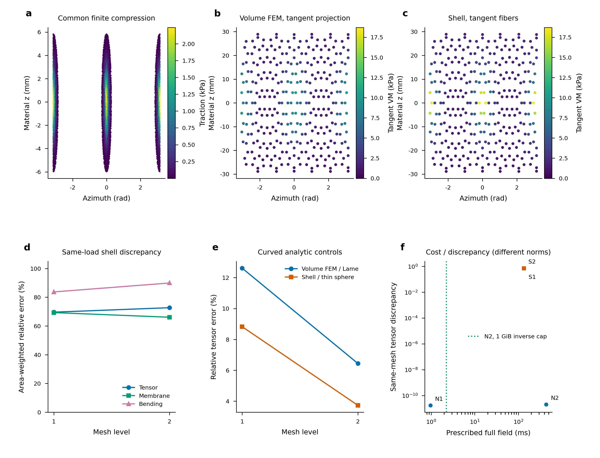
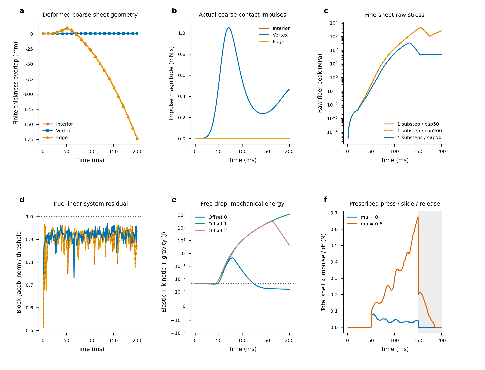
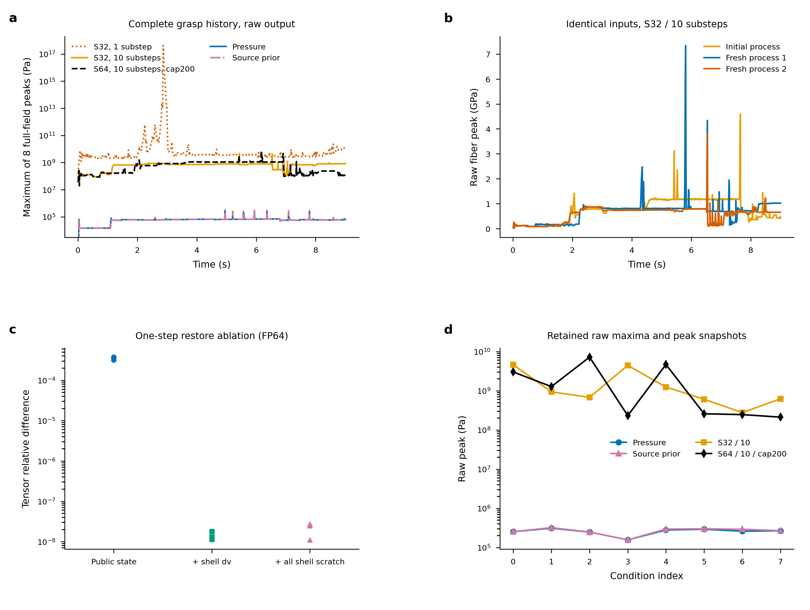
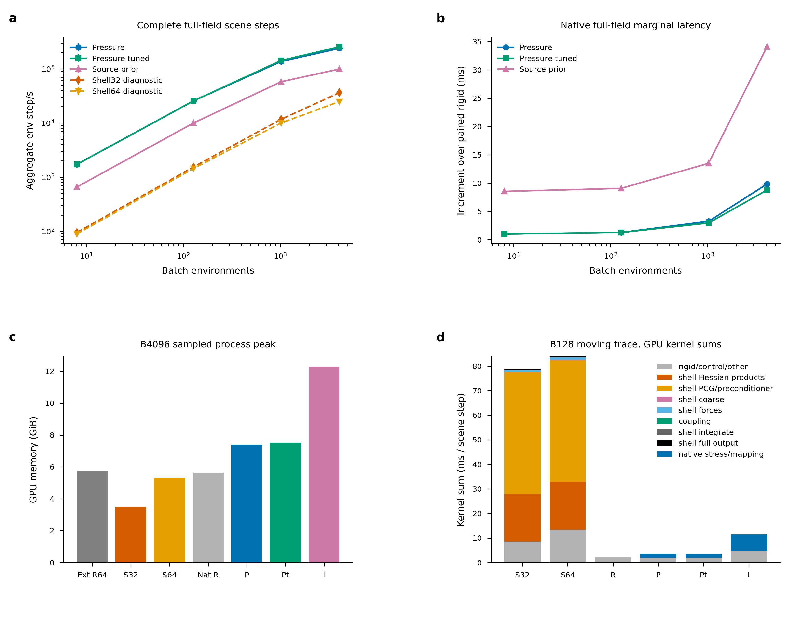

# Full stress and contact comparison with shell PR22

## Decision

Use native rigid pressure recovery for a fast, explicitly conditional elastic
stress proxy in large batches. Use intrinsic `body_source_prior` when its
different footprint/traction assumptions are useful; the preceding
[pressure comparison](PRESSURE_COMPARISON_RESULTS_20261018.md) still applies.
Neither is a physical damage oracle or a replacement for deformation feedback.

PR22 supplies membrane/bending deformation and potential plasticity/fracture
capabilities that rigid recovery cannot supply. Its elementary elastic controls
are useful. However, this pinned implementation has reproduced missed coarse
triangle-interior contacts, severe time-step sensitivity, nonconservative coupled
drop behavior, restart variability and incomplete numerical-state restoration.
We did **not** establish an accuracy-qualified shell Franka/egg operating point
in this bounded study. Its measured throughput is retained as diagnostic cost,
not as accepted physical simulation throughput. No contact solver redesign or
production repair is substituted for the baseline.

The [running guide](RUNNING_SHELL_COMPARISON.md),
[compact packet](../evidence/20261018-shell-comparison/comparison-v1/README.md),
and [requirement audit](SHELL_COMPARISON_AUDIT.md) provide the execution chain.
All native engine, tests, examples and preceding evidence packets are unchanged
from `7fe068267e09ff97c09ffac4904a2f47914596d9`.

## Sources and mechanical products

At execution start, the GitHub API reported
[Kashu7100/Genesis PR22](https://github.com/Kashu7100/Genesis/pull/22) open at
`fd051fe3f6ed58b52810846d4295d7b6fbb5e2ab`, base
`02908fe6474d8b073b662347a8794614fa250658`. The unmodified checkout and a
separate diagnostic checkout are isolated beside the task worktree. The
diagnostic patch adds read-only iteration/residual/contact hooks into owned
buffers, leaving the original operator, state and solve scratch untouched.
The original baseline plus its full-field observer supplies normal timing;
intrusive hooks/host exports supply separately timed diagnostics. Source
inventories, exact executed Python snapshots and patches are preserved, including
failed tooling attempts. The separate historical shell-contact project is not
used as a repaired baseline.

| Aspect | Native pressure / intrinsic | Pinned PR22 plus declared observer |
| --- | --- | --- |
| Mechanics | Rigid dynamics plus auxiliary small-strain affine-P2 tetrahedral elasticity | Deformable triangular SVK membrane, dihedral bending, mass lumping, damping |
| Contact feedback | Rigid contacts determine loads; stress does not deform the body | Free shell vertex velocities projected against rigid SDFs, sequential rigid reaction |
| Integration / solve | Native numerical acceptance including mapping and original-force equilibrium | One linearized backward-Euler solve/substep; block-Jacobi plus coarse PCG, per-environment convergence mask and threshold |
| Field / frame | Full corner symmetric volume tensor in Pa, authored-link frame | Raw second-PK membrane resultant in N/m; signed hinge curvature; reconstructed bottom/mid/top Cauchy tensors in world frame |
| Missing physics | No deformation-driven contact, buckling, plastic flow or crack feedback | No transverse normal/shear stress in this thin-shell observer; no validated fracture/damage claim here |
| Primary output scope | Full tensor/VM evaluation through the existing native solver | Full tensor/VM, membrane/curvature/bending arrays and deterministic raw spatial argmax, device resident |

For shell thickness h and signed face curvature K, the observer uses
`S(z) = S_mem/h + z C:K`, with fibers at `z = -h/2, 0, h/2`, then
`sigma(z) = F S(z) F^T / J_area`, assuming the PR's unchanged thickness.
The bending resultant is `h^3 C:K / 12` (N); membrane is N/m, fiber stress Pa.
This is an explicitly added constitutive/hinge **diagnostic reconstruction**,
not a unique through-thickness physical stress already exposed by PR22.
Positive-eigenvalue stiffness scratch and absolute-eigenvalue fracture criteria
are never treated as physical signed stresses. Finite-thickness nonlinear
bending and transverse stress remain unsupported by this observer.

Both sides are observed after each control step. Native full tensors describe
the final physical substep; its public max also aggregates substeps. All peaks
in the comparison are raw maxima of the declared end-step **full field**.
Dynamic comparisons use VM invariants; compatible static projections use the
same material positions, face tangents and actual projected volume thickness.
Dynamic tensor components in different frames are not subtracted.

## Elastic controls and same prescribed load

**Mechanics figure.** (a) Actual common finite traction samples. (b,c) Compatible
midsurface tangent VM at identical retained face positions, shared colour scale.
(d) Area-weighted shell versus same-mesh volume FEM tensor/resultant differences.
(e) Curved analytic controls, with their different reference/norm domains stated
below. (f) Prescribed-load cost versus discrepancy: N uses full volume corner
tensor error against independent same-mesh FEM; S uses compatible tangent fiber
error. Their different norms/models prevent a universal accuracy ranking.
The dotted cost line marks the separate level2 inverse-cap tuning.

* Shell FP64 uniform stretch/compression near1000Pa has maximum component error
  below1e-8Pa. FP32 errors reach2.86Pa, including a roughly1Pa rest floor.
  Cylindrical bending at curvature2/m, E=1e7Pa, nu=0, h=1mm gives interior
  outer-fiber VM means9999.74/9999.93Pa at grids8/16 versus10000Pa analytically.
  Interior ranges narrow9739–10260 to9935–10065Pa. Boundary hinges are absent:
  their estimated mean is about half the target. Signed top compression and
  bottom tension are retained, rather than validating VM alone.
* Native and independent P2 FEM plate controls use96tets/675DOFs. Native maximum
  tensor error is1.20e-7Pa for uniform +/-1000Pa and0.000186Pa for pure bending
  with10000Pa outer fibers. Original numerical gates pass.
* A sphere of midsurface radius22mm, h=0.5mm and inner pressure100Pa provides a
  curved analytic control. Independent/native volume corner error against Lamé
  decreases12.614% to6.442% over two meshes; native versus independent same-mesh
  full tensor error is below1.4e-11 relative. Shell area-weighted tangent tensor
  error against the corresponding thin-sphere target decreases8.824% to3.730%;
  mean hoop stress2023.14 to2117.37Pa versus2150.284Pa. Flat facets use a declared
  radial material-coordinate mapping; these are different discretization and
  stress domains, not evidence that a shell is universally more accurate.

The egg control integrates two opposite finite +/-0.05N loads with6mm support.
Net force is below1.5e-16N and moment below2e-19Nm. The same quadrature cloud is
integrated into each basis, retaining the residual load-position/thickness
differences. Independent volume residual budget fractions are0.00386/0.00443.
Shell nonlinear static force residuals after relaxation are1.80e-9/3.34e-9
relative; this is an equilibrium audit beyond its linear PCG stopping rule.

| Mesh level | Shell tangent tensor discrepancy | Membrane resultant | Bending resultant | Volume peak |
| --- | ---: | ---: | ---: | ---: |
| 1:42 midpoint vertices | 69.61% | 69.31% | 83.69% | 12953.9Pa |
| 2:162 midpoint vertices | 72.72% | 66.08% | 89.90% | 25959.0Pa |

Actual projected volume wall thicknesses are444.7–481.1um /480.3–495.3um,
versus nominal shell500um. Volume transverse tensor fractions are19.89%/13.56%.
These differences combine shell discretization, constitutive/hinge recovery and
load transfer, rather than unconverged algebra alone. The volume peak doubles
with refinement; it is **not a converged continuum peak**.

Separate public contact mapping of this same finite load gives pressure tensor
differences2.263%/1.858% and source-prior0.07058%/0.002952% against its continuous
volume reference. Pressure still violates some local-normal cones by about
2638/2475Pa despite passing its numerical gate. Intrinsic is another load model;
this simple opposing-load case does not erase the broader footprint uncertainty
in the accepted preceding study. See `native-curved-v1` receipts, including
per-source shifts and footprint/local-traction audits.

For warmed **device-prescribed-load to full field**, level1 native inverse takes
0.968ms/problem versus shell134.259ms (three static relaxation steps, cap300,
threshold1e-8, actual equilibrium checked). At level2 the native default64MiB
inverse cap selects direct,437.611ms versus shell133.408ms. A same-allocation
native ablation changes only the inverse cap to1GiB:432.321 to2.228ms, with
741895200B inverse payload and about173s setup in each process. Original gates
pass; native same-mesh full tensor differences are below2.1e-11. This exposes an
important storage/setup/runtime tradeoff. These numbers exclude contact mapping
and are not scene throughput or equal-fidelity discretization claims.

## Contact and consistency findings

**Contact figure.** Coarse interior/edge/vertex deformed-sheet overlap and actual
vertex impulses; fine-grid stress and true linear residual across substeps/caps;
free-drop mechanical energy; frictional slide/release impulse. Positive overlap
means radius plus half-thickness exceeds closest deformed-triangle distance.
This closest-point measure can become negative after passage; it is not signed
penetration depth. Geometry is poststep, while impulses are accumulated during
coupling before shell integration; no exact simultaneity or CCD claim is made.

For a10mm sphere over a coarse2x2 sheet, the interior condition has six sampled
overlaps without any vertex candidate or measured impulse, reaching10.15mm;
the sphere changes to the opposite oriented side. Edge misses also reproduce.
The vertex case produces a reaction and retains positive side distance.
This isolates vertex/SDF candidate coverage. Increasing PCG cannot create a
missing triangle-interior constraint.

**Correction of an early diagnostic label:** immutable old receipts contain
`fell_through`, computed only as sphere height below the initial plane minus its
radius. A flexible sheet can sag. That marker does not establish passage for
the finer sheets; actual deformed-triangle audits are the geometric evidence.
The current runner names the marker explicitly and retains the old receipts.

At grid16, cap50 versus200 both satisfy the linear threshold at every recorded
control/environment: true block-Jacobi residual below9.674e-5 for threshold1e-4,
no caps exhausted, maximum active iterations31/32. Peaks remain4.354/4.352GPa.
Four substeps reduce the peak to0.332GPa while still satisfying the threshold.
Thus linear convergence does not establish time-integration/contact convergence.
No material or damping change is described as a numerical repair.

The separate free-drop ledger records exact PR SVK membrane plus hinge energy,
shell/sphere kinetic energy and gravity. With initial total energy0.004356J,
the maximum rises to1152.602J during severe deformation despite active damping
and friction. There is no prescribed actuator work in that drop. Pending
coupling-force buffers are not assigned a fictitious energy. The measured sphere
momentum agrees with **one-step-lagged** opposite shell impulses to2.55e-9N s;
same-step discrepancy reaches1.24e-4N s. World-origin angular residual is
9.91e-10Nm s versus maximum measured moment impulse1.84e-5Nm s. This records
sequential reaction timing and instability; it does not isolate a unique cause
for the full energy growth. Prescribed press/slide tests with mu=0/0.6 show
different tangential impulses/slip, followed by release; they are actuated tests,
so their energy is not interpreted as a free-system conservation check.

A compact two-sheet approach crosses from5mm to-3mm signed midplane gap with
negligible stress: shell-shell/self-contact is unsupported by this coupling
route. This is a capability limit, separate from rigid-shell contact defects.

**Consistency figure.** Complete application raw peak histories, identical-input
fresh processes, one-step restore ablation and per-condition raw maxima. No
catastrophic default peak is clipped. The archive retains full fields at every
environment's sampled raw peak, primitive index, time/phase, material/world
position and shell vertices or native link pose. Collector checks reconstruct
the raw maximum from every retained peak field. Locations are in
`derived/raw-peaks.csv`; shell surface fibers are face-centroid samples and
native samples are tetrahedral corners, not an identical continuous search.

The principal case reuses all eight conditions and900steps (9s), including
approach, opposed/asymmetric contacts, lift/slide, weak4N-to0.055N force caps,
release, partial reset and recontact. Targets are positions **with force caps**;
contact forces are never simultaneously imposed. Native pressure/tuned/intrinsic
share the rigid trajectory. Shell dynamics change the contact loads, so the
following peak differences are not same-load tensor errors.

| Original shell setting, level1 unless stated | Raw full-fiber peak | Cap-exhausted substeps | Controls/envs passing recomputed block norm |
| --- | ---: | ---: | ---: |
| FP32,1substep,cap50 | 4.263e17Pa | 383 | 94.60% |
| FP32,10substeps,cap50 | 4.593e9Pa | 873 | 93.96% |
| FP64,10substeps,cap50 | 2.034e9Pa | 467 | 97.47% |
| FP64,10substeps,cap200 | 6.721e9Pa | 0 | 100% |
| FP64,20substeps,cap50 | 4.711e8Pa | 13 | 99.86% |
| FP64,10substeps,cap50,level2 | 1.207e11Pa | 48929 | 28.81% |

Here a control/environment passes only if the maximum over its substeps passes;
this is not a fraction of individual substeps. The recursive squared budget is
also retained separately. All900steps finished and fields remained finite,
which plainly does not establish stability: FP32/sub1's centroid reaches368869m.
FP64/cap200 satisfies both actual and recursive linear tests; its large peak
remains a coupled-model/time-step issue. Dense peak-capture reruns give
4.621GPa(S32/10) and7.229GPa(S64/10/cap200), versus0.312/0.322MPa native P/I.
Shell stored positions are **unweighted vertex centroids** and native positions
are authored-link origins; we do not compare those as matched COM heights.

Three identical-input fresh shell processes give peak maxima4.593/7.342/3.798GPa.
Peak-history relative differences versus the initial process are1.001/0.729,
and maximum positional differences about0.138/0.134m. All use the identical
frozen runner; one allocation has a different GPU UUID. Floating reductions,
amplified trajectories and numerical history are plausible contributors; a
specific race or a unique cause is **unresolved**.

Public restore reproduces the instantaneous tensor/state exactly, and partial
restore preserves unselected instantaneous environments. Continuation does not
reproduce: for example FP32 B1 gives5.17–10.07% tensor differences after40steps;
B16 gives44.86–58.05%. Duplicate inputs within the same batch also diverge in
the coupled trajectory. A tight FP64/current-coarse one-step private ablation
reduces tensor differences from3.19–3.76e-4 (public restore) to1.14–1.80e-8 by
restoring only `shell_scratch.verts_dv`. Public ShellState omits this warm-start
history. Restoring all shell scratch similarly reduces the discrepancy.
This is causal evidence for a dominant missing numerical history in this
one-step test, not a repaired public API or proof of bitwise GPU determinism.
No production patch is claimed; the comparison is executable without one.

## Matched scene, hardware and cost

Both use the native full hollow egg continuum: outer semiaxes22/22/30mm,
taper0.18, normal-offset wall0.5mm, E=1e10Pa, nu=.3, rho=2000kg/m³, with
42/162/642 midpoint vertices. At unchanged density the shell's lumped mass
exceeds the volume mass by6.377%/1.575%/0.390%; level1 volume mass is6.52985g.
Density, mass, inertia and discretization are therefore not all identical.
Panda MJCF/assets are byte identical across the tested revisions. The shell
route has9rigid DOFs versus15 for the native/rigid-egg scene.

Shell coupling uses constant mu=.6,2mm SDF softness, restitution0. Native rigid
contact uses its constraint solver and per-condition friction ratios (egg base
.6); the external shell coupling API does not apply those per-environment
ratios. Native reconstruction radius also varies sinusoidally with phase;
that is an auxiliary load-footprint parameter, not a shell collision radius.
These compliance/friction/DOF/deformation differences are exposed rather than
calling equal jaw targets equal contact forces.

**Performance figure.** Three-repeat medians/ranges for complete full-field scene
steps; native increment over the same-allocation rigid baseline; separately
sampled process memory; separately profiled GPU kernel groups. Ranges are observed
repeat ranges, not confidence intervals. Native versus external cohorts use
matched hardware; their GPU UUIDs are not asserted identical. Name-based kernel
groups retain unclassified work and fused rigid-post work; GPU/API intervals
overlap and are not added together.

Primary normal and memory/profile runs use the **same** Python3.10.20 environment:
Torch2.11.0+cu129, Quadrants1.3.3, NumPy2.2.6, SciPy1.15.3, Trimesh5.1.1.
GPUs are RTX PRO6000 Blackwell Server Edition,97887MiB, driver595.71.05.
CPU receipts inside four normal allocations identify Xeon Platinum8562Y+;
later allocation host/GPU identities remain in every receipt. Independent FEM
and some early native diagnostics use the established Torch2.8 reference
environment; they are not silently mixed into primary timing.

Normal scope is900warm steps then3x900timed steps, shared unfused Torch
controller, checks/full outputs and scheduled partial resets, device resident.
Host field exports, rendering, profiler and memory sampling are excluded.
Final field/position finiteness, persistent numerical counters and final errno
are read outside the timer; the numerical acceptance computations run inside
normal scene steps. The first new cohort omitted exported native counters;
`validated-native-v2` reruns all native configurations and is the primary source.
All36stress repeats and warmups have **zero invalid environment-steps**, including
across resets. This qualifies numerical acceptance, not absolute physical error.

| Batch | Pressure valid env-step/s | Tuned pressure valid | Source-prior valid | Shell FP32 diagnostic | Shell FP64 diagnostic |
| ---: | ---: | ---: | ---: | ---: | ---: |
| 8 | 1721 | 1718 | 657 | 95 | 89 |
| 128 | 25637 | 25622 | 10003 | 1542 | 1448 |
| 1024 | 136731 | 142322 | 57753 | 11696 | 10009 |
| 4096 | 239264 | 255089 | 99024 | 36282 | 24885 |

At B4096 native batch latencies are17.119/16.057/41.364ms versus7.298ms rigid;
increments9.822/8.760/34.066ms. The shell32/64 scene takes112.892/164.598ms.
Its different rigid DOFs mean subtracting the rigid-egg baseline is not a pure
deformation marginal cost. Full-field shell memory is3558/5446MiB; native rigid,
pressure, tuned and intrinsic are5760/7574/7702/12600MiB. These intrusive100ms
process samples include build/warm/rollout, not allocator-only payloads or
guaranteed instantaneous maxima. Native B4096 build times are about28–65s and
warmups15–55s; external shell builds about18–41s, warmups99–143s. Compilation can
occur during warmup as well as build; exact receipts distinguish the two.

Capacity is deliberately diagnostic: native P/I B32768 complete900warm+900steps,
sampled peaks44858/84092MiB; I B40960 fails CUDA OOM while growing sample
profiles. Native P B65536 and shell B131072 instead hit explicit rigid Jacobian
element-count guards (not CUDA OOM). Shell64 B65536 completes only120cold steps
at53764MiB, not a full-grasp or accepted-accuracy capacity. These earlier capacity
jobs lack the later persistent-counter export; no valid-rate claim is inferred
from their finite final fields. Failed-process instantaneous memory peaks are
unavailable; original failure logs are preserved.

At B128,60moving profiled steps after900warm give CPU annotation / summed GPU
kernel ms per step: external rigid64=25.299/20.151; shell32=93.731/78.571;
shell64=99.339/83.836; native rigid=4.361/2.231; P=5.747/3.596;
Pt=5.622/3.463; I=16.311/11.485. Shell64 has12812GPU kernel passes per scene
step. Its capped Python PCG loop continues dispatching masked work after an
environment converges; Hessian products and PCG/preconditioning dominate shell
GPU time. Dispatch is substantial but the shell is not simply CPU dominated.
For intrinsic, traction fit and cached traction scatter account for about
4.984/1.789GPU ms per scene step. Pressure's fused rigid-post kernel prevents a
clean sub-kernel split of mapping/recovery from rigid postprocessing; paired
rigid increments and exact kernel lists expose the useful cost bounds.

All explicit copy counts/bytes, API durations and interval overlaps are retained.
They are not DRAM traffic or achieved bandwidth. The accepted preceding packet's
Nsight2025.2.1 probe on the same GPU family returned DRAM metrics `n/a` onCC12.0;
we retain that limitation rather than inventing bandwidth. Original GB-scale
traces remain on data with SHA256 and compact derived summaries in Git.

## Operating limits and completion

Choose native pressure for broad rigid stress-aware inference/RL workloads when
its local-normal/footprint limitations are acceptable; intrinsic trades more
mapping cost for different admissibility assumptions. A tight prescribed-load
core solve and a fast scene rate do not remove contact-load uncertainty.
Choose a deformable shell when deformation feedback is essential and separately
qualify its mesh, integration/contact, state lifecycle and stress recovery.
This PR's controlled elastic successes do not qualify its tested grasp response.
For calibrated damage, fracture, buckling or unresolved contact peaks, neither
route in this study supports a reliable absolute claim. No full RL, fracture
validation or universal high-mesh convergence is implied.

The packet preserves failures, unresolved behavior, source/input/hardware
identities, source closures, exact commands and inspected editable figures.
The initial circular-import adapter, insufficient Python dependencies, coarse
precision/OBJ attempts, static run cancellation, unqualified counters and first
figure clipping are retained as tooling/execution history. Corrected versions
are explicit; no failed physical case is silently filtered from the decision.
