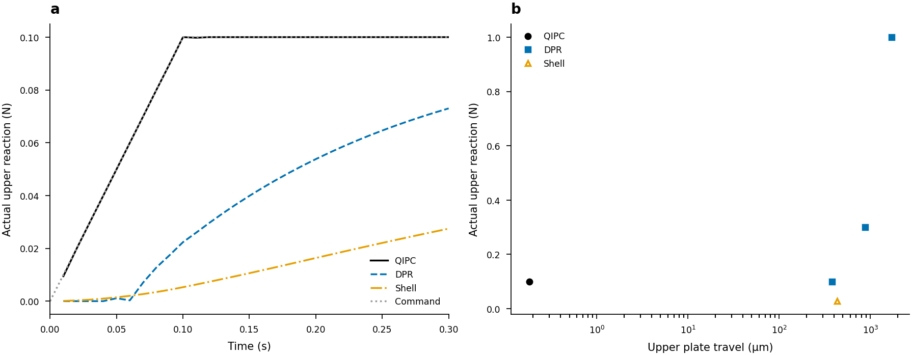
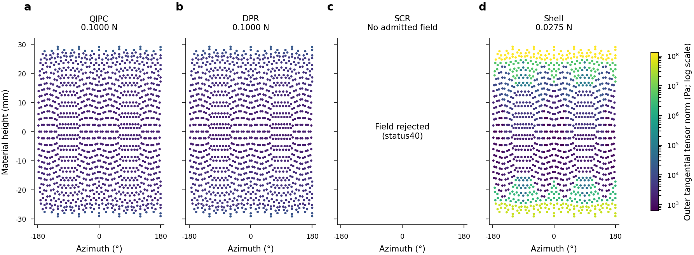

# Parallel-plate diagnostic checkpoint

This compact packet supports the [interim report](../../../docs/PARALLEL_PLATE_RESULTS_20261018.md)
and [figure plan](../../../docs/PARALLEL_PLATE_FIGURE_PLAN.md). It is not a
completed-goal receipt or a qualified continuum accuracy ranking.

`manifest.json` identifies copied receipts/task lists and the external captured
source inventories. Full raw histories/fields remain at the exact data paths
recorded in those files. `failure-state/rejected-state.npz` is the unmodified
native SCR failure array dump. The corrected aggregate-versus-physical-prior
interpretation is in`report-preview-v2/group1/scr-rejection/result.json`;
the earlier`diagnostics-v1` receipt used the ambiguous name`original_force_n`
for the packed auxiliary aggregate, and is retained as historical analysis.

Each campaign's`tasks.json` contains exact module/argv groups. Reproduction uses
`python3 -m research.rigid_stress.shell_comparison.submit --source BACKEND
--python ENV_PYTHON --tasks TASKS --output FRESH_DATA_OUTPUT --node-local-cache`
from the task checkout. Use the pinned original QIPC backend/environment for
reference tasks, original PR22 diagnostic checkout for Shell, native task
checkout for DPR/SCR, and the physical-analysis environment for derived audits
and figures. Backend paths, input SHA256s and GPU identities are in the saved
start/source receipts. Scientific execution remains Slurm/gs-srun; loading
NPZs or plotting on the login host is not part of these commands.

## Figure captions and QA

Mechanical response under a0.1N ramp. (a) Actual upper reactions during the
first0.3s; the same force command gives different transient loads. (b) Measured
endpoint force and upper plate travel: QIPC0.1N at0.3s, DPR0.1/0.3/1N after
2s holds, and the original Shell diagnostic endpoint at0.3s (open triangle).
Travel includes clearance and contact regularization; it is not pure elastic
egg indentation. Individual deterministic runs, no averaging/error bars.

Full-spatial material-column outer tangential tensor norms at selected
endpoints. All displayed values use one untruncated logarithmic color scale.
QIPC and DPR carry approximately0.1N; original Shell carries only0.0275N and
is not an equal-force accuracy comparison. SCR's missing field is an explicit
status40 rejection, not zero stress. The unwrapped point map uses common
material positions without smoothing; raw full-mesh extrema and spatial
uncertainty remain in the report and source receipts. QIPC continuum contact
fields remain unresolved, so this figure does not rank physical accuracy.

Claim anchor:`plates-admission-before-ranking`. Editable plotting source:
`research/rigid_stress/qipc_comparison/plate_figures.py`. Color and grayscale
PNGs were visually inspected for clipping, legibility, missing-field marking
and shared color limits. Programmatic text checks report no issues. SVGs
contain editable text (36 and45 objects); PDF export is provided, but the
separate`pdffonts` utility was unavailable, so independent PDF font embedding
verification is not claimed. These are reviewed diagnostic report figures,
not submission-ready scientific-accuracy figures.
