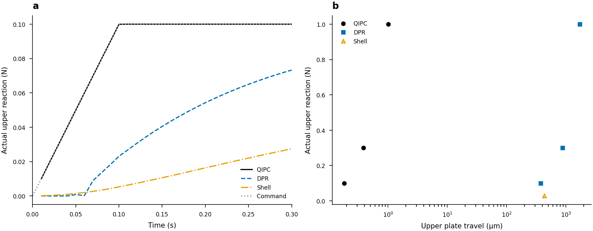
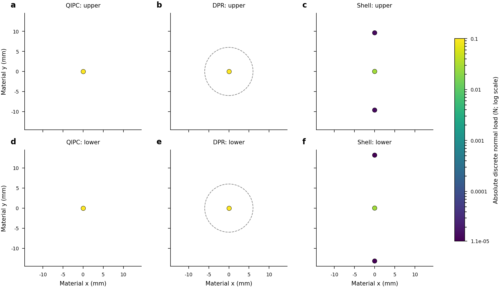

# Parallel-plate closeout evidence

Supports the [results](../../../docs/PARALLEL_PLATE_RESULTS_20261018.md),
[requirement audit](../../../docs/PARALLEL_PLATE_AUDIT.md) and
[reproduction guide](../../../docs/RUNNING_PARALLEL_PLATES.md).
The bounded goal is closed by measured results and explicitly diagnosed
unsupported quantities. **No continuum stress-accuracy ranking is qualified.**

The immutable [checkpoint](../checkpoint-v1/README.md) retains earlier pilot,
tolerance, CPU same-load and failure evidence. This supplement adds the three
load levels, stability/radius, cost/memory/profile, matched-history shear,
contact-band checks and final compatible-field receipts. Original physical
arrays and continuous histories stay at their recorded data paths.

`manifest.json` records exact copied bytes/SHA256s and hashes of external raw
fields, traces and captured source inventories. No copied artifact is rewritten.
`receipts/*/tasks.json` contains exact module arguments; backend revisions and
patches, analysis-source identities and runtime/GPU receipts remain traceable.
Captured unified diffs preserve space-only context lines byte for byte;
the packet's scoped Git attribute exempts only these patch-data files from
whitespace lint. Source-code whitespace checks remain enabled.
`failure-state/` preserves both original SCR array dumps. The normal failure
is final moment acceptance/status40; shear fails earlier traction fitting/
status33. Neither missing field is reconstructed into a successful result.

One historical progress dependency is intentionally superseded:
`checkpoint-analysis-v1/group0/summary/result.json` read QIPC`cost.json`
while its repeats were still being written (recorded SHA256`a963ba012d17...`).
The terminal cost SHA256 is`d66d8cab0de2...`; the authoritative final table is
`final-analysis-v1/group0/summary/result.json`. Both receipts remain unchanged.
The old partial timing summary is not used as final cost evidence.

[validation.json](validation.json) records verified hashes, document links,
code checks, figure QA and terminal Slurm statuses. The two closeout smoke
runs validate mass serialization, native B2 full-field output and QIPC profile
statistics at zero load; they are software checks, not physical qualification
or replacement throughput measurements.

All compact “QIPC” labels mean the pinned **roundoff diagnostic candidate** on
original revision`fe252bd30`, with16 double epsilons times abs(E0) allowed in
the non-KKT line-search comparison. The patch/binary are pinned in the guide;
the figures do not qualify an unmodified upstream binary. Shell retains its
original constitutive/contact kernels plus read-only instrumentation.

## Captions and interpretation

**Mechanical response and force–travel endpoints.** (a) First0.3s under the
same0.1N ramp: actual upper reactions distinguish transient contact response.
(b) QIPC and DPR0.1/0.3/1N endpoints after respective0.2s/2s holds, with an
open triangle for unadmitted original Shell at0.3s. QIPC/native use the same
20um clearance and3mm in-plane plate offset. Travel includes clearance and
contact regularization and is not pure elastic egg indentation. Individual
deterministic runs; no averaging or statistical error bars.

**Outer tangential tensor norms on common material samples.** All displayed
values share one untruncated logarithmic scale. QIPC and DPR carry about0.1N;
Shell carries0.0275N and is not an equal-force error comparison. SCR's blank
panel records status40 rejection. Common-position samples are neither smoothed
nor used to replace raw full-mesh extrema. The QIPC field changes61.27% under
surface refinement, so these maps do not rank continuum accuracy.

**Actual discrete normal loads on upper/lower contact supports.** QIPC nodal
forces, native rigid source-point forces and original Shell nodal impulse/dt
loads are shown at rest-material x/y positions. Units are N, not continuum
pressure Pa. QIPC places the entire normal load on one polar FEM vertex per
plate. Dashed native circles indicate the predeclared6mm reconstruction radius,
not a measured reference footprint. Shell has a different actual total load
and no admitted equilibrium. Components below1e-12N are omitted only from
this load-support plot and remain in the full raw fields. Marker size is fixed;
color alone encodes load. Common log limits retain both observed extrema.

## Figure QA and body-text handoff

Claim anchor:`plates-admission-before-ranking`. Editable source:
`research/rigid_stress/qipc_comparison/plate_figures.py` and the captured
analysis source in`closeout-figures-v1`. Figure plan:
[PARALLEL_PLATE_FIGURE_PLAN.md](../../../docs/PARALLEL_PLATE_FIGURE_PLAN.md).
Color and grayscale PNGs were visually inspected for layout, readable units,
complete labels, different line/marker encodings, shared scales and explicit
missing-field status. Programmatic text QA reports no issues. SVGs retain
36/45/48 editable text objects for mechanics/outer-stress/contact-loads.
PDF exports are included; independent PDF font embedding verification is not
claimed because the separate`pdffonts` utility was unavailable. These are
reviewed diagnostic report figures, not submission-ready accuracy figures.

The figures support the report's central argument: passing discrete mechanics
and same-traction elasticity checks does not resolve the pressure footprint;
the unavailable SCR field and unsettled Shell response cannot be discarded
to create a successful three-method comparison. Native throughput is useful
engineering evidence, while the failed primary QIPC cost and strong spatial
sensitivity prevent an accuracy-qualified speedup claim.
