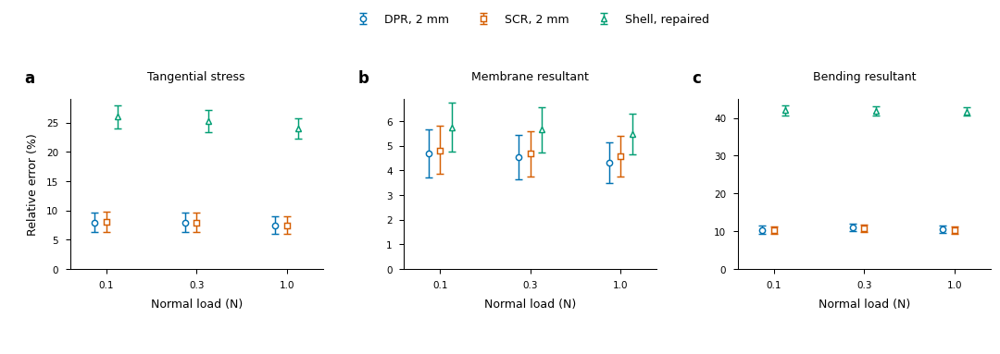

# Normal physical-pad reference checkpoint

The [manifest](manifest.json) verifies392 copied files totaling4,373,559 bytes
against their original data paths. Full runtime fields, step journals,
dependency assets and active refinements remain on data. No writer is moved.
The publication script, exact source/input receipts, selected executed analysis
modules, failed attempts and completed results are retained.

The joint125um/three-wall reference passes six normal equilibria and the
predeclared surface/wall/contact/integration change targets. The
[qualification result](pad-normal-qualification-v2/group0/qualification/result.json)
includes every history check and conditional ranking;
[errors.csv](pad-normal-qualification-v2/group0/qualification/errors.csv)
retains all loads and metrics. The
[report](../../../docs/NORMAL_PAD_QUALIFICATION_20261019.md) explains the
empirical-envelope assumption and the original baselines that remain unresolved.

The [SVG](pad-normal-figure-v1/group0/figure/normal-field-errors.svg),
[PDF](pad-normal-figure-v1/group0/figure/normal-field-errors.pdf),
[caption](pad-normal-figure-v1/group0/figure/caption.md),
[visual QA](pad-normal-figure-v1/group0/figure/visual-qa.json) and executed
plot/style sources are editable and reproducible. The ranges are conditional
on observed refinement bounding the reference error; they are not confidence
intervals or a proved continuum bound. The preview was visually inspected,
SVG text remains editable, and the PDF contains an embedded FontFile2 stream.

Dense and modal objective StVK references complete400 steps and pass both
normal/sustained-shear windows and current-position moments. Solver-equivalence
fields agree within7.759e-10; transient spatial/contact/timestep qualification
remains separate. The undamped modal failure and cold linear matrix-free
Slurm timeout remain included as failures/incomplete execution.

Every-step full/max preflight histories pass, but the stricter cross-run
Shell peak check fails at1.520e-7 against1e-8. The failed audit is retained;
subsequent same-state checks are separate evidence. Instrumented segmented
cost is not primary throughput or batching evidence.

This checkpoint does not complete the whole goal. Sustained-friction
refinement, common-peak spatial convergence, primary warm repeated/batched
cost and remaining field/traction/response figures are still required.
