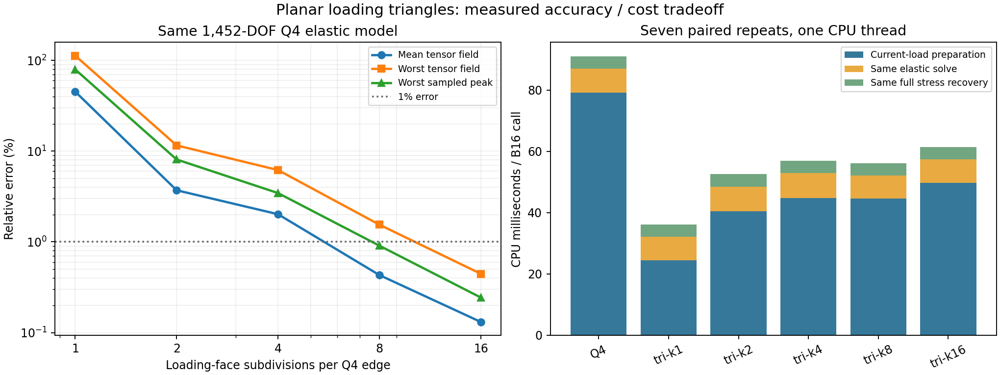
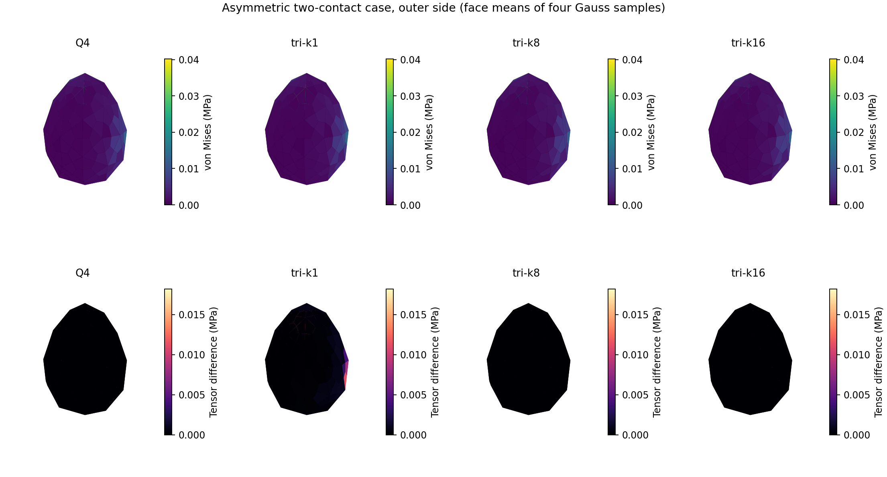

# 平面三角加载面＋原 Q4 薄壳：CPU 验证

研究日期：2026-10-27。基线源码为 `cf40684b1c170aacadcab3990e9d57e69882e4cc`。

**结论：这条路线在 CPU 上有可测收益，但每个 Q4 直接切成两个三角形不够准确。**
仅离线加密加载代理、不增加弹性自由度时，k8 的平均／最坏完整场误差为
0.431%／1.546%，最坏采样峰值误差0.908%，完整 CPU 模块配对加速1.56倍。
k16 可把最坏场误差降至0.445%、峰值误差降至0.244%，配对加速仍有1.49倍。

本研究只实现前述第二条路线：保持原 Q4 弹性模型，使用平面三角加载代理。
完整三角形壳单元、原生 Quadrants 集成、GPU／Franka 吞吐尚未在此测试。

## 算法和受控范围

采用分支原生 level1 鸡蛋 `shell.npz`：242节点、240个Q4、1452弹性自由度。
E=10 GPa、nu=0.3、厚0.5mm、密度2000kg/m³。两方法共享原CPU MITC4刚度、
质量、六刚体模态卸载、translation gauge、同一稀疏LU以及全物体应力采样。
两个物理表面、每个Q4四个Gauss点都进入误差统计。

每个Q4的材料参数域按每边k段离线细分，每个子四边形切成两个平面三角形。
代理顶点取原内／外偏置表面的真实位置，同时保留原Q4形函数值。
三角形上线性插值位移映射J，并用其转置传载：

\[
u_a=\sum_iN_i(\xi_a)(u_i+\theta_i\times d_i),\quad
f_i=\sum_aN_i(\xi_a)g_a,\quad m_i=d_i\times f_i,
\qquad d_i=\pm h n_i/2.
\]

该传递对代理模型保持虚功一致，重现刚体运动并守恒原始作用点的力矩。
主实验保持原接触中心、半径和力，锚点移动严格为零。法向力及摩擦产生的偏心
转矩均保留。原 Q4 弹性系统没有局部加密，也没有 Atlas 或弹性空间缩减。

压力律保持三维表面球支撑 `sqrt(1-|x-center|²/a²)`，以及原来的非负仿射压力拟合。
整圆完整落在单个三角形且仿射压力处处非负时，用精确零／一／二阶矩积分。
跨三角形边界时保留分片裁剪及原非负拟合。原Q4参考使用闭式逆映射加一次修正，
避免用旧Newton参考实现人为放大收益。

## 精度：75个案例全部保留

74加载案例＋1释放案例，覆盖全表面、内外侧、自动Hertz半径、摩擦、移动接触、
代理对角线、原Q4公共边、给定0.5／2mm有限足迹、非对称双／三接触。
自动半径使用共享的给定组合曲率50／70m⁻¹，典型半径约40.9μm。
这是接触半径到应力的受控比较，未建立新的曲率估计或独立接触参考。

原Q4高阶积分order48为参考，各候选order24。原Q4 order24→48的最坏完整场变化
为**0.000850%**，最坏采样峰值变化0.000528%。另外12个真正跨三角／Q4边界的k8
积分控制中，order24→48完整场差不超过4.98e−9。

下表为相对同一Q4参考的误差，全部为百分比。完整场使用面积加权张量Frobenius
范数，剪切分量权重为2，统计整个物体而非接触邻域。峰值指当前壳采样von Mises。

| 每边分段k | 每Q4三角形数 | 平均完整场 | 最坏完整场 | 最坏峰值 | 既定预算 |
|---:|---:|---:|---:|---:|---|
| 1 | 2 | 45.221 | 112.624 | 79.374 | 失败 |
| 2 | 8 | 3.705 | 11.570 | 8.090 | 失败 |
| 4 | 32 | 2.018 | 6.184 | 3.451 | 通过 |
| 8 | 128 | 0.431 | 1.546 | 0.908 | 通过 |
| 16 | 512 | 0.131 | 0.445 | 0.244 | 通过 |

既定预算保持平均场5%、最坏场10%、峰值5%、N/M/Q各10%。
k8最坏N/M/Q为0.433%／2.235%／1.191%，k16为0.116%／0.644%／0.326%。
最终所有方法75/75数值有效，所有源的归一化力矩误差小于1.3e−12，力误差小于2e−14。

**为何k1误差很大？** 本次鸡蛋外侧Q4本来就共面，内侧四角非共面最大约15μm。
即使没有几何翘曲，把原双线性Q4位移插值换成两个分片线性三角形也会改变节点载荷。
独立平面斜平行四边形控制的载荷差约49.8%，而虚功、力和力矩仍可精确守恒。
因此不能仅凭守恒检查声称应力等价，也不能把全部误差归因于曲面几何。

## 性能：包含载荷、共同求解及完整应力恢复

AMD EPYC 9V74，Python3.12.14、NumPy2.3.5，两个BLAS池均限制1线程。
B16包含15个加载案例及1释放案例，共16个接触源，14个源有切向力。
含内外侧、三角及Q4边界、双接触，所有方法重新生成当前载荷，不缓存案例解。
预热两轮，七轮正／反方法顺序交替，独立检查与绘图在主计时外。

| 方法 | 当前载荷中位ms | 完整模块中位ms | 完整模块配对加速 | 更快次数 |
|---|---:|---:|---:|---:|
| 原Q4 | 79.14 | 90.88 | 1.00× | — |
| k1 | 24.54 | 35.91 | 2.52× | 7/7，但精度失败 |
| k2 | 40.42 | 52.61 | 1.80× | 7/7，但精度失败 |
| k4 | 44.83 | 56.92 | 1.60× | 7/7 |
| k8 | 44.56 | 56.35 | **1.56×** | 7/7 |
| k16 | 49.77 | 61.05 | **1.49×** | 7/7 |

加速列为每轮时间比的中位数，与两个独立中位数之比不同。
k8逐轮加速范围1.497–1.709倍，k16为1.397–1.703倍。
完整模块包含同一原K的卸载／稀疏回代及完整应力恢复，**不包含Franka、刚体碰撞、
控制或策略推理**。CPU稀疏LU路径与当前GPU inverse路径不同，收益不能直接换算成GPU FPS。
分阶段中位数分别统计，其和不必等于完整耗时中位数。

每次B16调用，k8/k16均有12个源进入解析捷径，其余保留裁剪积分。
仍有约1.58万／1.61万数值样点，源于少数跨边界情形，故不能用整圆捷径代表全部成本。

| k | 两侧代理NumPy数组 | 离线准备时间 |
|---:|---:|---:|
| 1 | 0.269 MB | 见protocol原始值 |
| 4 | 4.301 MB | 见protocol原始值 |
| 8 | 17.203 MB | 约0.08 s |
| 16 | 68.813 MB | 约0.3 s |

数组计数不包含cKDTree内部结构、Python对象或整个进程峰值。代理为固定几何共享数据，
无需给每个环境复制。它增加加载面存储，弹性自由度始终为1452。

## 独立检查与非凸控制

17项独立检查全部通过，包含20,000个闭式／Newton逆映射查询、刚体重现、虚功、
偏心摩擦、释放、零摩擦拒绝、独立闭式Q4载荷、三角解析／数值积分和原K残差。
原K保持同一SHA，独立求解残差约4.8e−13。

另外在768DOF非凸环面上，以给定0.5／1mm足迹测试8个内圈、内外侧、摩擦和边界案例。
k4/k8/k16最坏完整场误差分别2.708%／0.306%／0.0849%，最坏峰值误差
1.383%／0.157%／0.0436%，全部有效。这是有限几何控制，不代表任意非凸几何认证。

保留一个漏检反例：人工高度翘曲Q4的真实0.2mm足迹有效，而粗k1代理完全漏掉足迹。
主算法对此显式拒绝。沿力线重新锚定可恢复载荷，但该控制移动了10个接触半径，
只作为诊断，未混入主实验或冒充同一载荷模型。一般曲面仍需要细分充分或保留原路径回退。

图中显示每Q4四点的面平均，仅作可视化。误差表使用全部未平均样点。

## 建议

可以继续评估三角加载面路线。当前CPU数据支持k8作为较低存储候选，k16作为更严格
误差候选。后续原生实现应保持相同载荷语义、守恒和误差验收，针对整圆解析、跨边界
积分、候选查询及融合进行GPU实测。此次结果既没有更换整个壳单元，也没有证明物理
接触半径或连续体峰值准确，更没有直接建立新的RL吞吐推荐。

源码入口、完整输入、原始七轮计时、初始失败和复现命令见[README](README.md)。
